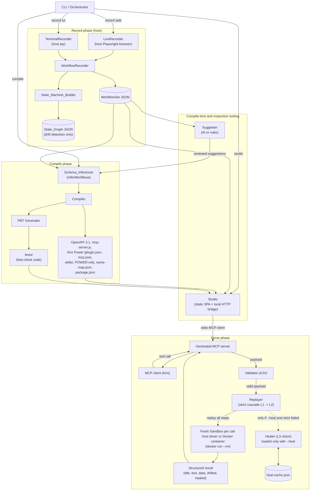
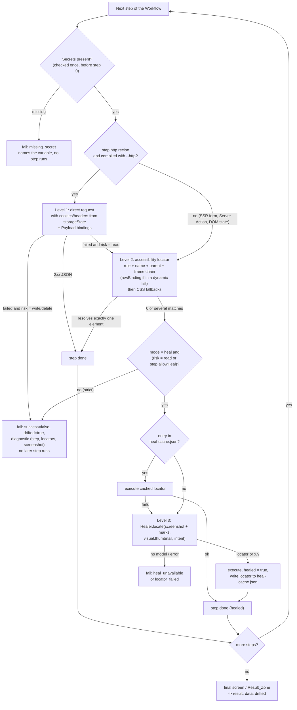

# Design Document

## Overview

Daemonize wraps legacy or API-less software (web interfaces and TUI/CLI programs) into callable MCP tools. A developer navigates the target application once inside a managed sandbox; Daemonize records every screen state and the transitions between them, infers typed JSON Schemas from the observations, and compiles a fully functional MCP server and OpenAPI 3.1 specification. The result is immediately registrable as a Kiro Power so AI agents can drive the wrapped application without any further configuration.

**Execution unit.** The recorded State_Graph is used for drift detection and documentation, not to drive execution. Each tool is a **Workflow**: a complete recorded path from a known start state (for example "logged in, on the home page") in which the user marked the variable fields. Every tool call starts a fresh sandbox at that start state and replays the whole path with the call's Payload values. The server therefore never needs to know which Screen it is on, never navigates between Screens, and never has to recover after a failure.

**Replay is Strict by default; Heal is opt-in.** In Strict_Mode (`--strict`, the default) each step runs only through recorded, deterministic means, following the cascade Level 1 recorded HTTP call, then Level 2 accessibility locator with an Anchor. If both fail, the call fails cleanly with `success: false`, `drifted: true` and a diagnostic, and no later step runs. Level 3 (vision, a multimodal model that finds the element on a screenshot) exists only in Heal_Mode (`--heal`), is never used on `write`/`delete` steps unless the user allowed it for that step, and is flagged `healed: true`. A language model is never called at run time unless `--heal` is on. See "Replay cascade".

Web targets and terminal targets share the Workflow set, schemas, validation, OpenAPI document and Kiro Power. The terminal path additionally records the terminal size and waits on screen patterns instead of fixed delays.

The system is built in TypeScript/Node.js, targeting Node.js 20 LTS. It runs as a CLI tool that orchestrates a local Docker container for sandbox isolation, uses Playwright for headless browser sessions and `node-pty` for TUI/CLI sessions, persists a versioned State_Graph as JSON, and emits generated server code and a Kiro Power to an output directory.

---

## Architecture

### High-Level Component Diagram



### Data Flow: Record Phase

1. The CLI launches a Docker container running either Playwright (web) or `node-pty` (TUI/CLI).
2. User interactions inside the container are forwarded to `State_Machine_Builder`.
3. Each interaction produces a (source Screen, action, destination Screen) triple — a Transition.
4. Screen identifiers are deterministic SHA-256 hashes of the normalized screen content.
5. While recording, the user marks the variable fields; the recorded steps and Variables form a Workflow.
6. On session end, `State_Machine_Builder` persists the State_Graph and the Workflow set as versioned JSON files.

### Data Flow: Compile Phase

1. `Schema_Inferencer` processes the Workflow set to derive input/output JSON Schemas per Workflow.
2. `Compiler` transforms the annotated graph into an OpenAPI 3.1 document, an MCP server TypeScript source file, and a Kiro Power (`plugin.json`, `mcp.json`, `skills/<name>/SKILL.md`, `POWER.md`).
3. `PBT Generator` reads the compiled schemas and emits self-contained `fast-check` test suite files.

### Data Flow: Serve Phase

1. The user runs the compiled MCP server.
2. An incoming tool call carries a Payload, which is validated against the tool's input schema.
3. Required `DAEMONIZE_SECRET_<NAME>` variables are checked; a missing one fails the call before any step runs.
4. The `Replayer` starts a fresh sandbox at the Workflow's start state (optionally a saved login via Playwright `storageState`) and replays every step through the cascade (Level 1 HTTP, Level 2 accessibility with Anchor; Level 3 vision only with `--heal`).
5. The final screen (or its Result_Zone) is reduced to title, visible text and, when a zone is defined, structured `data`, and returned as the tool response. `drifted` is computed from the zone-restricted hash; `healed` is set when Level 3 acted.

---

## Components and Interfaces

### CLI / Orchestrator

Entry point. Parses commands (`record`, `merge`, `compile`, `serve`, `sandbox build`, and the new `studio`) and wires components together. `serve` gains `--strict` (default) and `--heal`; the choice reaches the generated server as `DAEMONIZE_MODE=strict|heal`. `compile` gains `--http` (use Level 1 recipes), `--suggest` (compile-time suggestions) and the existing `--install`.

```typescript
interface DaemonizeConfig {
  targetType: "web" | "tui";
  targetUrl?: string;          // web only
  targetCommand?: string[];    // TUI/CLI only
  outputDir: string;
  stateGraphPath?: string;     // load existing graph for incremental sessions
  sandbox: {
    memoryMb: number;          // default 512
    cpuCount: number;          // default 1
  };
  replayTimeoutMs: number;     // default 10000
  snapshotIntervalMs: number;  // minimum 100
}
```

### Sandbox Manager

`SandboxDriver` is the uniform interface over `PlaywrightDriver` (web) and `PtyDriver` (terminal). During recording both drivers run on the host: a browser needs a visible window, and the user drives the terminal program from their own terminal. Containers are used for replay only (see "Sandbox" below).

```typescript
interface SandboxDriver {
  /** Start the sandbox and return when ready. */
  start(): Promise<void>;
  /** Capture the current screen state. */
  captureScreen(): Promise<ScreenContent>;
  /** Execute an interaction and return the resulting screen. */
  execute(action: RecordedAction): Promise<ScreenContent>;
  /** Stop the sandbox cleanly. */
  stop(): Promise<void>;
  /** Emitted when the sandbox process exits unexpectedly. */
  onUnexpectedExit: EventEmitter;
}

interface ScreenContent {
  type: "dom" | "terminal";
  /** Serialized DOM (web) or terminal buffer text (TUI). */
  raw: string;
  /** Canonical form used for hashing — dynamic attributes stripped. */
  normalized: string;
  capturedAt: number; // Unix ms
}
```

**PlaywrightDriver (web)**: Runs headless Chromium on the host through Playwright; `DAEMONIZE_CHROMIUM_PATH` selects an installed browser. Captures the DOM via `page.evaluate(() => document.documentElement.outerHTML)` after stabilization (network idle + 100 ms debounce).

**PtyDriver (terminal)**: Runs the program in a pty (`node-pty`) on the host and renders the screen with the headless xterm renderer (`TerminalScreen`), so a Screen is the text currently displayed, not the printed history. There is no Unix socket. See "Terminal targets" for recording and replay.

**SandboxManager**: A library built on `dockerode` that creates a container with the limits described in "Sandbox" and reports an exit it did not ask for. It is only tested against a fake Docker; the generated server replays through `docker run --rm` as described in "Sandbox".

### Terminal targets

A terminal program is run in a pty (`node-pty`) and its screen is rendered by the headless xterm renderer, so a Screen is the text currently displayed, not the history of what was printed. The steps of a terminal Workflow have no selectors: a `type` step writes text, a `keypress` step writes the bytes of a named key. The names and their byte sequences live in one table (`src/sandbox/keys.ts`) used by the recorder, the replayer and the generated server.

Recording (`TerminalRecorder`, `recordTui`): the user types in their own terminal in raw mode; the bytes are split into typed text and named keys, forwarded to the program, and turned into steps. Ctrl+] opens a menu (`v` marks the last typed text as a Variable, with a name suggested from the prompt shown on screen; `e` ends the recording). Input is handled in order, once the screen has rendered what the program printed.

Replay (generated server): each call starts the program afresh in a pty, waits for its first text, then sends each step and waits for the program to react (a short silence after its output, or a longer grace period if it prints nothing) before returning the text on screen.

Both kinds of target share the same Workflow set, schemas, validation, OpenAPI document, Kiro Power and property-based tests. A web set carries `startUrl`, a terminal set `startCommand`.

### Sandbox

Recording runs the target on the host: a browser needs a visible window to be used, and the user drives the terminal program from their own terminal. Replay, which is what an agent triggers, can run in a container.

With `DAEMONIZE_SANDBOX=docker` (or `daemonize serve --sandbox docker`) the generated server does not replay on the host: for every call it runs `docker run --rm` on an image built by `daemonize sandbox build`, sends the request (steps, payload) on stdin and reads the result on stdout. The image contains only `replay.js` and what it needs (`node-pty` and the screen renderer, or Playwright with its browsers), so the code that replays is the one that runs on the host. Each call is a new container, so the known start state is the container itself and a failed call leaves nothing behind.

The container is limited: memory (default 512 MB) and CPU (default 1), no Linux capabilities, `no-new-privileges`, at most 256 processes. An image is never downloaded implicitly (`--pull never`); the only folders of the host it sees are the ones the user mounts. A terminal program gets no network and a read-only file system with a scratch `/tmp`; a browser needs the network to reach the application, so a web target uses the `bridge` network (no access to the host network stack). A missing image, a missing `docker` command or an unreachable daemon is reported as `sandbox_unavailable`. Because a recorded terminal command may be a path of the host, the command to start inside the container can be given separately.

**Exact `docker run` arguments.** The generated `replayInDocker` builds:

```
docker run --rm -i --name daemonize-<random>
  --pull never --network <NETWORK>
  --memory <MEMORY_MB>m --cpus <CPUS>
  --pids-limit 256 --cap-drop ALL --security-opt no-new-privileges
  [terminal: --read-only --tmpfs /tmp] [web: --shm-size 512m]
  [-v <abs host storageState>:/run/daemonize/storage-state.json:ro
   -e DAEMONIZE_STORAGE_STATE=/run/daemonize/storage-state.json]
  [-e DAEMONIZE_SECRET_<NAME> ...]          # name only: Docker copies the value from the server's environment, so it never appears on the command line or in `docker inspect` of the image
  [-e DAEMONIZE_MODE=heal -e DAEMONIZE_MODEL_* -v <abs>/.daemonize:/run/daemonize/heal:rw]   # heal only
  [-v <user mounts> ...]
  <IMAGE>
```

The storageState file is mounted, never `COPY`'d: `generateSandboxFiles` writes a `.dockerignore` that excludes `*.json` state files and the Dockerfile has no `COPY` of it, so it is in no image layer. `NETWORK` comes from `sandbox.network` (`none` or `bridge`); a web target always needs `bridge`, and the compiler rejects `none` for web.

`SandboxManager` (dockerode) remains as a library to create a container with the same limits and to report an exit it did not ask for; it is only exercised against a fake Docker, since the server drives Docker through the `docker` command.

### State_Machine_Builder

Maintains the in-memory State_Graph and persists it. Runs inside the recording session.

```typescript
interface StateMachineBuilder {
  /** Record a completed interaction. Returns the destination ScreenId. */
  recordTransition(
    sourceId: ScreenId,
    action: RecordedAction,
    destinationContent: ScreenContent
  ): ScreenId;

  /** Merge another State_Graph into this one (commutative, idempotent). */
  merge(other: StateGraph): StateGraph;

  /** Serialize to JSON conforming to the State_Graph JSON Schema. */
  serialize(): string;

  /** Load from a JSON string; throws DescritiveParsError on failure. */
  static deserialize(json: string): StateMachineBuilder;

  getGraph(): StateGraph;
}
```

**Screen ID algorithm** (deterministic SHA-256):
1. Parse raw screen content to canonical form:
   - **DOM**: remove dynamic attributes (`id` attributes containing UUIDs, `nonce`, `data-reactid`, CSRF tokens detected by name pattern), sort attribute order alphabetically, strip whitespace-only text nodes.
   - **Terminal**: strip ANSI escape codes, trim trailing whitespace per line, remove cursor-position lines.
2. UTF-8 encode the canonical string.
3. SHA-256 hash → truncate to first 16 hex characters for compact IDs while keeping collision probability negligible at expected graph sizes (< 10,000 nodes).

### Schema_Inferencer

Derives JSON Schemas per Workflow. The input schema starts from the Variables the user marked while recording (authoritative for type, description and optionality) and is widened by any observed Payloads; the output schema describes the structured result (`screenType`, `title`, `text`, `drifted`). A language model may propose tool names, descriptions and candidate Variables at compile time; the user can edit them, and execution stays deterministic.

```typescript
interface SchemaInferencer {
  /** Derive schemas for all Transitions in the graph. */
  infer(graph: StateGraph): AnnotatedStateGraph;
  /** Derive schemas for all Workflows in the set. */
  inferWorkflows(set: WorkflowSet): WorkflowSet;
}
```

**Schema widening algorithm**: The inferencer maintains a `SchemaAccumulator` per Workflow. Each observed Payload is converted to a minimal JSON Schema (leaf types: `string`, `number`, `boolean`, `null`, `array`, `object`). When accumulating a second observation:

1. Fields present in all observations → kept in the base schema.
2. Fields present in some observations → moved to `additionalProperties` with `required` removed.
3. Conflicting primitive types on the same field → emitted as `anyOf` branches.
4. `integer` widened to `number` when a decimal observation arrives; `number` is never narrowed back.
5. `format` annotation pass runs after all observations are merged: applies `"email"`, `"date-time"`, `"uuid"` by testing each string field's observed values against their respective regexes (RFC 5322, ISO 8601, RFC 4122). Format is only annotated when ≥ 80% of non-null observations match.

Field `description` is populated by the `LabelExtractor`: for DOM screens, it uses the text of the nearest `<label>` element whose `for` attribute matches the field's input name, or the placeholder attribute. For terminal screens, it uses the text on the same line preceding the cursor position.

### Compiler

Transforms the annotated State_Graph into output artifacts.

```typescript
interface Compiler {
  compile(set: WorkflowSet, outputDir: string): Promise<CompileResult>;
}

interface CompileResult {
  openApiSpec: object;         // OpenAPI 3.1 document (JS object, not string)
  mcpServerSource: string;     // TypeScript source code
  kiroPower: {                 // files of the Kiro Power
    plugin: object;            // plugin.json
    mcp: object;               // mcp.json
    skill: string;             // skills/<name>/SKILL.md
    powerMd: string;           // POWER.md (older Kiro versions)
  };
  toolNames: Map<string, string>; // workflowId → toolName
}
```

`KiroPowerGenerator` emits the four Kiro Power files (see "Kiro Power Output"); `name-map.json` is unchanged.

**Output location note**: `mcp.json` references `mcp-server.js` by absolute path resolved at compile time. The output directory must therefore stay where it was compiled; moving it requires recompiling.

**Tool name derivation**:
1. Take the Workflow's human-readable label (set during recording).
2. `snake_case` transform: lowercase, replace non-alphanumeric runs with `_`, collapse repeated `_`, strip leading/trailing `_`.
3. Truncate to 64 characters at a word boundary (last `_` before position 64).
4. Conflict resolution: iterate Workflows in recording order; append `_2`, `_3`, … when the base name already exists in the output name set.

**MCP server generation**: The Compiler emits a TypeScript file that imports `@modelcontextprotocol/sdk/server/index.js`, registers each tool using `server.tool(name, description, zodSchema, handler)` (the handler replays the Workflow), and starts a `StdioServerTransport`. The generated file is standalone — no runtime Daemonize dependency — but requires `@modelcontextprotocol/sdk`, `zod` and `playwright` in the output project.

### Validator

Wraps AJV (v8, JSON Schema draft-07 compatible with OpenAPI 3.1 dialect) for sub-50 ms payload validation.

```typescript
interface Validator {
  /** Returns null on success; ValidationError with violation list on failure. */
  validate(actionId: string, payload: unknown): ValidationError | null;
}
```

AJV schemas are compiled once at server startup (not per request) to satisfy the 50 ms latency requirement. The compiled validate functions are cached by `actionId` in a `Map<string, ValidateFunction>`.

### Replayer

Resets to the known start state and replays a Workflow with values from the validated Payload.

```typescript
interface Replayer {
  replay(
    workflow: Workflow,
    payload: Record<string, unknown>,
    timeoutMs?: number
  ): Promise<ReplayResult>;
}

interface ReplayResult {
  success: boolean;
  screen?: ScreenContent;
  result?: WorkflowResult;   // { screenType, title?, text } — not the raw DOM
  drifted?: boolean;         // see "Runtime drift" for the exact semantics
  healed?: boolean;          // a step was located by Level 3 (Heal_Mode only)
  failure?: ReplayFailure;   // set when success is false because of a step
  error?: "timeout" | "sandbox_unavailable" | "locator_failed" | "heal_unavailable"
        | "missing_secret" | "pattern_timeout" | string;
  elapsedMs: number;
}

interface ReplayFailure {
  stepIndex: number;
  label?: string;
  levelsTried: Array<"api" | "accessibility" | "vision">;
  locatorsTried: string[];          // human-readable, secrets never included
  screenshotPath?: string;          // or an inline thumbnail in the MCP response
  lastText?: string;                // terminal: last rendered screen text
  missingSecret?: string;           // name of the missing DAEMONIZE_SECRET_<NAME>
}
```

Each call creates a new `SandboxDriver` through a factory, so no state leaks between calls. On timeout the driver is simply stopped and discarded; there is no navigation back to a source screen. Each step carries an ordered list of candidate selectors (accessibility role/name first, CSS as fallback); the first one that works is used. The generated MCP server embeds an equivalent standalone runtime (Playwright) so it needs no Daemonize dependency at run time. The cascade, the strict failure rule and the waits described below apply to both the host `Replayer` (`src/replayer/replayer.ts`, tested with fake drivers) and the generated runtime (`WEB_RUNTIME` and `TERMINAL_RUNTIME` in `src/compiler/mcp-generator.ts`). The shared pure logic lives in dependency-free files under `src/replay/runtime/` that the compiler copies verbatim into the output directory (see "Runtime drift"), so tests exercise the same code that ships.

### PBT Generator

Reads the compiled input schemas and emits self-contained `fast-check` test files, one per Action, in `<outputDir>/tests/`.

```typescript
interface PbtGenerator {
  generate(set: WorkflowSet, toolNames: Map<string, string>, outputDir: string): Promise<string[]>;
}
```

Each output file contains:
- One property for valid payloads (round-trip: schema → generate → validate → pass).
- One property for invalid payloads using `fc.oneof` over intentional violations (not an object, missing required field, wrong type, out-of-range value, value outside an enum, malformed email/uuid/date-time, unexpected field). Every violation is chosen so the payload cannot satisfy the schema.
- A report hook that prints the passing and failing counts and the shrunk counterexample of each failing property.

The converter supports a documented subset of JSON Schema (objects, arrays, strings with length/pattern/formats, numeric bounds, `enum`, `const`, `anyOf`, non-overlapping `oneOf`, simple object `allOf`, type lists). A schema outside that subset is never silently approximated: the converter throws an `UnsupportedSchemaError` naming the keyword and its location, and the generator writes skipped tests carrying that reason (and `compile` warns), because a property that ignores a keyword would pass without proving anything.

Arbitraries come from a small converter shipped with the tests (`schema-arbitrary`), because `json-schema-fast-check` bundles fast-check 1.x and cannot be combined with fast-check 3. The converter and the property runner are copied next to the tests, so the suite imports only `vitest`, `fast-check`, `ajv` and `ajv-formats` and runs with `vitest run` once the output project's dependencies are installed (the compiler writes `package.json` and `vitest.config.ts`).

---

## Replay cascade

Requirements 7.8, 7.9, 12, 13, 14, 15.

Every step is replayed through up to three levels. Strict_Mode stops after Level 2; Heal_Mode may continue to Level 3.



**Rules.**
- Level 1 is a recorded candidate, used by the generated server only when compiled with `daemonize compile --http`. It runs with Playwright's `APIRequestContext` created from the same `storageState`, so no browser is launched for a step that has a recipe. A Level 1 failure falls back to Level 2 only for `risk: 'read'` steps. A `write` or `delete` step whose request may already have reached the server fails instead of falling back, because the fallback could execute the action twice.
- Level 2 tries the `anchor` first (`getByRole(role, { name })` scoped by `parent` and the `frame` chain, and by `rowBinding` when present), then the CSS entries of `selectors[]`. A locator that matches more than one element is a failure, never resolved with `.first()` or `:nth-of-type`; the recorder instead adds `parent` or `rowBinding` until the locator is unique, and refuses to record a non-unique one with a message.
- Level 3 exists in Heal_Mode only, and only for `risk: 'read'` steps or steps with `allowHeal: true` (requirement 12.4).
- A strict failure ends the replay: the sandbox is stopped and no later step runs (requirement 12.6).

### Risk classification

The recorder sets `risk` for each step: a recorded request with `GET` is `read`, `POST`/`PUT`/`PATCH` is `write`, `DELETE` is `delete`. Without a request, a click on an element whose accessible name matches `/delete|remove|supprimer|destroy/i` is `delete`, a `form_submit` or a click on a submit button is `write`, everything else is `read`. The user can override the value in the workflow file.

### Data model additions: `WorkflowStep`

```typescript
interface WorkflowStep {
  // existing: actionType, selectors[], value?, variable?, label?
  anchor?: Anchor;                       // Level 2
  rowBinding?: RowBinding;               // Level 2, dynamic lists and tables
  http?: HttpRecipe;                     // Level 1 candidate
  visual?: VisualAnchor;                 // Level 3 (Heal_Mode only)
  risk?: "read" | "write" | "delete";    // default "read"
  allowHeal?: boolean;                   // write/delete steps: explicit opt-in to Level 3
  secretRef?: string;                    // name N of DAEMONIZE_SECRET_<N>: value typed at run time
  totp?: boolean;                        // with secretRef: type the current TOTP code, not the raw secret
  resultZone?: ResultZone;               // see "Result extraction"; normally on the last step
  waitFor?: ScreenWait;                  // terminal only
  timeoutMs?: number;                    // per-step timeout, overrides the default
}

interface Anchor {
  role: string;                          // ARIA role, e.g. "button", "combobox", "option"
  name: string;                          // accessible name
  parent?: { kind: "dialog" | "region" | "heading" | "label"; name: string };
  frame: number[];                       // iframe index chain from the top page; [] for the main frame
  popup?: { page: number; opens?: boolean }; // page the step runs on (0 = first); opens: this step opens it
}

interface RowBinding {
  container: { role: "row" | "listitem" | "article" | "group" | string };
  variable: string;                      // Workflow variable whose value identifies the row/card
}

interface HttpRecipe {
  method: "GET" | "POST" | "PUT" | "PATCH" | "DELETE";
  url: string;                           // may contain {{variable}} for path segments
  query: Record<string, string>;         // values may be {{variable}}
  body?: unknown;                        // JSON body; values may be {{variable}}
  bindings: Array<{ variable: string; in: "query" | "body" | "path"; name: string }>; // name: key, JSON pointer or segment index
  redacted: Array<{ in: "header" | "query" | "body"; name: string; secret: string }>; // secret: Secret_Reference name
}

interface VisualAnchor {
  thumbnailPath: string;                 // relative to the workflow file, e.g. "workflows.thumbs/ab12-3.png"
  rect: { x: number; y: number; w: number; h: number }; // fractions of the viewport, all in [0, 1], x+w <= 1, y+h <= 1
  intent: string;                        // "click the Save button of the customer dialog"
}

interface ScreenWait {
  pattern: string;                       // JavaScript RegExp source, flags "m"
  timeoutMs: number;
  when?: "before" | "after";             // relative to the step; default "after"
}
```

Example, a click on the "Delete" button inside the row of a customer, with a recorded HTTP call and a thumbnail:

```json
{
  "actionType": "click",
  "selectors": ["role=button[name=\"Delete\"]"],
  "anchor": {
    "role": "button",
    "name": "Delete",
    "parent": { "kind": "region", "name": "Customers" },
    "frame": [],
    "popup": { "page": 0 }
  },
  "rowBinding": { "container": { "role": "row" }, "variable": "customer" },
  "http": {
    "method": "DELETE",
    "url": "https://app.example.com/api/customers/{{customer_id}}",
    "query": {},
    "bindings": [{ "variable": "customer_id", "in": "path", "name": "4" }],
    "redacted": [
      { "in": "header", "name": "Authorization", "secret": "APP_TOKEN" },
      { "in": "header", "name": "Cookie", "secret": "APP_SESSION" }
    ]
  },
  "visual": {
    "thumbnailPath": "workflows.thumbs/3f2a-4.png",
    "rect": { "x": 0.81, "y": 0.42, "w": 0.06, "h": 0.04 },
    "intent": "click the Delete button of the customer row"
  },
  "risk": "delete",
  "timeoutMs": 5000
}
```

A terminal step with a screen wait and a typed secret:

```json
{
  "actionType": "type",
  "selectors": [],
  "secretRef": "DB_PASSWORD",
  "label": "password",
  "waitFor": { "pattern": "^Password: ?$", "timeoutMs": 5000, "when": "before" }
}
```

### Data model additions: `Workflow` and `WorkflowSet`

```typescript
interface Workflow {
  // existing: id, label, steps, variables, finalScreenId?, observedPayloads, inputSchema?, outputSchema?
  cols?: number;                         // terminal: recorded columns (default 80 when absent)
  rows?: number;                         // terminal: recorded rows (default 24 when absent)
  finalZone?: ZoneSpec;                  // zone used for the drift hash; absent = whole screen
  secrets?: SecretReference[];           // names only, never values
  timeoutMs?: number;                    // per-workflow replay timeout, overrides the server default
}

type ZoneSpec =
  | { selector: string }                                       // web
  | { rect: { row: number; col: number; rows: number; cols: number } }; // terminal, 0-based

interface SecretReference {
  name: string;                          // matches /^[A-Z][A-Z0-9_]*$/; resolved from DAEMONIZE_SECRET_<name>
  kind: "password" | "totp" | "token" | "header";
}

interface WorkflowSet {
  // existing: version, targetType, targetName, startUrl?, startCommand?, storageState?, workflows
  sandbox?: SandboxSpec;
}

interface SandboxSpec {
  image?: string;                        // base image, default "node:20-bookworm-slim"
  packages?: string[];                   // system packages (apt-get, or apk when the image name contains "alpine")
  install?: string[];                    // extra RUN commands, in order
  network?: "none" | "bridge";           // terminal default "none", web default "bridge"
}
```

`storageState` stays a path. The workflow file schema in `src/state/schema.ts` and the file's JSON Schema are extended with these optional properties; a file without them stays valid, so existing recordings keep working in Strict_Mode on Level 2 with `selectors[]` only.

### Replay mode and failure result

`DAEMONIZE_MODE=strict|heal` (set by `serve --strict|--heal`) selects the mode; anything else is rejected at startup. A strict locator failure returns:

```json
{
  "success": false,
  "drifted": true,
  "error": "locator_failed",
  "failure": {
    "stepIndex": 4,
    "label": "Delete",
    "levelsTried": ["accessibility"],
    "locatorsTried": ["getByRole('button', { name: 'Delete' }) in row[Customers: Ada]", "css: button.btn-danger"],
    "screenshotPath": "/tmp/daemonize/fail-3f2a-4.png"
  }
}
```

---

## Runtime drift

Requirement 11.1 to 11.5.

The generated server must not import from `src/`. The drift hash therefore ships as a standalone helper, `src/replay/runtime/screen-hash.ts`, copied by the compiler to the output directory and imported by the generated `replay.ts`. It is a verbatim port of `normalize` plus `normalizedHash`/`computeId` in `src/state/screen-hasher.ts`: the same attribute filters (UUID `id`, `nonce`, `data-reactid`, CSRF input names), attribute sorting, whitespace-only text node removal, ANSI stripping, cursor-only line removal, then SHA-256 over the UTF-8 string, truncated to 16 hex characters. It uses only `node:crypto`.

```typescript
// src/replay/runtime/screen-hash.ts (shipped as-is)
export function screenId(type: "dom" | "terminal", raw: string): string;      // 16 hex
export function normalizedHash(type: "dom" | "terminal", raw: string): string; // 64 hex
```

**Proof of equivalence (property 9).** A property test generates arbitrary DOM and terminal strings (including attributes in random order, UUID ids, CSRF inputs, ANSI sequences, trailing spaces) and asserts that `screenId(type, raw)` equals `new ScreenHasher().computeId({ type, raw, normalized: "", capturedAt: 0 })`, and the same for the 64-character hash. A second, example-based test asserts that the file the compiler writes into the output directory is byte-identical to `src/replay/runtime/screen-hash.ts`, so the code that is tested is the code that ships.

**Zone-restricted hashing.** When `finalZone` is set, the hash input is the zone only: for web, the `outerHTML` of the element matching `finalZone.selector` (no match counts as drifted); for terminal, the lines `rect.row .. rect.row+rect.rows-1`, each cut to columns `rect.col .. rect.col+rect.cols-1`, joined with `\n`. `finalScreenId` recorded for a Workflow with a `finalZone` is the hash of that zone, computed with the same helper at record time.

**`drifted` semantics.**

| Situation | `success` | `drifted` |
|---|---|---|
| All steps ran, zone hash equals `finalScreenId` | true | false |
| All steps ran, zone hash differs from `finalScreenId` | true | true |
| All steps ran, Workflow has no `finalScreenId` | true | false |
| Strict locator failure (any step) | false | true |
| Pattern timeout (`waitFor`) | false | true |
| Timeout, sandbox unavailable, invalid payload, missing secret | false | omitted |

---

## Zod generation

Requirement 11.6 to 11.8.

Today `jsonSchemaToZod` in `src/compiler/mcp-generator.ts` maps only scalar types and falls back to `z.unknown()`. It is replaced by a recursive translator that emits a Zod expression string for the supported subset below. The MCP SDK validates with this Zod schema first, and AJV (`validatePayload`) still runs on the same payload, so Zod can be stricter in the SDK layer without ever being the only check.

| JSON Schema | Zod |
|---|---|
| `type: "string"` | `z.string()` |
| `minLength`, `maxLength` | `.min(n)`, `.max(n)` |
| `pattern` | `.regex(new RegExp(p, "u"))` (the pattern is JSON-escaped into the source) |
| `format: "email"`, `"uuid"`, `"date-time"` | `.email()`, `.uuid()`, `.datetime({ offset: true })` |
| `type: "integer"` | `z.number().int()` |
| `type: "number"` | `z.number()` |
| `minimum`, `maximum` | `.gte(n)`, `.lte(n)` |
| `exclusiveMinimum`, `exclusiveMaximum` | `.gt(n)`, `.lt(n)` |
| `type: "boolean"`, `"null"` | `z.boolean()`, `z.null()` |
| `enum` (all strings) | `z.enum([...])` |
| `enum` (mixed) | `z.union([z.literal(a), z.literal(b), ...])` |
| `const` | `z.literal(v)` |
| `type: "array"` + `items` | `z.array(<items>)` |
| `minItems`, `maxItems` | `.min(n)`, `.max(n)` |
| `type: "object"` + `properties`, `required` | `z.object({...})`, fields not in `required` get `.optional()` |
| `additionalProperties: false` | `.strict()` |
| `additionalProperties` absent or `true` | `.passthrough()` |
| `anyOf`, `oneOf` | `z.union([...])` (for `oneOf` only when the branches cannot overlap, the same condition the PBT converter already checks) |
| `type: ["string", "null"]` | `z.union([z.string(), z.null()])`; each member carries the sibling keywords that apply to its type |

**Not expressible in Zod**: `uniqueItems`, `if`/`then`/`else`, `$ref`, `patternProperties`, `dependentRequired`, `allOf` with overlapping object branches, `oneOf` with overlapping branches. For these the translator emits the widest Zod type that cannot reject a valid payload (for example `z.unknown()` for that node) and a comment `// AJV is the authority for: <keyword> at <path>`. AJV runs afterwards on the whole payload, so the final decision for these keywords is AJV's. `compile` lists such keywords in its output.

**Equivalence (property 10).** For any schema in the supported subset, `zod.safeParse(x).success` equals `ajv.validate(schema, x)`, for generated valid and invalid payloads. Schemas come from `schemaArbitrary` and `invalidPayloadArbitrary` in `src/pbt/schema-arbitrary.ts` (restricted by `findUnsupported` to the subset), AJV is created with `ajv-formats` as in the Validator. The test evaluates the emitted Zod source against the real `zod` package.

---

## Secrets and Auth

Requirement 13.5, 13.6, 13.7, 16.

**Resolution at run time.** A step with `secretRef: "DB_PASSWORD"` reads `process.env.DAEMONIZE_SECRET_DB_PASSWORD`; the `env` entry of `mcp.json` is the usual way to provide it, because Kiro exports it to the server process. Before step 0 the runtime collects every name in `workflow.secrets`, every `secretRef` and every `http.redacted[].secret`, and returns `{ success: false, error: "missing_secret", failure: { missingSecret: "<NAME>" } }` if one is unset or empty. The error contains the variable name, never a value. In Docker the names are forwarded with `-e DAEMONIZE_SECRET_<NAME>` (see "Sandbox").

**TOTP.** `totp: true` with `secretRef` makes the runtime type the current RFC 6238 code (HMAC-SHA1, 30 s step, 6 digits) derived from the base32 secret in the environment variable. It is implemented in `src/replay/runtime/totp.ts` using only `node:crypto`, copied into the output like `screen-hash.ts`, and tested against the RFC 6238 Appendix B vectors. The code is computed immediately before the step so it does not expire while earlier steps run.

**Redaction in the recorder.** A new `src/recorder/redactor.ts` is applied to every captured request before it is stored on a step:
- Header values of `Authorization`, `Cookie`, `Set-Cookie`, `Proxy-Authorization`, and any header whose name matches `/token|secret|api[-_]?key|session/i`, are replaced by a `Secret_Reference` and listed in `http.redacted`.
- Query and JSON body fields whose name matches the same pattern, and string values that look like tokens (a JWT `^eyJ[\w-]+\.[\w-]+\.[\w-]+$`, a `Bearer ` value, or a run of at least 24 base64/hex characters), are redacted the same way.
- A typed value in a password input (`type="password"`) is never stored: the step gets `secretRef` and the recorder asks the user for the secret name; there is also no thumbnail for it (requirement 15.4).
- A value typed without being marked as a Variable or secret is stored as typed, and `record` prints a warning naming the step (requirement 16.5).

Redacted entries keep the name and position of the field, never the value, so the replay can rebuild the request from `storageState` or the environment.

**No-leak guarantee.** `compile` writes only names. A leak check test (property 11) generates random secret values, sets them in `DAEMONIZE_SECRET_*` variables, records or builds workflows containing those names, compiles to a temporary directory, and asserts that no file there (workflow, OpenAPI, `mcp-server.js`, `replay.ts`, Kiro Power, tests, Dockerfile, `.dockerignore`) contains any secret value as a substring. The generated values are at least 8 characters, so a match cannot be a coincidence of a short string.

---

## Waits and timeouts

Requirement 14.8 to 14.10, 7.5.

The `networkidle` waits in `WEB_RUNTIME` (`page.waitForLoadState("networkidle", { timeout: 5000 })`) are removed. After each web action the runtime waits for an **effect-based settle**:

1. Before the action, install a `MutationObserver` on `document` (childList, attributes, characterData, subtree) that records the time of the last mutation, and start counting `fetch`/`xhr` requests through Playwright `request`, `requestfinished` and `requestfailed` events. Resource types `websocket`, `eventsource` and requests still in flight after `LONG_LIVED_MS` (2000) are ignored, so a WebSocket, SSE stream or long poll never blocks the settle.
2. The action is **settled** when one of these holds: a navigation (`framenavigated` on the page and `load`) completed and the DOM was quiet for `QUIET_MS` (default 150); or at least one counted request was started by the action, all counted requests finished and the DOM was quiet for `QUIET_MS`; or nothing observable happened (no mutation, request or navigation) within `QUIET_MS` after the action.
3. The wait is bounded by the step timeout. When the bound is reached the step is considered executed and the runtime goes on; the next step's locator waits, with its own timeout, decide whether the page reached the expected state. A bounded wait that expires is therefore not a failure by itself.

Polling pages or live tickers keep mutating the DOM; the quiet period is measured only against mutations in the 150 ms after the last observed effect, and the step bound guarantees termination. The same steps run in the same order whatever traffic the page has (requirement 14.10, covered by an integration test against a page that streams SSE and a WebSocket, not by a property).

**Timeouts.** `TIMEOUT_MS` (whole replay) is read from `DAEMONIZE_TIMEOUT_MS`, default 10000, and may be overridden by `workflow.timeoutMs`. The step timeout (`STEP_TIMEOUT_MS`, default 3000) is read from `DAEMONIZE_STEP_TIMEOUT_MS` and overridden by `step.timeoutMs`. A step bound never exceeds the time left in the whole replay. Docker mode passes both variables with `-e`.

---

## Result extraction

Requirement 16.8.

By default the result is `{ screenType, title, text }` with the whole visible text. A step (normally the last) or the Workflow can carry a `resultZone`:

```typescript
interface ResultZone {
  selector?: string;                                  // web: restrict text to this element
  rect?: { row: number; col: number; rows: number; cols: number }; // terminal
  extractor?: Extractor;                              // optional structured extraction
}

type Extractor =
  | { kind: "text" }                                  // string in `data`
  | { kind: "fields"; fields: Array<{ name: string; selector: string; attr?: string }> }          // object
  | { kind: "table"; rowSelector: string; columns: Array<{ name: string; selector: string; attr?: string }> } // array of objects
  | { kind: "regex"; pattern: string; groups: string[] };   // terminal: named captures per match -> array of objects
```

Extractors are JSON, evaluated in the page (`page.evaluate`) or over the rendered terminal text; there is no code in the workflow file. Without `extractor`, `data` is the zone's text. The `Schema_Inferencer` adds a `data` property to `outputSchema` when a zone is defined: `string` for `text`, an object with the field names for `fields`, an array of objects with string properties for `table` and `regex`. `text` then holds the zone's text, not `document.body.innerText`.

---

## Terminal reliability

Requirement 17.

**Size.** `TerminalRecorder` stores `process.stdout.columns` and `rows` (fallback 80x24) in `workflow.cols` and `workflow.rows`. `PtyDriver` and the `TERMINAL_RUNTIME` create the pty and the `TerminalScreen` renderer with these values.

**`waitForPattern(screen, pattern, timeoutMs)`.** The runtime tests the RegExp (flags `m`) against the rendered screen text, not the raw byte stream. It evaluates once immediately, again after every output chunk from the pty, and on a 25 ms poll as a fallback, and resolves as soon as the test succeeds. If `timeoutMs` passes first it fails with `error: "pattern_timeout"`, `success: false`, `drifted: true`, and `failure.lastText` set to the last rendered text. `when: "before"` waits before sending the step's input, `"after"` (default) waits after it, replacing the silence-based wait for that step. Steps without `waitFor` keep the existing behaviour (short silence after output, longer grace if nothing is printed). The recorder menu gains `p` to mark the text currently displayed as a pattern for the next or previous step; the suggested pattern is the last non-empty line, escaped, anchored with `$`.

**Dockerfile generation.** `generateSandboxFiles` produces, from `set.sandbox`:

```dockerfile
FROM <image>
RUN apt-get update && apt-get install -y --no-install-recommends <packages> && rm -rf /var/lib/apt/lists/*
RUN <install[0]>
RUN <install[1]>
...
ENV DAEMONIZE_IN_CONTAINER=1
```

(`apk add --no-cache <packages>` when the image name contains `alpine`.) The Node runtime (`replay.js`, `node-pty`) is added as today. `daemonize sandbox build [dir]` accepts flags that override `set.sandbox` for that build:

| Flag | Effect |
|---|---|
| `--image <ref>` | base image |
| `--package <name>` (repeatable) | system package |
| `--install <command>` (repeatable) | extra `RUN` command |
| `--network none\|bridge` | network profile written to `sandbox/image.json` and used by `replayInDocker` |

Examples:

```json
{ "sandbox": { "image": "node:20-bookworm-slim", "packages": ["sqlite3"], "network": "none" } }
```

```json
{ "sandbox": { "image": "node:20-bookworm-slim", "packages": ["git"], "install": ["git config --system user.name daemonize"], "network": "none" } }
```

`daemonize sandbox build ./out --package sqlite3 --network none` builds the first one. A failed `docker build` is reported with the exit code and the build never leaves a partial `sandbox/image.json` tag marked ready.

---

## Heal mode

Requirement 12.7 to 12.12, 15, 18.4.

```typescript
// src/heal/healer.ts
interface Mark { id: number; rect: { x: number; y: number; w: number; h: number }; role?: string; name?: string }

type HealLocation =
  | { locator: { role: string; name?: string; text?: string } }   // resolved with Playwright getByRole/getByText
  | { x: number; y: number };                                      // viewport pixels

interface Healer {
  locate(
    screenshot: Buffer,          // viewport screenshot with set-of-mark overlays drawn
    marks: Mark[],               // the overlay legend (empty for Canvas/Flutter pages)
    thumbnail: Buffer | undefined, // the recorded Visual_Anchor image
    intent: string
  ): Promise<HealLocation>;
}
```

**Model provider abstraction.** `src/heal/model-healer.ts` implements `Healer` against a multimodal chat endpoint configured only by environment: `DAEMONIZE_MODEL_PROVIDER` (`openai-compatible` or `anthropic`), `DAEMONIZE_MODEL_NAME`, `DAEMONIZE_MODEL_API_KEY`, `DAEMONIZE_MODEL_BASE_URL` (optional). The prompt carries the screenshot, the thumbnail, the intent and the legend, and asks for one JSON `HealLocation`; any other answer is a failed locate. The same variables serve the compile-time `Suggester`. If Heal_Mode is on and `DAEMONIZE_MODEL_PROVIDER` or the key is missing, the call fails with `error: "heal_unavailable"` before any model is contacted (requirement 12.11).

**Cache.** `.daemonize/heal-cache.json` (relative to the server's working directory, or `DAEMONIZE_HEAL_CACHE`), separate from the workflow file:

```json
{
  "version": "1",
  "entries": {
    "<workflowId>#4": { "locator": { "role": "button", "name": "Remove" }, "healedAt": "2025-01-01T10:00:00Z", "model": "<DAEMONIZE_MODEL_NAME>" }
  }
}
```

The key is `workflowId#stepIndex`. On a later call the cached locator is tried first (deterministic, no model); if it fails the entry is dropped and the model is asked again. Coordinates are cached as `{ "point": { "x": 0.83, "y": 0.44 } }` in fractions of the viewport. The file never holds secrets or screenshots.

**`healed` flag.** `healed: true` is returned whenever a step was executed through a Level 3 result or a cached heal entry.

**Isolation from Strict_Mode.** The heal code lives in `src/heal/` and is emitted as a separate `heal.js` loaded by a dynamic `import()` only when `DAEMONIZE_MODE=heal`. The strict replay path does not import it, does not contain any HTTP client for a model, and reads no `DAEMONIZE_MODEL_*` variable. Strict mode therefore cannot call a model by accident, and the generated server calls a model only when `--heal` is on. The Workflow file is opened read-only by the replay; heal writes only the cache (property 15).

---

## Suggester and Studio

Requirement 18.

**Suggester.** `src/suggest/suggester.ts`:

```typescript
interface Suggestions {
  workflows: Array<{
    workflowId: string;
    toolName?: string;
    description?: string;
    variables?: Array<{ stepIndex: number; name: string; type?: "string" | "number" | "boolean"; description?: string }>;
    correlatedParams?: Array<{ stepIndex: number; variable: string; in: "query" | "body" | "path"; name: string }>;
    resultZone?: ResultZone;
  }>;
  source: "ai" | "rules";
}

interface Suggester { suggest(set: WorkflowSet): Promise<Suggestions> }
```

`ModelSuggester` (uses `DAEMONIZE_MODEL_*`) receives the workflow with secrets and password thumbnails already removed. `RuleSuggester` is the deterministic fallback: names from labels through `ToolNameDeriver`, variables from typed values matching the existing label extractor, correlated parameters by exact value match between typed values and recorded requests, and a result zone from the last `table`/`dl`/`output` element. `compile --suggest` picks `ModelSuggester` when a key is configured, otherwise `RuleSuggester`, and prints which one ran. Nothing is applied silently: suggestions are written to `<workflows>.suggestions.json` with `"accepted": false` on each entry, the user edits and sets `accepted: true` (or runs the interactive review, `compile --suggest --review`), and `compile` applies only accepted entries before inference.

**Studio.** `daemonize studio [dir] [--workflows <file>] [--port 4173]` starts `src/studio/server.ts`, a Node `http` server bound to `127.0.0.1`. It serves a static single-page app from `src/studio/app/` (plain HTML, CSS and JavaScript, no build step) and a small JSON bridge:

| Endpoint | Content |
|---|---|
| `GET /api/workflows` | the WorkflowSet with `secrets` names only and no thumbnails of password steps |
| `GET /api/graph` | the State_Graph, for the graph view |
| `GET /api/schemas` | `inputSchema`/`outputSchema` per tool |
| `GET /api/levels` | per step: has `http` (Level 1), has `anchor` (Level 2), has `visual` (Level 3, Heal only), and `risk` |
| `GET /api/tests` | `tests/pbt-report.json` written by the generated suite's report hook |
| `POST /api/call` | `{ tool, args }`; the bridge uses the MCP SDK client over stdio against `mcp-server.js` and returns `{ result, drifted, healed, preview }` |

All responses pass through `redactForDisplay`, which removes `secrets` values and any string equal to a value of a `DAEMONIZE_SECRET_*` variable present in the bridge's environment; text coming back from a replay has those values replaced by `***`. The playground launches the server with the user's environment, which is not returned.

`daemonize studio --export <dir>` writes the same SPA with a `sample-data.json` built from the committed examples. When the SPA cannot reach `/api`, it loads `sample-data.json` and the playground returns recorded sample results, so the Studio can be deployed as a static demo.

---

## Examples and proof

Requirement 19.

```
examples/
├── web-app/              # source, committed
│   ├── package.json      # Next.js (App Router) + React + Radix UI
│   ├── app/login/        # login form; credentials from EXAMPLE_USER / EXAMPLE_PASSWORD
│   ├── app/customers/    # dynamic table: row order depends on a seeded shuffle, row actions
│   ├── app/api/          # JSON routes used by Level 1 (GET/POST/DELETE customers)
│   ├── components/       # Radix Select (custom select, portal), row action menu
│   └── Dockerfile        # runs `next start`; published on a local port
└── cli-sqlite/
    ├── init.sql          # schema and rows
    ├── daemonize.sandbox.json  # { "packages": ["sqlite3"], "network": "none" }
    └── README.md
```

`examples/web-app` is built and started with Docker (`docker build`, `docker run -p`), and also runs locally with `npm run build && npm start`. It exercises: authentication (storageState saved by `record`, password through `DAEMONIZE_SECRET_EXAMPLE_PASSWORD`), a dynamic table (rowBinding on the customer name), and a custom select (`role=combobox` plus `role=option` in a Radix portal). `examples/cli-sqlite` wraps the `sqlite3` CLI against the database created by `init.sql`.

Integration tests (`tests/integration/examples-web.test.ts`, `examples-sqlite.test.ts`) record the example with the real recorder drivers, compile, start `mcp-server.js` over stdio with the MCP SDK client, call each tool, and assert the result and `drifted: false`. They check that no compiled file contains the example password. A helper `tests/integration/helpers/availability.ts` detects `docker info` success and `sqlite3 -version`; tests use `describe.skipIf(!available)` and print `skipped: <dependency> not available` through `console.warn` at module load, so a missing Docker or tool is named in the output (requirement 19.4).

---

## Data Models

### State_Graph JSON Schema

```json
{
  "$schema": "https://json-schema.org/draft/2020-12/schema",
  "$id": "https://daemonize.dev/schemas/state-graph/v1",
  "type": "object",
  "required": ["version", "createdAt", "updatedAt", "screens", "transitions"],
  "additionalProperties": false,
  "properties": {
    "version": { "type": "string", "const": "1" },
    "createdAt": { "type": "string", "format": "date-time" },
    "updatedAt": { "type": "string", "format": "date-time" },
    "screens": {
      "type": "object",
      "additionalProperties": { "$ref": "#/$defs/Screen" }
    },
    "transitions": {
      "type": "array",
      "items": { "$ref": "#/$defs/Transition" }
    }
  },
  "$defs": {
    "ScreenId": { "type": "string", "pattern": "^[0-9a-f]{16}$" },
    "Screen": {
      "type": "object",
      "required": ["id", "type", "normalizedHash", "snapshot", "firstSeenAt"],
      "additionalProperties": false,
      "properties": {
        "id": { "$ref": "#/$defs/ScreenId" },
        "type": { "type": "string", "enum": ["dom", "terminal"] },
        "normalizedHash": { "type": "string", "pattern": "^[0-9a-f]{64}$" },
        "snapshot": { "type": "string" },
        "label": { "type": "string" },
        "firstSeenAt": { "type": "string", "format": "date-time" },
        "observationCount": { "type": "integer", "minimum": 1 }
      }
    },
    "Transition": {
      "type": "object",
      "required": ["id", "sourceScreenId", "destinationScreenId", "actionType", "label"],
      "additionalProperties": false,
      "properties": {
        "id": { "type": "string", "format": "uuid" },
        "sourceScreenId": { "$ref": "#/$defs/ScreenId" },
        "destinationScreenId": { "$ref": "#/$defs/ScreenId" },
        "actionType": {
          "type": "string",
          "enum": ["click", "keypress", "form_submit", "type", "select"]
        },
        "label": { "type": "string" },
        "selector": { "type": "string" },
        "inputSchema": { "type": "object" },
        "outputSchema": { "type": "object" },
        "observedPayloads": {
          "type": "array",
          "items": { "type": "object" }
        }
      }
    }
  }
}
```

### Workflow Set

```typescript
interface WorkflowSet {
  version: "1";
  targetType: "web" | "tui";
  targetName: string;
  startUrl?: string;        // web only
  storageState?: string;    // Playwright storage state: the logged-in start state
  workflows: Workflow[];
}

interface Workflow {
  id: string;               // UUID
  label: string;
  steps: WorkflowStep[];    // { actionType, selectors[], value?, variable?, label? }
  variables: WorkflowVariable[];  // { name, type?, description?, optional? }
  finalScreenId?: string;   // drift detection only
  observedPayloads: object[];
  inputSchema?: object;
  outputSchema?: object;
}
```

### OpenAPI Output Structure

```
/actions/{action_id}:
  post:
    operationId: {tool_name}
    summary: {workflow.label}
    requestBody:
      required: true
      content:
        application/json:
          schema: {workflow.inputSchema}
    responses:
      "200":
        description: Structured content of the resulting screen
        content:
          application/json:
            schema: {workflow.outputSchema}
      "400":
        description: Payload validation failure
      "504":
        description: Replay timeout
```

Top-level `info.title` is set to the target application name. `info.version` is `1`.

### MCP Tool Schema (per Workflow)

```typescript
{
  name: string,            // snake_case, max 64 chars
  description: string,     // derived from workflow.label + schema descriptions
  inputSchema: {           // JSON Schema object (AJV-compatible)
    type: "object",
    properties: { ... },
    required: [...],
    additionalProperties: false
  },
  annotations: {
    readOnlyHint: false,   // all actions mutate state
    destructiveHint: false // conservative default; user may override
  }
}
```

### Kiro Power Output

Kiro imports the output directory as a Custom Power (Powers panel → Add Custom Power → Import power from a folder) and activates it from the `keywords`. Kiro namespaces the server name on install.

```
output-dir/
├── plugin.json
├── mcp.json
├── POWER.md                      # older Kiro versions
└── skills/<name>/SKILL.md
```

`plugin.json` (`name` is the kebab-case target name; `keywords` come from the target name and the tool names):

```json
{
  "$schema": "https://agent-plugins.org/schemas/1.0.0/plugin.schema.json",
  "name": "{target-name}",
  "version": "1.0.0",
  "description": "Generated MCP server for {target application name} by Daemonize",
  "author": { "name": "Daemonize" },
  "keywords": ["{target name}", "{tool_name}"]
}
```

`mcp.json` (the path is absolute, resolved at compile time):

```json
{
  "$schema": "https://agent-plugins.org/schemas/1.0.0/mcp.schema.json",
  "mcpServers": {
    "{target-name}": {
      "type": "stdio",
      "command": "node",
      "args": ["{absolute path}/mcp-server.js"],
      "env": {}
    }
  }
}
```

`skills/{target-name}/SKILL.md`:

```markdown
---
name: {target-name}
description: Use when the user wants to operate {target application name}.
---

# {target application name}

## Tools
- `{tool_name}`: {description}. Inputs: `{field}` ({type}) {field description}.

A result flagged `drifted` means the application changed since recording.
```

`POWER.md` (older Kiro versions):

```markdown
---
name: "{target-name}"
displayName: "{target application name}"
description: "Generated MCP server for {target application name} by Daemonize"
keywords: ["{target name}", "{tool_name}"]
---
```

---

## Correctness Properties

*A property is a characteristic or behavior that should hold true across all valid executions of a system — essentially, a formal statement about what the system should do. Properties serve as the bridge between human-readable specifications and machine-verifiable correctness guarantees.*

### Property 1: State_Graph Serialization Round-Trip

*For any* valid State_Graph object, serializing it to JSON and then deserializing the result SHALL produce a State_Graph that is structurally equal to the original — same screen set, same transition set, same schema annotations.

**Validates: Requirements 3.3**

### Property 2: Screen ID Determinism

*For any* screen content (DOM or terminal), computing the screen ID twice from the same normalized content SHALL produce the same 16-character hex identifier.

**Validates: Requirements 2.2**

### Property 3: Payload Validation Idempotence (valid)

*For any* Payload that the Validator accepts on the first call, applying the Validator again to the same Payload and the same schema SHALL return a pass result.

**Validates: Requirements 6.4**

### Property 4: Payload Validation Idempotence (invalid)

*For any* Payload that the Validator rejects on the first call, applying the Validator again to the same Payload and the same schema SHALL return a fail result.

**Validates: Requirements 6.5**

### Property 5: State_Graph Merge Commutativity

*For any* two valid State_Graphs A and B, merging A into B SHALL produce a State_Graph with the same node set and edge set as merging B into A.

**Validates: Requirements 10.4**

### Property 6: State_Graph Merge Idempotence

*For any* valid State_Graph A, merging A with itself SHALL produce a State_Graph equal to A — no duplicate screens, no duplicate transitions.

**Validates: Requirements 10.5**

### Property 7: Schema Round-Trip (PBT suite generation)

*For any* valid Payload generated by the PBT suite from a compiled Action's input JSON Schema, applying the Validator to that Payload SHALL return a pass result.

**Validates: Requirements 9.2**

### Property 8: Invalid Payload Rejection (PBT suite generation)

*For any* Payload generated by the PBT suite that violates at least one constraint in a compiled Action's input JSON Schema, applying the Validator to that Payload SHALL return a fail result.

**Validates: Requirements 9.3**

### Property 9: Runtime hash equals ScreenHasher

*For any* screen content (DOM or terminal string), the `screenId` and `normalizedHash` computed by `src/replay/runtime/screen-hash.ts` SHALL equal `ScreenHasher.computeId` and `ScreenHasher.normalizedHash` of `src/state/screen-hasher.ts`.

**Validates: Requirements 11.2, 11.3, 11.5**

### Property 10: Zod accepts iff AJV accepts

*For any* JSON Schema in the supported keyword subset and any payload (generated valid or invalid), the Zod schema emitted by the generator SHALL accept the payload if and only if AJV accepts it.

**Validates: Requirements 11.6, 11.8**

### Property 11: No secret value in any artifact

*For any* set of secret values supplied through `DAEMONIZE_SECRET_*` variables and any Workflow referencing those secret names, no file produced by `compile` (workflow file, OpenAPI, server source, Kiro Power files, generated tests, sandbox files) and no Studio API response SHALL contain any of the values.

**Validates: Requirements 16.1, 16.9, 18.8, 19.5**

### Property 12: Redaction removes sensitive values

*For any* recorded request containing sensitive headers, sensitive fields or token-like values, the serialized request after redaction SHALL contain none of the original sensitive values, and the redacted request SHALL list one `redacted` entry per replaced value.

**Validates: Requirements 13.5, 13.7**

### Property 13: Relational locator is independent of row order

*For any* generated table or list model with unique row keys, any permutation of its rows, and any target key, resolving a `rowBinding` plus `anchor` with the target key as variable SHALL select the action belonging to the row with that key.

**Validates: Requirements 14.5, 14.6, 14.7**

### Property 14: Strict failure stops the replay

*For any* Workflow and any step index `k` at which every deterministic locator fails in Strict_Mode, the replay SHALL return `success: false` and `drifted: true`, and no step with an index greater than `k` SHALL be executed, whatever the step risks.

**Validates: Requirements 7.9, 12.5, 12.6**

### Property 15: Heal never mutates the workflow file

*For any* Workflow and any sequence of Heal_Mode replays (successful heals, cache hits and failures), the bytes of the workflow file SHALL be identical before and after.

**Validates: Requirements 12.9, 12.12**

### Property 16: waitForPattern resolves as soon as the pattern appears

*For any* sequence of terminal output chunks and any pattern that first matches the rendered screen after chunk `i`, `waitForPattern` SHALL resolve no later than one poll interval after chunk `i` is rendered, which is before the silence timeout of an unconditional wait, and SHALL fail with `pattern_timeout` when no chunk ever matches within the timeout.

**Validates: Requirements 17.4, 17.5**

### Property 17: Visual anchor rectangles are normalized

*For any* viewport size and element rectangle inside it, the recorded `VisualAnchor.rect` SHALL have `x`, `y`, `w` and `h` in [0, 1] with `x + w <= 1` and `y + h <= 1`.

**Validates: Requirements 15.5**

---

## Error Handling

### Sandbox Unexpected Exit

The SandboxDriver emits an `unexpectedExit` event with the container exit code. The Orchestrator catches this event and within 5 seconds: logs the exit code, displays an error message to the user, persists any in-progress State_Graph to a recovery file, and terminates the CLI process cleanly.

### Malformed State_Graph JSON

`StateMachineBuilder.deserialize` runs AJV validation against the published State_Graph JSON Schema before attempting structural parsing. On failure it throws a `DescriptiveParseError` containing the AJV error path (`schemaPath`) and the offending value.

### Schema Validation Failures (Payload)

The Validator returns a typed `ValidationError` object (never throws) with an array of `{ instancePath, schemaPath, message }` objects sourced directly from AJV. The MCP server and OpenAPI server both map this to a 400 response body serialized as `{ "errors": [...] }`.

### Replay Timeout

The Replayer uses `Promise.race` between the replay and a `setTimeout` of `replayTimeoutMs`. On timeout: it logs `{ actionId, payload, elapsedMs }` at WARN level, stops and discards the sandbox (the next call starts a fresh one), and returns `{ success: false, error: "timeout" }`. The MCP server maps this to a 504 response.

### Sandbox Unavailable

If the sandbox cannot be started when a replay is requested, the Replayer immediately returns `{ success: false, error: "sandbox_unavailable" }` without blocking. The MCP server maps this to a 503 response.

### Tool Name Conflicts

The Compiler resolves name conflicts deterministically during the compile phase (suffix `_2`, `_3`, …) and writes the final name mapping to a `name-map.json` sidecar file so users can inspect which workflow maps to which tool name.

### OpenAPI Validation Failure

After generating the OpenAPI spec object, the Compiler validates it against the official OpenAPI 3.1 JSON Meta Schema using AJV. If validation fails, compilation aborts with an error listing the failing schema paths and the generated spec is not written to disk.

### Strict Locator Failure

When Level 1 and Level 2 both fail for a step in Strict_Mode, the Replayer stops the sandbox and returns `{ success: false, drifted: true, error: "locator_failed", failure }` with the step index, the locators tried and a screenshot path. No later step runs. The MCP server returns it as a tool result (not a protocol error) with `isError: true`, so the agent can read the diagnostic. The same applies to a `waitFor` that does not match (`error: "pattern_timeout"`, `failure.lastText`).

### Heal Unavailable

With `--heal` and without a configured model or key, `error: "heal_unavailable"` is returned for the step whose strict locators failed, with the same diagnostic. A model error, a malformed model answer or a located element that does not exist produce `locator_failed` and nothing is written to the cache. If the cache file is unreadable or invalid JSON it is ignored and rewritten; the Workflow file is never touched.

### Missing Secret

A missing or empty `DAEMONIZE_SECRET_<NAME>` fails the call before the sandbox starts: `error: "missing_secret"`, `failure.missingSecret` is the variable name. With `serve --sandbox docker` the check runs on the host, before `docker run`. A TOTP secret that is not valid base32 fails the same way with the name only.

### Pattern Timeout

See "Strict Locator Failure": `waitForPattern` returns `pattern_timeout` after `waitFor.timeoutMs`, with the last rendered text. It is distinct from the whole-replay `timeout`, which wins if the replay budget ends first.

### Docker Build Failure

`daemonize sandbox build` exits non-zero with the exit code of `docker build` and the Docker output; `sandbox/image.json` is not marked ready, and `serve --sandbox docker` then reports `sandbox_unavailable` naming the missing image. A missing `docker` command is reported as "Cannot run docker. Is Docker installed and running?".

### Other new failure modes

- A recorded request whose redaction cannot be applied (for example an unparsable body that contains a token-like value) is not stored; the step falls back to Level 2 and the recorder prints why.
- `compile --http` on a step without a recorded `http` recipe uses Level 2 for that step and lists it.
- A model suggestion that fails schema validation is dropped with a warning; deterministic rules fill in.
- The Studio bridge returns 502 with the tool error when the MCP server cannot start, and never includes environment values.

---

## Testing Strategy

### Unit Tests (Vitest)

Unit tests cover specific examples and edge cases for pure logic:

- `ScreenHasher`: verify that two semantically identical DOM trees with different whitespace hash to the same ID; verify that a one-character change produces a different ID.
- `SchemaWidener`: verify primitive type widening (`integer` → `number`), `anyOf` generation on conflicting types, `format` annotation at ≥ 80% threshold, and `additionalProperties` behavior when a field is absent from some observations.
- `ToolNameDeriver`: verify snake_case conversion, 64-character truncation at word boundary, and suffix generation for up to five conflicting names.
- `Replayer`: verify fresh sandbox per call, selector fallback, timeout, sandbox-unavailable, and structured result extraction.
- `Compiler`: verify that the emitted OpenAPI document passes AJV validation against the OpenAPI 3.1 meta-schema.
- `StateMachineBuilder.merge`: verify union of node sets, deduplication of identical transitions, and preservation of distinct transitions from both inputs.
- `Replayer` cascade (fake drivers): Level 1 used when an `http` recipe exists and `--http` is on; Level 1 failure falls back for `read` but not for `write`/`delete`; strict mode never reaches Level 3; heal skips write/delete steps without `allowHeal`; heal with no model returns `heal_unavailable`; cache hit avoids the model.
- `src/replay/runtime/totp.ts`: RFC 6238 Appendix B test vectors.
- `redactor`: Authorization, Cookie, Set-Cookie, JWT, `Bearer`, long hex values, password fields; non-sensitive values untouched.
- Zod translator: one example per row of the translation table, and the "AJV is the authority" comment for each unsupported keyword.
- Effect-based wait: fake page events (mutation, request start/finish, navigation, WebSocket/SSE requests) assert settle conditions and the step bound.
- Dockerfile and `docker run` argument builders: `generateSandboxFiles` for sqlite3 and git configs, the read-only storageState mount, `-e DAEMONIZE_SECRET_<NAME>` without value, `.dockerignore` content.
- `Suggester`: `RuleSuggester` output on fixed workflows; `ModelSuggester` with a stubbed HTTP client; invalid model output dropped; nothing applied without `accepted: true`.
- Studio: `redactForDisplay`, endpoint payloads, static export with `sample-data.json`.
- Workflow file schema: files without the new optional properties still validate.

### Property-Based Tests (fast-check, 100 iterations minimum)

Each property test references its design document property by tag comment:
`// Feature: daemonize, Property N: <property_text>`

The PBT library used is `fast-check`. Arbitraries for State_Graph objects are built using `fc.record` over `fc.dictionary` for the screen map and `fc.array` for transitions.

For schema round-trip properties (Properties 7 and 8), arbitraries are derived from compiled JSON Schemas with the `schema-arbitrary` converter.

| Property | Test approach |
|---|---|
| P1: Graph round-trip | Generate random StateGraph, serialize, deserialize, assert deep equality |
| P2: Screen ID determinism | Generate random screen content, compute ID twice, assert equality |
| P3: Validator idempotence (valid) | Generate valid payloads via schema arbitrary, validate twice, assert both pass |
| P4: Validator idempotence (invalid) | Generate invalid payloads, validate twice, assert both fail |
| P5: Merge commutativity | Generate two random graphs, assert merge(A,B) equals merge(B,A) |
| P6: Merge idempotence | Generate random graph A, assert merge(A,A) equals A |
| P7: PBT suite valid round-trip | Per compiled schema, generated valid payload passes validator |
| P8: PBT suite invalid rejection | Per compiled schema, generated invalid payload fails validator |
| P9: Runtime hash = ScreenHasher | Arbitrary DOM/terminal strings, compare `screen-hash.ts` with `ScreenHasher` (16 and 64 hex); plus a byte-equality check of the shipped copy |
| P10: Zod iff AJV | `schemaArbitrary` / `invalidPayloadArbitrary` over the supported subset; eval the emitted Zod source, compare with AJV |
| P11: No secret leak | Random secret values (min 8 chars) in `DAEMONIZE_SECRET_*`, compile to a temp dir, scan every file and every Studio response for the values |
| P12: Redaction | Arbitrary requests with sensitive headers, fields and token-like strings; serialized output contains none of the originals |
| P13: Row-order independence | Model-based: generated accessibility-tree model of a table, random permutations, oracle = row with the key; run `src/replay/row-resolver.ts` |
| P14: Strict failure stops | Fake driver that fails at a random step; assert result flags and that the driver never saw a later step |
| P15: Heal leaves workflow unchanged | Fake healer and driver, random success/failure/cache sequences; compare file bytes before and after |
| P16: waitForPattern timing | Fake screen and fake clock, random chunk sequences and patterns; assert resolution within one poll interval of the first match, and `pattern_timeout` when none matches |
| P17: Visual rect normalized | Arbitrary viewport and element rectangles; assert all fractions in [0, 1] and `x+w <= 1`, `y+h <= 1` |

P13 tests the pure resolver over an accessibility-tree model. The Playwright locator that implements the same rule in a browser is covered by integration tests on the example web app, not by the property.

### Integration Tests

- Record a simple web form against a local static HTTP server and verify the generated OpenAPI passes validation.
- Record a TUI command (`cat`, `echo`) and verify the resulting State_Graph has the expected structure.
- Run the generated MCP server against `@modelcontextprotocol/inspector` to verify tool registration.
- Parse `plugin.json` and `mcp.json`, check that the `mcp-server.js` they reference exists, and that `SKILL.md` lists every tool.

- Real applications (skipped with a message naming the missing dependency when Docker or the tool is unavailable): `examples/web-app` (login with `DAEMONIZE_SECRET_*`, dynamic table row action by `rowBinding`, Radix select, Level 1 call with `--http`, strict failure after the app source is changed, heal with a stubbed `Healer`), and `examples/cli-sqlite` (query tool, `waitFor` on the `sqlite>` prompt, recorded `cols`/`rows`, docker sandbox with `--network none`). Each example is recorded, compiled, called through the MCP SDK client, and its output directory is scanned for the example password.
- Page with SSE and WebSocket traffic: the same steps run in the same order as on a quiet page (requirement 14.10).
- Docker: `sandbox build` with `sqlite3` and `git` packages, and the `docker run` arguments, including the read-only storageState mount, against a real daemon when present.
- Generated server started without `DAEMONIZE_MODE=heal`: a network spy confirms no model request, and `heal.js` is not loaded.

Property-based tests do not apply to sandbox interaction (Docker I/O, Playwright, node-pty) or compilation artifact writing — these use integration tests with 1–3 representative examples.
