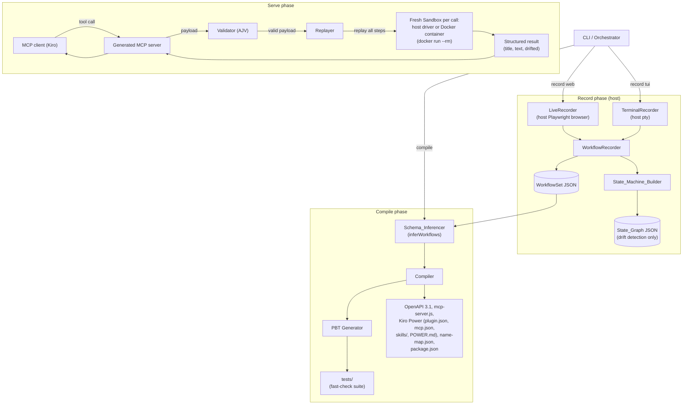

# Design Document

## Overview

Daemonize wraps legacy or API-less software (web interfaces and TUI/CLI programs) into callable MCP tools. A developer navigates the target application once inside a managed sandbox; Daemonize records every screen state and the transitions between them, infers typed JSON Schemas from the observations, and compiles a fully functional MCP server and OpenAPI 3.1 specification. The result is immediately registrable as a Kiro Power so AI agents can drive the wrapped application without any further configuration.

**Execution unit.** The recorded State_Graph is used for drift detection and documentation, not to drive execution. Each tool is a **Workflow**: a complete recorded path from a known start state (for example "logged in, on the home page") in which the user marked the variable fields. Every tool call starts a fresh sandbox at that start state and replays the whole path with the call's Payload values. The server therefore never needs to know which Screen it is on, never navigates between Screens, and never has to recover after a failure. Web targets come first; TUI replay follows once the web pipeline works end to end.

The system is built in TypeScript/Node.js, targeting Node.js 20 LTS. It runs as a CLI tool that orchestrates a local Docker container for sandbox isolation, uses Playwright for headless browser sessions and `node-pty` for TUI/CLI sessions, persists a versioned State_Graph as JSON, and emits generated server code and a Kiro Power to an output directory.

---

## Architecture

### High-Level Component Diagram



### Data Flow: Record Phase

1. The CLI launches a Docker container running either Playwright (web) or `node-pty` (TUI/CLI).
2. User interactions inside the container are forwarded to `State_Machine_Builder`.
3. Each interaction produces a (source Screen, action, destination Screen) triple — a Transition.
4. Screen identifiers are deterministic SHA-256 hashes of the normalized screen content.
5. While recording, the user marks the variable fields; the recorded steps and Variables form a Workflow.
6. On session end, `State_Machine_Builder` persists the State_Graph and the Workflow set as versioned JSON files.

### Data Flow: Compile Phase

1. `Schema_Inferencer` processes the Workflow set to derive input/output JSON Schemas per Workflow.
2. `Compiler` transforms the annotated graph into an OpenAPI 3.1 document, an MCP server TypeScript source file, and a Kiro Power (`plugin.json`, `mcp.json`, `skills/<name>/SKILL.md`, `POWER.md`).
3. `PBT Generator` reads the compiled schemas and emits self-contained `fast-check` test suite files.

### Data Flow: Serve Phase

1. The user runs the compiled MCP server.
2. An incoming tool call carries a Payload, which is validated against the tool's input schema.
3. The `Replayer` starts a fresh sandbox at the Workflow's start state (optionally a saved login via Playwright `storageState`) and replays every step, resolving each step's selectors in order.
4. The final screen is reduced to its title and visible text and returned as the tool response, flagged `drifted` when it differs from the recorded final screen.

---

## Components and Interfaces

### CLI / Orchestrator

Entry point. Parses commands (`record`, `merge`, `compile`, `serve`) and wires components together.

```typescript
interface DaemonizeConfig {
  targetType: "web" | "tui";
  targetUrl?: string;          // web only
  targetCommand?: string[];    // TUI/CLI only
  outputDir: string;
  stateGraphPath?: string;     // load existing graph for incremental sessions
  sandbox: {
    memoryMb: number;          // default 512
    cpuCount: number;          // default 1
  };
  replayTimeoutMs: number;     // default 10000
  snapshotIntervalMs: number;  // minimum 100
}
```

### Sandbox Manager

`SandboxDriver` is the uniform interface over `PlaywrightDriver` (web) and `PtyDriver` (terminal). During recording both drivers run on the host: a browser needs a visible window, and the user drives the terminal program from their own terminal. Containers are used for replay only (see "Sandbox" below).

```typescript
interface SandboxDriver {
  /** Start the sandbox and return when ready. */
  start(): Promise<void>;
  /** Capture the current screen state. */
  captureScreen(): Promise<ScreenContent>;
  /** Execute an interaction and return the resulting screen. */
  execute(action: RecordedAction): Promise<ScreenContent>;
  /** Stop the sandbox cleanly. */
  stop(): Promise<void>;
  /** Emitted when the sandbox process exits unexpectedly. */
  onUnexpectedExit: EventEmitter;
}

interface ScreenContent {
  type: "dom" | "terminal";
  /** Serialized DOM (web) or terminal buffer text (TUI). */
  raw: string;
  /** Canonical form used for hashing — dynamic attributes stripped. */
  normalized: string;
  capturedAt: number; // Unix ms
}
```

**PlaywrightDriver (web)**: Runs headless Chromium on the host through Playwright; `DAEMONIZE_CHROMIUM_PATH` selects an installed browser. Captures the DOM via `page.evaluate(() => document.documentElement.outerHTML)` after stabilization (network idle + 100 ms debounce).

**PtyDriver (terminal)**: Runs the program in a pty (`node-pty`) on the host and renders the screen with the headless xterm renderer (`TerminalScreen`), so a Screen is the text currently displayed, not the printed history. There is no Unix socket. See "Terminal targets" for recording and replay.

**SandboxManager**: A library built on `dockerode` that creates a container with the limits described in "Sandbox" and reports an exit it did not ask for. It is only tested against a fake Docker; the generated server replays through `docker run --rm` as described in "Sandbox".

### Terminal targets

A terminal program is run in a pty (`node-pty`) and its screen is rendered by the headless xterm renderer, so a Screen is the text currently displayed, not the history of what was printed. The steps of a terminal Workflow have no selectors: a `type` step writes text, a `keypress` step writes the bytes of a named key. The names and their byte sequences live in one table (`src/sandbox/keys.ts`) used by the recorder, the replayer and the generated server.

Recording (`TerminalRecorder`, `recordTui`): the user types in their own terminal in raw mode; the bytes are split into typed text and named keys, forwarded to the program, and turned into steps. Ctrl+] opens a menu (`v` marks the last typed text as a Variable, with a name suggested from the prompt shown on screen; `e` ends the recording). Input is handled in order, once the screen has rendered what the program printed.

Replay (generated server): each call starts the program afresh in a pty, waits for its first text, then sends each step and waits for the program to react (a short silence after its output, or a longer grace period if it prints nothing) before returning the text on screen.

Both kinds of target share the same Workflow set, schemas, validation, OpenAPI document, Kiro Power and property-based tests. A web set carries `startUrl`, a terminal set `startCommand`.

### Sandbox

Recording runs the target on the host: a browser needs a visible window to be used, and the user drives the terminal program from their own terminal. Replay, which is what an agent triggers, can run in a container.

With `DAEMONIZE_SANDBOX=docker` (or `daemonize serve --sandbox docker`) the generated server does not replay on the host: for every call it runs `docker run --rm` on an image built by `daemonize sandbox build`, sends the request (steps, payload) on stdin and reads the result on stdout. The image contains only `replay.js` and what it needs (`node-pty` and the screen renderer, or Playwright with its browsers), so the code that replays is the one that runs on the host. Each call is a new container, so the known start state is the container itself and a failed call leaves nothing behind.

The container is limited: memory (default 512 MB) and CPU (default 1), no Linux capabilities, `no-new-privileges`, at most 256 processes. An image is never downloaded implicitly (`--pull never`); the only folders of the host it sees are the ones the user mounts. A terminal program gets no network and a read-only file system with a scratch `/tmp`; a browser needs the network to reach the application, so a web target uses the `bridge` network (no access to the host network stack). A missing image, a missing `docker` command or an unreachable daemon is reported as `sandbox_unavailable`. Because a recorded terminal command may be a path of the host, the command to start inside the container can be given separately.

`SandboxManager` (dockerode) remains as a library to create a container with the same limits and to report an exit it did not ask for; it is only exercised against a fake Docker, since the server drives Docker through the `docker` command.

### State_Machine_Builder

Maintains the in-memory State_Graph and persists it. Runs inside the recording session.

```typescript
interface StateMachineBuilder {
  /** Record a completed interaction. Returns the destination ScreenId. */
  recordTransition(
    sourceId: ScreenId,
    action: RecordedAction,
    destinationContent: ScreenContent
  ): ScreenId;

  /** Merge another State_Graph into this one (commutative, idempotent). */
  merge(other: StateGraph): StateGraph;

  /** Serialize to JSON conforming to the State_Graph JSON Schema. */
  serialize(): string;

  /** Load from a JSON string; throws DescritiveParsError on failure. */
  static deserialize(json: string): StateMachineBuilder;

  getGraph(): StateGraph;
}
```

**Screen ID algorithm** (deterministic SHA-256):
1. Parse raw screen content to canonical form:
   - **DOM**: remove dynamic attributes (`id` attributes containing UUIDs, `nonce`, `data-reactid`, CSRF tokens detected by name pattern), sort attribute order alphabetically, strip whitespace-only text nodes.
   - **Terminal**: strip ANSI escape codes, trim trailing whitespace per line, remove cursor-position lines.
2. UTF-8 encode the canonical string.
3. SHA-256 hash → truncate to first 16 hex characters for compact IDs while keeping collision probability negligible at expected graph sizes (< 10,000 nodes).

### Schema_Inferencer

Derives JSON Schemas per Workflow. The input schema starts from the Variables the user marked while recording (authoritative for type, description and optionality) and is widened by any observed Payloads; the output schema describes the structured result (`screenType`, `title`, `text`, `drifted`). A language model may propose tool names, descriptions and candidate Variables at compile time; the user can edit them, and execution stays deterministic.

```typescript
interface SchemaInferencer {
  /** Derive schemas for all Transitions in the graph. */
  infer(graph: StateGraph): AnnotatedStateGraph;
  /** Derive schemas for all Workflows in the set. */
  inferWorkflows(set: WorkflowSet): WorkflowSet;
}
```

**Schema widening algorithm**: The inferencer maintains a `SchemaAccumulator` per Workflow. Each observed Payload is converted to a minimal JSON Schema (leaf types: `string`, `number`, `boolean`, `null`, `array`, `object`). When accumulating a second observation:

1. Fields present in all observations → kept in the base schema.
2. Fields present in some observations → moved to `additionalProperties` with `required` removed.
3. Conflicting primitive types on the same field → emitted as `anyOf` branches.
4. `integer` widened to `number` when a decimal observation arrives; `number` is never narrowed back.
5. `format` annotation pass runs after all observations are merged: applies `"email"`, `"date-time"`, `"uuid"` by testing each string field's observed values against their respective regexes (RFC 5322, ISO 8601, RFC 4122). Format is only annotated when ≥ 80% of non-null observations match.

Field `description` is populated by the `LabelExtractor`: for DOM screens, it uses the text of the nearest `<label>` element whose `for` attribute matches the field's input name, or the placeholder attribute. For terminal screens, it uses the text on the same line preceding the cursor position.

### Compiler

Transforms the annotated State_Graph into output artifacts.

```typescript
interface Compiler {
  compile(set: WorkflowSet, outputDir: string): Promise<CompileResult>;
}

interface CompileResult {
  openApiSpec: object;         // OpenAPI 3.1 document (JS object, not string)
  mcpServerSource: string;     // TypeScript source code
  kiroPower: {                 // files of the Kiro Power
    plugin: object;            // plugin.json
    mcp: object;               // mcp.json
    skill: string;             // skills/<name>/SKILL.md
    powerMd: string;           // POWER.md (older Kiro versions)
  };
  toolNames: Map<string, string>; // workflowId → toolName
}
```

`KiroPowerGenerator` emits the four Kiro Power files (see "Kiro Power Output"); `name-map.json` is unchanged.

**Output location note**: `mcp.json` references `mcp-server.js` by absolute path resolved at compile time. The output directory must therefore stay where it was compiled; moving it requires recompiling.

**Tool name derivation**:
1. Take the Workflow's human-readable label (set during recording).
2. `snake_case` transform: lowercase, replace non-alphanumeric runs with `_`, collapse repeated `_`, strip leading/trailing `_`.
3. Truncate to 64 characters at a word boundary (last `_` before position 64).
4. Conflict resolution: iterate Workflows in recording order; append `_2`, `_3`, … when the base name already exists in the output name set.

**MCP server generation**: The Compiler emits a TypeScript file that imports `@modelcontextprotocol/sdk/server/index.js`, registers each tool using `server.tool(name, description, zodSchema, handler)` (the handler replays the Workflow), and starts a `StdioServerTransport`. The generated file is standalone — no runtime Daemonize dependency — but requires `@modelcontextprotocol/sdk`, `zod` and `playwright` in the output project.

### Validator

Wraps AJV (v8, JSON Schema draft-07 compatible with OpenAPI 3.1 dialect) for sub-50 ms payload validation.

```typescript
interface Validator {
  /** Returns null on success; ValidationError with violation list on failure. */
  validate(actionId: string, payload: unknown): ValidationError | null;
}
```

AJV schemas are compiled once at server startup (not per request) to satisfy the 50 ms latency requirement. The compiled validate functions are cached by `actionId` in a `Map<string, ValidateFunction>`.

### Replayer

Resets to the known start state and replays a Workflow with values from the validated Payload.

```typescript
interface Replayer {
  replay(
    workflow: Workflow,
    payload: Record<string, unknown>,
    timeoutMs?: number
  ): Promise<ReplayResult>;
}

interface ReplayResult {
  success: boolean;
  screen?: ScreenContent;
  result?: WorkflowResult;   // { screenType, title?, text } — not the raw DOM
  drifted?: boolean;         // final screen differs from the recorded one
  error?: "timeout" | "sandbox_unavailable" | string;
  elapsedMs: number;
}
```

Each call creates a new `SandboxDriver` through a factory, so no state leaks between calls. On timeout the driver is simply stopped and discarded; there is no navigation back to a source screen. Each step carries an ordered list of candidate selectors (accessibility role/name first, CSS as fallback); the first one that works is used. The generated MCP server embeds an equivalent standalone runtime (Playwright) so it needs no Daemonize dependency at run time.

### PBT Generator

Reads the compiled input schemas and emits self-contained `fast-check` test files, one per Action, in `<outputDir>/tests/`.

```typescript
interface PbtGenerator {
  generate(set: WorkflowSet, toolNames: Map<string, string>, outputDir: string): Promise<string[]>;
}
```

Each output file contains:
- One property for valid payloads (round-trip: schema → generate → validate → pass).
- One property for invalid payloads using `fc.oneof` over intentional violations (not an object, missing required field, wrong type, out-of-range value, value outside an enum, malformed email/uuid/date-time, unexpected field). Every violation is chosen so the payload cannot satisfy the schema.
- A report hook that prints the passing and failing counts and the shrunk counterexample of each failing property.

The converter supports a documented subset of JSON Schema (objects, arrays, strings with length/pattern/formats, numeric bounds, `enum`, `const`, `anyOf`, non-overlapping `oneOf`, simple object `allOf`, type lists). A schema outside that subset is never silently approximated: the converter throws an `UnsupportedSchemaError` naming the keyword and its location, and the generator writes skipped tests carrying that reason (and `compile` warns), because a property that ignores a keyword would pass without proving anything.

Arbitraries come from a small converter shipped with the tests (`schema-arbitrary`), because `json-schema-fast-check` bundles fast-check 1.x and cannot be combined with fast-check 3. The converter and the property runner are copied next to the tests, so the suite imports only `vitest`, `fast-check`, `ajv` and `ajv-formats` and runs with `vitest run` once the output project's dependencies are installed (the compiler writes `package.json` and `vitest.config.ts`).

---

## Data Models

### State_Graph JSON Schema

```json
{
  "$schema": "https://json-schema.org/draft/2020-12/schema",
  "$id": "https://daemonize.dev/schemas/state-graph/v1",
  "type": "object",
  "required": ["version", "createdAt", "updatedAt", "screens", "transitions"],
  "additionalProperties": false,
  "properties": {
    "version": { "type": "string", "const": "1" },
    "createdAt": { "type": "string", "format": "date-time" },
    "updatedAt": { "type": "string", "format": "date-time" },
    "screens": {
      "type": "object",
      "additionalProperties": { "$ref": "#/$defs/Screen" }
    },
    "transitions": {
      "type": "array",
      "items": { "$ref": "#/$defs/Transition" }
    }
  },
  "$defs": {
    "ScreenId": { "type": "string", "pattern": "^[0-9a-f]{16}$" },
    "Screen": {
      "type": "object",
      "required": ["id", "type", "normalizedHash", "snapshot", "firstSeenAt"],
      "additionalProperties": false,
      "properties": {
        "id": { "$ref": "#/$defs/ScreenId" },
        "type": { "type": "string", "enum": ["dom", "terminal"] },
        "normalizedHash": { "type": "string", "pattern": "^[0-9a-f]{64}$" },
        "snapshot": { "type": "string" },
        "label": { "type": "string" },
        "firstSeenAt": { "type": "string", "format": "date-time" },
        "observationCount": { "type": "integer", "minimum": 1 }
      }
    },
    "Transition": {
      "type": "object",
      "required": ["id", "sourceScreenId", "destinationScreenId", "actionType", "label"],
      "additionalProperties": false,
      "properties": {
        "id": { "type": "string", "format": "uuid" },
        "sourceScreenId": { "$ref": "#/$defs/ScreenId" },
        "destinationScreenId": { "$ref": "#/$defs/ScreenId" },
        "actionType": {
          "type": "string",
          "enum": ["click", "keypress", "form_submit", "type", "select"]
        },
        "label": { "type": "string" },
        "selector": { "type": "string" },
        "inputSchema": { "type": "object" },
        "outputSchema": { "type": "object" },
        "observedPayloads": {
          "type": "array",
          "items": { "type": "object" }
        }
      }
    }
  }
}
```

### Workflow Set

```typescript
interface WorkflowSet {
  version: "1";
  targetType: "web" | "tui";
  targetName: string;
  startUrl?: string;        // web only
  storageState?: string;    // Playwright storage state: the logged-in start state
  workflows: Workflow[];
}

interface Workflow {
  id: string;               // UUID
  label: string;
  steps: WorkflowStep[];    // { actionType, selectors[], value?, variable?, label? }
  variables: WorkflowVariable[];  // { name, type?, description?, optional? }
  finalScreenId?: string;   // drift detection only
  observedPayloads: object[];
  inputSchema?: object;
  outputSchema?: object;
}
```

### OpenAPI Output Structure

```
/actions/{action_id}:
  post:
    operationId: {tool_name}
    summary: {workflow.label}
    requestBody:
      required: true
      content:
        application/json:
          schema: {workflow.inputSchema}
    responses:
      "200":
        description: Structured content of the resulting screen
        content:
          application/json:
            schema: {workflow.outputSchema}
      "400":
        description: Payload validation failure
      "504":
        description: Replay timeout
```

Top-level `info.title` is set to the target application name. `info.version` is `1`.

### MCP Tool Schema (per Workflow)

```typescript
{
  name: string,            // snake_case, max 64 chars
  description: string,     // derived from workflow.label + schema descriptions
  inputSchema: {           // JSON Schema object (AJV-compatible)
    type: "object",
    properties: { ... },
    required: [...],
    additionalProperties: false
  },
  annotations: {
    readOnlyHint: false,   // all actions mutate state
    destructiveHint: false // conservative default; user may override
  }
}
```

### Kiro Power Output

Kiro imports the output directory as a Custom Power (Powers panel → Add Custom Power → Import power from a folder) and activates it from the `keywords`. Kiro namespaces the server name on install.

```
output-dir/
├── plugin.json
├── mcp.json
├── POWER.md                      # older Kiro versions
└── skills/<name>/SKILL.md
```

`plugin.json` (`name` is the kebab-case target name; `keywords` come from the target name and the tool names):

```json
{
  "$schema": "https://agent-plugins.org/schemas/1.0.0/plugin.schema.json",
  "name": "{target-name}",
  "version": "1.0.0",
  "description": "Generated MCP server for {target application name} by Daemonize",
  "author": { "name": "Daemonize" },
  "keywords": ["{target name}", "{tool_name}"]
}
```

`mcp.json` (the path is absolute, resolved at compile time):

```json
{
  "$schema": "https://agent-plugins.org/schemas/1.0.0/mcp.schema.json",
  "mcpServers": {
    "{target-name}": {
      "type": "stdio",
      "command": "node",
      "args": ["{absolute path}/mcp-server.js"],
      "env": {}
    }
  }
}
```

`skills/{target-name}/SKILL.md`:

```markdown
---
name: {target-name}
description: Use when the user wants to operate {target application name}.
---

# {target application name}

## Tools
- `{tool_name}`: {description}. Inputs: `{field}` ({type}) {field description}.

A result flagged `drifted` means the application changed since recording.
```

`POWER.md` (older Kiro versions):

```markdown
---
name: "{target-name}"
displayName: "{target application name}"
description: "Generated MCP server for {target application name} by Daemonize"
keywords: ["{target name}", "{tool_name}"]
---
```

---

## Correctness Properties

*A property is a characteristic or behavior that should hold true across all valid executions of a system — essentially, a formal statement about what the system should do. Properties serve as the bridge between human-readable specifications and machine-verifiable correctness guarantees.*

### Property 1: State_Graph Serialization Round-Trip

*For any* valid State_Graph object, serializing it to JSON and then deserializing the result SHALL produce a State_Graph that is structurally equal to the original — same screen set, same transition set, same schema annotations.

**Validates: Requirements 3.3**

### Property 2: Screen ID Determinism

*For any* screen content (DOM or terminal), computing the screen ID twice from the same normalized content SHALL produce the same 16-character hex identifier.

**Validates: Requirements 2.2**

### Property 3: Payload Validation Idempotence (valid)

*For any* Payload that the Validator accepts on the first call, applying the Validator again to the same Payload and the same schema SHALL return a pass result.

**Validates: Requirements 6.4**

### Property 4: Payload Validation Idempotence (invalid)

*For any* Payload that the Validator rejects on the first call, applying the Validator again to the same Payload and the same schema SHALL return a fail result.

**Validates: Requirements 6.5**

### Property 5: State_Graph Merge Commutativity

*For any* two valid State_Graphs A and B, merging A into B SHALL produce a State_Graph with the same node set and edge set as merging B into A.

**Validates: Requirements 10.4**

### Property 6: State_Graph Merge Idempotence

*For any* valid State_Graph A, merging A with itself SHALL produce a State_Graph equal to A — no duplicate screens, no duplicate transitions.

**Validates: Requirements 10.5**

### Property 7: Schema Round-Trip (PBT suite generation)

*For any* valid Payload generated by the PBT suite from a compiled Action's input JSON Schema, applying the Validator to that Payload SHALL return a pass result.

**Validates: Requirements 9.2**

### Property 8: Invalid Payload Rejection (PBT suite generation)

*For any* Payload generated by the PBT suite that violates at least one constraint in a compiled Action's input JSON Schema, applying the Validator to that Payload SHALL return a fail result.

**Validates: Requirements 9.3**

---

## Error Handling

### Sandbox Unexpected Exit

The SandboxDriver emits an `unexpectedExit` event with the container exit code. The Orchestrator catches this event and within 5 seconds: logs the exit code, displays an error message to the user, persists any in-progress State_Graph to a recovery file, and terminates the CLI process cleanly.

### Malformed State_Graph JSON

`StateMachineBuilder.deserialize` runs AJV validation against the published State_Graph JSON Schema before attempting structural parsing. On failure it throws a `DescriptiveParseError` containing the AJV error path (`schemaPath`) and the offending value.

### Schema Validation Failures (Payload)

The Validator returns a typed `ValidationError` object (never throws) with an array of `{ instancePath, schemaPath, message }` objects sourced directly from AJV. The MCP server and OpenAPI server both map this to a 400 response body serialized as `{ "errors": [...] }`.

### Replay Timeout

The Replayer uses `Promise.race` between the replay and a `setTimeout` of `replayTimeoutMs`. On timeout: it logs `{ actionId, payload, elapsedMs }` at WARN level, stops and discards the sandbox (the next call starts a fresh one), and returns `{ success: false, error: "timeout" }`. The MCP server maps this to a 504 response.

### Sandbox Unavailable

If the sandbox cannot be started when a replay is requested, the Replayer immediately returns `{ success: false, error: "sandbox_unavailable" }` without blocking. The MCP server maps this to a 503 response.

### Tool Name Conflicts

The Compiler resolves name conflicts deterministically during the compile phase (suffix `_2`, `_3`, …) and writes the final name mapping to a `name-map.json` sidecar file so users can inspect which workflow maps to which tool name.

### OpenAPI Validation Failure

After generating the OpenAPI spec object, the Compiler validates it against the official OpenAPI 3.1 JSON Meta Schema using AJV. If validation fails, compilation aborts with an error listing the failing schema paths and the generated spec is not written to disk.

---

## Testing Strategy

### Unit Tests (Vitest)

Unit tests cover specific examples and edge cases for pure logic:

- `ScreenHasher`: verify that two semantically identical DOM trees with different whitespace hash to the same ID; verify that a one-character change produces a different ID.
- `SchemaWidener`: verify primitive type widening (`integer` → `number`), `anyOf` generation on conflicting types, `format` annotation at ≥ 80% threshold, and `additionalProperties` behavior when a field is absent from some observations.
- `ToolNameDeriver`: verify snake_case conversion, 64-character truncation at word boundary, and suffix generation for up to five conflicting names.
- `Replayer`: verify fresh sandbox per call, selector fallback, timeout, sandbox-unavailable, and structured result extraction.
- `Compiler`: verify that the emitted OpenAPI document passes AJV validation against the OpenAPI 3.1 meta-schema.
- `StateMachineBuilder.merge`: verify union of node sets, deduplication of identical transitions, and preservation of distinct transitions from both inputs.

### Property-Based Tests (fast-check, 100 iterations minimum)

Each property test references its design document property by tag comment:
`// Feature: daemonize, Property N: <property_text>`

The PBT library used is `fast-check`. Arbitraries for State_Graph objects are built using `fc.record` over `fc.dictionary` for the screen map and `fc.array` for transitions.

For schema round-trip properties (Properties 7 and 8), arbitraries are derived from compiled JSON Schemas with the `schema-arbitrary` converter.

| Property | Test approach |
|---|---|
| P1: Graph round-trip | Generate random StateGraph, serialize, deserialize, assert deep equality |
| P2: Screen ID determinism | Generate random screen content, compute ID twice, assert equality |
| P3: Validator idempotence (valid) | Generate valid payloads via schema arbitrary, validate twice, assert both pass |
| P4: Validator idempotence (invalid) | Generate invalid payloads, validate twice, assert both fail |
| P5: Merge commutativity | Generate two random graphs, assert merge(A,B) equals merge(B,A) |
| P6: Merge idempotence | Generate random graph A, assert merge(A,A) equals A |
| P7: PBT suite valid round-trip | Per compiled schema, generated valid payload passes validator |
| P8: PBT suite invalid rejection | Per compiled schema, generated invalid payload fails validator |

### Integration Tests

- Record a simple web form against a local static HTTP server and verify the generated OpenAPI passes validation.
- Record a TUI command (`cat`, `echo`) and verify the resulting State_Graph has the expected structure.
- Run the generated MCP server against `@modelcontextprotocol/inspector` to verify tool registration.
- Parse `plugin.json` and `mcp.json`, check that the `mcp-server.js` they reference exists, and that `SKILL.md` lists every tool.

Property-based tests do not apply to sandbox interaction (Docker I/O, Playwright, node-pty) or compilation artifact writing — these use integration tests with 1–3 representative examples.
