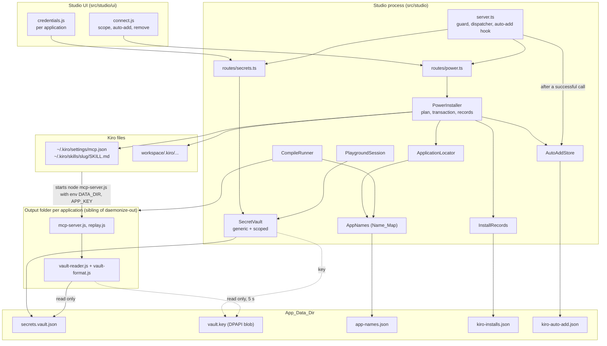
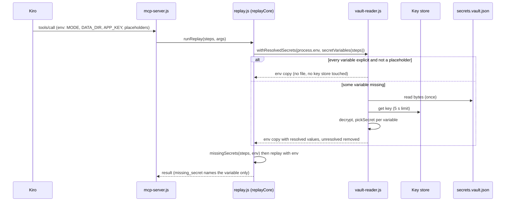
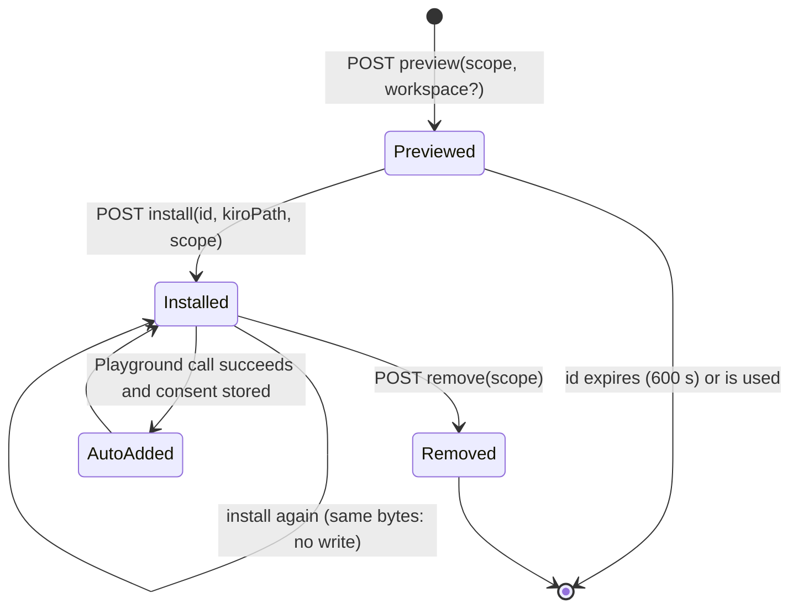

# Design Document: kiro-global-connect-vault-bridge

## Overview

This design makes "Connect to Kiro" work end to end for several applications at once. A password typed once in Credentials reaches the MCP server that Kiro starts, with no secret value in any file Kiro or git can see. It covers the preparatory step (test isolation) and Step 1 of the larger plan (1.1 user-level install, remembered consent, undo, application-specific names; 1.2 read-only vault bridge; 1.3 verification). Step 2 (`.vsix`) and Step 3 (persistent profile, Chrome extension, semantic firewall) are out of scope.

Everything is an addition to the existing code. No CLI command, flag or default output changes. The Studio security model (loopback, token cookie, Host and Origin checks, `x-studio-request`, CSP, `redactForStudio`) is untouched, and every new route uses the existing `RouteDef` mechanism with `remote: 'blocked'`.

### Decisions in one place

| # | Question | Decision | Why |
|---|---|---|---|
| 1 | How does the Kiro-started server read the vault? | A standalone runtime file `vault-reader.ts` (plus a tiny shared `vault-format.ts`) copied next to `mcp-server.js`, like `settle.ts` and `totp.ts`. | Matches the "no import from `src/`" rule. The launcher alternative is rejected, see below. |
| 2 | Where are secrets resolved? | Once per call, at the top of each `replayCore` variant and of `replayInDocker`. The resolved environment object replaces `process.env` in the secret-related calls only. | `missingSecrets`, `secretValues`, `resolveStepValue`, `runHttpStep` already take an `env` argument, so the redaction set and `missing_secret` shape come for free. |
| 3 | Vault file format | Same envelope. Scoped entries are extra keys `<Application_Key>/<NAME>` in the plaintext map. Generic entries keep the key `<NAME>`. | Old vaults work without migration. A generic name can never contain `/` (`plainName` forbids it), so the two kinds cannot collide. |
| 4 | Shared code between Studio and reader | `src/replay/runtime/vault-format.ts` (pure: AAD, encrypt, decrypt, key naming, `pickSecret`, placeholder test, DPAPI script constants). Studio files import it. The reader imports it as a sibling. | One definition of the format and of precedence. A round-trip property test guards the rest. |
| 5 | Application_Slug | Pure `deriveSlug`, plus a persistent Name_Map `<App_Data_Dir>/app-names.json`. | Stable names across runs, collision suffixes, no change to the CLI. |
| 6 | Studio output folder | Sibling of the base output folder, named `<slug>`. A new `ApplicationLocator` tells the Studio which folder is active. Legacy `daemonize-out` is used only until the first Studio compile for that application. | Requirements 5.11 to 5.13. |
| 7 | Install scopes | `global` writes into `<home>/.kiro`, `project` into `<workspace>/.kiro`, through one code path that differs only in the root. | Same guards for both (Requirement 3.1). |
| 8 | Undo | `kiro-installs.json` Install_Record with the SHA-256 of the bytes Daemonize wrote. Removal compares the current hash. | Requirements 4.7 to 4.15. |
| 9 | Auto-add | `kiro-auto-add.json` consent plus a hook after a successful Playground call in `server.ts`. | Requirements 4.1 to 4.6. |

### Research summary

- Kiro reads user-level MCP servers from `~/.kiro/settings/mcp.json` (`%USERPROFILE%\.kiro\settings\mcp.json` on Windows) and workspace servers from `.kiro/settings/mcp.json`. The workspace level overrides the user level ([Kiro MCP docs](https://kiro.dev/docs/mcp/)). A skill folder name must match the skill name, and a workspace skill wins over a global one ([Kiro Agent Skills](https://kiro.dev/docs/skills/)). Consequence: installing the same slug in both scopes is allowed, and the project copy wins in that project. The preview tells the user so when an Install_Record exists for the other scope.
- Kiro expands `${VAR}` from its own environment. When the variable is not set, a client may pass the text through unexpanded. The reader therefore treats any value that begins with `${` and ends with `}` as not set (Requirement 7.12).
- The existing design `.kiro/specs/studio-first-flow/design.md` already established the key store (DPAPI through PowerShell, `security -i`, `secret-tool`), the test providers `memory | file | unavailable` gated by `NODE_ENV === 'test'`, and the atomic temp-plus-rename write. This design reuses them without change.
- Existing code facts that shape the design (read from the repository): `SecretVault` stores a flat `name -> value` map and `names()`, `snapshot()` return every key; `PlaygroundSession.launchSpec` currently lets vault values override environment values; `StudioPowerInstaller` hard-codes `outDir` and writes only `<workspace>/.kiro`; `KiroPowerGenerator` names the server `toKebabCase(set.targetName)`; every replay variant reads secrets through `missingSecrets(steps, process.env)` and `secretValues(steps, process.env)`.

### Vault_Reader versus a `daemonize serve --vault` launcher

| Criterion | Standalone `vault-reader.ts` (chosen) | `daemonize serve --vault` launcher |
|---|---|---|
| Works when `daemonize` is not installed globally | Yes, the output folder is self-contained | No, `mcp.json` would need a global binary or `npx` |
| Respects "generated files never import from `src/`" | Yes | Yes, but the launcher lives in `src/` and the generated server no longer owns its secret logic |
| Startup cost | One key-store call per tool call | Same, plus a second Node start |
| Change surface | One runtime file, a few lines in the generator | New CLI flag (forbidden: no CLI change), new `mcp.json` command shape (conflicts with Requirement 3.12) |
| Cost of duplicating key-store code | Small: read path only, shared constants | None |

The launcher changes the `command` and `args` of the Server_Entry and adds a CLI flag, so it conflicts with Requirement 3.12 and the "CLI stays unchanged" constraint. The standalone reader wins.

## Architecture



### Runtime sequence: a call started by Kiro



### Install and undo flow



## Components and Interfaces

Files under `src/` use the repository's `.js` import suffix convention. New or changed signatures are listed per module.

### 1. `src/replay/runtime/vault-format.ts` (new, shared, pure)

Imports only `node:crypto`. Copied verbatim to every output folder, next to the reader. The Studio imports the same file.

```ts
export const VAULT_FILE = 'secrets.vault.json';
export const VAULT_AAD = 'daemonize-vault-v1';
export const KEY_BYTES = 32;
export const KEY_SERVICE = 'daemonize-studio-vault-v1';
export const LINUX_KEY_ATTRS: readonly string[]; // ['service','daemonize-studio','account','vault-key-v1']
export const DPAPI_UNPROTECT: string;            // moved from key-providers.ts, re-exported there
export const DPAPI_PROTECT: string;

export interface VaultEnvelope { v: 1; alg: 'aes-256-gcm'; iv: string; tag: string; ct: string }
export function encryptVault(key: Buffer, map: ReadonlyMap<string, string>): VaultEnvelope;
export function decryptVault(key: Buffer, text: string): Map<string, string>; // throws on any problem

/** `https://host:port` + `/` + NAME. A generic key never contains `/`. */
export function scopedKey(applicationKey: string, name: string): string;
export function isScopedKey(key: string): boolean;
export function parseHexKey(text: string): Buffer;          // throws on a bad key

/** `${...}` check of Requirement 7.12. */
export function isUnexpandedPlaceholder(value: string | undefined): boolean;
/** `DAEMONIZE_SECRET_PASSWORD` -> `PASSWORD`; undefined for any other name. */
export function secretNameOf(variable: string): string | undefined;

export interface SecretCandidates { explicit?: string; scoped?: string; generic?: string }
/** First candidate with at least 1 character; an explicit placeholder counts as absent. */
export function pickSecret(c: SecretCandidates): string | undefined;
```

`pickSecret` is the single definition of precedence (Requirements 6.4, 6.7, 7.1, 7.13). `secret-vault.ts` re-exports `encryptVault`, `decryptVault`, `VAULT_FILE` so existing imports keep working.

### 2. `src/replay/runtime/vault-reader.ts` (new, standalone runtime file)

Imports only `node:*` modules and `./vault-format.js`. Read-only by construction: it calls `readFile` and `stat` and never a write, rename, mkdir or rm function.

```ts
type Env = Record<string, string | undefined>;
export interface ReaderOptions {
  env?: Env;                 // default process.env
  timeoutMs?: number;        // key store limit, default 5000
  run?: RunProcess;          // test seam for the key-store subprocess
  platform?: NodeJS.Platform;
}

/**
 * A copy of `env` where each listed DAEMONIZE_SECRET_<NAME> variable holds the resolved value (explicit,
 * then scoped by DAEMONIZE_APP_KEY, then generic) or is deleted when none is usable. Never throws.
 * Reads and decrypts the vault at most once per call, and not at all when every variable is explicit.
 */
export async function withResolvedSecrets(env: Env, variables: readonly string[], options?: ReaderOptions): Promise<Env>;

/** Directory rule of Requirement 7.3: DAEMONIZE_DATA_DIR when non-empty, else the platform default. */
export function resolveDataDir(env: Env, platform?: NodeJS.Platform): string | undefined;
```

Key providers inside the reader (read path only, no `create`):

| Platform | Read | Notes |
|---|---|---|
| win32 | `powershell.exe -EncodedCommand DPAPI_UNPROTECT`, blob from `<dataDir>/vault.key` on stdin | same scripts as the Studio |
| darwin | `/usr/bin/security find-generic-password -a daemonize -s KEY_SERVICE -w` | |
| linux | `secret-tool lookup LINUX_KEY_ATTRS` | |
| test | `DAEMONIZE_VAULT_KEY_PROVIDER=memory\|file\|unavailable`, honoured only when `NODE_ENV === 'test'`. `file` reads `<dataDir>/vault.key.test`. `memory` returns no key (a separate process cannot share memory), so integration tests use `file`. | |

Every subprocess runs without a shell, with the same allow-listed environment as `minimalEnv` (copied as a constant list), and is killed after `timeoutMs`. Any failure (provider unavailable, timeout, missing file, corrupt file, decryption error, key of the wrong size) is swallowed and the variable stays unset. The existing `missingSecrets` then produces the existing `missing_secret` response, which names the variable and nothing else. The reader never puts a path, a key or a value in any message.

The decrypted map is a local variable of one `withResolvedSecrets` call. Nothing is cached in a module variable (Requirement 7.9). The resolved values are visible to the caller only through the returned env, which `secretValues(steps, env)` feeds to the redaction set (Requirement 7.8).

### 3. Generator changes (`src/compiler/compiler.ts`, `src/compiler/mcp-generator.ts`, `src/replay/runtime/step-plan.ts`)

- `compiler.ts` reads `vault-format.ts` and `vault-reader.ts` like `totp.ts` and writes `.ts` plus transpiled `.js` for both, always, whenever it writes `mcp-server.js` (Requirement 7.6). `CompileOptions` gains `powerName?: string` (consumed by section 4).
- `step-plan.ts` gains `secretVariables(steps: StepLike[]): string[]` (names `DAEMONIZE_SECRET_<ref>` of every `secretRef`). Additive; existing functions unchanged.
- In `WEB_RUNTIME`, `WEB_RUNTIME_HTTP`, the terminal runtime and `replayInDocker`, the first lines after `deadline` become:

```ts
const env = await withResolvedSecrets(process.env, [...secretVariables(steps), ...httpVariables]);
const missing = missingSecrets(steps, env);                 // was process.env
const secrets = [...secretValues(steps, env), ...httpSecretValues(httpSteps, env)];
// resolveStepValue(step, args, env) and runHttpStep(recipe, variables, env, ...) use env as well
```

`httpVariables` is `[]` without `--http`, otherwise the `secretVariable(name)` of each `httpSecretNames` of the HTTP steps. `replay.ts` gets one import line `import { withResolvedSecrets } from "./vault-reader.js";`. In `replayInDocker` the resolved `env` is what is forwarded to the container with `-e NAME` (the container cannot reach the host vault), so secrets are read on the host once per call. Non-secret `process.env` reads (`DAEMONIZE_MODE`, timeouts, browser path) are left alone.

### 4. Names: `src/studio/app-names.ts` (new) and `kiro-power-generator.ts`

```ts
export type AppSource = { origin: string } | { name: string };   // origin = Application_Key

export const MAX_SLUG = 48;
export const SLUG_PATTERN: RegExp;                // ^[a-z0-9][a-z0-9-]{0,63}$ (Requirement 5.5)
/** Pure. Rules of Requirement 5.1 to 5.4. Uses node:url domainToASCII for the host. */
export function deriveSlug(source: AppSource): string;
/** Pure. `-2`, `-3`... with the base shortened so the total stays <= 48 and no trailing hyphen. */
export function withSuffix(base: string, n: number): string;
/** Name_Map key: the origin itself, or `name:<Action name>` for a source without an http(s) origin. */
export function mapKey(source: AppSource): string;

export class AppNamesError extends Error {}       // map unreadable, invalid or unwritable
export interface AppNames {
  /** Stored slug, else the slug that `ensure` would store. Reads only. */
  peek(source: AppSource): Promise<string>;
  /** Stored slug, else derive, resolve a collision, write the map (temp + rename), return. Throws AppNamesError. */
  ensure(source: AppSource): Promise<string>;
}
export function createAppNames(deps: { appData: AppData }): AppNames;
/** Source of a loaded set: origin of `set.startUrl` for a web target, else the target name. */
export function sourceOfSet(set: WorkflowSet): AppSource;
```

`ensure` calls are serialized with a promise chain, like `FileSecretVault.exclusive`, so two compiles cannot take the same suffix. `kiro-power-generator.ts` uses `options.powerName ?? toKebabCase(set.targetName)` for `name` (so the plugin name, the `mcp.json` server key and the `skills/<name>` folder all equal the slug, Requirement 5.10). The CLI never passes `powerName`, so CLI output is unchanged (Requirement 5.14).

The generated `SKILL.md` and `POWER.md` replace the "Secrets" paragraph (generator only changes text) with:

> **Passwords.** The password is read from the Daemonize vault of your account on this computer. Enter it once in the Daemonize Studio, on the Credentials screen. Nothing secret is written in this file. A value set in the environment where Kiro runs is used first when it exists. Names used by this tool: `DAEMONIZE_SECRET_<NAME>` (names only).

The list of names stays, because the Server_Entry may still carry placeholders for them.

### 5. Vault: `src/studio/secret-vault.ts`, `contracts.ts`

`SecretVault` keeps every current method with the current behaviour on generic entries, and gains four methods. The first four existing methods filter out scoped keys so `/api/secrets` without an application behaves as before (Requirement 6.6).

```ts
export interface SecretVault {
  // existing, generic entries only (keys without "/")
  names(): Promise<ReadonlySet<string>>;
  has(name: string): Promise<boolean>;
  set(name: string, value: string): Promise<void>;
  remove(name: string): Promise<boolean>;
  snapshot(): Promise<Record<string, string>>;
  /** Every value, generic and scoped, plus normalized TOTP keys, for the Redactor. */
  values(): readonly string[];

  // new
  /** Replaces the scoped value of (applicationKey, name). Empty value is refused with VaultUnavailableError-free 400 at the route. */
  setFor(applicationKey: string, name: string, value: string): Promise<void>;
  /** Deletes only the scoped entry. true when it existed. */
  removeFor(applicationKey: string, name: string): Promise<boolean>;
  /** Names with a non-empty scoped or generic value. Unreadable vault -> empty set. Never returns a value. */
  namesFor(applicationKey: string): Promise<ReadonlySet<string>>;
  /** name -> value, scoped over generic, only non-empty values. For the Child_Server. Throws VaultUnreadableError. */
  snapshotFor(applicationKey: string): Promise<Record<string, string>>;
}
```

Both write paths reuse `exclusive`, `keyForWrite`, `write` unchanged. A `set` of a generic name never touches scoped keys, and `setFor` never touches generic keys (Requirements 6.1, 6.3).

### 6. Secrets routes: `src/studio/routes/secrets.ts`

- `GET /api/secrets?application=<origin>`: when the query is absent, the server uses the active application key from `ctx.activeApplication()` (new, section 9). The answer is `{ application?: string, secrets: [{ name, kind, configured }] }`. `configured` is true when `namesFor(application)` (or `names()` when there is no application) holds the name, or the variable is set in the environment. Names and booleans only.
- `POST /api/secrets` and `POST /api/secrets/forget` accept an optional `application` string. It must satisfy `applicationKey(value) === value` (a normalized origin), else 400 `SECRET_APPLICATION_INVALID`. With it, the route calls `setFor`/`removeFor`. Without it, it calls `set`/`remove` as today.
- Empty value and write failure keep the current 400/503 answers and messages, which already hold no value, key or vault path (Requirement 6.9).
- After a change, `stopServer()` still ends a running Child_Server.

### 7. Playground: `src/studio/playground.ts`

Additive options, existing behaviour otherwise:

```ts
interface PlaygroundOptions {
  outDir: string | (() => string);              // getter: the active application folder can change
  applicationKey?: () => string | undefined;    // active Application_Key
  // vault: Pick<SecretVault, 'snapshot'|'snapshotFor'|'names'|'namesFor'|'values'>
}
```

`launchSpec` uses `snapshotFor(key)` when a key exists, else `snapshot()`. Precedence changes to match Requirement 6.7 and 7.1: an environment value that is non-empty and not an Unexpanded_Placeholder wins; the vault fills the rest through `pickSecret`. This reverses the current "vault wins" rule on purpose; the unit test that asserts the old order is updated by group G1. `configuredSecretVariables` uses `namesFor(key)`.

### 8. Power installer (split into focused modules)

`src/studio/power-installer.ts` becomes the orchestrator. Pure and file helpers are separate so they can be tested without a Studio.

```ts
// contracts.ts
export type InstallScope = 'global' | 'project';
export interface PowerInfo {
  available: boolean;
  defaultWorkspace: string;
  outputPath: string;
  serverName?: string;            // the slug
  kiroHome: string;               // absolute path of <home>/.kiro
  kiroHomeExists: boolean;        // drives the preselection (Requirements 2.2, 2.3)
  installs: InstallSummary[];     // for "Remove from Kiro"
}
export interface InstallSummary { scope: InstallScope; slug: string; kiroPath: string }
export interface PowerPreview {
  confirmationId: string;
  scope: InstallScope;
  kiroPath: string;               // absolute, shown to the user
  files: PowerFilePlan[];
  replacesEntry: boolean;
  serverName: string;
  placeholders: string[];         // variables that will be written as ${...}
  missingSecrets: string[];       // Secret_Names with no value yet, for the warning
  backup: boolean;                // true when settings/mcp.json exists and will be copied
  otherScopeInstalled?: InstallScope;
}
export interface PowerInstaller {
  info(): Promise<PowerInfo>;
  preview(request: { scope: unknown; workspacePath?: unknown }): Promise<PowerPreview>;
  install(request: { confirmationId: unknown; kiroPath: unknown; scope: unknown; autoAdd?: unknown }):
    Promise<{ written: string[]; placeholders: string[]; missingSecrets: string[]; scope: InstallScope }>;
  remove(request: { scope: unknown }): Promise<{ removed: string[] }>;
  snippet(): Promise<string>;
  getAutoAdd(): Promise<AutoAddState>;
  disableAutoAdd(): Promise<AutoAddState>;
  /** Called by the server after a successful Playground call. Never throws. */
  runAutoAdd(): Promise<AutoAddOutcome>;
}
export interface AutoAddState { enabled: boolean; scope?: InstallScope; writable: boolean; last?: AutoAddOutcome }
export interface AutoAddOutcome { status: 'disabled' | 'added' | 'unchanged' | 'failed'; message?: string }
```

`PowerError.status` stays `400 | 409 | 500`. New helper modules:

```ts
// src/studio/power-config.ts   (pure, no fs)
export function mergeServer(root: Record<string, unknown>, name: string, entry: ServerEntry): Record<string, unknown>;
export function removeServer(root: Record<string, unknown>, name: string): { root: Record<string, unknown>; removed: boolean };
export function parseConfig(bytes: Buffer): { ok: true; root: Record<string, unknown> } | { ok: false; reason: 'json' | 'not-object' | 'servers-not-object' };
export function serialize(root: Record<string, unknown>): Buffer;       // JSON.stringify(root, null, 2) + "\n"
export function targetPaths(scope: InstallScope, kiroRoot: string, slug: string): { mcp: string; backup: string; skill: string; skillDir: string };
export function sha256(bytes: Buffer): string;

// src/studio/power-fs.ts
export function inside(a: string, b: string): boolean;                  // moved from power-installer.ts
export async function realDeepest(path: string): Promise<string>;       // moved
export interface Transaction {
  write(path: string, bytes: Buffer): void;       // queued: temp file in the same folder, then rename
  remove(path: string): void;                     // queued
  commit(): Promise<void>;                        // applies in order, restores every touched file on failure
}
export function beginTransaction(fsOps?: FsOps): Transaction;           // FsOps is the failure-injection seam

// src/studio/install-records.ts
export interface InstallRecord {
  slug: string; applicationKey?: string; scope: InstallScope;
  kiroPath: string; written: string[]; skillDir: string;
  configSha256: string; backup: boolean; installedAt: string;
}
export interface InstallRecords {
  list(): Promise<InstallRecord[]>;
  put(record: InstallRecord): Promise<void>;          // replaces same (slug, scope)
  delete(slug: string, scope: InstallScope): Promise<void>;
}
export function createInstallRecords(deps: { appData: AppData }): InstallRecords;

// src/studio/auto-add-store.ts
export interface AutoAddSetting { enabled: true; scope: InstallScope; workspacePath?: string }
export interface AutoAddStore { read(): Promise<AutoAddSetting | undefined>; write(s: AutoAddSetting): Promise<void>; clear(): Promise<void> }
export function createAutoAddStore(deps: { appData: AppData }): AutoAddStore;
```

`PowerInstallerDeps` becomes:

```ts
interface PowerInstallerDeps {
  locate: () => Promise<ActiveApplication>;   // slug, outDir, applicationKey of the active application
  cwd: string;
  home?: string;                              // injected home; default os.homedir() (Requirement 2.7)
  appData: AppData;
  vault: Pick<SecretVault, 'namesFor' | 'names'>;
  records: InstallRecords;
  autoAdd: AutoAddStore;
  now?: () => number;
  fsOps?: FsOps;                              // failure injection in tests
}
```

#### Install algorithm (preview and install share `plan`)

1. `locate()` gives the slug and output folder. A folder without `mcp-server.js`, `mcp.json` or `skills/<slug>/SKILL.md` gives 409 `POWER_NOT_COMPILED` (Requirement 8.9).
2. Resolve the root. `global`: `kiroRoot = join(realHome, '.kiro')`. `project`: validate `workspacePath` exactly as today (absolute, real folder, not in `node_modules`, not inside the output or App_Data folders), then `kiroRoot = join(realWorkspace, '.kiro')`. When `kiroRoot` exists it must be a folder whose realpath lies inside the real home (global) or the real workspace (project); a symbolic-link `.kiro` that leaves that area gives 409 `POWER_KIRO_OUTSIDE`.
3. For `targetPaths(...)`: `realDeepest(dirname(file))` must lie inside the real `.kiro`; a target that is a symbolic link gives 409 `POWER_TARGET_LINK`; a target that is not a regular file gives 409.
4. Read the existing `settings/mcp.json` with the 2 MiB cap (409 `POWER_SETTINGS_TOO_LARGE`), `parseConfig` (409 with the reason: `POWER_SETTINGS_NOT_JSON`, `..._NOT_OBJECT`, `..._SERVERS_NOT_OBJECT`).
5. Vault status by name only: `required` = `DAEMONIZE_SECRET_*` keys of the compiled `mcp.json`. `configured = await vault.namesFor(appKey)` (falls back to "none stored" on any error, Requirement 8.10). Build the entry with `buildServerEntry(source, serverJsPath, { dataDir, applicationKey, configuredNames })`.
6. `preview` stores `Confirmation { id, scope, kiroPath, slug, expires }`, then answers. No file is created or changed (Requirement 2.8). A new preview for the same `(scope, kiroPath)` replaces the older one; at most 8 are kept; expiry is 600 s.
7. `install` finds the confirmation by id, removes it (single use), and refuses with 409 `POWER_CONFIRM_INVALID` when it is unknown, used, expired, or when `scope`, `kiroPath` or `slug` differ from the preview. Other confirmations are not touched. It re-runs `plan`, then builds buffers: merged config bytes, skill bytes (the compiled `SKILL.md`, unchanged).
8. If `merged bytes == existing bytes` and the skill bytes are equal, nothing is written (idempotence, Requirement 3.10) and the existing Install_Record and Backup_File stay. Otherwise a Transaction queues, in order: `mcp.json.bak` (previous bytes, only when `mcp.json` existed), the skill file, then `mcp.json` last. Each is written to `<name>.tmp-<random>` in the same folder and renamed. Parent folders are created first and re-checked with `realDeepest`.
9. On any failure the Transaction restores every touched file to its previous bytes or deletes it, removes temporary files, writes no record, and the route answers 500 `POWER_WRITE_FAILED` (Requirement 3.11).
10. On success `InstallRecords.put` stores scope, absolute paths, `configSha256 = sha256(written config bytes)`, and `backup`. If `autoAdd === true` the store writes `{ enabled: true, scope, workspacePath? }`; when that write fails the install still succeeds and the answer carries a flag so the UI shows "this choice cannot be remembered" (Requirement 4.6).

The skill file is written inside `skills/<slug>/` only, so two applications never share a skill folder.

#### Remove algorithm

1. Load the Install_Record for `(active slug, scope)`; none gives 409 `POWER_NOTHING_TO_REMOVE`.
2. Re-run the confinement checks on `record.kiroPath`. Read `mcp.json` if present; present but not a valid object gives 409 `POWER_SETTINGS_NOT_JSON`, no write, record kept (Requirement 4.13).
3. Decide the config action:
   - hash(current) equals `record.configSha256` and `record.backup`: restore `mcp.json.bak` bytes as `mcp.json` (temp plus rename); keep the `.bak` file.
   - hash equal and not `record.backup`: delete `mcp.json` only when the root has no key but `mcpServers` and that map holds only our entry; otherwise fall to the next case.
   - hash differs (or the case above did not apply): `removeServer(root, slug)`, write the result, keep the `.bak` file, keep every other server.
   - config file already missing, or entry already absent: nothing to write for the config.
4. Delete the folder `skills/<slug>` (only the path recorded in the Install_Record, checked inside the real `.kiro`, not a link); already absent counts as removed.
5. A Transaction runs steps 3 and 4. A failure restores the previous state, keeps the record, answers 500 `POWER_REMOVE_FAILED`.
6. On success the Install_Record is deleted.

#### Auto-add

`runAutoAdd()` reads the consent. When none exists it returns `{ status: 'disabled' }` without any file access to Kiro folders. Otherwise it calls the same `plan` and write steps as `install`, with the stored scope (and stored workspace for `project`), without a confirmation id. Every other guard applies. The answer is `added` (written), `unchanged` (bytes already equal) or `failed` with a plain message; a failure leaves the Kiro files as found and keeps the consent (Requirement 4.4). The result is remembered in memory as `last` for `GET /api/power/auto-add`.

### 9. Application location: `src/studio/active-app.ts` (new) and the server seam

```ts
export interface ActiveApplication {
  applicationKey?: string;     // Application_Key, undefined for a non-http target
  slug: string;
  outDir: string;              // absolute, where the compiled tool is or will be
  legacy: boolean;             // true while the base folder (daemonize-out) is the one in use
}
export interface ApplicationLocator {
  /** Reads only. Order: Name_Map entry whose folder is compiled; else a compiled base folder (legacy, Requirement 5.12); else the peeked slug. */
  current(): Promise<ActiveApplication>;
  /** Called by the compile runner before writing: creates the Name_Map entry (Requirement 5.6) and returns the target. Throws AppNamesError. */
  prepareCompile(): Promise<ActiveApplication>;
}
export function createApplicationLocator(deps: {
  baseOutDir: string;          // the Studio's configured folder, e.g. <cwd>/daemonize-out
  apps: AppNames;
  loadSet: () => Promise<{ set: WorkflowSet | undefined }>;
}): ApplicationLocator;
```

For a legacy folder the slug is the server key found in its `mcp.json` (Requirement 5.12). The sibling folder is `join(dirname(baseOutDir), slug)`.

`server.ts` (owned by the seam group) keeps a synchronous `activeOutDir` updated after `current()` at startup, after each `load()`, and after each finished compile. It passes `() => activeOutDir` to the playground and uses it in `loadLive`, `readOutputs`, `runPbtSuite`, and `RouteContext`. `RouteContext` gains `activeApplication(): Promise<ActiveApplication>` and keeps `outDir` as the base folder for compatibility. `StudioOptions` gains `home?: string` (test seam, passed to the Power_Installer).

`CompileRunnerDeps.outDir: string` becomes `target: () => Promise<{ outDir: string; slug: string }>`; the runner calls it at the start of `run()`, passes `powerName: slug` to `compile`, and reports `AppNamesError` as a plain failure with no file written (Requirement 5.9). A new folder has no `node_modules`, so the first compile of each application runs `npm install` in its own folder (existing behaviour of the runner, now once per application).

### 10. Power routes: `src/studio/routes/power.ts`

All `remote: 'blocked'`, bodies limited to 64 KiB by the dispatcher, unknown body fields refused with 400.

| Route | Method | Body | Answer |
|---|---|---|---|
| `/api/power/info` | GET | none | `PowerInfo` |
| `/api/power/snippet` | GET | none | `{ snippet }` (includes `DAEMONIZE_DATA_DIR` and `DAEMONIZE_APP_KEY`) |
| `/api/power/preview` | POST | `{ scope: 'global'\|'project', workspacePath? }` | `PowerPreview` |
| `/api/power/install` | POST | `{ confirmationId, kiroPath, scope, autoAdd? }` | `{ written, placeholders, missingSecrets, scope, autoAddSaved? }` |
| `/api/power/remove` | POST | `{ scope }` | `{ removed }` |
| `/api/power/auto-add` | GET | none | `AutoAddState` |
| `/api/power/auto-add` | POST | `{ enabled: false }` | `AutoAddState` (consent deleted) |

`scope` outside `global|project` gives 400 `POWER_SCOPE_INVALID`. The Power routes return only names, paths and counts, never a value.

### 11. Server seam: auto-add hook

In `server.ts`, after `session.call(...)` returns `outcome`, when `outcome.status === 200 && outcome.body.success === true`:

```ts
const added = await services.power.runAutoAdd();
if (added.status !== 'disabled') outcome.body = { ...outcome.body, autoAdd: added };
```

`runAutoAdd` never throws and returns within the install time (a few file operations). The existing `sendJson(..., knownSecretValues)` redaction still wraps the body.

### 12. Server_Entry builder: `src/studio/mcp-snippet.ts`

```ts
export interface EntryContext {
  dataDir?: string;                    // absolute App_Data_Dir; omitted when unusable
  applicationKey?: string;
  configuredNames: ReadonlySet<string>; // Secret_Names with a stored value (names only)
}
export function buildServerEntry(source: unknown, serverJsPath: string, ctx: EntryContext): ServerEntry;
```

Result keys are exactly `type`, `command`, `args`, `env`. `env` holds `DAEMONIZE_MODE: 'strict'`, `DAEMONIZE_DATA_DIR`, `DAEMONIZE_APP_KEY` (each only when known), and `DAEMONIZE_SECRET_<NAME>: '${DAEMONIZE_SECRET_<NAME>}'` for every required name that is not in `configuredNames`. The heal-only `DAEMONIZE_MODEL_*` placeholders are still carried when the source holds them; the Studio compiles with `healSupport: false`, so the Studio flow never has them (Requirement 3.12 holds for every Studio-made entry). A value that is not a placeholder is never copied from the source.

### 13. UI

`src/studio/ui/js/views/connect.js` (plain language, `code.path` for every absolute path):

- A `fieldset` with a `legend` and two radio inputs, "All my projects" and "Only this project". Selected by `info.kiroHomeExists` (global when true). The user choice wins afterwards.
- For `global`, a sentence: the tool will be available in every Kiro project. The workspace folder field is shown only for `project`.
- A checkbox "Add to Kiro automatically after a successful test", off when `GET /api/power/auto-add` reports no consent. The install request sends `autoAdd: true` when it is checked. When the answer says the choice could not be remembered, show that sentence.
- The confirmation dialog shows the `.kiro` path from the preview, each file with `create`, `merge` or `replace`, and either "a backup of the previous file is kept" or "no previous file exists, so no backup is made" (from `preview.backup`).
- The success screen lists written files, a reload reminder ("reload or reconnect the server in the server panel of Kiro"), and for each name in `missingSecrets` a warning "`<name>` has no value yet" with a link to Credentials. When `missingSecrets` is empty no warning is shown.
- "Remove from Kiro" appears for each entry of `info.installs`, with a confirmation dialog, then `POST /api/power/remove`. After success it disappears and the reload reminder is shown.
- A failed preview, install or removal shows which action failed and that the Kiro files were left as they were, and keeps the card open.

`credentials.js` passes `application` (from the `GET /api/secrets` answer) on save and forget, and shows which application the passwords belong to (host only). `playground.js` shows a short line when a call answer carries `autoAdd` with status `added` or `failed`. New strings live in `copy.js` (connect) and a new `copy-secrets.js` (credentials, playground), both covered by the existing plain-language lint. The static demo hides these features through `features.js`.

### 14. Test environment: `tests/helpers/env-scrub.ts`, `tests/setup/clean-env.ts`, `vitest.config.ts`

```ts
// tests/helpers/env-scrub.ts (pure)
export function scrubEnv(env: Record<string, string | undefined>): Record<string, string | undefined>; // returns a copy
export function isScrubbed(name: string): boolean;  // DAEMONIZE_SECRET_*, DAEMONIZE_MODEL_*, DAEMONIZE_DATA_DIR, DAEMONIZE_APP_KEY
// tests/helpers/with-env.ts
export async function withEnv<T>(vars: Record<string, string | undefined>, body: () => Promise<T> | T): Promise<T>; // restores in finally
```

`tests/setup/clean-env.ts` deletes the matching names from `process.env` at import. `vitest.config.ts` lists `./tests/setup/clean-env.ts` in `setupFiles` of both the `fast` and the `integration` project (Requirement 1.2).

## Data Models

All files below live in the App_Data_Dir, are written through `appData.ensure()` (so they are never inside a git work tree), use temp file plus rename, and use mode 0600. None holds a secret value.

### `secrets.vault.json` (unchanged envelope)

```json
{ "v": 1, "alg": "aes-256-gcm", "iv": "<b64 12 bytes>", "tag": "<b64>", "ct": "<b64>" }
```

Plaintext of `ct` is `JSON.stringify(map)`, additional authenticated data `daemonize-vault-v1`. Map keys:

| Key form | Meaning | Example |
|---|---|---|
| `NAME` | Generic_Vault_Entry (no `/`) | `PASSWORD` |
| `<Application_Key>/<NAME>` | Scoped_Vault_Entry | `https://cycyly.vercel.app/PASSWORD` |

### `app-names.json` (Name_Map)

```json
{ "v": 1, "apps": { "https://cycyly.vercel.app": "cycyly-vercel-app", "http://localhost:3000": "localhost-3000", "name:Payer": "payer" } }
```

Limit 1 MiB. An unreadable, oversized or invalid file makes `peek` fall back to a derived slug without writing, and makes `ensure` throw `AppNamesError` with no write (Requirement 5.9).

### `kiro-installs.json` (Install_Records)

```json
{ "v": 1, "installs": [ {
  "slug": "cycyly-vercel-app", "applicationKey": "https://cycyly.vercel.app", "scope": "global",
  "kiroPath": "C:\\Users\\HP\\.kiro",
  "written": ["C:\\Users\\HP\\.kiro\\settings\\mcp.json", "C:\\Users\\HP\\.kiro\\skills\\cycyly-vercel-app\\SKILL.md"],
  "skillDir": "C:\\Users\\HP\\.kiro\\skills\\cycyly-vercel-app",
  "configSha256": "<64 hex>", "backup": true, "installedAt": "2025-01-01T00:00:00.000Z" } ] }
```

At most one record per `(slug, scope)`.

### `kiro-auto-add.json` (Auto_Add_Consent)

```json
{ "v": 1, "enabled": true, "scope": "project", "workspacePath": "D:\\work\\app" }
```

`workspacePath` only for `project`. Deleting the file turns the option off.

### Server_Entry written to `mcp.json`

```json
{ "type": "stdio", "command": "node", "args": ["D:\\out\\cycyly-vercel-app\\mcp-server.js"],
  "env": { "DAEMONIZE_MODE": "strict",
           "DAEMONIZE_DATA_DIR": "C:\\Users\\HP\\AppData\\Local\\Daemonize",
           "DAEMONIZE_APP_KEY": "https://cycyly.vercel.app" } }
```

When a required secret is not in the vault, `"DAEMONIZE_SECRET_PASSWORD": "${DAEMONIZE_SECRET_PASSWORD}"` is added. Saving the password later needs no reinstall: the reader ignores the unexpanded placeholder and reads the vault.

### Backup_File

`<kiroRoot>/settings/mcp.json.bak`: the exact previous bytes of `mcp.json`, replaced on each real write of an existing `mcp.json`.

### Output folder per application

`<parent of daemonize-out>/<slug>/` holds the usual generated files plus `vault-format.ts/.js` and `vault-reader.ts/.js`.

## Correctness Properties

*A property is a characteristic or behavior that should hold true across all valid executions of a system-essentially, a formal statement about what the system should do. Properties serve as the bridge between human-readable specifications and machine-verifiable correctness guarantees.*

Criteria such as UI layout, wording on a single screen, the final command run (`tsc`, `vitest`, `check:secrets`) and the test-suite requirements of Requirement 10 are covered by example, smoke or integration tests in the Testing Strategy, not by properties. Redundant candidates were merged: merge preservation also covers file creation (2.11, 2.12), the invalid-config property also covers 3.5 and 4.13, and the precedence property covers 6.4, 6.7, 7.1, 7.11, 7.12, 7.13 and 7.16.

### Property 1: Test environment scrubbing

For any environment map, `scrubEnv` returns a map with no name that starts with `DAEMONIZE_SECRET_` or `DAEMONIZE_MODEL_` and no `DAEMONIZE_DATA_DIR` or `DAEMONIZE_APP_KEY`, and every other name keeps its value.

**Validates: Requirements 1.1**

### Property 2: Targets lie inside the allowed root

For any valid Application_Slug, any scope and any home or workspace path, `targetPaths` returns exactly `<root>/settings/mcp.json`, `<root>/settings/mcp.json.bak`, `<root>/skills/<slug>/SKILL.md` with `<root>` equal to `<home>/.kiro` for `global` and `<workspace>/.kiro` for `project`, and every returned path satisfies `inside(path, root)`. For any path that is not inside the root (including `..` segments and sibling folders with the same prefix), `inside` is false.

**Validates: Requirements 2.5, 2.6, 2.7, 2.9, 2.10**

### Property 3: Preview is complete and read-only

For any fake-home state (absent, empty, or arbitrary valid configuration, with or without an existing skill file) and either scope, `preview` returns the scope, the absolute `.kiro` path, the files with outcomes `create`, `merge` or `replace` consistent with what exists, the server name, `replacesEntry` equal to whether the entry already exists, and `backup` equal to whether `mcp.json` exists, and afterwards every file under the fake home and the App_Data_Dir has the same bytes as before.

**Validates: Requirements 2.8**

### Property 4: Merge preserves everything except the installed entry

For any root object (including an absent file, an object without `mcpServers`, and an object with any number of other servers and root keys), after an install the parsed Target_Config is an object whose `mcpServers[slug]` equals the Server_Entry, and every other `mcpServers` entry and every other root key is deep-equal to its value before the install. When the file was absent, the new file has `mcpServers` as its only root key.

**Validates: Requirements 2.11, 2.12, 3.8, 3.9**

### Property 5: Install is idempotent

For any fake-home state and scope, installing the same Server_Entry twice yields the same `mcp.json` bytes and the same `SKILL.md` bytes as installing once, and the second install leaves the `.bak` file and the Install_Record unchanged.

**Validates: Requirements 3.10**

### Property 6: Unusable configuration is refused without any write

For any text that is not valid JSON, any valid JSON whose root is not an object, and any object whose `mcpServers` is not an object, `install` and `remove` answer status 409 naming which condition holds, and every file under the fake home (including `.bak`, skill files and temporary files) is byte-identical to before, and the Install_Record is unchanged.

**Validates: Requirements 2.13, 3.5, 4.13**

### Property 7: Backup fidelity and record content

For any existing valid `mcp.json` bytes, with any whitespace and key order, a real install writes `mcp.json.bak` with exactly those bytes, and the Install_Record holds the scope, the absolute written paths, `backup: true`, and a `configSha256` equal to the SHA-256 of the `mcp.json` bytes now on disk. When the file did not exist, `backup` is false and no `.bak` is created. A second install of the same application and scope replaces the record, never adds one.

**Validates: Requirements 3.6, 4.7**

### Property 8: Confirmation binding

For any preview and any single change of its scope, `.kiro` path or Application_Slug, any reuse of its identifier, any expired identifier (clock past 600 s), and any unknown identifier, `install` answers 409 and writes no file, and every other still-valid confirmation identifier remains usable.

**Validates: Requirements 3.3, 3.4**

### Property 9: Install then remove restores the original state

For any original state (absent file, or any valid configuration with any other servers) and either scope, an install followed by a remove with no outside edit leaves `mcp.json` byte-identical to the original (or absent when it was absent), the skill folder absent, the Install_Record deleted, and every other server still present. When a server or the skill folder was already absent before removal, removal still succeeds.

**Validates: Requirements 4.9, 4.10, 4.12**

### Property 10: Remove after an outside edit keeps later servers

For any configuration edited after the install (any servers added or other root keys changed, our entry kept or already removed), `remove` deletes only the Server_Entry named in the record, keeps every other server and root key, leaves the `.bak` file in place, and deletes the skill folder.

**Validates: Requirements 4.9, 4.11**

### Property 11: Server_Entry shape and placeholder rule

For any set of required Secret_Names, any subset of them stored in the vault, any App_Data_Dir and any Application_Key, `buildServerEntry` returns an object whose keys are exactly `type`, `command`, `args`, `env`; whose `env` has `DAEMONIZE_MODE` equal to `strict`, `DAEMONIZE_DATA_DIR` and `DAEMONIZE_APP_KEY` as plain values, and a `${DAEMONIZE_SECRET_<NAME>}` placeholder for exactly the required names that are not stored, and no `DAEMONIZE_SECRET_*` key whose value is not a placeholder. When every required name is stored, there is no `DAEMONIZE_SECRET_*` key and the warning list is empty.

**Validates: Requirements 3.12, 8.1, 8.2, 8.3, 8.4**

### Property 12: Slug validity and determinism

For any http or https URL (including internationalized hosts and non-default ports) and for any Action name, `deriveSlug` returns a string that matches `^[a-z0-9][a-z0-9-]{0,63}$`, has at most 48 characters, has no trailing hyphen, equals the result of deriving it again, and for an http(s) origin equals the rule of host plus `-port` when the port is not the scheme default, lowercased, with runs of other characters replaced by one hyphen.

**Validates: Requirements 5.1, 5.2, 5.3, 5.4, 5.5, 5.16**

### Property 13: Name_Map uniqueness and stability

For any sequence of Application_Keys (with repeats) passed to `ensure`, different keys always receive different slugs, the same key always receives the same slug on every later call and after reloading the map from disk, every slug (suffix included) has at most 48 characters and no trailing hyphen, and a collision gets the first unused suffix starting at `-2`.

**Validates: Requirements 5.7, 5.8, 5.15, 5.16**

### Property 14: Vault isolation between applications

For any sequence of operations `set`, `remove`, `setFor` and `removeFor` over any set of Application_Keys and Secret_Names, the vault behaves like a model with one generic map and one map per Application_Key: `setFor(A, n, v)` changes only the scoped value of `(A, n)`, `removeFor(A, n)` deletes only that entry, `set` and `remove` touch only generic entries, and the value resolved for any other Application_Key B is unchanged by any operation on A. Calls without an Application_Key never read or change scoped entries.

**Validates: Requirements 6.1, 6.2, 6.3, 6.6, 6.10, 6.11**

### Property 15: Secret precedence

For any combination in which the explicit value, the scoped value and the generic value are each absent, empty, an Unexpanded_Placeholder (explicit only) or a non-empty string, and for any presence or absence of `DAEMONIZE_APP_KEY`, the value used by the reader, by the Studio vault resolution and by the Playground launch is the first non-empty usable value in the order explicit, scoped, generic, or "not found" when none exists. When every variable has a usable explicit value, the reader opens no file and calls no key provider. A scoped lookup is skipped when `DAEMONIZE_APP_KEY` is unset or empty.

**Validates: Requirements 6.4, 6.7, 7.1, 7.11, 7.12, 7.13, 7.16**

### Property 16: Studio write then reader read round trip

For any non-empty values (including Unicode, quotes, spaces and long strings) stored for any generic or scoped names with the Studio vault, the reader, using the same key provider and the same data folder, returns exactly the stored bytes for each name.

**Validates: Requirements 7.5, 7.14, 7.15**

### Property 17: Reader failures never leak

For any vault file that is missing, truncated, has flipped bytes, holds random text, uses a wrong key, or is read while the key provider is unavailable or too slow, the reader leaves the variable unset so that the call answers `missing_secret` naming the variable, and the answer text contains no stored value, no key material and no vault path. No file is created or changed.

**Validates: Requirements 7.7, 8.10**

### Property 18: The reader is read-only

For any vault contents and any list of requested variables, the vault file, the key file and the whole App_Data_Dir listing have the same bytes, the same modification times and the same entries before and after `withResolvedSecrets`, whether it succeeds or fails.

**Validates: Requirements 7.4**

### Property 19: Resolved values are redacted

For any resolved secret value and any output text that embeds it (a log line, an error message, a tool response), the redaction applied with `secretValues(steps, env)` removes every occurrence of the value.

**Validates: Requirements 7.8**

### Property 20: No stored value appears outside the vault

For any non-empty values stored in the vault, no response of `/api/secrets`, `/api/power/preview`, `install`, `auto-add`, `remove` or `snippet`, no log line written by those routes, and none of the files `mcp.json`, `SKILL.md`, `POWER.md`, `mcp.json.bak` written or kept by Daemonize contains any stored value as a substring. Status data holds Secret_Names and booleans only.

**Validates: Requirements 6.5, 6.8, 8.5, 8.6, 8.11**

### Property 21: Plain-language copy

For every string this feature adds or changes in the connect screen copy table, a case-insensitive whole-word search finds none of the terms record, compile, storage state, environment variable, MCP, JSON, token, CLI outside `code.path` elements.

**Validates: Requirements 9.1, 9.8**

## Error Handling

All messages are constants in `src/studio/messages/power.ts` (new), `messages/secrets.ts` and `messages/compile.ts`, in plain language, with no value, key, stack trace or absolute path outside the shown `.kiro` folder.

| Condition | Status | Message constant (meaning) | State after |
|---|---|---|---|
| `scope` missing or unknown | 400 | `POWER_SCOPE_INVALID` | unchanged |
| Project folder not given, not absolute, not a folder, not allowed | 400 | existing `POWER_FIELD_REQUIRED`, `POWER_PATH_*` | unchanged |
| Tool not compiled | 409 | `POWER_NOT_COMPILED` ("Build your tool first") | unchanged |
| Target outside the allowed folder, `.kiro` link leaving it | 409 | `POWER_KIRO_OUTSIDE` | unchanged |
| Target is a symbolic link | 409 | `POWER_TARGET_LINK` | unchanged |
| `mcp.json` over 2 MiB | 409 | `POWER_SETTINGS_TOO_LARGE` | unchanged |
| `mcp.json` not JSON / not an object / `mcpServers` not an object | 409 | `POWER_SETTINGS_NOT_JSON`, `_NOT_OBJECT`, `_SERVERS_NOT_OBJECT` | unchanged, no `.bak`, no skill |
| Confirmation unknown, used, expired or mismatched | 409 | `POWER_CONFIRM_INVALID` ("Preview again") | unchanged, other ids kept |
| Write step failed | 500 | `POWER_WRITE_FAILED` ("existing settings were left as they were") | all touched files restored, no record |
| Remove: no record | 409 | `POWER_NOTHING_TO_REMOVE` | unchanged |
| Remove: config invalid | 409 | `POWER_SETTINGS_NOT_JSON` | unchanged, record kept |
| Remove step failed | 500 | `POWER_REMOVE_FAILED` | restored, record kept |
| Auto-add failed | 200 with `autoAdd.status: 'failed'` | `POWER_AUTO_ADD_FAILED` | Kiro files as found, consent kept |
| Consent cannot be stored | 200 with `autoAddSaved: false` | `POWER_AUTO_ADD_NOT_SAVED` | option stays off |
| Name_Map unreadable, invalid or unwritable | compile failure message, install 409 | `APP_NAME_NOT_SAVED` ("The application name could not be saved") | no output written, map unchanged |
| `application` field not an origin | 400 | `SECRET_APPLICATION_INVALID` | unchanged |
| Vault empty value, unwritable | 400 / 503 | existing `SECRET_VALUE_MISSING`, `SECRET_UNAVAILABLE` | vault unchanged |
| Vault unreadable while checking status | no error | every required name is treated as "no value yet" | placeholder written, warning shown |
| Reader: provider unavailable, 5 s timeout, missing, corrupt, wrong key | tool answer | existing `missing_secret` naming the variable | no file written |

`PowerError.status` is widened only in value, not in type: 400, 409, 500 stay the type. Unexpected exceptions in routes keep the existing generic 500 handler of the dispatcher.

Rollback rule shared by install, remove and auto-add: a `Transaction` snapshots each touched path (bytes or absence) before its first write, and on failure restores them in reverse order and deletes every temporary file. A rollback step that itself fails is ignored so the original error is reported.

## Testing Strategy

### Dual approach

Property-based tests use `fast-check` (already a dev dependency, version ^3.23.2) with the existing runner in `tests/property/`. Unit and integration tests use vitest. Property-based testing applies here because the core is pure logic with large input spaces: merge and removal of JSON configuration, slug derivation, precedence, vault encryption round trip and redaction. It does not apply to the UI layout, to the OS key stores themselves, or to the final command runs, which use examples, smoke checks and one manual smoke test per platform.

Rules for every property test:

- Minimum 100 runs (`{ numRuns: 100 }` or more).
- A single property-based test per correctness property.
- A comment tag in the form `Feature: kiro-global-connect-vault-bridge, Property N: <property text>`.
- A fake home in a temporary directory, a fake `DAEMONIZE_DATA_DIR`, and the `file` test key provider with `NODE_ENV=test`. No test reads or writes the real `~/.kiro` (a test hashes the real `~/.kiro` before and after the suite when it exists, Requirement 10.1).
- Failure injection for write errors goes through the `FsOps` seam of `power-fs.ts`, not through global patching.

### Property tests (`tests/property/`)

| File | Properties |
|---|---|
| `env-scrub.property.test.ts` | 1 |
| `power-targets.property.test.ts` | 2 |
| `power-install.property.test.ts` | 3, 4, 5, 6, 7, 8 |
| `power-remove.property.test.ts` | 9, 10 |
| `server-entry.property.test.ts` | 11 |
| `app-slug.property.test.ts` | 12, 13 |
| `vault-scoped.property.test.ts` | 14 |
| `vault-reader.property.test.ts` | 15, 16, 17, 18, 19 |
| `bridge-no-leak.property.test.ts` | 20 |
| `connect-copy.property.test.ts` | 21 (loops over the copy table) |

The existing `tests/property/secrets-studio.property.test.ts` changes its name search to use the boundary `(?![A-Za-z0-9_])` (Requirement 1.4).

### Unit and example tests (`tests/unit/`)

- Power installer, one test per case of Requirement 10.2 (a) to (g), under a fake home: creation, merge with at least two other servers, replacement of the same name, invalid JSON gives 409 and no byte changes, removal with matching hash restores the backup bytes, removal after an outside edit keeps later servers, no stored value in any written file.
- Two applications with the same Secret_Name and different values, scope `global`: different slugs, skill folders, Server_Entries, and different values resolved by the reader (Requirement 10.3).
- Guards for both scopes: symbolic link target, `.kiro` link leaving the area, file over 2 MiB, rename failure leaving no temporary file, write failure at each step restores every file and writes no record.
- Reader cases (Requirement 10.5): key provider unavailable, corrupt vault, missing vault, Unexpanded_Placeholder, and a successful read after which the vault bytes and modification time are unchanged. One test counts key-provider calls for several variables in one call (at most one).
- Slug examples: `https://cycyly.vercel.app` gives `cycyly-vercel-app`, `http://localhost:3000` gives `localhost-3000`, an internationalized host, a 60-character host, an empty Action name gives `app`.
- Name_Map: entry is written before `compile` is called; unreadable map writes nothing; legacy folder stays byte-identical and keeps its server key; compiling goes to the sibling `<slug>` folder and never into `daemonize-out`.
- Compiler: output contains `vault-reader.ts/.js` and `vault-format.ts/.js` for a web and a terminal target; a test reads the generated reader and asserts it has no `import` or `require` specifier resolving inside `src/` (Requirement 10.7); `powerName` sets the plugin name, the server key and the skill folder; the CLI without `powerName` produces the same files as before.
- Generated `SKILL.md` and `POWER.md` contain the vault statement and no value (Requirement 8.8).
- Auto-add: consent stored after a confirmed install with the option on, deleted when turned off, kept after a failed automatic install, refused when the App_Data_Dir is not writable; a successful Playground call triggers one install, a failed one triggers none.
- Routes: each new route answers 403 from a non-loopback listener, 400 on an unknown body field, and 405 on a wrong method.
- UI (DOM with a stubbed `api`): exactly two exclusive scope choices, preselection from `kiroHomeExists`, user choice wins, global sentence shown only for `global`, confirmation shows path, outcomes and the correct backup sentence, warning only when `missingSecrets` is not empty, "Remove from Kiro" visible only with a record, reload reminder after install and removal, error messages keep the card open and show no secret value. The plain-language lint runs on the whole connect screen text.
- `withEnv` restores variables after a passing and a throwing test.
- Playground: environment value wins over the vault, vault fills the rest, scoped over generic (updated from the old "vault wins" test).

### Integration test (`tests/integration/vault-bridge.test.ts`)

One Studio test with the `file` test key provider and a fake home, running in order: save a secret in Credentials for an application; compile the Action; install with scope `global`; start the generated `mcp-server.js` with only the `env` of the written Server_Entry plus the two test-only selectors `NODE_ENV=test` and `DAEMONIZE_VAULT_KEY_PROVIDER=file`; call the tool. It asserts the answer is not `missing_secret`, and that the secret value appears neither in the answer nor in any file in the fake home or in the output folder (Requirement 10.6). The memory provider cannot be used here because the server is a separate process.

### Environment isolation

`vitest.config.ts` lists `tests/setup/clean-env.ts` in `setupFiles` for the `fast` and `integration` projects. A smoke test imports the config and asserts both projects list it (Requirement 1.2). The final checkpoint runs `npx vitest run` once with `DAEMONIZE_SECRET_PASSWORD`, `DAEMONIZE_MODEL_*`, `DAEMONIZE_DATA_DIR` and `DAEMONIZE_APP_KEY` set and once with none set, and compares passed, failed and skipped counts (Requirements 1.6, 1.7).

### Manual and platform checks

Windows DPAPI, macOS Keychain and Linux `secret-tool` are exercised by one manual smoke test each: save a secret with the Studio, start `node mcp-server.js` from Kiro's environment, call the tool. The automated suite uses only the test providers.

### Final checkpoint

The report lists, with exit codes, `npm run build`, `npm run check:secrets`, `npx tsc --noEmit` and `npx vitest run` (with passed, failed and skipped counts). All four must exit 0 with 0 failed tests. Work stops there; Step 2 and Step 3 do not start (Requirement 10.9).

## Implementation groups

Groups own disjoint files. A group changes a file it does not own only through the seam group's published interface. Waves: group G0 and group G5 first (they publish the interfaces and the test environment), then G1 to G4 in parallel, then one integration checkpoint.

| Group | Wave | Owns (create or edit) | Depends on |
|---|---|---|---|
| **G0 Seam and contracts** | 1 | `src/studio/contracts.ts` (new types: `InstallScope`, `PowerInfo`, `PowerPreview`, `InstallSummary`, `AutoAddState`, `AutoAddOutcome`, `ActiveApplication`, extended `SecretVault` and `PowerInstaller`), `src/studio/inert-services.ts` (inert versions of the new methods), `src/studio/services.ts` (builds `AppNames`, `ApplicationLocator`, `InstallRecords`, `AutoAddStore`, passes `home`), `src/studio/server.ts` (`activeOutDir`, `StudioOptions.home`, `RouteContext.activeApplication`, auto-add hook after the Playground call), `src/studio/routes/types.ts`, `src/cli/commands/studio.ts` only if `home` needs plumbing | none |
| **G5 Test environment** | 1 | `vitest.config.ts`, `tests/setup/clean-env.ts`, `tests/helpers/env-scrub.ts`, `tests/helpers/with-env.ts`, `tests/property/secrets-studio.property.test.ts`, `tests/property/env-scrub.property.test.ts`, edits to any existing test that depends on ambient `DAEMONIZE_*` variables | none |
| **G1a Vault format, reader, Studio vault** | 2 | `src/replay/runtime/vault-format.ts`, `src/replay/runtime/vault-reader.ts`, `src/studio/secret-vault.ts`, `src/studio/key-providers.ts` (import shared constants only), `tests/property/vault-scoped.property.test.ts`, `tests/property/vault-reader.property.test.ts`, `tests/unit/vault-reader.test.ts`, `tests/unit/secret-vault-scoped.test.ts` | G0 |
| **G1b Generator** | 2 | `src/compiler/compiler.ts` (copy the two runtime files, `powerName` option), `src/compiler/mcp-generator.ts` (resolve once per call in every replay variant and in `replayInDocker`), `src/replay/runtime/step-plan.ts` (`secretVariables`), tests for generated output and for "no `src/` import" | G1a interface (`withResolvedSecrets`, `pickSecret`) |
| **G1c Secrets route and Playground** | 2 | `src/studio/routes/secrets.ts`, `src/studio/messages/secrets.ts`, `src/studio/playground.ts`, `tests/unit/` files for these, `tests/property/bridge-no-leak.property.test.ts` (shared with G3 only for the secrets half) | G0, G1a vault methods |
| **G2 Names and compile** | 2 | `src/studio/app-names.ts`, `src/studio/active-app.ts`, `src/studio/compile-runner.ts`, `src/studio/messages/compile.ts` (compile messages only), `src/compiler/kiro-power-generator.ts` (`powerName`, vault wording in `SKILL.md` and `POWER.md`), `src/cli/commands/compile.ts` (pass `powerName` through), `tests/property/app-slug.property.test.ts`, `tests/unit/app-names.test.ts`, `tests/unit/compile-runner-target.test.ts` | G0, the `CompileOptions.powerName` field from G1b |
| **G3a Install core** | 2 | `src/studio/power-config.ts`, `src/studio/power-fs.ts`, `src/studio/install-records.ts`, `src/studio/auto-add-store.ts`, `src/studio/mcp-snippet.ts`, `tests/property/power-targets.property.test.ts`, `tests/property/server-entry.property.test.ts`, unit tests of these modules | G0 |
| **G3b Installer and routes** | 2 | `src/studio/power-installer.ts`, `src/studio/routes/power.ts`, `src/studio/messages/power.ts`, `tests/helpers/power-fixture.ts` (adds a fake home helper), `tests/property/power-install.property.test.ts`, `tests/property/power-remove.property.test.ts`, `tests/unit/power-installer.test.ts`, `tests/unit/power-auto-add.test.ts`, `tests/unit/power-routes.test.ts` | G0, G3a signatures |
| **G4a Connect UI and docs** | 2 | `src/studio/ui/js/views/connect.js`, `src/studio/ui/js/copy.js`, `src/studio/ui/js/api.js`, `src/studio/ui/js/features.js`, `README.md` section, `tests/property/connect-copy.property.test.ts`, DOM tests for the connect screen | G0 route shapes |
| **G4b Credentials UI** | 2 | `src/studio/ui/js/views/credentials.js`, `src/studio/ui/js/views/playground.js` (auto-add line), `src/studio/ui/js/copy-secrets.js` (new; G4a adds the single re-export line in `copy.js`), DOM tests | G0, G1c route shape |
| **G6 Integration checkpoint** | 3 | `tests/integration/vault-bridge.test.ts`, the final report of Requirement 10.8 | all groups |

Interface-first rule: G0 lands the TypeScript signatures of this document (contracts and inert stubs) before wave 2 starts, so each group compiles against stubs. A wave-2 group that needs a change to a file it does not own writes the request into its hand-off note for the owner instead of editing the file.

Known test changes caused by deliberate behaviour changes, owned by the group that changes the behaviour: Playground vault precedence (G1c), `SKILL.md` and `POWER.md` secret wording (G2), install refusal statuses moving from 400 to 409 and the `PowerInstallerDeps` shape (G3b), `RouteContext` and `StudioServices` shapes (G0).
