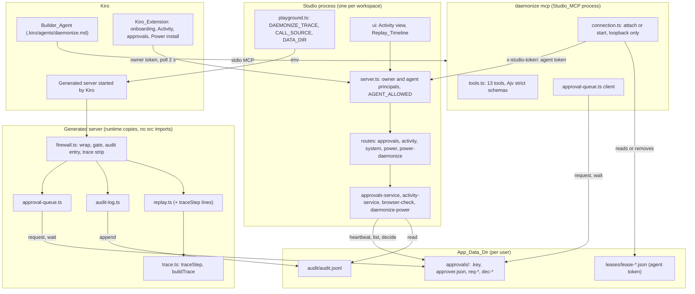
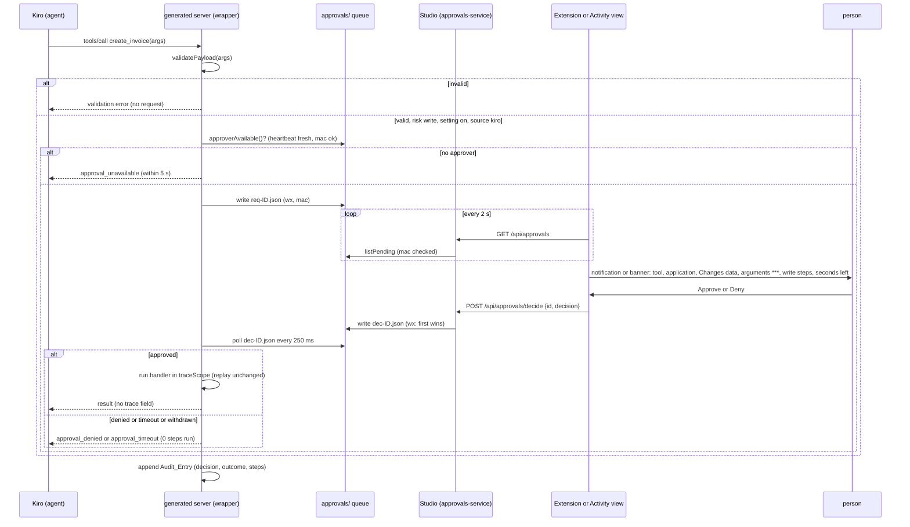
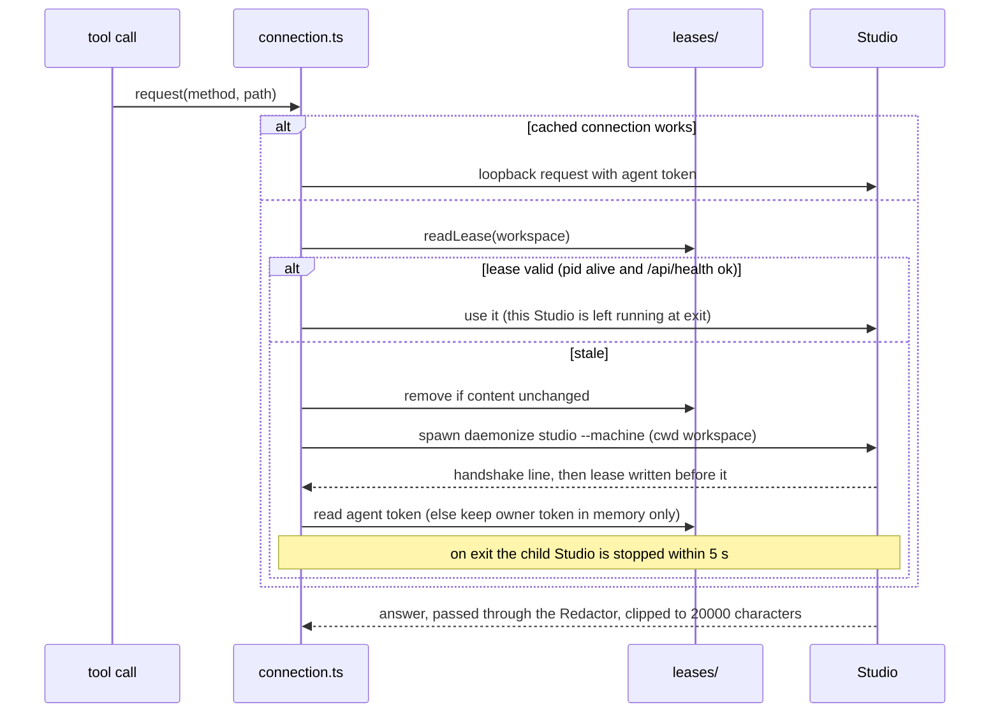

# Design Document: kiro-native-agent-and-firewall

## Overview

This design adds five things to Daemonize, in this order of dependency: a Studio_MCP that lets a Kiro agent drive the Studio (I1), an approval gate and an audit log inside every generated server (I2), a one-click install, a browser check, a walkthrough and a welcome state in the Kiro extension (D1), a replay timeline in the Studio (D2), and the `power/` folder that packages Daemonize as a Kiro Power (D4).

Everything is an addition. Old workflow files load unchanged. A generated server compiled before this change keeps working. A generated server compiled after it behaves as before while the Approval_Setting is off, no data folder is named and the trace is not requested. No existing CLI command, flag or default output changes (`daemonize --version` and `daemonize mcp` are new). Every new Studio route is a `RouteDef` with `remote: 'blocked'`, answers 409 in sample mode when it writes, and passes through `redactForStudio`. `src/replay/runtime/*` stays copyable and imports only `node:*` and its siblings. `kiro-extension/src/core/` imports neither `vscode` nor the root `src/`.

### Decisions in one place

| # | Question | Decision | Why, and what was rejected |
|---|---|---|---|
| 1 | Command and transport of the Studio_MCP | `daemonize mcp [--workspace <dir>]`, MCP over stdio, built with `@modelcontextprotocol/sdk` (already a dependency, `^1.32.2`). The server name is `daemonize-studio`. The command rebinds `console.log` to stderr, so stdout carries MCP messages only. | Rejected: `daemonize studio --mcp` (changes the meaning and the stdout contract of an existing command, which prints the handshake line); an HTTP transport (needs a port and a credential that Kiro would have to store). Kiro starts stdio servers itself, as it does for generated servers. |
| 2 | SDK API used for the tools | The low-level `Server` with `ListTools` and `CallTool` handlers, and one Ajv validator per tool built from the published `inputSchema` (`additionalProperties: false`). | `McpServer.tool(name, desc, zodShape, cb)` builds a zod object that strips unknown keys, so Requirement 6.7 (refuse a field the schema does not list, name it) could not be met. With explicit JSON Schema, the schema Kiro sees is the schema that is enforced. |
| 3 | How the Studio_MCP gets a Studio | Order: live Studio_Lease for the workspace, else `daemonize studio --machine` as a child. One Studio per workspace folder. On a network error the connection is dropped and the attach runs once more. The workspace is `--workspace`, else `DAEMONIZE_WORKSPACE`, else `process.cwd()`. The tools that write refuse to run when the workspace is the user's home folder or a drive root. | The extension and the agent then share one recording, one compile lock and one approval list. Starting always a child would give two Studios on one `daemonize.workflows.json`. The home-folder refusal exists because a Kiro server started from a global scope may have the home folder as its current directory (assumption: not verified for every Kiro version). |
| 4 | The Studio_Lease and its security | Keep it, hardened. File `<App_Data_Dir>/leases/lease-<16 hex of sha256(workspace)>.json`, folder `0700`, file `0600`, atomic write (temp, then rename), written only for a loopback listener and never in sample mode. A reader accepts the file only when the schema is complete, the origin is `http://127.0.0.1:N`, `http://localhost:N` or `http://[::1]:N`, the process is alive **and** `GET /api/health` with the lease token answers within 1.5 s (this defeats a recycled pid). A stale file is removed only when its content hash is still the one that was read. The Studio removes its own file at close and on `exit`. | The lease is the only way two processes find one Studio without a fixed port. Rejected: a fixed port (collisions, no per-workspace identity); a named pipe or socket file (not portable to Windows without extra code, and still needs a credential). Windows ignores the mode bits: the folder under `%LOCALAPPDATA%` is protected by the per-user ACL, which is the same protection the vault file has. |
| 5 | What the token in the lease can do | The lease holds an **agent token**, a second per-process secret, not the owner token. The owner token (printed in the handshake line, put in the URL, kept in the extension's memory) never touches a disk. The server maps each token to a principal and answers 403 to the agent principal on every route that is not in `AGENT_ALLOWED` (`src/studio/agent-access.ts`, default deny). Not allowed for the agent: `POST /api/approvals/decide`, `POST /api/secrets*`, `POST /api/power/approval`, `POST /api/power/remove`, `POST /api/power/daemonize/*`, `POST /api/sessions/forget`, `POST /api/power/auto-add`, `POST /api/pbt/run`, `GET /api/approvals`. | A file that an assistant may read must not be able to answer its own question (Requirement 14) or write a credential (Requirement 2.7). This enforces both in the server, not only in the Studio_MCP code. It is an addition to the requirements, and it stays inside Requirement 1.4 (the lease holds "the token" the Studio_MCP uses). Residual risk in the security analysis. |
| 6 | Approval channel | A file queue in `<App_Data_Dir>/approvals/`. A broker on a loopback port was rejected. | The generated server is started by Kiro, imports nothing from `src/`, and must not know a Studio address or token (Requirement 12.1). A broker needs a discovery file with a credential (the lease problem again), and it fails closed only when nobody listens, while a queue also survives a Studio restart. Files give atomic first-wins with `wx`, simple cleanup and a trivial test double. |
| 7 | Integrity of the queue | HMAC-SHA256 (base64url) over the canonical JSON of each record, with one 32-byte key per App_Data_Dir, file `approvals/.key` (mode `0600`, created with `wx`, so the first creator wins). The decision record carries the `mac` of the request it answers (`reqMac`), so a decision cannot be moved to another request. A record with a wrong mac is ignored. | "Per install" is read as per Daemonize data folder: a key in the Kiro entry would be a secret in a settings file (forbidden). The honest limit: a process of the same user that can read the key can sign. The key stops forged files from anything that cannot read it (another account, a restricted agent), and it detects corruption. |
| 8 | Is an approver there | `approvals/approver.json`, rewritten by the Studio every 2 s `{v, pid, at, mac}`. Available means: valid mac, `at` within 6 s, pid alive. The gate checks it before it writes a request (answer `approval_unavailable` in a few milliseconds), and while it waits it gives up with `unavailable` when the heartbeat has been stale for 10 s. | Meets the 5 s of Requirement 12.5 without a network call. The wait-time check is an addition so that a Studio that was closed during a question ends the call at once and not at the timeout. |
| 9 | Where the protocol code lives | `src/replay/runtime/approval-queue.ts`, one standalone module. The generated server (copied next to it), the Studio and the Studio_MCP all import it. | One implementation means one set of properties tests all three users. `src/` already imports from `replay/runtime` (`vault-format.ts`), so the direction is allowed. |
| 10 | Where the gate sits in the generated code | `firewall.ts` (runtime, host only). `mcp-server.ts` gets a few marked lines that wrap `server.tool`, so each handler becomes `firewall.wrap(name, handler)`. The wrapper validates the payload with the existing `validatePayload`, asks, runs the untouched handler inside a trace scope, builds the audit entry and removes `trace` from the result unless it was requested. The one function that Requirement 11.9 names is `approvalGate` in `mcp-server.ts`: a three line function that calls `firewall`. | Existing lines of `mcp-server.ts` stay identical, which keeps the regression snapshot difference to added lines only (decision 25). In Docker mode the wrapper runs on the host before `replayInDocker`, as Requirement 11.8 wants. |
| 11 | Timeouts against the Kiro limit | The default approval timeout stays 120 s (Requirement 12.2). The Power_Installer writes `DAEMONIZE_APPROVAL_TIMEOUT_MS=90000` in the entry of an install with the setting on. The Builder_Agent sets `requestTimeout: 300000` on its `mcpServers` entry. | The configuration reference gives 120000 ms as the default per-call request timeout of an MCP server of an agent. A question that ends at 120 s would leave no time to replay. 90 s leaves 30 s. Whether a settings entry honours `requestTimeout` is not verified, so it is set only where the reference documents it. |
| 12 | Audit log | One file `<App_Data_Dir>/audit/audit.jsonl`, one JSON object per line, `O_APPEND`, one write per entry. Writers take the directory lock `audit/audit.lock` (created with `mkdir`, stale after 10 s, 1 s of retries). Retention runs after every append, under the lock: read, `applyRetention`, write a temp file, rename. | One file is what the Studio reads. The lock is needed only because retention rewrites the file. If the lock cannot be had in 1 s the entry is dropped with one stderr line (Requirement 15.8: the call result is never changed by the log). |
| 13 | Audit redaction | `redactArguments` in `audit-log.ts`: a copy of the `isSensitiveKey` pattern of `playground.ts`, the declared secret argument names of the tool (embedded by the compiler), the secret values resolved for the call (environment and vault, through `vault-reader`), every text clipped to 200 characters. A test fails when the runtime pattern differs from `SENSITIVE_KEY` of `playground.ts`. | The runtime cannot import `src/`. A copy with a drift test is the same technique the Studio already uses for the vault format. |
| 14 | Reading the log | The Studio reads the file with the same `readAuditEntries` and passes the answer through `redactForStudio`. The extension reads only `GET /api/activity` and `GET /api/approvals`. | One reader, skips corrupt lines, newest first. |
| 15 | Trace collection | `traceStep(index)` (one added line in each step loop of `replay.ts`) marks the start of a step. `buildTrace` (pure, in `trace.ts`) turns the marks and the result of the call (`levels`, `skippedSteps`, `healedSteps`, `failure.stepIndex`, `error`, `drifted`) into the Trace. The container entry builds the trace itself and puts it in the result line. | The loops are templates with several variants (web, web with `--http`, terminal, with and without the call block). One added line per loop is the smallest change. Durations are the gaps between marks. A scope per call uses `AsyncLocalStorage`, so two concurrent calls never mix. |
| 16 | Trace opt-in and pictures | `DAEMONIZE_TRACE=1`, set by the Playground in the environment of its server and never written to an install entry. No reserved argument. Thumbnails: the existing `/api/assets/<name>` whitelist (secret steps excluded, PNG signature, 2 MiB) matched by step index through `/api/workflows`; the failure picture is the Playground `screenshotUrl`. | A reserved argument would be visible to Kiro and would change the schema (Requirement 22.8). No new picture is taken and no new route serves one. |
| 17 | Approval_Setting default and storage | Entry env `DAEMONIZE_ASK_BEFORE_CHANGES` is `true` or `false` (exactly `true` is on; absent or anything else is off). The install record gets `askBeforeChanges?: boolean` and `askBeforeChangesChosen?: true` (an explicit user choice). Default on when any tool has risk `write` or `delete`. A re-install keeps the choice when `askBeforeChangesChosen` is set. A record without the field reads as off. The toggle is `POST /api/power/approval`; it rewrites the entry and the record in one transaction. | Matches Requirements 10.1 to 10.8. The risk of a tool is `toolRiskOf(workflow)` exported by `src/studio/model.ts` and used by the Power_Installer and the compiler, so one function defines it. |
| 18 | Calls made by the Studio | `DAEMONIZE_CALL_SOURCE=studio` (set by the Playground) skips the question and writes `source: "studio"`, `decision: "auto"`. | The person at the Studio has the confirmation dialog (Requirement 18.4). The install entry builder never writes this variable, so a Kiro entry cannot carry it unless someone edits the settings file by hand. |
| 19 | One-click install | The extension runs `npm install --prefix <globalStorage>/cli.new-<rand> --no-audit --no-fund <PACKAGE>` with an argument array and no shell, checks the result (`--version`, `studio --help` lists `--machine`), then renames the folder to `cli`. `npm` is found as `node` plus `npm-cli.js` next to it (Windows: `<nodeDir>/node_modules/npm/bin/npm-cli.js`; elsewhere `<nodeDir>/../lib/node_modules/npm/bin/npm-cli.js`). The package name is the constant `DAEMONIZE_PACKAGE` in `kiro-extension/src/core/install-constants.ts`. | Newer Node refuses to spawn `npm.cmd` without a shell, and a shell is forbidden. A staging folder means no half installed folder is ever used. `node-pty` has no Linux prebuild and may need a toolchain: the failure text is shown redacted, and this is listed as a risk. |
| 20 | Browser check | A new read-only Studio route `GET /api/system/browser` that starts the same launch chain as a replay (`launchReplayBrowser`: Playwright Chromium, Chrome, Edge, or `DAEMONIZE_CHROMIUM_PATH`), closes the browser at once, caches the answer for 30 s, and answers a name, never a path. | The extension may not copy the launch logic (Requirement 19.10). The route is the "documented read-only" interface. It needs a running Studio, which the install step starts anyway. |
| 21 | Walkthrough and welcome | `contributes.walkthroughs` with six steps and `completionEvents` of `onCommand:...` plus `onContext:daemonize.cliFound` for step 1. `viewsWelcome` entries with mutually exclusive `when` clauses built from context keys the extension sets (`daemonize.cliFound`, `daemonize.browserMissing`, `daemonize.actionCount`, `daemonize.installCount`). The pure function `welcomeFor(state)` decides which entry applies and a manifest test evaluates the `when` clauses to prove the two agree. | Requirement 21.8 asks for a pure function of the state. `viewsWelcome` gives real buttons; a tree node would give a row. |
| 22 | Power layout and how it is installed | `power/` holds `POWER.md`, `plugin.json`, `mcp.json`, `steering/`, `skills/daemonize-builder/SKILL.md`, `agents/daemonize.md`, in the shape `KiroPowerGenerator` writes. The extension installs it through a Studio route family (`/api/power/daemonize/*`) that reuses the transaction of `power-fs.ts`, with files read from the package's own `power/` folder. The `power/mcp.json` command is `daemonize mcp`; the installed entry uses the command of the located program. | The extension cannot import the Power_Installer (Requirement 9.5 and 25.3 want the same transaction). The route is the only way to share it. One copy of the files keeps the extension templates and the Power equal (Requirement 9.8). |
| 23 | Agent fields and permissions | Fields used: `name`, `description`, `tools`, `includeMcpJson`, `mcpServers`, `resources`, `permissions`, `welcomeMessage`. No `model`, `hooks`, `prompt`, `includePowers`, `toolsSettings`. `tools: ["read", "@daemonize-studio"]`. Rules: deny `shell` (`**` and `*`) and `fs_write` (`**`); allow `fs_read`; deny `fs_read` of the three App_Data_Dir locations; `mcp` allow for the seven read and recording tools, `mcp` ask for the six others. | Every field is in the 2026 configuration reference. The extra `fs_read` denies keep the lease, the key and the vault out of an assistant's reach even though the agent has no tool that could use them (defence in depth). `shell` rules match command prefixes in the reference, so `**` may match nothing; both patterns are listed and `shell` is also absent from `tools`. |
| 24 | Opening the chat with the agent | No documented command opens the Kiro chat with a named agent. The IDE shows each agent as a slash command (the file name `daemonize` gives `/daemonize`). The extension probes `vscode.commands.getCommands()` for an entry of the list `CHAT_OPEN_COMMANDS` (data, empty of Kiro ids until one is documented; `workbench.action.chat.open` with `{ query: "/daemonize " }` as the one VS Code candidate) and otherwise shows the documented fallback of Requirement 9.3, with the sentence "You can also type /daemonize." | Inventing a command id would fail silently. Data-driven means a documented id is one line later. |
| 25 | Narrow regression differences | Every generated line added by this work ends with the marker `//#fw` (constant `FW_MARK`). `ALLOWED_DIFFERENCES` gets one named entry per change; each entry removes only the marked lines that match its own pattern, and the test fails when a marked line is left over. Lines are only added, never edited, in `mcp-server.ts` and `replay.ts`. | A removal rule can only hide what it names. An edited line would need a text replacement and would hide more. |
| 26 | What is audited | Only calls to a generated tool (Requirement 15). Actions of the Studio_MCP (install, delete, test) are approved through the same queue but have no Audit_Entry. | Requirement 15 defines the entry for a Generated_Tool call. A Studio_MCP `test_action` then produces one entry with `source: "studio"` and `decision: "auto"` (Requirement 15.11), even though a person approved it in the queue. Open point 6. |
| 27 | Delivery | One serial seam group (G0), then groups with disjoint files, then eight commits (CG-0 to CG-7). | See "Implementation groups". |

### Research summary

- The code was read before designing. Facts that shape the design:
  - The Studio is one `node:http` server. `authorized()` compares one token, `dispatchRoute` applies `remote`, the sample refusal and the body checks, and every JSON answer passes `redactForStudio`. `studio --machine` prints `{ origin, token, pid }` and the process watches its parent; the extension parses it with `parseHandshakeLine`.
  - `PlaygroundSession` builds the child environment from an allow list that already admits every `DAEMONIZE_*` name, so `DAEMONIZE_CALL_SOURCE`, `DAEMONIZE_TRACE` and `DAEMONIZE_DATA_DIR` reach the server once the session sets them. `summarizeResult` copies named fields only, so `trace` and `skippedSteps` must be added to it.
  - A generated `mcp-server.ts` registers `server.tool(name, description, zodShape, handler)` with four arguments, validates with `validatePayload`, calls `runReplay` and answers `JSON.stringify(withMode(result))`. `replay.ts` and `docker-replay.ts` are built from line arrays, with a `patchLines` mechanism (insert after a line, or replace) already used for the call block. `compiler.ts` copies each runtime file by name and lists the container files in `generateSandboxFiles().copy`.
  - The regression snapshot compares the full text of `mcp-server.ts`, `replay.ts` and `docker-replay.ts` for three option sets, the list of files of the output folder, and `sandbox/image.json`. `ALLOWED_DIFFERENCES` today edits only the JSON part (`name.json`), not the text files.
  - `buildServerEntry` writes `type`, `command`, `args` and an env of `DAEMONIZE_MODE`, `DAEMONIZE_DATA_DIR`, `DAEMONIZE_APP_KEY` and `${NAME}` placeholders. `InstallRecord` is validated field by field, so an optional field is safe for old files.
  - The risk of a tool is `risk.highest` of `buildWorkflowView`, which counts every step with a risk other than `read`, so a tool whose only write is a login has risk `write` (open point 8).
  - `plain-language.ts` bans the whole words `record`, `compile`, `MCP`, `JSON`, `token`, `CLI` and the phrases `storage state` and `environment variable`. "Recording" passes (no word boundary after `record`); "Record" does not.
  - The extension locator, the process manager and the parsers are pure and injected, so every new core module follows the same ports and fakes.
- Kiro custom agents ([configuration reference](https://kiro.dev/docs/custom-agents/configuration-reference/)): a Markdown agent file has front matter for the configuration and a body that is the system prompt. The fields used here are `name`, `description`, `tools` (selectors `read`, `@server`, `@server/tool`), `includeMcpJson`, `mcpServers` (with `command`, `args`, `env` with `${VAR}`, `timeout`, `requestTimeout`), `resources` (`file://`, `skill://`), `permissions.rules` (`capability`, `match`, `exclude`, `effect` of `allow`, `ask` or `deny`; a deny in any scope wins; the `mcp` capability matches `server/tool`) and `welcomeMessage`. The default `requestTimeout` is 120000 ms.
- Opening an agent from an extension ([slash commands](https://kiro.dev/docs/ide/chat/slash-commands/), [issue 7273](https://github.com/kirodotdev/Kiro/issues/7273)): the IDE lists each file of `.kiro/agents/` as a slash command named after the file; the issue asks for custom agents as the main chat agent. No documented extension command opens the chat with an agent, so decision 24 uses the documented fallback of Requirement 9.3. Content was rephrased for compliance with licensing restrictions.
- Power format: the existing generator writes `plugin.json` (`$schema`, `name`, `version`, `description`, `author`, `keywords`), `mcp.json` (`$schema`, `mcpServers.<name>` of `{ type, command, args, env }`), `POWER.md` (front matter `name`, `displayName`, `description`, `keywords`) and `skills/<name>/SKILL.md`. `power/` copies exactly that layout.

### Behavior changes named by the requirements

These differ from today for an old workflow file or an old install, and the regression test names each one:

1. Every output folder holds six more runtime files: `approval-queue.ts`, `audit-log.ts`, `firewall.ts`, `trace.ts` and their `.js`. The container image list gains `trace.js` only.
2. `mcp-server.ts` gains marked lines: the imports, the embedded `FIREWALL` table (risk, write steps, secret names, step labels per tool), the wrapper of `server.tool`, and the one function `approvalGate`.
3. `replay.ts` gains marked lines: the `trace.js` import, one `traceStep(index)` in each step loop, and in the container entry a call that puts the trace in the result line.
4. The result of a call has `trace` only when `DAEMONIZE_TRACE` is `1`. A refused call has the new errors `approval_denied`, `approval_timeout`, `approval_unavailable`.
5. `POST /api/power/preview` and `install` answer `askBeforeChanges` and `askBeforeChangesTools`. `POST /api/playground/call` answers `trace` and, when present, `skippedSteps`.
6. A Kiro install entry written after this change has two more env keys: `DAEMONIZE_ASK_BEFORE_CHANGES` and, when it is `true`, `DAEMONIZE_APPROVAL_TIMEOUT_MS`.
7. The CLI answers `--version`.

### Requirement conflicts and open points

| # | Where | Problem | Resolution in this design |
|---|---|---|---|
| RC-1 | 20.2, 20.3, 21.1 and 27.2 | The texts "Record your first action", "Record the first thing you do..." and the button "Record an action" contain the whole word `record`, which `plain-language.test.ts` bans in extension text. | The design uses "Create your first action", "Show Daemonize the first thing you do in your software." and the button "New action". Amend 20.2 and 21.1 to these words, or add the word to the test exemptions. |
| RC-2 | 11.9 | "The Approval_Gate SHALL be one function in the generated mcp-server.ts." The logic needs a queue client, a clock and a file API. | `approvalGate` is the one function in `mcp-server.ts`; it calls `requestApproval` of the copied runtime module `approval-queue.js`. The test checks both: one function in the file, no import from `src/`. |
| RC-3 | 4.2 and 12.2 | 120 s of waiting (a compile, an approval) equals the default per-call limit of an agent MCP server, 120000 ms. | Decision 11: 90 s in new installs with the setting on, `requestTimeout: 300000` in the Builder_Agent entry. The Studio_MCP keeps 120 s for `compile`. The skill tells the agent to call again after a client timeout. |
| RC-4 | 22.4 and the status list | `blocked` is in the list of Step_Status, but 22.4 gives the failed write step the status `failed`, and 23.7 shows approval refusals as "Not run". No rule produces `blocked`. | `blocked` stays in the type and is accepted by the UI; `buildTrace` never produces it. The row text "Blocked: not run again" is chosen from the note of 22.4. The sample trace of 23.13 uses `failed` plus that note. |
| RC-5 | 9.2, 9.3 | No documented command opens the chat with a named agent. | Decision 24. |
| RC-6 | 30.9 and the constraint "each requirement is its own commit" | The generator, the playground, the extension manifest and the Kiro view serve several features. A commit per requirement cannot separate them without splitting hunks of one file. | Commits are per group (CG-0 to CG-7, see "Implementation groups"). Each message names its requirements. |
| RC-7 | 15.3 and 11.11 | A call cancelled during the question is neither approved, denied nor timed out. | The gate withdraws the request (internal decision `withdrawn`), and the Audit_Entry says `decision: "denied"`, `outcome: "cancelled"`. The outcome is free text in 15.4, so this fits. |
| RC-8 | 15.11 | A `test_action` of the Studio_MCP is approved by a person in the queue, but the generated server writes `decision: "auto"`. | Accepted and recorded in decision 26. The approval itself is visible in the Activity_Summary while pending. |
| RC-9 | 1.4 and 6.1 | A token on disk. | Decision 5: an agent token with a closed route list. |
| RC-10 | 7.4 | `match` of `shell` rules is a command prefix in the reference, so `**` may not match every command. | Both `**` and `*` are listed, and `shell` is not in `tools`. |
| RC-11 | 19.6 | `daemonize --version` does not exist. | G-A adds it (an addition to the CLI). |
| RC-12 | 24.4 | `power/mcp.json` cannot hold the absolute path of the program of the user. | The Power uses `command: "daemonize", args: ["mcp"]`; the extension and the Studio route write the command of the located program. The README says the program must be on the PATH for the Powers panel. |
| OP-6 | 15 | The Studio_MCP actions (`install_to_kiro`, `delete_action`) have no Audit_Entry. | Not done. A later change can add `source: "studio-mcp"`. |
| OP-7 | 12.5 | Nobody may be looking at the approval. | The question times out after 90 s with `approval_timeout`, and the message says to open the Daemonize sidebar. |
| OP-8 | 10.1 | A tool whose only write is a login (`writeSummary: "login-only"`) has risk `write` and asks. | Kept: it follows `risk.highest`. A later change can exempt `login-only`. |
| OP-9 | 19.3 | `node-pty` may need a compiler on Linux, so the one-click install can fail there. | The redacted npm tail goes to the log. Making `node-pty` an optional dependency of the package is out of scope. |

## Architecture



### A write call from Kiro with "Ask before changes" on



### The Studio_MCP attaches to a Studio



### Security analysis

| Question | Answer |
|---|---|
| Who can approve | A person using the Studio page or the extension, both authenticated with the owner token (cookie plus `x-studio-request` plus matching Origin for a POST, as for every other POST). The agent principal is refused on `POST /api/approvals/decide` and `GET /api/approvals`. The generated server has no tool or argument that touches the queue, and ignores every reserved argument except `_timeoutMs`. |
| What an assistant with only the Builder_Agent can do | Call the thirteen Studio_MCP tools. The tools run with the agent token, so even a modified Studio_MCP cannot decide, store a credential, change the setting or remove an install. The agent has no `shell`, no `fs_write`, no `web`, and `fs_read` is denied for the data folder. |
| What an assistant with `shell` (the default Kiro agent) can do | Read the lease (`0600`, same user), call the routes of the agent principal directly, bypass the Studio_MCP's own `confirm` and approval checks, and read the queue key, so it could also sign a decision file. This is the same power it already has over the vault file, the workflow file and the settings file. The design does not claim to stop a process that runs as the user with a shell. It does stop: a generated server called through Kiro with the setting on (no step runs without a signed decision), a restricted agent, another account, and a corrupt or half written file. |
| Fail closed | No heartbeat, an unusable data folder, a wrong mac, a queue directory with 50 pending files, a clock error, a write error or an exception inside the gate all end as `approval_unavailable` and no step runs. |
| Secrets | A request, a decision, an audit line, a lease, a trace and every answer hold names and `***`, never a value. The queue key is the one secret on disk, and it is not a credential of the user's applications. |
| Remote listener | The lease is never written when the Studio listens on a non loopback address. The new routes are `remote: 'blocked'`. |

## Components and Interfaces

All signatures below are final for the seam group G0, which creates each file with these exports (functions that belong to another group throw `Error('not implemented: <group>')`). A later group may add exports but may not change one.

### 1. Runtime modules (`src/replay/runtime/`, group G-B)

Each file imports only `node:*` and its siblings, and is copied next to `mcp-server.js`. `trace.ts` is also copied into the container image.

```ts
// ---- trace.ts -------------------------------------------------------------
export type TraceLevel = 'http' | 'accessibility' | 'vision' | 'terminal' | 'skipped' | 'not_run';
export type TraceStatus = 'ok' | 'failed' | 'skipped' | 'not_run' | 'blocked' | 'drifted';
export interface TraceStep { index: number; label: string; level: TraceLevel; durationMs: number; status: TraceStatus; note?: string }
export const TRACE_MAX_STEPS = 200;
export const TRACE_LABEL_MAX = 120;
export const NOT_REPEATED_NOTE = 'Not repeated: this step changes data';
export interface TraceMarks { startedAt: number; marks: Array<{ index: number; at: number }> }
/** No-op when no scope is active, so a replay used without the wrapper behaves as before. */
export function traceStep(index: number): void;
/** Runs `fn` in a scope (AsyncLocalStorage) and returns the marks it collected. */
export function traceScope<T>(fn: () => Promise<T>): Promise<{ value: T; marks: TraceMarks }>;
/** Container entry: the process serves one call, so the scope may last until exit. */
export function enterTraceScope(): void;
export function takeMarks(): TraceMarks;
export interface BuildTraceInput {
  steps: ReadonlyArray<{ label?: string; actionType: string; risk?: 'read' | 'write' | 'delete' }>;
  marks: TraceMarks;
  /** The object the call returned (before `trace` is added). */
  result: Record<string, unknown>;
  targetType: 'web' | 'tui';
  /** The call ran no replay step at all (a refusal, a validation error). Every step is `not_run`. */
  refused?: boolean;
  /** Secret values removed from labels and notes. */
  secrets?: readonly string[];
  endedAt?: number;
}
export function buildTrace(input: BuildTraceInput): { steps: TraceStep[]; truncated: boolean };
/** A trace read from an untrusted object (the container result): valid steps only, at most 200. */
export function sanitizeTrace(value: unknown): TraceStep[] | undefined;
```

```ts
// ---- approval-queue.ts ----------------------------------------------------
export type ApprovalRisk = 'write' | 'delete';
export type ApprovalSource = 'kiro' | 'studio-mcp';
export type ApprovalKind = 'tool-call' | 'install' | 'delete-action' | 'test-action';
export type ApprovalDecisionValue = 'approved' | 'denied' | 'timeout' | 'withdrawn';
export interface WriteStepMeta { index: number; label: string; risk: ApprovalRisk }
export interface ApprovalRequestBody {
  v: 1;
  id: string;                 // 32 lower-case hex
  createdAt: string;          // ISO 8601 UTC
  timeoutMs: number;          // 5000 to 600000
  pid: number;                // the process that waits
  source: ApprovalSource;
  kind: ApprovalKind;
  tool: string;
  application: string;
  risk: ApprovalRisk;
  summary?: string;           // one plain sentence for kinds other than tool-call
  arguments: unknown;         // Redacted_Arguments
  writeSteps: WriteStepMeta[];
}
export type ApprovalRequestRecord = ApprovalRequestBody & { mac: string };
export interface ApprovalDecisionBody { v: 1; id: string; decision: ApprovalDecisionValue; decidedAt: string; by: 'studio' | 'requester'; reqMac: string }
export type ApprovalDecisionRecord = ApprovalDecisionBody & { mac: string };

export const APPROVAL_DEFAULT_TIMEOUT_MS = 120_000;
export const APPROVAL_MIN_TIMEOUT_MS = 5_000;
export const APPROVAL_MAX_TIMEOUT_MS = 600_000;
export const APPROVAL_MAX_PENDING = 50;
export const HEARTBEAT_EVERY_MS = 2_000;
export const HEARTBEAT_FRESH_MS = 6_000;
/** A whole number of milliseconds from 5000 to 600000 as text, else 120000. */
export function parseApprovalTimeout(value: string | undefined): number;
export function canonicalJson(value: unknown): string;          // sorted keys, no spaces
export function sign<T extends object>(key: Buffer, body: T): T & { mac: string };
export function verify(key: Buffer, record: unknown): boolean;  // constant time
export function encodeRecord(record: ApprovalRequestRecord | ApprovalDecisionRecord): string;
export function decodeRequest(text: string): ApprovalRequestRecord | undefined;   // shape only, never throws
export function decodeDecision(text: string): ApprovalDecisionRecord | undefined;

export interface ApprovalStore { dir: string; key: Buffer }
/** `<dataDir>/approvals`, created `0700`; the key is created with `wx` (0600). On POSIX the folder must be owned by the user and not group or world accessible. undefined = unusable. */
export function openApprovalStore(dataDir: string): Promise<ApprovalStore | undefined>;
export function writeHeartbeat(store: ApprovalStore, now?: number): Promise<void>;
export function removeHeartbeat(store: ApprovalStore): Promise<void>;
export function approverAvailable(store: ApprovalStore, now?: number): Promise<boolean>;
export function listPending(store: ApprovalStore, now?: number): Promise<ApprovalRequestRecord[]>;
/** `exists` when a decision file is already there (first wins). */
export function writeDecision(store: ApprovalStore, req: ApprovalRequestRecord, decision: ApprovalDecisionValue, by: 'studio' | 'requester', now?: number): Promise<'written' | 'exists'>;
/** Removes decided, expired and orphaned files older than the retention (10 min), and temp files older than 1 min. */
export function sweep(store: ApprovalStore, now?: number): Promise<void>;

export interface RequestApprovalOptions {
  dataDir: string | undefined;
  source: ApprovalSource;
  kind: ApprovalKind;
  tool: string;
  application: string;
  risk: ApprovalRisk;
  summary?: string;
  arguments: unknown;        // already redacted by the caller
  writeSteps: WriteStepMeta[];
  timeoutMs: number;
  signal?: AbortSignal;
  pollMs?: number;           // default 250
  now?: () => number;        // test seams
  sleep?: (ms: number) => Promise<void>;
}
export type ApprovalOutcome = { decision: 'approved' | 'denied' | 'timeout' | 'withdrawn' | 'unavailable'; id?: string };
/** Never throws. Anything unexpected is `unavailable`. Writes `timeout` or `withdrawn` itself with `wx`; a decision that won the race is honoured. */
export function requestApproval(options: RequestApprovalOptions): Promise<ApprovalOutcome>;
```

```ts
// ---- audit-log.ts ---------------------------------------------------------
export type AuditDecision = 'auto' | 'approved' | 'denied' | 'timeout' | 'unavailable';
export type AuditSource = 'kiro' | 'studio';
export interface AuditEntry {
  v: 1;
  at: string;                          // ISO 8601 UTC
  tool: string;
  application: string;
  risk: 'read' | 'write' | 'delete';
  source: AuditSource;
  arguments: unknown;                  // Redacted_Arguments
  decision: AuditDecision;
  outcome: string;                     // 'success' or an error code or clipped text (200)
  durationMs: number;
  steps?: TraceStep[];                 // compact, no pictures, no typed values
  stepsTruncated?: true;
}
export const AUDIT_MAX_ENTRIES = 1000;
export const AUDIT_MAX_BYTES = 1_048_576;
export const AUDIT_MAX_LINE_BYTES = 16_384;
export const AUDIT_TEXT_MAX = 200;
export const SENSITIVE_KEY: RegExp;    // equal to SENSITIVE_KEY of src/studio/playground.ts (a test checks the source)
export function isSensitiveKey(name: string): boolean;
export function redactArguments(args: unknown, declared: readonly string[], secretValues: readonly string[]): unknown;
export function scrubText(text: string, secretValues: readonly string[], max?: number): string;
export function formatAuditLine(entry: AuditEntry): string;                   // one line, <= 16384 bytes, steps trimmed to fit
export function parseAuditLine(line: string): AuditEntry | undefined;         // strict shape, undefined when corrupt
/** Oldest whole lines removed until both limits hold; the rest unchanged and in order. */
export function applyRetention(lines: readonly string[], limits?: { maxEntries: number; maxBytes: number }): string[];
export function appendAudit(dataDir: string, entry: AuditEntry, now?: () => number): Promise<'ok' | 'dropped'>;
export function readAuditEntries(dataDir: string, options?: { limit?: number }): Promise<AuditEntry[]>;   // newest first, skips corrupt lines
```

```ts
// ---- firewall.ts (host only) ---------------------------------------------
export interface FirewallToolMeta {
  risk: 'read' | 'write' | 'delete';
  writeSteps: WriteStepMeta[];
  /** Variable names that hold a typed secret. */
  sensitiveArgs: string[];
  /** Names of the DAEMONIZE_SECRET_* variables the tool needs (the values are scrubbed from audit and trace). */
  secretVariables: string[];
  steps: Array<{ label?: string; actionType: string; risk?: 'read' | 'write' | 'delete' }>;
}
export interface FirewallConfig { application: string; targetType: 'web' | 'tui'; tools: Record<string, FirewallToolMeta> }
export type ToolHandler = (args: Record<string, unknown>, extra?: { signal?: AbortSignal }) => Promise<{ content: Array<{ type: string; text: string }>; isError?: boolean }>;
export interface Firewall {
  wrap(tool: string, handler: ToolHandler, validate: (payload: unknown) => unknown): ToolHandler;
}
/** `env` default process.env. `decorate` is `withMode` of the generated server. */
export function createFirewall(config: FirewallConfig, decorate: (result: object) => object, env?: NodeJS.ProcessEnv): Firewall;
export const APPROVAL_MESSAGES: { approval_denied: string; approval_timeout: string; approval_unavailable: string };
```

**What `wrap` does, in order** (the whole behavior of the Approval_Gate, Audit_Log and trace in a Generated_Server):

1. Split `_timeoutMs` from the payload. Read once per call: `askOn = env.DAEMONIZE_ASK_BEFORE_CHANGES === 'true'`, `source = env.DAEMONIZE_CALL_SOURCE === 'studio' ? 'studio' : 'kiro'`, `traceOn = env.DAEMONIZE_TRACE === '1'`, `dataDir = env.DAEMONIZE_DATA_DIR`, `timeoutMs = parseApprovalTimeout(env.DAEMONIZE_APPROVAL_TIMEOUT_MS)`.
2. `validate(payload)`. When it returns errors, call the inner handler (it answers the existing `validation` error), write the entry with `decision: 'auto'`, `outcome: 'validation'`, and stop. No request is created (Requirement 11.6).
3. The call needs a question when `askOn`, `risk !== 'read'`, `source === 'kiro'`. Then `redactArguments` builds the arguments, and `requestApproval({ source: 'kiro', kind: 'tool-call', ... , signal: extra.signal })` waits.
4. `approved`: run `traceScope(() => handler(args, extra))` with the arguments unchanged. `denied`, `timeout`, `withdrawn`, `unavailable`: no step, no request to the application; the result is `decorate({ success: false, error: 'approval_denied' | 'approval_timeout' | 'approval_unavailable', message })` with `isError: true`. A cancelled call (`withdrawn`) answers `approval_denied`.
5. Parse the first text block of the result as JSON. Build the trace with `buildTrace` (the container's `result.trace`, when valid, wins). Remove `trace` from the result unless `traceOn`; with `traceOn` it is added last, with `traceTruncated: true` when cut. If the text is not JSON it is returned untouched.
6. When `dataDir` is set, append the Audit_Entry (`appendAudit`); a failure writes one stderr line without arguments and changes nothing in the answer. An error inside step 5 or 6 is caught: the original answer is returned.
7. Any exception in steps 1 to 4 before a decision is `unavailable` (fail closed), never a run.

Messages (`APPROVAL_MESSAGES`): `approval_denied` "You said no, so nothing was changed."; `approval_timeout` "Nobody answered in time, so nothing was changed."; `approval_unavailable` "Daemonize could not ask you. Open the Daemonize sidebar in Kiro, then try again."

### 2. Generated code (`src/compiler/`, group G-C)

New file `firewall-markers.ts` (G0): `export const FW_MARK = '//#fw'`, the `FirewallMeta` embedded type, and the patterns used by the regression test. `mcp-generator.ts` adds, through the existing `patchLines`, only lines that end with `FW_MARK`:

```ts
// mcp-server.ts (added, after VALIDATION_RUNTIME and withMode)
import { createFirewall } from "./firewall.js"; //#fw
const FIREWALL = {"application":"...","targetType":"web","tools":{"<tool>":{"risk":"write","writeSteps":[...],"sensitiveArgs":[...],"secretVariables":[...],"steps":[{"label":"...","actionType":"click","risk":"write"}]}}}; //#fw
const firewall = createFirewall(FIREWALL as any, withMode); //#fw
async function approvalGate(...a: Parameters<typeof firewall.wrap>) { return firewall.wrap(...a); } //#fw
const registerTool = (server as any).tool.bind(server); //#fw
(server as any).tool = (...a: any[]) => registerTool(...a.slice(0, -1), approvalGate(a[0], a[a.length - 1], (payload: unknown) => validatePayload(a[0], payload))); //#fw   (the wrapper passes the payload without `_timeoutMs`)

// replay.ts (added)
import { traceStep, enterTraceScope, buildTrace, takeMarks } from "./trace.js"; //#fw
traceStep(index); //#fw           first line of each step loop body (web strict callback, web --http loop, terminal loop)
enterTraceScope(); //#fw          container entry, before replay()
Object.assign(result, { trace: buildTrace({ steps: request.steps, marks: takeMarks(), result: result as any, targetType: "web" }).steps }); //#fw   container entry, after replay() ("tui" for a terminal target)
```

- The embedded table is built by `buildFirewallMeta(set, toolNames)`: `risk` is `toolRiskOf(workflow)` and `writeSteps` is `writeStepsOf(workflow).writeSteps` from `src/studio/model.ts` (one definition). Tools are sorted by name so the text does not depend on the order of the workflows (Requirement 28.8).
- `compiler.ts` copies the four runtime files for every target, writes the `.js` next to each, and adds `trace.js` to the `copy` list of `sandbox/image.json`.
- `kiro-power-generator.ts` adds one short section to the generated `SKILL.md`: what `approval_denied`, `approval_timeout` and `approval_unavailable` mean and that the agent must tell the user and must not retry in a loop. The tool descriptions and the OpenAPI document are not touched (Requirement 11.12).
- The call-block variants (`usesWorkflowCall`) are derived from the same arrays, so the marked lines are inherited. A step skipped by `skippedSet` is marked first and skipped after, so `buildTrace` reads it from `skippedSteps`.

### 3. The Studio_MCP (`src/studio/mcp/`, `src/cli/commands/mcp.ts`, `src/studio/lease.ts`, group G-A)

```ts
export interface StudioMcpOptions { workspace: string; env?: NodeJS.ProcessEnv; spawn?: SpawnFn; fetchImpl?: typeof fetch; now?: () => number }
export function runMcpCommand(options: { workspace?: string }): Promise<void>;        // cli/commands/mcp.ts
export function createStudioMcpServer(deps: StudioMcpDeps): Server;                  // mcp/server.ts

// lease.ts
export interface StudioLease { v: 1; origin: string; agentToken: string; pid: number; workspace: string; startedAt: string }
export function workspaceKey(workspace: string): string;                              // realpath, case folded on win32 and darwin
export function leasePath(dataDir: string, workspace: string): string;
export function writeLease(dataDir: string, lease: StudioLease): Promise<{ remove(): Promise<void> }>;
export function readLease(dataDir: string, workspace: string, deps?: { isAlive(pid: number): boolean; health(l: StudioLease): Promise<boolean> }): Promise<StudioLease | undefined>;
```

`readLease` never throws; a corrupt, truncated, wrong-version or non-loopback file gives `undefined`. `studio()` in `cli/commands/studio.ts` writes the lease right after `startStudio` (before the handshake line is printed) for a loopback, non-sample Studio, and removes it when the handle closes and on `exit`.

**Tools.** Every input schema has `additionalProperties: false`. An error is `{ isError: true, content: [{ type: 'text', text: JSON.stringify({ error, message, field?, ... }) }] }`. A success is the same shape with the result object and no `isError`. Error codes: `studio_unavailable`, `studio_error`, `timeout`, `invalid_argument`, `unknown_field`, `unknown_action`, `confirmation_required`, `approval_denied`, `approval_timeout`, `approval_unavailable`, `missing_secret`, `sample_mode`.

| Tool | Input | Result | Studio call |
|---|---|---|---|
| `list_actions` | `{}` | `{ actions: ActionSummary[] }` | `GET /api/workflows`, `GET /api/overview` |
| `get_action` | `{ id: string (1 to 200) }` | `ActionSummary & { steps: string[]; writeSteps: Array<{ index; label; risk; kind }> }`; unknown id: `{ error: 'unknown_action', message: 'No action has this id.', knownIds: string[] }` | `GET /api/workflows` |
| `list_credentials` | `{}` | `{ credentials: Array<{ name; kind: 'password' \| 'totp' \| 'token'; configured: boolean }>; instruction?: string }` | `GET /api/secrets` |
| `get_activity` | `{ limit?: integer 1 to 100 }` (default 20) | `{ entries: AuditEntry[] }` newest first | `GET /api/activity?limit=N` |
| `start_recording` | `{ name: string; url: string; reuseSession?: boolean }` | `{ state: 'recording'; message }` | `POST /api/record/start` |
| `get_recording_status` | `{}` | `{ state; message; steps: number; labels: string[]; variables?: Array<{ name; type; optional }> }` | `GET /api/record/status` |
| `finish_recording` | `{}` | `{ state: 'saving'; message }` | `POST /api/record/stop` |
| `compile` | `{ http?: 'off' \| 'auto'; healSupport?: boolean }` | `{ state: 'done' \| 'running' \| 'error'; message }`, polls every 500 ms up to 120 s | `POST /api/compile`, `GET /api/compile/status` |
| `test_action` | `{ tool: string; arguments?: object; mode?: 'strict' \| 'heal'; timeoutMs?: integer 1 to 600000; confirm?: boolean }` | `{ success; drifted?; driftChecked?; healed?; mode?; levels?; skippedSteps?; text?; data?; error?; message? }` | `GET /api/playground`, `POST /api/playground/call` |
| `preview_kiro_install` | `{ scope: 'global' \| 'project' }` | `{ application; scope; tools: Array<{ name; risk }>; missingCredentials: string[]; askBeforeChanges: boolean; confirmationId; message }` | `POST /api/power/preview` (the workspace is added by the server of the MCP, never by the agent) |
| `install_to_kiro` | `{ scope: 'global' \| 'project'; confirmationId: string }` | `{ installed: true; scope; missingCredentials: string[]; message }` | `POST /api/power/install` after approval |
| `update_action` | `{ id: string; confirm?: boolean; label?: string; description?: string; variables?: Array<{ name; newName?; type?: 'string' \| 'number' \| 'boolean'; optional?: boolean; whenOmitted?: 'useRecorded' \| 'skip'; description? }> }` | `ActionSummary` | `POST /api/workflows/update` (without `confirm`) |
| `delete_action` | `{ id: string; confirm?: boolean }` | `{ deleted: true; remaining: number }` | `POST /api/workflows/delete` after approval |

`ActionSummary` is `{ id; tool: string | null; label; description?; risk: 'read' \| 'write' \| 'delete'; variables: Array<{ name; type; optional }>; compiled: boolean }`. `tool` is the compiled tool name, `null` before the first compile.

Behavior shared by all tools: unknown field, wrong type or out of range is an `unknown_field` or `invalid_argument` error naming the field, before any request. The answer passes `redactForStudio` and is cut at 20000 characters (`{ truncated: true, text }`). A request that has no answer within its own timeout plus 5 s ends as `timeout`. A Studio answer of 400 to 599 becomes `studio_error` with its `error` text, redacted. `test_action` for risk `write` or `delete`: no `confirm: true` gives `confirmation_required` with `{ risk, writeSteps, message }`; with it the tool creates an approval (`source: 'studio-mcp'`, `kind: 'test-action'`) with the redacted arguments, waits, and sends `POST /api/playground/call` with `confirm: true` only after `approved`. `install_to_kiro` (`kind: 'install'`, summary "Add <application> to Kiro for <all projects | this project>") and `delete_action` (`kind: 'delete-action'`, summary "Delete the action <label>") follow the same rule. `delete_action` and `update_action` without `confirm: true` answer `confirmation_required`. `start_recording` and `finish_recording` answer `sample_mode` when the Studio does. A Studio_MCP whose workspace is the home folder or a drive root refuses the tools that write with `invalid_argument` and the sentence "Open the folder of your project in Kiro first."

### 4. Studio server side (`src/studio/`)

**Principals (G0, `server.ts`, `agent-access.ts`).** `StudioOptions.agentToken?: string` (default random, like `token`) and `StudioHandle.agentToken`. `authorized(req)` becomes `principalOf(req): 'owner' | 'agent' | undefined`: the header `x-studio-token` equal to `token` is `owner`, equal to `agentToken` is `agent` (only through the header, never through the cookie), the cookie rules for `owner` are unchanged. After authentication, an `agent` request whose method and path are not in `AGENT_ALLOWED` gets `403 { error: 'This action needs you, not an assistant.' }` before any handler runs.

```ts
// agent-access.ts
export interface AgentRule { method: 'GET' | 'POST'; path: string | RegExp }
export const AGENT_ALLOWED: ReadonlyArray<AgentRule> = [
  { method: 'GET', path: '/api/health' }, { method: 'GET', path: '/api/overview' }, { method: 'GET', path: '/api/workflows' },
  { method: 'GET', path: '/api/secrets' }, { method: 'GET', path: '/api/activity' },
  { method: 'GET', path: '/api/record/status' }, { method: 'POST', path: '/api/record/start' }, { method: 'POST', path: '/api/record/stop' },
  { method: 'POST', path: '/api/compile' }, { method: 'GET', path: '/api/compile/status' },
  { method: 'POST', path: '/api/workflows/update' }, { method: 'POST', path: '/api/workflows/delete' },
  { method: 'GET', path: '/api/playground' }, { method: 'POST', path: '/api/playground/call' },
  { method: 'GET', path: '/api/power/info' }, { method: 'POST', path: '/api/power/preview' }, { method: 'POST', path: '/api/power/install' },
];
export function agentMayCall(method: string, pathname: string): boolean;
```

**Services (G0 declares, owners fill).**

```ts
// contracts.ts additions
export interface ApprovalView {
  id: string; tool: string; application: string; risk: 'write' | 'delete'; riskText: 'Changes data' | 'Deletes data';
  source: 'kiro' | 'studio-mcp'; kind: 'tool-call' | 'install' | 'delete-action' | 'test-action'; summary?: string;
  arguments: unknown; writeSteps: Array<{ index: number; label: string; risk: 'write' | 'delete' }>;
  createdAt: string; expiresAt: string; secondsLeft: number;
}
export type DecideOutcome = { ok: true; decision: 'approved' | 'denied' } | { ok: false; reason: 'ended' | 'invalid' };
export interface ApprovalsService {
  /** Creates the folder and the key, writes the heartbeat, starts the 2 s timer (unref), starts the sweep. No-op when the data folder is unusable. */
  start(): Promise<void>;
  list(): Promise<ApprovalView[]>;
  decide(id: string, decision: 'approved' | 'denied'): Promise<DecideOutcome>;
  /** Stops the timers and removes the heartbeat. */
  close(): Promise<void>;
}
export interface ActivityQuery { limit: number; tool?: string; decision?: 'auto' | 'approved' | 'denied' | 'timeout' | 'unavailable' }
export interface ActivityService { list(query: ActivityQuery): Promise<{ entries: AuditEntry[]; tools: string[]; total: number }> }
export interface BrowserCheck { check(): Promise<{ available: boolean; browser?: 'chromium' | 'chrome' | 'edge' | 'custom' }> }
export type DaemonizePowerParts = 'power' | 'agent';
export interface DaemonizePowerPlan {
  confirmationId: string; scope: InstallScope; parts: DaemonizePowerParts; kiroPath: string;
  files: PowerFilePlan[]; conflicts: string[]; alreadyInstalled: boolean; replacesEntry: boolean;
}
export interface DaemonizePowerInstaller {
  info(): Promise<{ installs: Array<{ scope: InstallScope; parts: DaemonizePowerParts }>; agentPresent: { project: boolean; global: boolean } }>;
  preview(request: { scope: unknown; parts?: unknown; workspacePath?: unknown }): Promise<DaemonizePowerPlan>;
  install(request: { confirmationId: unknown; kiroPath: unknown; scope: unknown; replace?: unknown }): Promise<{ written: string[]; skipped: string[]; alreadyInstalled: boolean }>;
  remove(request: { scope: unknown; parts?: unknown }): Promise<{ removed: string[] }>;
}
// StudioServices gains: approvals, activity, browser, daemonizePower
// PowerPreview gains: askBeforeChanges: boolean; askBeforeChangesTools: string[]
// InstallSummary gains: askBeforeChanges: boolean
// PowerInstaller gains: setApproval(request: { scope: unknown; askBeforeChanges: unknown }): Promise<{ scope: InstallScope; askBeforeChanges: boolean }>
// PowerInstallerDeps gains: toolRisks: () => Promise<Array<{ toolName: string; risk: 'read' | 'write' | 'delete' }>>
```

`createServices` builds the real services, or the inert ones in sample mode (`approvals` answers the fictitious list of `sample-activity.ts`, `decide` is refused by the route with 409). `startStudio` calls `services.approvals.start()` after the listener is up and `close()` before the other services close.

**New routes (all `remote: 'blocked'`).**

| Route | Request | Answer |
|---|---|---|
| `GET /api/approvals` | none | `200 { pending: ApprovalView[]; serverTime: string }` |
| `POST /api/approvals/decide` | `{ id: string (32 hex); decision: 'approved' \| 'denied' }`, no other field | `200 { id; decision }`; `400 { error, field? }` unknown field, bad id, other decision; `404 { error: 'This question has already ended.' }`; `409 { error: SAMPLE_MODE }` |
| `GET /api/activity` | query `limit` (1 to 200, default 50), `tool`, `decision`, no other name | `200 { entries: AuditEntry[]; tools: string[]; total: number }` newest first; `400 { error, field }` |
| `GET /api/system/browser` | none | `200 { available: boolean; browser?: 'chromium' \| 'chrome' \| 'edge' \| 'custom' }` |
| `POST /api/power/approval` | `{ scope: 'global' \| 'project'; askBeforeChanges: boolean }` | `200 { scope; askBeforeChanges }`; `400`; `409` when there is no install for the active application in that scope |
| `GET /api/power/daemonize/info` | none | `200` of `DaemonizePowerInstaller.info()` |
| `POST /api/power/daemonize/preview` | `{ scope; parts?: 'power' \| 'agent'; workspacePath? }` | `200` of `DaemonizePowerPlan` |
| `POST /api/power/daemonize/install` | `{ confirmationId; kiroPath; scope; replace?: string[] }` | `200 { written; skipped; alreadyInstalled }` |
| `POST /api/power/daemonize/remove` | `{ scope; parts? }` | `200 { removed: string[] }` |

`POST /api/power/preview` and `install` add `askBeforeChanges: boolean` and `askBeforeChangesTools: string[]` to their answers, and `install` accepts an optional boolean `askBeforeChanges` (a non boolean answers 400 with the plain message of the Power_Installer, nothing written). `GET /api/power/info` adds `askBeforeChanges` to each install.

**The Power_Installer (G-S).** `buildServerEntry(source, serverJsPath, ctx)` gets `ctx.askBeforeChanges?: boolean`: it writes `DAEMONIZE_ASK_BEFORE_CHANGES` as `'true'` or `'false'`, and `DAEMONIZE_APPROVAL_TIMEOUT_MS: '90000'` when `true`. The default is `tools.some(t => t.risk !== 'read')`. `InstallRecord` gets `askBeforeChanges?: boolean` and `askBeforeChangesChosen?: true`; `toRecord` accepts both and old files read as off. A re-install keeps the value when `askBeforeChangesChosen` is set. `setApproval` rewrites only `env.DAEMONIZE_ASK_BEFORE_CHANGES` and `env.DAEMONIZE_APPROVAL_TIMEOUT_MS` of this server key in `settings/mcp.json`, with the same transaction and backup rules, then updates `configSha256` and the two record fields (`askBeforeChangesChosen: true`). The remove path is unchanged.

**The Playground (G-D).** `PlaygroundOptions` gains `dataDir?: () => string | undefined`, `callSource?: 'studio'` and `traceEnabled?: boolean` (G0 adds the fields, G-D uses them). `buildChildEnv` sets `DAEMONIZE_CALL_SOURCE=studio`, `DAEMONIZE_TRACE=1` and `DAEMONIZE_DATA_DIR=<dir>` (when the App_Data_Dir is usable), and deletes any `DAEMONIZE_ASK_BEFORE_CHANGES` and `DAEMONIZE_APPROVAL_TIMEOUT_MS` inherited from the shell. `summarizeResult` copies `skippedSteps` (array of whole numbers, at most 200) and `trace` through `sanitizeTrace` (labels and notes already scrubbed because `redact(raw)` runs first), with `traceTruncated`.

**Samples (G0, `sample-activity.ts`).** `sampleAuditEntries()` (one entry for each of the five decisions, one with `steps`), `sampleApprovals()` (one pending request, `secondsLeft: 90`) and `sampleTrace()` (an `http` step, an `accessibility` step, a `skipped` step, a `drifted` step, a `failed` write step with `NOT_REPEATED_NOTE`, and one `not_run`). The three feed the sample Studio, the static demo and the tests.

### 5. The Studio UI (`src/studio/ui/`, groups G-U1 and G-U2)

- `js/views/activity.js` (route `activity`, registered by G0 in `features.js`): `renderActivity(route)`. Filters `tool` and `decision` live in the hash (`#/activity?tool=...&decision=...`). Rows: time, tool, risk, decision, outcome, duration, in text and with a chip; a row expands to the Redacted_Arguments and, when `steps` exist, the simplified timeline (`renderSimpleTimeline(steps)` from `timeline.js`). Empty: "No calls yet. When Kiro uses one of your tools, it appears here." and no table. There is no control that edits or deletes an entry.
- `js/approval-banner.js`: `mountApprovalBanner(container)` polls `GET /api/approvals` every 2 s while mounted (it stops on `hashchange`), renders each request as `<section role="alert">` with the tool, application, risk text, arguments, write steps, a `secondsLeft` that counts down, and the buttons "Approve" and "Deny" (Tab order Approve, Deny; focus is never moved when a request appears). New and changed requests are announced through `announce()` (polite) and the `role="alert"` section (assertive). Outcome text appears when the entry arrives.
- `js/timeline.js` (G-U2): `renderReplayTimeline(trace, { workflow, failureShotUrl, stoppedByApproval })` returns an `<ol aria-label="Replay timeline">` with one `<li>` per step: number, label (text node, never HTML), level as text and chip, duration, status as text and chip, the thumbnail from `workflow.steps[index].thumbnailUrl` with the alt text "Recorded screen of step N", the failure picture with "Page at the failing step", "No picture" on a load error, "Drifted", "Blocked: not run again", "Skipped (optional value left out)", and "Stopped by Ask before changes" when `stoppedByApproval`. `renderSimpleTimeline(steps)` is the same list without thumbnails. `views/playground.js` calls it from `resultPanel` only when `r.trace` is an array.
- Text lives in `js/copy-activity.js` and `js/copy-timeline.js` (linted like `copy.js`). CSS lives in `css/activity.css` and `css/timeline.css` and uses only existing tokens (`tests/unit/studio-ui-contrast.test.ts` already scans every file of `css/`). `api.js` gets `approvals()`, `approvalDecide(id, decision)`, `activity(query)` and the static map entries `/api/activity` and `/api/approvals` (files `data/activity.json`, `data/approvals.json`, written by `build-studio-demo.mjs` from `sample-activity.ts`).

### 6. The Kiro extension (`kiro-extension/`, groups G-E1 to G-E4)

G0 edits, once, the files that every feature touches: `package.json` (all commands, the view, the walkthrough, `viewsWelcome`, activation events), `package.nls.json`, `src/core/strings.ts` (every new text), `src/core/types.ts`, `src/core/ports.ts`, `src/extension.ts` (calls the `register*` of each feature module), `src/core/studio-url.ts` (route `activity`) and `tests/extension/fake-vscode.ts`. After that each feature owns its own modules.

| Id | Kind | Title (plain) | Owner |
|---|---|---|---|
| `daemonize.buildWithAgent` | command | Build a tool with the Daemonize agent | G-E1 |
| `daemonize.installCli` | command | Install Daemonize | G-E3 |
| `daemonize.checkBrowser` | command | Daemonize: Check the browser | G-E3 |
| `daemonize.getStarted` | command | Daemonize: Get started | G-E3 |
| `daemonize.openActivity` | command | Open all activity | G-E2 |
| `daemonize.approve`, `daemonize.deny` | commands (inline on a pending row) | Approve, Deny | G-E2 |
| `daemonize.toggleAskBeforeChanges` | command (inline on an install row) | Change "Ask before changes" | G-E2 |
| `daemonize.installPower`, `daemonize.removePower` | commands | Install the Daemonize Power, Remove the Daemonize Power | G-E4 |
| `daemonize.activity` | view in the container | Activity | G-E2 |
| `daemonize.getStarted` | walkthrough, steps `daemonize.getStarted.install`, `.studio`, `.action`, `.test`, `.kiro`, `.agent` | Get started with Daemonize | G-E3 |
| `daemonize.cliFound`, `daemonize.browserMissing`, `daemonize.actionCount`, `daemonize.installCount` | context keys | | G-E3 |

The walkthrough steps, in order: "Install Daemonize" (`daemonize.installCli`, completes on `onCommand:daemonize.installCli` or `onContext:daemonize.cliFound`), "Open the Studio" (`daemonize.openStudio`), "Create your first action" (`daemonize.newAction`, completes on `onCommand:daemonize.finishRecording`; see RC-1), "Test it" (`daemonize.testInStudio`), "Add it to Kiro" (`daemonize.connectToKiro`), "Try the Daemonize agent" (`daemonize.buildWithAgent`). Media are Markdown files `media/walkthrough/<step>.md`, no colour.

```ts
// core/types.ts (G0)
export interface ApprovalRow { id: string; tool: string; application: string; riskText: string; summary?: string; arguments: unknown; writeSteps: Array<{ index: number; label: string; risk: 'write' | 'delete' }>; secondsLeft: number; kind: string }
export interface ActivityRow { at: string; tool: string; decision: 'auto' | 'approved' | 'denied' | 'timeout' | 'unavailable'; success: boolean }
export interface InstallRow { scope: InstallScope; slug: string; kiroPath: string; askBeforeChanges?: boolean }

// core/ports.ts (G0)
export interface ActivityApi { approvals(): Promise<ApiResult<ApprovalRow[]>>; decide(id: string, decision: 'approved' | 'denied'): Promise<ApiResult<{ id: string; decision: string }>>; activity(limit: number): Promise<ApiResult<ActivityRow[]>>; setAskBeforeChanges(scope: InstallScope, value: boolean): Promise<ApiResult<{ scope: InstallScope; askBeforeChanges: boolean }>> }
export interface PowerApi { info(): Promise<ApiResult<{ installs: Array<{ scope: InstallScope; parts: 'power' | 'agent' }>; agentPresent: { project: boolean; global: boolean } }>>; preview(i: { scope: InstallScope; parts: 'power' | 'agent'; workspacePath?: string }): Promise<ApiResult<DaemonizePowerPlanRow>>; install(i: { confirmationId: string; kiroPath: string; scope: InstallScope; replace?: string[] }): Promise<ApiResult<{ written: string[]; skipped: string[]; alreadyInstalled: boolean }>>; remove(scope: InstallScope, parts: 'power' | 'agent'): Promise<ApiResult<{ removed: string[] }>>; browser(): Promise<ApiResult<{ available: boolean }>> }
```

New pure core modules (each with an injected port, no `vscode`, no root `src/`):

```ts
// core/cli-locator.ts (G-E3): LocatorInput gains `managedPrefix?: string`; order: cliPath, `<managedPrefix>/node_modules/.bin/daemonize(.cmd)` and its `dist/cli/index.js`, workspace node_modules, PATH.
// core/install-constants.ts (G-E3)
export const DAEMONIZE_PACKAGE = 'daemonize';
export const MIN_NODE_MAJOR = 20;
// core/cli-installer.ts (G-E3)
export interface InstallerPorts { locateNode(): Promise<string | undefined>; fs: FsPort; run(command: string, args: string[], options: { cwd: string; timeoutMs: number }): Promise<{ code: number | null; output: string }>; rename(from: string, to: string): Promise<void>; remove(path: string): Promise<void>; redact: Redactor }
export type InstallResult = { kind: 'ok'; prefix: string } | { kind: 'no-node' } | { kind: 'failed'; tail: string } | { kind: 'rejected' };
export function locateNpmCli(nodePath: string, platform: NodeJS.Platform, fs: FsPort): Promise<string | undefined>;
export function installCli(ports: InstallerPorts, target: string, platform: NodeJS.Platform): Promise<InstallResult>;   // arguments array, never a shell; staging folder, check, rename
// core/welcome-model.ts (G-E3)
export interface WelcomeState { cliFound: boolean; browserMissing: boolean; actionCount: number; installCount: number }
export type WelcomeId = 'install' | 'first-action' | 'browser-missing' | 'none';
export function welcomeFor(state: WelcomeState): WelcomeId;       // pure; the same input gives the same answer
// core/approval-watcher.ts (G-E2)
export function createApprovalWatcher(deps: { api: () => ActivityApi | undefined; notify(row: ApprovalRow): void; clear(id: string): void; setTimeout: typeof setTimeout; clearTimeout: typeof clearTimeout; everyMs?: number }): { start(): void; stop(): void; readonly pending: ApprovalRow[] };
// core/activity-model.ts (G-E2)
export function activityNodes(input: { running: boolean; pending: ApprovalRow[]; recent: ActivityRow[]; now: number }): TreeNode[];
// core/chat-launch.ts (G-E1)
export const CHAT_OPEN_COMMANDS: ReadonlyArray<{ id: string; args(agent: string): unknown[] }>;
export function chooseChatCommand(available: ReadonlySet<string>): { id: string; args: unknown[] } | undefined;
```

Behavior that is not obvious:

- **Welcome.** `welcomeFor`: no program is `install` (sentence "Daemonize is not installed yet." and the button "Install Daemonize"); program found and zero actions is `first-action` ("Show Daemonize the first thing you do in your software.", buttons "New action" and "Build a tool with the Daemonize agent"), with the browser message first when `browserMissing`; otherwise `none`. The `viewsWelcome` entries use these `when` clauses: `!daemonize.cliFound`, `daemonize.cliFound && daemonize.actionCount == 0 && !daemonize.browserMissing`, `daemonize.cliFound && daemonize.actionCount == 0 && daemonize.browserMissing`. The Kiro view shows "Add a tool to Kiro to use it in chat." with "Add to Kiro" when `actionCount > 0 && installCount == 0`. A manifest test evaluates the clauses and compares them with `welcomeFor`.
- **Install.** `installCli` locates `node` (Node 20 or newer, else `no-node` and the message of Requirement 19.4), builds `npm-cli.js` next to it, runs it with an argument array, `--prefix <globalStorage>/cli.new-<rand>`, `--no-audit`, `--no-fund`, a 10 minute limit. It then runs the installed program with `--version` and `studio --help`, and accepts it only when the first answers a version and the second lists `--machine`. Success renames the staging folder to `cli` (replacing an old one by remove then rename); any failure removes the staging folder and the log gets the redacted tail. After success the extension starts the Studio and calls `GET /api/system/browser` once; the answer is remembered in the global state with the extension version, so the check runs again after an update.
- **Approvals.** The watcher starts when the Studio runs and polls every 2 s. A new id shows `showInformationMessage(text, 'Approve', 'Deny')` once; the same row is the first node of the Activity section with inline Approve and Deny. When the id disappears from the list the notification is not touched (it cannot be withdrawn), and the row goes within 5 s. Text never holds an argument value. Turning the setting off asks first: "Changes will run without a question. Turn it off?".
- **Agent button.** `daemonize.buildWithAgent`: run the first command of `chooseChatCommand(await vscode.commands.getCommands(true))`; if none, show "Open the chat and pick the Daemonize agent from the agent list. You can also type /daemonize." with "Open the chat" when a chat-opening command exists. If neither `<folder>/.kiro/agents/daemonize.md` nor `~/.kiro/agents/daemonize.md` exists, offer "Add the Daemonize agent" first, which previews and installs `parts: 'agent'` through `PowerApi` (never replacing a file). Nothing about paths or tokens is logged.
- **Power.** `installPower` asks the scope, calls `preview({ parts: 'power' })`, shows the files in plain words, asks again for each entry of `conflicts`, calls `install({ replace })`, and then offers "Build a tool with the Daemonize agent". `removePower` calls `remove`. The Kiro view lists the installs of `PowerApi.info()` next to the application installs. These two rows and the "Ask before changes: on/off" description are drawn by `kiro-model.ts` and `kiro-view.ts`, which G-E2 owns.
- **Templates.** `scripts/bundle.mjs` copies `power/agents/daemonize.md` and `power/skills/daemonize-builder/SKILL.md` into `kiro-extension/templates/` (the only part of `power/` that `.vscodeignore` lets into the package); `tests/extension/packaging.test.ts` compares the bytes. The Studio route installs from the package's own `power/` folder, so both read the same files.

### 7. Agent, skill and Power files (groups G-F1 and G-F2)

`.kiro/agents/daemonize.md` (the Builder_Agent), in this form:

```markdown
---
name: daemonize
description: Builds a tool for software that has no API, by watching you do the task once.
tools: ["read", "@daemonize-studio"]
includeMcpJson: false
mcpServers:
  daemonize-studio:
    command: daemonize
    args: ["mcp"]
    requestTimeout: 300000
resources:
  - file://.kiro/steering/product.md
  - file://README.md
  - skill://.kiro/skills/daemonize-builder/SKILL.md
permissions:
  rules:
    - { capability: shell, match: ["**", "*"], effect: deny }
    - { capability: fs_write, match: ["**"], effect: deny }
    - { capability: fs_read, match: ["**"], effect: allow }
    - { capability: fs_read, match: ["**/AppData/Local/Daemonize/**", "**/Application Support/Daemonize/**", "**/.local/share/daemonize/**"], effect: deny }
    - { capability: mcp, match: ["daemonize-studio/list_actions", "daemonize-studio/get_action", "daemonize-studio/list_credentials", "daemonize-studio/get_activity", "daemonize-studio/start_recording", "daemonize-studio/get_recording_status", "daemonize-studio/finish_recording"], effect: allow }
    - { capability: mcp, match: ["daemonize-studio/compile", "daemonize-studio/test_action", "daemonize-studio/preview_kiro_install", "daemonize-studio/install_to_kiro", "daemonize-studio/update_action", "daemonize-studio/delete_action"], effect: ask }
welcomeMessage: "What do you want Daemonize to do for you? Tell me the task and the web page it starts on."
---
```

The body is the system prompt: the journey of Requirement 7.7 in order, the secret rules of 7.8 and the write rule of 7.9, in plain words. `power/agents/daemonize.md` differs only in `resources` (`file://steering/daemonize-rules.md`, `skill://skills/daemonize-builder/SKILL.md`, and no `README.md`). The Studio route rewrites `resources` for the scope it installs into (`.kiro/...` relative for a project, the home path of the user for global) and sets the `command` and `args` of the entry to the located program.

`.kiro/skills/daemonize-builder/SKILL.md`: front matter `name: daemonize-builder` and a description of at most 300 characters; sections "When to use", "Steps" (the thirteen tools, each with its plain result), "Safety rules", "Troubleshooting" (`missing_secret`, `drifted`, `approval_denied`, `approval_timeout`, `approval_unavailable`, `storage_state_missing`, and a client timeout). `power/skills/daemonize-builder/SKILL.md` is the same bytes.

`power/`: `POWER.md` (front matter `name: "daemonize-studio"`, `displayName: "Daemonize"`, `description`, `keywords`), `plugin.json` (`name`, `version`, `description`, `author`, `keywords`, `$schema` as `KiroPlugin`), `mcp.json` (`$schema`, `mcpServers["daemonize-studio"] = { type: "stdio", command: "daemonize", args: ["mcp"], env: {} }`), `steering/daemonize-rules.md` (secrets only in Credentials, writes need the user's word, report `drifted`, plain language), the skill and the agent. The same kebab-case name is in the three places (Requirement 24.8).

## Data Models

**Files in the App_Data_Dir** (`%LOCALAPPDATA%\Daemonize`, `~/Library/Application Support/Daemonize`, `~/.local/share/daemonize`, or `DAEMONIZE_DATA_DIR`). Never inside a workspace or a git tree (the existing `app-data.ts` check).

```
<App_Data_Dir>/
  approvals/            0700
    .key                0600, 32 random bytes as hex, created with wx
    approver.json       { v:1, pid, at, mac }          rewritten every 2 s by the Studio
    req-<id>.json       ApprovalRequestRecord          created with wx, then renamed from .tmp-<id>
    dec-<id>.json       ApprovalDecisionRecord         created with wx: the first decision wins
  audit/
    audit.jsonl         one AuditEntry per line, 1000 entries or 1 MiB at most
    audit.lock/         directory used as a lock, stale after 10 s
  leases/               0700
    lease-<16 hex>.json { v:1, origin, agentToken, pid, workspace, startedAt }   0600
  kiro-installs.json    existing; records gain askBeforeChanges? and askBeforeChangesChosen?
```

**MAC.** `mac = base64url(HMAC-SHA256(key, canonicalJson(record without mac)))`. A request is valid when `verify` holds and `v === 1`. A decision is valid when `verify` holds, `id` equals the request id and `reqMac` equals the request `mac`. The decoders reject a record over 16 KiB, with an unknown `decision`, or with a `timeoutMs` outside 5000 to 600000.

**State of a request** (derived, never stored): `pending` (request valid, no decision, `now < createdAt + timeoutMs`, `pid` alive); `decided` (a valid decision exists); `expired` (past the timeout, no decision: the Studio writes `timeout`); `withdrawn` (the pid is gone: the Studio writes `withdrawn`). The requester deletes its two files when it has read the outcome; the Studio sweep removes what is left after 10 minutes.

**Install entry** (`settings/mcp.json`, written by the Power_Installer):

```json
{ "type": "stdio", "command": "node", "args": ["<abs>/mcp-server.js"],
  "env": { "DAEMONIZE_MODE": "strict", "DAEMONIZE_DATA_DIR": "<abs>", "DAEMONIZE_APP_KEY": "https://example.com",
           "DAEMONIZE_ASK_BEFORE_CHANGES": "true", "DAEMONIZE_APPROVAL_TIMEOUT_MS": "90000", "DAEMONIZE_SECRET_PASSWORD": "${DAEMONIZE_SECRET_PASSWORD}" } }
```

**Install record** (`kiro-installs.json`): the existing fields plus `askBeforeChanges?: boolean` and `askBeforeChangesChosen?: true`. A Daemonize Power record uses `slug: "daemonize-studio"`, the written files, and `skillDir` of the builder skill; `info()` of the application installer filters by the active slug, so it does not list it.

**Environment of a generated server** (all optional): `DAEMONIZE_ASK_BEFORE_CHANGES` (`true` is on), `DAEMONIZE_APPROVAL_TIMEOUT_MS`, `DAEMONIZE_CALL_SOURCE` (`studio`), `DAEMONIZE_TRACE` (`1`), `DAEMONIZE_DATA_DIR`.

**Result of a call.** The fields of today, plus `trace?: TraceStep[]` and `traceTruncated?: true` only with `DAEMONIZE_TRACE=1`, and the three new errors with `success: false`, `error`, `message`, `mode`.

**Trace rules (`buildTrace`).** For each step `i` of the workflow, in order, at most 200:

| Case | Level | Status | Note |
|---|---|---|---|
| `i` in `result.skippedSteps` | `skipped` | `skipped` | |
| call refused or validation error, or `i` after the failing step | `not_run` | `not_run` | |
| `result.levels[i] === 'http'` | `http` | see below | |
| `i` in `result.healedSteps` | `vision` | see below | |
| terminal target | `terminal` | see below | |
| otherwise (web) | `accessibility` | see below | |
| failing step (`result.failure.stepIndex`, or the last marked step when `error` is `timeout`) | its own level | `failed`, or `drifted` when `result.drifted === true` | `NOT_REPEATED_NOTE` when the error is `http_failed` and the step has risk `write` or `delete` (status stays `failed`); "Timed out" for `timeout` |
| call succeeded and `result.drifted === true` | | the last step that ran gets `drifted` | |
| step ran, no problem | | `ok` | |

`durationMs` of a step is the gap to the next mark (the end of the call for the last one), a whole number, 0 for `skipped` and `not_run`; the sum is cut so that it never exceeds `result.elapsedMs + 50`. `label` is `step.label` or `step.actionType`, scrubbed with `secrets` and cut to 120 characters. No typed value is read. Over 200 steps the first 200 are kept and `truncated` is true.

**Audit outcome.** `success` when `result.success === true`; else `result.error` when it is a short code; else the scrubbed text of `result.error` cut to 200 characters; `cancelled` for a withdrawn question.

## Correctness Properties

*A property is a characteristic or behavior that should hold true across all valid executions of a system-essentially, a formal statement about what the system should do. Properties serve as the bridge between human-readable specifications and machine-verifiable correctness guarantees.*

Reflection before writing the list: the criteria about tool lists (2.1, 3.1, 4.1, 5.1, 6.8) and about forbidden tools (3.7, 5.10, 14.1, 14.6) collapse into the tool-list and the route-set properties (numbers 4 and 6 below); the criteria about a refused call (11.3 to 11.5, 11.10, 12.5) into the "refused call runs nothing" one; the redaction criteria (13.2, 13.14, 15.6, 15.13, 22.9) into the "shown text" one, which also covers the text of the approver; retention (15.7, 15.14) into the "suffix" one. Criteria about files, text and layout (Requirements 7, 8, 24, 26, 29) are example tests, not properties.

### Property 1: Lease reader is total and round trips

For any lease value, writing it and reading it returns an equal lease; for any byte string (empty, truncated, corrupt, wrong version, an origin that is not loopback, extra fields), `readLease` returns a complete lease or `undefined` and never throws.

**Validates: Requirements 1.4, 1.10**

### Property 2: A stale lease is never used

For any lease whose process is not alive or whose health check fails, `attach` does not return it, removes the file when its content is unchanged since it was read, and starts its own Studio; for any live lease it starts no Studio.

**Validates: Requirements 1.2, 1.3, 1.5, 1.9**

### Property 3: The token never leaves the loopback header

For any origin string and any Studio answer, the Studio_MCP sends a request only to a loopback origin, puts the token only in `x-studio-token`, and no tool answer, log line or error text contains the token or the origin.

**Validates: Requirements 1.7, 1.8, 6.2**

### Property 4: The tool list is exactly the specified list and every schema is closed

For any build of the Studio_MCP, the listed names equal the thirteen names of Requirements 2 to 5, each matches `^[a-z][a-z0-9_]*$` and has at most 64 characters, each has a title, a plain description and an `inputSchema` with `additionalProperties: false`, and no property of any schema is named like a secret, a click, a type or a navigation.

**Validates: Requirements 2.1, 2.7, 3.1, 3.7, 4.1, 5.1, 6.8**

### Property 5: A bad argument is refused before any request

For any tool and any argument object that has a field the schema does not list, a wrong type, or a value outside its range (including a `limit` that is not a whole number from 1 to 100), the answer is an error naming the field and zero requests reach the Studio.

**Validates: Requirements 2.9, 6.7**

### Property 6: The Studio_MCP touches only allowed routes

For any tool and any valid arguments, every request it sends has a method and path in the documented set of its tool, and none is `POST /api/approvals/decide`, `/api/secrets*`, `/api/power/approval`, `/api/power/remove`, `/api/power/daemonize/*`, `/api/sessions/forget` or a route that reads or writes the vault.

**Validates: Requirements 5.10, 6.1, 14.1, 14.5, 14.6**

### Property 7: Answers hold no secret, path, address or stack

For any Studio answer or error body that contains known secret values (vault values, `DAEMONIZE_SECRET_*` values, storage-state values, secret-like text, Unicode, `"`, `\` and newline), any tool answer built from it contains none of those values, no stack trace, no file path of the machine, and an error text equal to the redacted `error` text of the Studio.

**Validates: Requirements 2.5, 2.10, 3.8, 4.4, 4.11, 6.2, 6.3, 6.6**

### Property 8: An answer is bounded and valid

For any Studio answer, the text of the tool answer parses as JSON and is at most 20000 characters; when the full answer was longer it holds `truncated: true`.

**Validates: Requirements 6.4**

### Property 9: A change runs only after a human said yes

For any workflow risk, arguments and approval decision, `test_action` of a `write` or `delete` tool sends `POST /api/playground/call` zero times without `confirm: true`, zero times after `denied`, `timeout` or `unavailable`, and exactly once after `approved`, with the arguments unchanged; `install_to_kiro` and `delete_action` follow the same rule for their routes; `update_action` and `delete_action` without `confirm: true` send nothing; a `read` tool is never held.

**Validates: Requirements 4.5, 4.6, 4.7, 4.8, 5.3, 5.4, 5.7, 5.8, 5.9**

### Property 10: Tool answers and requests match the Studio's own data

For any set of workflows, `list_actions` and `get_action` give for each action its id, tool name, label, description, risk, variables and compiled flag with no recorded value; `start_recording`, `update_action` and `get_activity` send the same body or query as the documented route; `get_activity` returns the entries newest first.

**Validates: Requirements 2.2, 2.3, 2.8, 3.2, 5.6**

### Property 11: Approval records round trip and resist change

For any request or decision record, `decode(encode(record))` equals the record and `verify` holds; for any single byte changed, any field changed, or any decision moved to another request (`reqMac`), `verify` or the match fails and the record is ignored.

**Validates: Requirements 12.9, 12.12**

### Property 12: The first decision wins

For any request and any sequence of decisions written by any mix of the Studio and the requester, `writeDecision` returns `written` once, every later call returns `exists`, and `requestApproval` returns the decision that was written first; a request after its timeout is no longer listed as pending.

**Validates: Requirements 12.4, 12.7**

### Property 13: Requests are independent

For any two requests and any interleaving of their decisions, each requester gets the decision of its own request only and runs its call if and only if its own request was `approved`; a decision for one leaves the other pending.

**Validates: Requirements 12.6, 12.11**

### Property 14: A refused call runs nothing

For any tool of risk `write` or `delete`, any arguments, and any outcome in {denied, timeout, withdrawn, unavailable (no approver, unusable folder, wrong mac, queue full, stale heartbeat)}, the wrapped handler is called zero times, no request goes to the target application, and the result is `success: false` with `approval_denied`, `approval_timeout` or `approval_unavailable` and the plain message; for `approved` the handler is called once with the arguments unchanged and the result has no field that names the approval.

**Validates: Requirements 11.2, 11.3, 11.4, 11.5, 11.10, 12.5, 18.2**

### Property 15: Without a reason to ask, nothing changes

For any call where the tool risk is `read`, or the setting is not exactly `true`, or the source is `studio`, no request file is created and, with trace and data folder off, the result equals the result of the unwrapped handler.

**Validates: Requirements 10.10, 11.7, 18.6, 28.7**

### Property 16: Validation comes first

For any payload that does not fit the input schema, the answer is the existing `validation` error, no request file is created, and the setting does not change the answer.

**Validates: Requirements 11.6, 18.3**

### Property 17: The approval timeout is bounded

For any string, `parseApprovalTimeout` returns 120000 unless the string is a whole number of milliseconds from 5000 to 600000, and then returns that number; the result is always in the range.

**Validates: Requirements 12.2, 12.3**

### Property 18: Reserved arguments cannot change the gate

For any arguments that also hold keys such as `_approval`, `_askBeforeChanges`, `confirm` or `_trace`, the decision to ask and the result equal those of the same call without them, except for `_timeoutMs`.

**Validates: Requirements 14.4**

### Property 19: Shown text holds no secret and is bounded

For any argument object (secret-like strings, names that match `isSensitiveKey`, declared secret names, strings of 0 to 5000 characters, Unicode, `"`, `\`, newline) and any set of secret values, the Redacted_Arguments contain no sensitive value and no secret value, every text is at most 200 characters, it is JSON serializable, and every label and note of a Trace_Step is scrubbed and at most 120 characters; the same holds for the text the approver builds from a request.

**Validates: Requirements 13.1, 13.2, 13.14, 15.6, 15.13, 22.9**

### Property 20: An Audit_Entry round trips and fits one line

For any Audit_Entry, `parseAuditLine(formatAuditLine(entry))` equals the entry (with `steps` trimmed only when the line would pass 16384 bytes), the line has no newline and at most 16384 bytes, and a log with any mix of valid and corrupt lines reads as exactly its valid entries in order, newest first.

**Validates: Requirements 15.2, 15.5, 15.12**

### Property 21: Retention keeps a suffix

For any sequence of appends, after retention there are at most 1000 lines and at most 1 MiB, the remaining lines are the last lines of the appended sequence, unchanged and in order, and the newest entry is the last line.

**Validates: Requirements 15.7, 15.14**

### Property 22: Concurrent appends never interleave

For any number of writers appending at the same time, every line of the file parses, no entry is split, and the number of entries equals the number of appends within the retention limits.

**Validates: Requirements 15.10**

### Property 23: Decision and outcome follow the gate

For any gate result and source, the entry has `source` `studio` only when `DAEMONIZE_CALL_SOURCE` is `studio`, a `decision` in {auto, approved, denied, timeout, unavailable} that matches what happened, and an `outcome` of `success`, the error code, or text of at most 200 characters; a log that cannot be written never changes the answer and never skips the question.

**Validates: Requirements 15.3, 15.4, 15.8, 15.9, 15.11**

### Property 24: Trace invariants

For any step list, marks and result, the trace indices strictly increase, the number of trace steps is at most `min(steps, 200)`, each step that ran has exactly one entry, every `durationMs` is a whole number from 0 up to the call timeout, and the sum of durations is at most `elapsedMs + 50`; over 200 steps, `truncated` is true and 200 are kept.

**Validates: Requirements 22.1, 22.10, 22.12, 22.13**

### Property 25: Trace levels and statuses follow the result

For any result with `levels`, `skippedSteps`, `healedSteps`, `failure.stepIndex`, `error` and `drifted`, skipped steps are `skipped`, steps after the failing step or in a refused call are `not_run`, healed steps are `vision`, terminal steps are `terminal`, HTTP steps are `http`, the failing step is `failed` or `drifted`, and a failed HTTP step of risk `write` or `delete` carries `NOT_REPEATED_NOTE`.

**Validates: Requirements 22.2, 22.3, 22.4**

### Property 26: Trace is opt-in and changes nothing else

For any result, the answer has no `trace` field unless `DAEMONIZE_TRACE` is `1`; with it, the answer holds `trace` and, with `trace` removed, equals the answer without it; the input schema, description and reserved arguments are the same in both runs.

**Validates: Requirements 22.5, 22.6, 22.8, 28.7**

### Property 27: Ask before changes has a default, a memory and a strict input

For any set of tool risks, the default of the Approval_Setting is on if and only if some risk is not `read`, and no option is shown otherwise; for any install record with `askBeforeChangesChosen`, a re-install keeps its value; a record without the field reads as off; for any value that is not a boolean, install and `POST /api/power/approval` answer 400 and the settings file and records keep their bytes.

**Validates: Requirements 10.1, 10.2, 10.3, 10.4, 10.5, 10.6**

### Property 28: Decide accepts only a valid decision

For any request body, `POST /api/approvals/decide` answers 400 and changes nothing when it has a field other than `id` and `decision`, an `id` that is not 32 hex characters, or a `decision` other than `approved` or `denied`; for an id that does not exist or has ended it answers 404; a second decision for the same id changes nothing.

**Validates: Requirements 12.8, 13.11**

### Property 29: Activity filters and errors

For any set of entries and any query, `GET /api/activity` returns the newest first, at most `limit` entries, all matching `tool` and `decision`; a `limit` outside 1 to 200, an unknown query name or a `decision` outside the five values answers 400 with the field.

**Validates: Requirements 16.2, 16.3**

### Property 30: The agent principal is confined

For any method and path that is not in `AGENT_ALLOWED`, a request with the agent token answers 403 and has no effect; the same request with the owner token behaves as before; for any listed route the agent token behaves as the owner token.

**Validates: Requirements 14.3, 6.1**

### Property 31: Risk and write steps are embedded once and deterministically

For any workflow set, the `FIREWALL` table of the generated `mcp-server.ts` holds for each tool the risk of `toolRiskOf` and the write steps of `writeStepsOf`, compiling twice gives the same bytes, a permutation of the workflows gives the same table, and the tool names, descriptions, input schemas and OpenAPI document equal those of a compile without the table.

**Validates: Requirements 11.1, 11.12, 28.8**

### Property 32: The locator is pure and ordered

For any file system map, setting values and PATH, `locateCli` gives the same answer for the same input, and the first of these that exists wins: `daemonize.cliPath`, the extension-owned folder, the workspace `node_modules`, the PATH.

**Validates: Requirements 19.1, 19.13**

### Property 33: The welcome state is a pure function

For any combination of (program found, browser found, number of actions, number of installs), `welcomeFor` returns the same id, exactly one `viewsWelcome` entry of the manifest is true for it (or none for `none`), and the text and buttons of that entry equal those of the specification.

**Validates: Requirements 21.1, 21.2, 21.3, 21.4, 21.8**

### Property 34: The Activity summary shows facts, not values

For any pending requests and entries, the nodes list the pending requests first, then at most 5 entries, each with the tool, one of the four decision labels, "Worked" or "Failed" and a relative time, and no node text contains an argument value; with no running Studio the single line is "Start Daemonize to see activity", and with no entry "Nothing yet".

**Validates: Requirements 17.1, 17.2, 17.4, 17.5, 17.7**

### Property 35: The timeline has one row per step and adds no markup

For any trace (labels with `<`, `>`, `&`, quotes and script text included), the Replay_Timeline has exactly one list item per step, in order, each with the number, label, level text and status text, and the DOM holds no element created from a label.

**Validates: Requirements 23.1, 23.2, 23.15**

### Property 36: Installing the Daemonize Power and removing it restores the settings

For any existing Kiro settings file (any other servers, any key order), `install` then `remove` of the same scope returns the settings file to its earlier bytes and leaves other servers unchanged; an install that fails on any write leaves every file as it was; installing twice writes nothing the second time.

**Validates: Requirements 25.3, 25.5, 25.8, 25.11**

## Error Handling

| Situation | Who | Result |
|---|---|---|
| No approver (no heartbeat, stale, wrong mac) | generated server | `approval_unavailable` in milliseconds; no file written; audit `decision: "unavailable"` |
| Data folder unusable or `DAEMONIZE_DATA_DIR` missing while the setting is on | generated server | `approval_unavailable`; the Power_Installer still writes the setting on, the preview says so in plain words |
| Queue folder not owned by the user or open to others (POSIX), 50 pending files, key unreadable, `req` write fails | generated server | `approval_unavailable` |
| Nobody answers | generated server | `timeout` decision written with `wx`; `approval_timeout`; if an approval won the race it is honoured |
| Client cancels during the question | generated server | request withdrawn (`withdrawn` decision), no step, audit `denied` / `cancelled` |
| Exception inside the wrapper before a decision | generated server | `approval_unavailable` (fail closed) |
| Exception after the handler (trace, audit) | generated server | the handler's answer is returned unchanged; one stderr line without arguments |
| Audit log cannot be locked or written | generated server | entry dropped, one stderr line; the question and the answer are not affected |
| Corrupt audit line, corrupt or foreign queue file | readers | skipped; never an exception |
| Studio cannot be reached or started in 20 s | Studio_MCP | `studio_unavailable`: "Daemonize could not start. In Kiro, run Daemonize: Show log." No path, address or token |
| Studio answers 400 to 599 | Studio_MCP | `studio_error` with the redacted `error` text |
| Studio answers 403 `This action needs you, not an assistant.` | Studio_MCP | `studio_error` with that text (a bug or a changed route list; the tool never retries) |
| Workspace is the home folder or a drive root | Studio_MCP | `invalid_argument` for the tools that write |
| Approval denied, timed out, unavailable | Studio_MCP | `approval_denied`, `approval_timeout`, `approval_unavailable`; nothing sent to the Studio |
| Lease file corrupt or stale | Studio_MCP | ignored (removed when unchanged), own Studio started |
| `POST /api/approvals/decide` with a bad body | Studio | 400; unknown or ended id 404; sample mode 409; agent principal 403 |
| `GET /api/activity` with a bad query | Studio | 400 with `field` |
| App_Data_Dir unusable | Studio | the approvals service does not start and writes no heartbeat; `/api/activity` answers an empty list; approvals list is empty |
| `GET /api/system/browser` cannot launch | Studio | `{ available: false }`, never an error |
| Power install fails on a write | Studio | no file changes (transaction), 500 with the plain message of the Power_Installer |
| `npm` or `node` missing, install fails, verification fails | extension | the plain messages of Requirement 19; staging folder removed; redacted tail in the log |
| No chat-open command | extension | the documented fallback notification |
| Studio not running | extension | Activity section shows "Start Daemonize to see activity" |

## Testing Strategy

**Libraries.** Vitest and fast-check (already dependencies). No property test framework is written. Each property of the section above is **one** fast-check test with `numRuns: 100` at least, tagged with a comment `// Feature: kiro-native-agent-and-firewall, Property N: <title>`. Generators live in `tests/helpers/firewall-arbitraries.ts` (G0): secret-like strings (`sk-...`, JWT shapes, base64 runs), text of 0 to 5000 characters, Unicode, strings with `"`, `\` and newline, argument objects with sensitive names, audit entries, approval requests, traces, leases, route sets. Every generator that feeds a redaction property includes those character classes (Requirement 30.11).

**Unit and integration tests (examples).** Edge cases and files: the agent, skill and `power/` file checks; the walkthrough manifest; the `viewsWelcome` evaluator; the installer with fakes; the messages; the static demo build; the README table test.

**Test doubles.**
- `tests/helpers/fake-studio.ts` (G-A): an `http` server that answers the documented routes from fixtures and records `(method, path, body, header)`; used by the Studio_MCP unit and property tests, and to assert "zero requests".
- Real Studio over loopback: `startStudio` with a temp workflow file and a stub playground, for the integration test of the Studio_MCP (attach through a real lease, agent token rules, `confirmation_required`, approval wait, no secret in any answer).
- `tests/helpers/approver-sim.ts` (G-B): a function that watches a queue folder and writes decisions with the real `approval-queue` API, with a delay and a decision chosen by the test.
- A compiled fixture server: `tests/integration/firewall-e2e.test.ts` (G-C) compiles a fixture workflow, starts the generated server with the SDK client, and runs: approve (replay runs), deny and timeout (no step), no approver (answers in under 5 s), a read tool (never held), and the entry of each case in the audit file. The replay uses a local HTTP page served by the test, as the existing integration tests do; no Docker.

**Regression snapshot and its allowed differences.** `tests/unit/regression-fixture.test.ts` (G0) gets a second hook, `removeFromTexts(files)`, next to `remove(snapshot)`, and these entries, each removing only what it names:

| Entry | Removes | From |
|---|---|---|
| `runtime files of the firewall and trace` | `approval-queue`, `audit-log`, `firewall`, `trace` with `.ts` and `.js` | `files` of every option set |
| `trace.js in the container image` | `trace.js` | `sandboxImage.copy` |
| `firewall import and table in mcp-server.ts` | lines ending with `//#fw` that match `^import .* from "\./firewall\.js"` or start with `const FIREWALL =` or `const firewall =` or `async function approvalGate` or `const registerTool =` or `(server as any).tool =` | `*.mcp-server.ts.txt` |
| `trace import and step marks in replay.ts` | lines ending with `//#fw` that match `^import .* from "\./trace\.js"` or `^\s*traceStep\(index\);` | `*.replay.ts.txt` |
| `container trace` | lines ending with `//#fw` that match `^\s*enterTraceScope\(\);` or `^\s*Object\.assign\(result, \{ trace:` | `*.replay.ts.txt` |

After all entries run, the test fails if any line ending with `//#fw` is left, so a new marked line needs a new named entry. The entries are no-ops when the lines are absent, so G0 can add them before the generator changes. The expected snapshot files are not regenerated by this work. The same test file keeps the existing three entries.

Other existing tests that change with a named difference: `tests/unit/power-installer.test.ts` and `mcp-snippet.test.ts` (two more env keys), `tests/unit/playground.test.ts` (`trace` and `skippedSteps` in the summary, three more child env names), and `tests/unit/generated-no-src-import.test.ts` (the four new runtime files join the list). `scripts/lib/secret-scan.mjs` lists the new test files that plant fake credentials.

**Property to test map (owners in "Implementation groups").**

| Properties | Test file |
|---|---|
| 1, 2, 3 | `tests/property/studio-lease.property.test.ts` |
| 4 to 10 | `tests/property/studio-mcp.property.test.ts` |
| 11, 12, 13, 17 | `tests/property/approval-queue.property.test.ts` |
| 14, 15, 16, 18, 23 | `tests/property/firewall.property.test.ts` |
| 19, 20, 21, 22 | `tests/property/audit-log.property.test.ts` |
| 24, 25, 26 | `tests/property/trace.property.test.ts` |
| 27 | `tests/property/ask-before-changes.property.test.ts` |
| 28, 29, 30 | `tests/property/studio-approvals-routes.property.test.ts` |
| 31 | `tests/property/generated-firewall.property.test.ts` |
| 32, 33, 34 | `tests/extension/pure/onboarding.property.test.ts`, `tests/extension/pure/activity-model.property.test.ts` |
| 35 | `tests/property/studio-timeline.property.test.ts` |
| 36 | `tests/property/daemonize-power.property.test.ts` |

**Static guards.** `tests/unit/generated-no-src-import.test.ts`, `tests/extension/static/imports.test.ts`, `no-hardcoded-colors.test.ts`, `plain-language.test.ts` and `tests/unit/studio-ui-contrast.test.ts` already scan folders or lists; the new files are added to the lists where a list exists. A new test, `tests/unit/firewall-runtime-drift.test.ts` (G-B), compares the `SENSITIVE_KEY` source of `audit-log.ts` and `playground.ts`.

**Verification suite (final checkpoint).** At the repository root: `npm run build`, `npx tsc --noEmit`, `npm run check:secrets`, `npm run studio:build`. In `kiro-extension/`: `npm run typecheck`, `npm run build`, `npm run package`. At the root: `$env:DAEMONIZE_REQUIRE_EXTENSION_BUILD='1'; npm test`. Every command must exit with code 0. Nothing is pushed.

## Implementation groups

The work is split into one serial seam group and fifteen groups that run in parallel (G-Z runs last, once the others report done), each owning a **disjoint** set of files. A group never edits a file it does not own; if it needs a change in one, it stops and asks the conductor. Groups are named for the order of the commits they land in (CG-0 to CG-7).

**Rules for every group.**
1. G0 finishes first, passes `npx tsc --noEmit` and the existing test suite, and is committed as CG-0. Every other group starts from that commit.
2. A group's own tests must pass without another group's code (use the stubs of G0 and the test doubles). A test that needs another group's real code is written by its consumer, begins with the comment `// checkpoint-only: needs G-x`, and runs at the final checkpoint.
3. A group keeps the exported names and signatures of Section "Components and Interfaces". It may add exports.
4. No group pushes, commits, or changes `package.json` of the root (no new dependency is needed).
5. Tests that plant fake credentials are named in `scripts/lib/secret-scan.mjs` by G0 (the names below are final).

### G0: seams (serial, first, commit CG-0)

Creates or edits, once, the files that several features share, so that no later group needs them.

- Studio contracts and wiring: `src/studio/contracts.ts` (the types of Section 4), `src/studio/model.ts` (adds `toolRiskOf`, `buildWorkflowView` uses it), `src/studio/server.ts` (principals, `agentToken`, `AGENT_ALLOWED` check, services start and close, new `PlaygroundOptions` fields passed), `src/studio/agent-access.ts` (complete), `src/studio/services.ts`, `src/studio/inert-services.ts`, `src/studio/playground.ts` (option and result **types** only), `src/studio/sample-activity.ts` (complete), `src/studio/messages/{approvals,activity,system}.ts` (plain texts), `src/studio/mcp/tool-names.ts` (the thirteen names, `STUDIO_MCP_TOOL_NAMES`).
- Stubs that the owners rewrite: `src/studio/{approvals-service,activity-service,browser-check,daemonize-power}.ts`, `src/studio/routes/{approvals,activity,system,power-daemonize}.ts` (each returns `[]`), `src/studio/routes/index.ts` (registers them), `src/studio/routes/types.ts`.
- Runtime stubs with the final types and signatures of Section 1: `src/replay/runtime/{approval-queue,audit-log,trace,firewall}.ts`. `src/compiler/firewall-markers.ts` (complete: `FW_MARK`, the patterns of the regression table, `FirewallMeta`).
- Studio UI seam: `src/studio/ui/index.html` (nav item `nav-activity` shown outside the static demo's hidden set, two `<link>` tags), `src/studio/ui/js/features.js` (route `activity`), empty-bodied `js/views/activity.js`, `js/timeline.js`, `js/approval-banner.js`, `js/copy-activity.js`, `js/copy-timeline.js`, `css/activity.css`, `css/timeline.css`.
- Extension seam: `kiro-extension/package.json` (every command, the `daemonize.activity` view, the walkthrough, `viewsWelcome`, `activationEvents`, menus), `package.nls.json`, `src/core/strings.ts` (every new text), `src/core/types.ts`, `src/core/ports.ts`, `src/core/studio-api.ts` (parse `askBeforeChanges` in `parsePowerInfo` only), `src/core/studio-url.ts` (route `activity`), `src/extension.ts` (calls each `register*`), stubs `src/core/{cli-installer,install-constants,welcome-model,approval-watcher,activity-model,activity-api,power-api,chat-launch}.ts`, `src/ui/commands/{agent,approvals,onboarding,power}.ts`, `src/ui/views/activity-view.ts`, `src/ui/context-keys.ts`, `media/walkthrough/{install,studio,action,test,kiro,agent}.md` (one heading each), `tests/extension/fake-vscode.ts` (adds `commands.getCommands`, `env.clipboard`, buttons for `showInformationMessage`, `withProgress`, `globalState`).
- Test seam: `tests/helpers/firewall-arbitraries.ts`, `tests/unit/regression-fixture.test.ts` (the `removeFromTexts` hook and the named entries, no-ops until the generator changes), `scripts/lib/secret-scan.mjs` (names of the planned test files that plant fake credentials).

### Groups and files

| Group | Commit | Owns (and only these) | Depends on |
|---|---|---|---|
| G-B | CG-1 | `src/replay/runtime/{approval-queue,audit-log,trace,firewall}.ts`; `tests/unit/{approval-queue,audit-log,trace,firewall,firewall-runtime-drift}.test.ts`; `tests/property/{approval-queue,audit-log,trace,firewall}.property.test.ts`; `tests/helpers/approver-sim.ts` | G0 |
| G-C | CG-1 | `src/compiler/{mcp-generator,compiler,kiro-power-generator}.ts`; `tests/unit/{generator-firewall,generated-no-src-import}.test.ts`; `tests/property/generated-firewall.property.test.ts`; `tests/integration/firewall-e2e.test.ts` (checkpoint-only: needs G-B) | G0 |
| G-D | CG-2 | `src/studio/{approvals-service,activity-service,playground,sample-playground}.ts`; `src/studio/routes/{approvals,activity}.ts`; `tests/unit/{approvals-service,activity-service,approvals-routes,studio-agent-access,playground}.test.ts`; `tests/property/studio-approvals-routes.property.test.ts` | G0, G-B (checkpoint) |
| G-S | CG-2 | `src/studio/{power-installer,install-records,mcp-snippet}.ts`; `src/studio/routes/power.ts`; `src/studio/messages/power.ts`; `tests/unit/{power-installer,mcp-snippet,install-records}.test.ts`; `tests/property/ask-before-changes.property.test.ts`; `tests/integration/studio-power.test.ts` | G0 |
| G-U1 | CG-2 | `src/studio/ui/js/{api,copy-activity,approval-banner}.js`; `src/studio/ui/js/views/activity.js`; `src/studio/ui/css/activity.css`; `scripts/build-studio-demo.mjs`; `tests/integration/studio-ui-activity.test.ts`; `tests/unit/studio-copy-activity.test.ts` | G0 |
| G-E2 | CG-2 | `kiro-extension/src/core/{approval-watcher,activity-model,activity-api}.ts`; `kiro-extension/src/core/models/kiro-model.ts`; `kiro-extension/src/ui/commands/approvals.ts`; `kiro-extension/src/ui/views/{activity-view,kiro-view}.ts`; `tests/extension/pure/{activity-model.property,approval-watcher}.test.ts`; `tests/extension/glue/{approvals,approvals-never-leak}.test.ts` | G0 |
| G-U2 | CG-3 | `src/studio/ui/js/{timeline,copy-timeline}.js`; `src/studio/ui/css/timeline.css`; `src/studio/ui/js/views/playground.js`; `src/studio/ui/js/sim/{simulate.js,simulate.d.ts,static-session.js}`; `tests/property/studio-timeline.property.test.ts`; `tests/integration/studio-ui-timeline.test.ts` | G0 |
| G-A | CG-4 | `src/cli/index.ts`; `src/cli/commands/{mcp,studio}.ts`; `src/studio/lease.ts`; `src/studio/mcp/{server,tools,connection,schemas,texts}.ts`; `tests/helpers/fake-studio.ts`; `tests/unit/{studio-mcp,studio-lease,cli-mcp,studio-machine}.test.ts`; `tests/property/{studio-mcp,studio-lease}.property.test.ts`; `tests/integration/studio-mcp.test.ts` (checkpoint-only: needs G-B, G-D) | G0 |
| G-P | CG-4 | `src/studio/daemonize-power.ts`; `src/studio/routes/power-daemonize.ts`; `src/studio/messages/daemonize-power.ts`; `tests/unit/daemonize-power.test.ts`; `tests/property/daemonize-power.property.test.ts`; `tests/integration/studio-daemonize-power.test.ts` | G0, G-F1 files (checkpoint) |
| G-F1 | CG-4 | `.kiro/agents/daemonize.md`; `.kiro/skills/daemonize-builder/SKILL.md`; `power/agents/daemonize.md`; `power/skills/daemonize-builder/SKILL.md`; `tests/unit/{agent-files,skill-file}.test.ts` | G0 (`tool-names.ts`) |
| G-E1 | CG-4 | `kiro-extension/src/core/{chat-launch,power-api}.ts`; `kiro-extension/src/ui/commands/agent.ts`; `kiro-extension/scripts/bundle.mjs`; `kiro-extension/.vscodeignore`; `tests/extension/pure/chat-launch.test.ts`; `tests/extension/glue/agent-command.test.ts`; `tests/extension/packaging.test.ts` | G0, G-F1 (templates, checkpoint) |
| G-O | CG-5 | `src/studio/browser-check.ts`; `src/studio/routes/system.ts`; `tests/unit/browser-check.test.ts` | G0 |
| G-E3 | CG-5 | `kiro-extension/src/core/{cli-locator,cli-installer,install-constants,welcome-model}.ts`; `kiro-extension/src/ui/commands/onboarding.ts`; `kiro-extension/src/ui/context-keys.ts`; `kiro-extension/media/walkthrough/*.md`; `tests/extension/pure/{cli-locator,cli-installer,welcome-model,onboarding.property}.test.ts`; `tests/extension/static/manifest.test.ts` | G0 |
| G-F2 | CG-6 | `power/{POWER.md,plugin.json,mcp.json}`; `power/steering/daemonize-rules.md`; `.kiro/settings/mcp.json.example`; `.gitignore`; `docs/dogfooding.md`; `tests/unit/{power-folder,dogfooding-doc}.test.ts` | G0, G-F1 |
| G-E4 | CG-6 | `kiro-extension/src/ui/commands/power.ts`; `tests/extension/glue/install-power.test.ts` | G0, G-E1 (`power-api`) |
| G-Z | CG-7 | `README.md`; `kiro-extension/README.md`; `.kiro/steering/{structure,tech}.md`; `tests/unit/readme-built-with-kiro.test.ts` | all |

### What each group delivers

- **G-B** implements Section 1 completely, including the lock, the permission checks, `requestApproval` with its three exits, and the pure `buildTrace`. Delivers properties 11, 12, 13, 14 (with a fake handler), 15, 16, 17, 18, 19 (redaction part), 20 to 26 for the runtime, and Requirements 11.2 to 11.11, 12, 15, 22.1 to 22.4, 22.9, 22.10, 22.12, 22.13.
- **G-C** adds the marked lines of Section 2 through `patchLines`, `buildFirewallMeta`, the copies and the `copy` list, and the two paragraphs of the generated `SKILL.md`. It updates `generated-no-src-import.test.ts` (four new files) and proves properties 31 and the regression result (Requirements 11.1, 11.8, 11.9, 11.12, 18, 22.14, 28).
- **G-D** fills `ApprovalsService` (heartbeat, list with the mac check, decide with `wx`, sweep), `ActivityService`, the two routes, the Playground environment and `summarizeResult` changes, and the sample trace in `sample-playground.ts`. Delivers Requirements 12.4, 12.8, 13.10 to 13.12, 14.3, 15.11, 16.2, 16.3, 16.9, 22.7, 22.11, 23.13 (live sample).
- **G-S** delivers Requirement 10 (default, record, entry, route `/api/power/approval`, preview and install answers, legacy installs) and property 27.
- **G-U1** delivers the Activity view, the banner and the static demo files (Requirements 13.3 to 13.9, 16, 27.4 to 27.6 for those screens).
- **G-E2** delivers the Activity section, the notification and its two commands, the Approval_Setting row and toggle, and the Power rows of the Kiro view (Requirements 10.7, 10.9, 13.6, 13.8, 17, 25.9).
- **G-U2** delivers the Replay_Timeline, the simple timeline used by the Activity view, the Playground hook and the static simulation (Requirement 23, 27.4, 27.6 for the timeline). The Activity view loads `renderSimpleTimeline` from the G0 stub's export, which G-U2 fills; the two screens meet in the checkpoint-only test.
- **G-A** delivers the Studio_MCP, the lease and the CLI (`mcp`, `--version`, the lease in `studio()`), properties 1 to 10 (Requirements 1 to 6, 19.6).
- **G-P** delivers `/api/power/daemonize/*` and property 36 (Requirements 9.4, 9.5, 25.2 to 25.8, 25.11).
- **G-F1** delivers the Builder_Agent, the Builder_Skill and their copies (Requirements 7, 8).
- **G-E1** delivers `daemonize.buildWithAgent`, the chat fallback, the template bundling (Requirements 9, 24.11).
- **G-O** delivers `GET /api/system/browser` (Requirements 19.9, 19.10).
- **G-E3** delivers the locator change, the installer, the browser check command, the welcome function, the context keys, the walkthrough media and the manifest test (Requirements 19, 20, 21).
- **G-F2** delivers the rest of `power/`, the settings example, `.gitignore` and `docs/dogfooding.md`. The document gives the commands and the expected result of each step and a table headed "Calls recorded during development" that the maintainers fill from the Audit_Log; the agent that writes it leaves the table empty and says so, because the calls did not happen yet (Requirements 24, 26).
- **G-E4** delivers `daemonize.installPower` and `daemonize.removePower` (Requirement 25).
- **G-Z** rewrites "Built with Kiro" as the table (rows for every spec folder of `.kiro/specs/`, the steering files, the four hooks, the defects found by property tests, the sub-agents, the Builder_Agent, the Builder_Skill, the Studio_MCP and the Daemonize_Power), adds the three sections of Requirement 29.4 to 29.6, computes every count from the repository, and writes the test that checks the table against the folders (Requirement 29).

### Commit groups

| Commit | Message | Groups | Requirements |
|---|---|---|---|
| CG-0 | `chore: seams for the Kiro-native agent and firewall` | G0 | all (types, stubs, manifest, regression hook) |
| CG-1 | `feat(firewall): approval gate, audit log and trace in the generated server` | G-B, G-C | 11, 12 (runtime), 15, 18, 22, 28 |
| CG-2 | `feat(firewall): ask before changes in the Studio and in Kiro` | G-D, G-S, G-U1, G-E2 | 10, 12.4, 12.8, 13, 14.3, 16, 17, 27 |
| CG-3 | `feat(studio): replay timeline in the Playground and the Activity view` | G-U2 | 23 |
| CG-4 | `feat(agent): Studio_MCP, Builder_Agent and Builder_Skill` | G-A, G-P, G-F1, G-E1 | 1 to 9, 14.1, 14.6 |
| CG-5 | `feat(onboarding): one-click install, browser check, walkthrough and welcome` | G-O, G-E3 | 19, 20, 21 |
| CG-6 | `feat(power): Daemonize Power, install command and dogfooding guide` | G-F2, G-E4 | 24, 25, 26 |
| CG-7 | `docs: Built with Kiro as a feature table` | G-Z | 29 |

The order respects the dependencies, so each commit builds on stubs or code that an earlier commit holds. Nothing is pushed.

### Final checkpoint (the conductor, after all groups report done)

1. `git status --porcelain` lists only files of the ownership table above. A file touched by two groups, or by none, is a defect to fix before anything else.
2. Run the Verification_Suite in this order, each must exit 0 (Windows PowerShell):
   - repository root: `npm run build`, `npx tsc --noEmit`, `npm run check:secrets`, `npm run studio:build`;
   - `kiro-extension/`: `npm run typecheck`, `npm run build`, `npm run package`;
   - repository root: `$env:DAEMONIZE_REQUIRE_EXTENSION_BUILD='1'; npm test`, which also runs the checkpoint-only integration tests.
3. Read the regression test output: every removed line of the three generated files is accounted for by a named entry, and no `//#fw` line is left.
4. Commit CG-1 to CG-7 in order with `git add` of the paths of their groups only, message from the table, no `--no-verify`. Do not push.
5. Report to the user: the commits, the open points OP-6 to OP-9, the conflicts RC-1 to RC-12 that need a decision on the requirements (RC-1 first), and the two unverified assumptions (the Kiro per-call timeout of a settings entry, and the working directory of a Kiro-started server).
