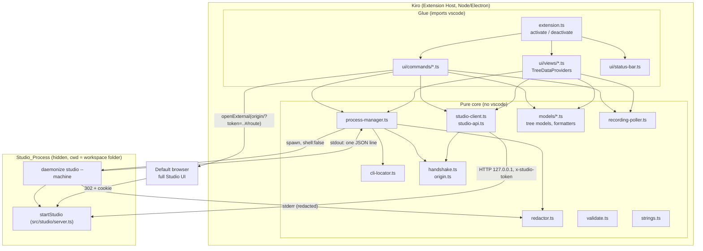
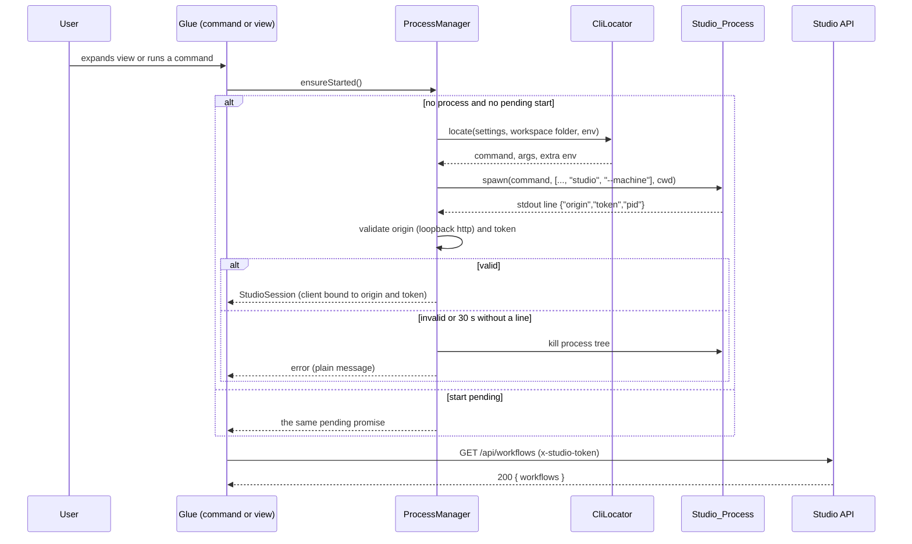
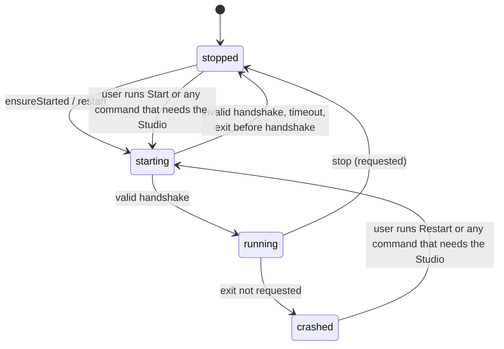
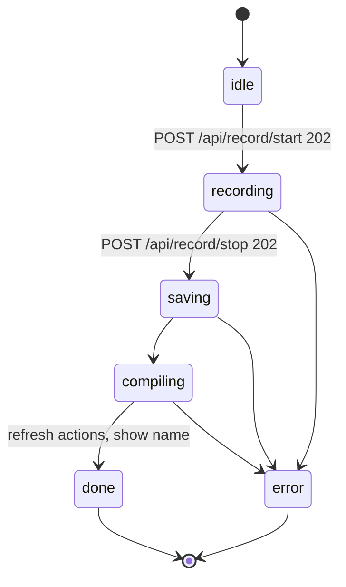

# Design Document: kiro-thin-extension

## Overview

This design adds a thin Kiro extension (`kiro-extension/`, packed as a `.vsix`) that lets a user create, list, test and connect Daemonize tools from the Kiro sidebar. The Studio and the engine do not move. The extension starts the Daemonize CLI as a hidden Node process, reads one JSON line from its stdout to learn the address and token, and then talks to the existing Studio JSON API over loopback HTTP.

The work has two parts that must run in this order:

- **Part A (Requirements 1 and 2).** Two fixes in the "Connect to Kiro" dialog: `null` children written as the text "null", and a wrong "no credentials" sentence when all secrets are in the vault.
- **Part B (Requirements 3 to 17).** The CLI option `--machine`, the extension, the generated browser fallback, packaging and checks.

Nothing existing changes shape. The Studio security model (loopback, per-process token, HttpOnly SameSite=Strict cookie, Host and Origin checks, `x-studio-request`, CSP, `redactForStudio`) is not touched. The only CLI addition is the option `--machine` of `daemonize studio`.

### Decisions in one place

| # | Question | Decision | Why |
|---|---|---|---|
| 1 | How does the extension learn address and token? | `daemonize studio --machine` writes exactly one JSON line `{"origin","token","pid"}` to stdout, after `startStudio` resolved. Everything else goes to stderr. The token is the one `startStudio` already generates (`randomBytes(24).toString('base64url')`, 32 characters). | No new Studio code path and no new secret. `StudioHandle` already has `origin` (no token) and `token` as separate fields. |
| 2 | How does the browser get signed in? | The extension opens `<origin>/?token=<token>#/<route>`. The Studio answers `302` to the same path without the token and sets the cookie. | The existing first-visit flow in `serveStatic`. The fragment is kept by the browser across the redirect because the `Location` header has none (RFC 9110, section 10.2.2). |
| 3 | How does the extension talk to the Studio? | `node:http` from the Extension Host, `x-studio-token` header, no cookie, no redirect following, loopback origin only. | The token header is accepted for GET and POST without Origin or `x-studio-request`. The client still sends `x-studio-request: 1` on POST (Requirement 5.8). |
| 4 | How is the CLI started? | `spawn(command, args, { shell: false, windowsHide: true, cwd })`. A Windows `.cmd` shim is never spawned: the locator reads the shim and runs the `.js` file it points to with Node. | Node 18.20, 20.12 and later refuse to spawn `.cmd` files without a shell (CVE-2024-27980, `EINVAL`). Using a shell would break the rule of Requirement 8.1. |
| 5 | Which code is pure? | Everything under `kiro-extension/src/core/` imports no `vscode`. Glue lives in `kiro-extension/src/ui/` and `extension.ts`. | Requirement 17.1. Pure code is tested in plain vitest. Glue is tested against a fake `vscode` module. |
| 6 | How do tests stub `vscode`? | A vitest project `extension` with `resolve.alias: { vscode: tests/extension/fake-vscode.ts }`. | `vscode` exists only inside the editor. The alias keeps production imports unchanged. |
| 7 | How is it bundled? | `esbuild`, one CommonJS file `dist/extension.js`, `vscode` external, no runtime dependencies. | Requirement 16. No native module can reach the bundle. |
| 8 | How does a generated server find a browser? | A new standalone runtime file `src/replay/runtime/browser-launch.ts`, copied next to `replay.js` like `settle.ts`, used at both `chromium.launch` sites. | Same copy mechanism as the other runtime files, no import from `src/`. |
| 9 | Where does the string table live? | `kiro-extension/src/core/strings.ts`. `package.nls.json` is generated from `CONTRIBUTION_STRINGS` in the same file and checked by a sync test. | One source for the Plain_Language lint (Requirement 10.8). |

### Research summary

Findings from reading the repository and the editor documentation. They shape the design.

- **Studio token flow (`src/studio/server.ts`).** `authorized()` accepts a valid `x-studio-token` header for any method. A cookie request needs, for POST, `x-studio-request` and an allowed `Origin`. `handle()` refuses a `Host` header outside `allowedHosts` (`127.0.0.1:<port>`, `localhost:<port>`, `[::1]:<port>`, plus the bound host). A request with an `Origin` header outside that set is refused with 403, so the extension client sends no `Origin` header. `serveStatic()` handles `?token=`: compares in constant time, deletes the parameter, answers `302` with `Set-Cookie: daemonize_studio=...; Path=/; HttpOnly; SameSite=Strict`.
- **Bodies.** Every registered POST route reads a JSON object (limit 64 KiB) and answers `415` if the `content-type` is not `application/json` and the body is not empty.
- **Routes the extension uses** (read from `routes/*.ts`, `model.ts`, `contracts.ts`):
  - `GET /api/workflows` returns `{ workflows: WorkflowView[] }`. Used fields: `id`, `label`, `toolName?`, `risk.highest`.
  - `GET /api/secrets` returns `{ application?, secrets: [{ name, kind, configured }] }`. `kind` is `password`, `totp` or `token`.
  - `POST /api/secrets` takes `{ name, value }`. Answers 200 `{ name, configured }`, 400 `{ error, field? }`, 503 `{ error }`.
  - `POST /api/secrets/forget` takes `{ name }`.
  - `POST /api/record/start` takes `{ name, url, reuseSession }`. Answers 202 `{ state }`, 400 `{ error, field }`, 409 `{ error }`.
  - `GET /api/record/status` returns `{ state, steps, labels, error?, recoveryFile?, sessionNote? }` with `state` in `idle | recording | saving | compiling | done | error`.
  - `POST /api/record/stop` takes `{}` and answers 202 `{ state: 'saving' }` or 409.
  - `GET /api/power/info`, `POST /api/power/preview`, `POST /api/power/install`, `POST /api/power/remove` as in `routes/power.ts` and `power-installer.ts`.
  - `GET /api/health` returns `{ ok, sample }`.
- **Where `required` secrets are computed.** `StudioPowerInstaller.readSource()` returns `required`, the sorted names of the `DAEMONIZE_SECRET_*` keys in the compiled `mcp.json`. `buildEntry()` derives `missing` from it. `requiredSecrets` therefore reads `source.required`, and `missing` is a subset by construction.
- **The dialog defect.** `setContent` calls `body.replaceChildren(...nodes)`. `replaceChildren(null)` writes the text "null". `showSuccess` passes `null` directly for the missing-credentials block and for the auto-add line. `failure()` in `connect.js` also returns an array with a `null`, and callers spread it into `error.replaceChildren(...)`, so the same defect appears on the error path. The `h()` builder already skips empty children (`append()` in `dom.js`), so only direct `replaceChildren` and `setContent` calls are affected.
- **Hash routes.** `router.js` accepts the names `overview`, `workflows`, `graph`, `schemas`, `tests`, `playground` plus `FEATURE_ROUTES` (`record`, `credentials`). The Playground route is `#/playground`. The Credentials route is `#/credentials`.
- **Generated runtime.** `compiler.ts` reads each runtime file from `src/replay/runtime/` (`RUNTIME_TOTP`, `RUNTIME_VAULT_READER`, and so on) and writes the `.ts` copy and the `.js` copy (`toJavaScript`) into the output folder. `mcp-generator.ts` has two `chromium.launch` sites: `WEB_RUNTIME` (about line 301) and the `openBrowser` of `WEB_RUNTIME_HTTP` (about line 376). `generateSandboxFiles` lists the files copied into the Docker image (`copy`). `replay.js` runs inside the container, so a new runtime file must be in that list too. `src/recorder/browser-launcher.ts` holds the reference behavior: attempts `chromium`, `chrome`, `msedge`, the two `NOT_INSTALLED` patterns, `DAEMONIZE_CHROMIUM_PATH` with no fallback. `src/sandbox/playwright-driver.ts` also calls `chromium.launch`, but it is host-side code that is not copied into generated output, so it is out of scope.
- **Windows spawn.** [Node.js April 2024 security release](https://nodejs.org/en/blog/vulnerability/april-2024-security-releases-2) made `spawn` of `.cmd` and `.bat` without `shell: true` throw `EINVAL`. The npm shim `daemonize.cmd` contains the line `"%dp0%\..\daemonize\dist\cli\index.js"`, which the locator can read.
- **Workspace Trust.** The extension can run `node_modules/.bin/daemonize` from the open folder, which is code from the folder. The [Workspace Trust guide](https://code.visualstudio.com/api/extension-guides/workspace-trust) lets an extension declare `capabilities.untrustedWorkspaces.supported: false`, so it does not activate in Restricted Mode. Settings with `"scope": "machine"` cannot be set by a `.vscode/settings.json` inside a cloned folder.
- **Bundling.** The [VS Code bundling guide](https://code.visualstudio.com/api/working-with-extensions/bundling-extension) recommends esbuild with `vscode` as external. `vsce package --no-dependencies` skips the `npm ls` call, so packaging needs no network once `@vscode/vsce` is installed.

## Architecture



### Start and handshake



### Process states



A `crashed` state is never left by the manager itself (Requirement 8.11). The user runs "Restart", or any command that needs the Studio, which is an explicit user action.

### Recording flow



The poller runs while the state is `recording`, `saving` or `compiling`, and stops at `idle`, `done` or `error`.

## Components and Interfaces

All paths are relative to the repository root `d:\deamonize\workspace`.

### Part A: Studio UI fixes (`src/studio/ui/js/`)

**`dialog.js`**. A pure exported helper and its use:

```js
/** Drops null, undefined and false; keeps every other child and the order. */
export function withoutEmpty(children) {
  return children.filter((child) => child !== null && child !== undefined && child !== false);
}
// setContent = (...nodes) => body.replaceChildren(...withoutEmpty(nodes));
// openDialog: setContent(...(Array.isArray(content) ? content : [content]));  // goes through the same filter
```

`dialog.js` imports only `./dom.js`, which touches the DOM only inside functions, so `withoutEmpty` can be imported in a node test.

**`credentials-notice.js`** (new, no imports). The decision table of Requirement 2.3 to 2.6, shared by tests and by `connect.js`:

```js
/**
 * @param {{ placeholders?: unknown, requiredSecrets?: unknown } | undefined} result  the install answer
 * @param {{ requiredSecrets?: unknown } | undefined} preview                         the preview answer
 * @returns {'placeholders' | 'vault' | 'none' | 'unknown'}
 */
export function credentialsNotice(result, preview)
```

Rules, in order: a non-empty `result.placeholders` array gives `'placeholders'`. Otherwise `requiredSecrets` is read from `result`, and when `result` has no array field, from `preview`. A non-empty array gives `'vault'`, an empty array gives `'none'`, and no array anywhere gives `'unknown'` (no sentence).

**`connect.js`**. `showSuccess` calls `credentialsNotice(result, preview)` and renders: `'placeholders'` the existing lead and chips, `'vault'` the paragraph `COPY.credentialsFromVault`, `'none'` the paragraph `COPY.noPlaceholders` ("This tool needs no credentials."), `'unknown'` nothing. The missing-credentials notice stays as it is (Requirement 2.9). `failure()` returns only non-empty children (`.filter(Boolean)`), and every direct `setContent(...)` argument that can be `null` goes through `withoutEmpty` because `setContent` now filters.

**`copy.js`**: `credentialsFromVault: 'This tool will use the passwords you saved in Daemonize. Nothing else to set up.'` The text has none of the eight banned words, so the existing lint in `tests/unit/studio-ui-copy.test.ts` passes.

**`src/studio/contracts.ts` and `power-installer.ts`**. `PowerPreview` and the return type of `PowerInstaller.install` get `requiredSecrets: string[]`. `Plan` gets `required: string[]`, set from `source.required` in `plan()`. `preview()` and `install()` return `requiredSecrets: plan.required`. `routes/power.ts` passes answers through unchanged, so it needs no edit.

### Part B-1: the CLI option (`src/cli/commands/studio.ts`, `src/cli/index.ts`)

```ts
export interface StudioCommandOptions {
  /* existing fields unchanged */
  /** Print one JSON line (origin, token, pid) to stdout, send messages to stderr, never open a browser. */
  machine?: boolean;
  /** Test seams, used only with `machine`. Default: process.stdout.write and process.stderr.write. */
  stdout?: (text: string) => void;
  stderr?: (line: string) => void;
}

export interface Handshake { origin: string; token: string; pid: number }
/** One line, `JSON.stringify` of exactly these three fields, plus `\n`. */
export function formatHandshakeLine(h: Handshake): string;
```

Behavior of `studio()` when `machine` is true:

1. `log` is replaced by `stderr`. The non-loopback warning goes there.
2. `startStudio` is called with the same arguments as today. If it throws, the error propagates, `main()` prints `Error: ...` on stderr and sets exit code 1. Nothing was written to stdout.
3. After `startStudio` resolves, the function writes `formatHandshakeLine({ origin: handle.origin, token: handle.token, pid: process.pid })` to stdout, and returns the handle. It does not print the URL line, the Ctrl+C line, the Playground line, and it does not call `openInBrowser`, whatever `open` is.

`index.ts` adds `.option('--machine', 'print one JSON line with the address and token to stdout, send messages to stderr and never open a browser (for editor extensions)')` to the `studio` command and passes `machine: options.machine === true`. The default action (no subcommand) is not touched. The existing `untilInterrupted(handle, { exit: false })` keeps the process alive and closes the Studio on SIGTERM or SIGINT.

**Why the token is safe on stdout.** The pipe is private to the parent process (`stdio: ['ignore', 'pipe', 'pipe']`). The token is the same value that `--open` puts in a URL on the command line today, and it is valid for this process only.

**Known limit.** If the Extension Host dies without calling `deactivate`, the Studio_Process is orphaned. The Studio has no idle exit. The extension stops it on `deactivate`, on window close and on `process.on('exit')` (best effort, direct child only). This is documented in the README.

### Part B-2: the extension (`kiro-extension/`)

#### Layout

```
kiro-extension/
  package.json  package.nls.json  tsconfig.json  .vscodeignore  LICENSE  README.md
  media/daemonize.svg
  scripts/bundle.mjs
  src/
    extension.ts                       (glue) activate, deactivate, composition root
    core/                              (pure, no `vscode`)
      types.ts  strings.ts  ports.ts
      handshake.ts  origin.ts  studio-url.ts
      cli-locator.ts  process-manager.ts
      studio-client.ts  studio-api.ts
      redactor.ts  validate.ts  recording-poller.ts  plain-language.ts
      models/actions-model.ts  credentials-model.ts  kiro-model.ts  status-model.ts  preview-format.ts  credentials-notice.ts
    ui/                                (glue, imports `vscode`)
      controller.ts  settings.ts  status-bar.ts  logger.ts
      views/actions-view.ts  credentials-view.ts  kiro-view.ts
      commands/lifecycle.ts  studio.ts  record.ts  credentials.ts  kiro.ts
```

#### Shared types (`core/types.ts`)

```ts
export interface Handshake { origin: string; token: string; pid: number }
export type ProcessState = 'stopped' | 'starting' | 'running' | 'crashed';
export type Risk = 'read' | 'write' | 'delete';
export type RecordingState = 'idle' | 'recording' | 'saving' | 'compiling' | 'done' | 'error';
export type InstallScope = 'global' | 'project';

export interface WorkflowRow { id: string; label: string; toolName?: string; risk: Risk }
export interface SecretRow { name: string; kind: 'password' | 'totp' | 'token'; configured: boolean }
export interface InstallRow { scope: InstallScope; slug: string; kiroPath: string }
export interface PowerInfo { kiroHomeExists: boolean; installs: InstallRow[]; available: boolean }
export interface PreviewAnswer {
  confirmationId: string; scope: InstallScope; kiroPath: string;
  files: Array<{ path: string; outcome: 'create' | 'merge' | 'replace' }>;
  replacesEntry: boolean; placeholders: string[]; missingSecrets: string[];
  requiredSecrets?: string[]; backup: boolean;
}
export interface InstallAnswer { written: string[]; placeholders: string[]; missingSecrets: string[]; requiredSecrets?: string[]; scope: InstallScope }
export interface RecordingStatus { state: RecordingState; steps: number; labels: string[]; error?: string; sessionNote?: string }

/** A request outcome that the Studio answered. Network failures throw StudioClientError. */
export type ApiResult<T> =
  | { ok: true; status: number; data: T }
  | { ok: false; status: number; error: string; field?: string };

/** Plain data for a tree row. The glue turns it into a vscode.TreeItem. */
export interface TreeNode {
  id: string; label: string; description?: string; tooltip?: string;
  icon: 'play' | 'sync' | 'warning' | 'read' | 'write' | 'delete' | 'key' | 'check' | 'plug' | 'folder' | 'add' | 'info';
  contextValue?: string; command?: { id: string; args?: unknown[] };
  children?: TreeNode[];
}
```

#### `core/handshake.ts`, `core/origin.ts`, `core/studio-url.ts`

```ts
export function parseHandshakeLine(line: string): Handshake | undefined;       // shape + origin + token checks
export function formatHandshake(h: Handshake): string;                         // same bytes as the CLI (test helper and round trip)
export function isLoopbackOrigin(text: string): boolean;                       // Requirement 5.2
export function isStudioToken(text: string): boolean;                          // /^[A-Za-z0-9_-]{16,128}$/
export type StudioRoute = 'playground' | 'credentials' | 'overview';
export function buildBrowserUrl(h: Pick<Handshake, 'origin' | 'token'>, route?: StudioRoute): string;
```

`isLoopbackOrigin` uses `new URL()` and checks: `protocol === 'http:'`, `hostname` in `127.0.0.1`, `localhost`, `[::1]`, a non-empty `port` that is an integer from 1 to 65535, `pathname === '/'`, empty `username`, `password`, `search`, `hash`, and the input text equals `url.origin` or `url.origin + '/'` (so a trailing junk or whitespace is refused). `parseHandshakeLine` takes `JSON.parse` inside try/catch, requires a plain object, a string `origin`, a string `token`, an integer `pid > 0`, and ignores other fields that do not change the three. `buildBrowserUrl` builds `new URL('/', origin)`, sets `searchParams.token`, sets `hash` to `#/playground`, `#/credentials` or empty. It throws if the origin or token is invalid.

#### `core/cli-locator.ts`

```ts
export interface FsPort {
  isFile(path: string): Promise<boolean>;
  realpath(path: string): Promise<string>;
  readText(path: string, maxBytes: number): Promise<string | undefined>;
}
export interface LocatorInput {
  cliPath: string;          // setting daemonize.cliPath ('' = unset)
  nodePath: string;         // setting daemonize.nodePath
  workspaceFolder: string;
  pathEntries: string[];    // split PATH, already in order
  platform: NodeJS.Platform;
  execPath: string;         // process.execPath
  fs: FsPort;
}
export type LocatorResult =
  | { kind: 'ok'; command: string; baseArgs: string[]; extraEnv: Record<string, string>; cliFile: string; usedElectronNode: boolean }
  | { kind: 'not-found' }
  | { kind: 'configured-missing'; path: string }
  | { kind: 'unsupported-shim'; path: string };
export function locateCli(input: LocatorInput): Promise<LocatorResult>;
```

Order for an empty `cliPath` (Requirement 4.2): `<ws>/node_modules/.bin/daemonize` (`daemonize.cmd` on win32), then `<ws>/node_modules/daemonize/dist/cli/index.js`, then `daemonize` (win32: `daemonize.cmd`, `daemonize.exe`) in each PATH entry. Each candidate is tested with `fs.isFile` only. No shell, no `which`.

Resolving a found candidate:

- `.js`: run with Node.
- win32 `.cmd` or `.bat`: read the shim (cap 64 KiB), match `/"%dp0%\\([^"]+?\.js)"/i`, resolve relative to the shim folder, check `isFile`. No match gives `unsupported-shim`.
- posix file: `realpath`. If the real path ends in `.js` it runs with Node. Otherwise it is run directly (a real executable).
- `.exe` or a non-script posix file: `command = file`, `baseArgs = []`, no Node needed (Requirement 4.7).

Node runtime for a `.js` CLI: `nodePath` if set (a missing file is `configured-missing` for that path), else `node` (`node.exe` on win32) from `pathEntries`, else `execPath` with `extraEnv = { ELECTRON_RUN_AS_NODE: '1' }` and `usedElectronNode: true`. A set `cliPath` that does not exist gives `configured-missing` with no fallback (Requirement 4.9).

#### `core/redactor.ts`

```ts
export interface Redactor { (text: string): string }
export function createRedactor(sources: { sensitiveValues(): string[]; env(): Record<string, string | undefined> }): Redactor;
```

Order: strip ANSI escape sequences, replace each literal in `sensitiveValues()` and each non-empty `DAEMONIZE_SECRET_*` value of `env()` (longest first, `split(v).join('***')`), then `/(token=)[^&\s"']+/gi` and `/(Bearer\s+)\S+/gi`. Literals shorter than 3 characters are skipped so a value such as "a" does not mangle every line. Replacement text contains `*` only, and `*` is not in the token alphabet, so a replaced token cannot be reassembled by a later step.

#### `core/studio-client.ts` and `core/studio-api.ts`

```ts
export interface TransportRequest {
  method: 'GET' | 'POST'; hostname: string; port: number; path: string;
  headers: Record<string, string>; body?: string; timeoutMs: number;
}
export interface TransportResponse { status: number; text: string }
export interface Transport { send(req: TransportRequest): Promise<TransportResponse> }
export function createHttpTransport(): Transport;   // node:http, agent: false, no redirect following, 4 MiB cap

export type ClientErrorKind = 'refused-path' | 'network' | 'timeout' | 'redirect' | 'bad-body' | 'too-large' | 'unauthorized';
export class StudioClientError extends Error { constructor(readonly kind: ClientErrorKind, message: string) }

export interface StudioClient {
  get(path: string): Promise<{ status: number; body: unknown }>;
  post(path: string, body: Record<string, unknown>): Promise<{ status: number; body: unknown }>;
}
export function createStudioClient(deps: {
  origin: string; token: string; transport?: Transport; log?: (line: string) => void;
}): StudioClient;
```

Rules enforced by `createStudioClient`:

- The path must start with `/api/`, must not contain `\`, CR, LF or NUL, and `new URL(path, origin)` must keep `origin` and a pathname that still starts with `/api/` (this stops `//host/x`, `/api/../x` and absolute URLs). Otherwise `refused-path`.
- Headers: `x-studio-token`, `Host: <url.host>`, `Accept: application/json`. POST adds `Content-Type: application/json`, `x-studio-request: 1`. No `Origin`, no cookie. The body must be a plain object.
- Timeout 15 s, and 120 s for `POST /api/power/install` and `POST /api/power/preview`.
- Status 3xx throws `redirect`. Status 401 throws `unauthorized`. Other statuses are returned. A non-JSON answer body is `bad-body`.
- On a failed request (network, timeout, 5xx) it calls `log` with `METHOD /path STATUS` only. The path has no query. No body, no header.

`studio-api.ts` wraps a `StudioClient` with typed functions that parse tolerant shapes (unknown JSON never throws):

```ts
export interface StudioApi {
  health(): Promise<ApiResult<{ ok: boolean }>>;
  workflows(): Promise<ApiResult<WorkflowRow[]>>;
  secrets(): Promise<ApiResult<SecretRow[]>>;
  setSecret(name: string, value: string): Promise<ApiResult<{ name: string; configured: boolean }>>;
  forgetSecret(name: string): Promise<ApiResult<{ name: string; configured: boolean }>>;
  recordStart(i: { name: string; url: string; reuseSession: boolean }): Promise<ApiResult<{ state: string }>>;
  recordStatus(): Promise<ApiResult<RecordingStatus>>;
  recordStop(): Promise<ApiResult<{ state: string }>>;
  powerInfo(): Promise<ApiResult<PowerInfo>>;
  powerPreview(scope: InstallScope, workspacePath?: string): Promise<ApiResult<PreviewAnswer>>;
  powerInstall(p: { confirmationId: string; kiroPath: string; scope: InstallScope }): Promise<ApiResult<InstallAnswer>>;
  powerRemove(scope: InstallScope): Promise<ApiResult<{ removed: string[] }>>;
}
export function createStudioApi(client: StudioClient): StudioApi;
```

`setSecret` is the only function whose argument is a secret value. It puts the value in the request body and nowhere else. `parseWorkflows` keeps only entries with a string `id`, a string `label` and `risk.highest` in `read | write | delete`, and copies only `id`, `label`, `toolName`, `risk`.

#### `core/process-manager.ts`

```ts
export interface ChildLike {
  pid?: number;
  stdout: { on(e: 'data', f: (b: Buffer | string) => void): void };
  stderr: { on(e: 'data', f: (b: Buffer | string) => void): void };
  on(e: 'exit', f: (code: number | null, signal: string | null) => void): void;
  on(e: 'error', f: (err: Error) => void): void;
}
export interface ProcessManagerDeps {
  locate(): Promise<LocatorResult>;
  workspaceFolder(): string | undefined;
  spawn(command: string, args: string[], options: { cwd: string; env: NodeJS.ProcessEnv; shell: false; windowsHide: true; stdio: ['ignore', 'pipe', 'pipe']; detached: boolean }): ChildLike;
  killTree(pid: number, platform: NodeJS.Platform): Promise<void>;     // taskkill /pid N /T /F, or SIGTERM to the group, SIGKILL after 5 s
  env: NodeJS.ProcessEnv;
  platform: NodeJS.Platform;
  setTimeout: typeof setTimeout; clearTimeout: typeof clearTimeout;
  onStderr(line: string): void;            // already redacted by the caller's logger, or raw: the glue redacts
  createClient(h: Handshake): StudioClient;
  handshakeTimeoutMs?: number;             // default 30000
}

export class StudioSession {
  readonly origin: string; readonly pid: number; readonly client: StudioClient;
  browserUrl(route?: StudioRoute): string;                 // the only way the token leaves the session, besides the client
  sensitiveValues(): string[];                             // for the redactor
}

export class StartError extends Error {
  constructor(readonly reason: 'no-folder' | 'locator' | 'spawn' | 'handshake-invalid' | 'timeout' | 'exited-early' | 'old-cli', readonly locator?: LocatorResult)
}

export interface ProcessManager {
  readonly state: ProcessState;
  readonly session: StudioSession | undefined;
  onDidChangeState(listener: (s: ProcessState) => void): { dispose(): void };
  ensureStarted(): Promise<StudioSession>;     // lazy, one pending start shared by all callers
  restart(): Promise<StudioSession>;           // stop, wait for exit, start
  stop(): Promise<void>;                       // requested stop
  markStale(): void;                           // after a 401: next ensureStarted starts a new process
}
export function createProcessManager(deps: ProcessManagerDeps): ProcessManager;
```

Rules:

- `spawn` options are exactly those of Requirement 8.1. `detached` is `true` on POSIX only, so the child leads its own process group for `kill(-pid)`. On Windows, `detached: false` and `taskkill /T` kills the tree.
- Arguments are `locator.baseArgs` plus `['studio', '--machine']`. The environment is `{ ...deps.env, ...locator.extraEnv }`. Nothing else is added (Requirement 8.14).
- stdout is buffered by line, capped at 64 KiB. The **first complete line** is the candidate handshake. If it does not pass `parseHandshakeLine`, the child is killed and `start` rejects with `handshake-invalid`. Later stdout lines are dropped and never logged.
- A timer of `handshakeTimeoutMs` kills the child and rejects with `timeout`.
- If the child exits before a valid handshake, `start` rejects with `exited-early`, or `old-cli` when the stderr tail contains `unknown option '--machine'`.
- After `running`, an exit that was not requested sets `crashed`. The manager never spawns again by itself.
- `ensureStarted` returns `this.pending ??= this.start()`. `pending` is cleared when the start settles.
- `stop()` sets a `stopRequested` flag, calls `killTree`, and resolves when the child emitted `exit` or after 10 s.
- The pid of the handshake is informational. The kill uses `child.pid`.

#### `core/recording-poller.ts`

```ts
export interface PollerDeps {
  fetchStatus(): Promise<ApiResult<RecordingStatus>>;
  onStatus(s: RecordingStatus): void;
  onFinished(s: RecordingStatus): void;       // state done or error, or idle
  onGaveUp(): void;                           // three failures in a row
  setTimeout: typeof setTimeout; clearTimeout: typeof clearTimeout;
  intervalMs?: number;                        // default 1000
}
export interface RecordingPoller { start(): void; stop(): void; readonly running: boolean }
export function createRecordingPoller(deps: PollerDeps): RecordingPoller;
```

`start()` while `running` does nothing (one loop). The loop is a `setTimeout` chain with an in-flight guard. It stops on a state outside `recording | saving | compiling`, and gives up after three consecutive failed fetches (a thrown error or `ok: false`). A success resets the counter.

#### `core/validate.ts`

```ts
export type Validation<T> = { ok: true; value: T } | { ok: false; message: string };
export function validateName(input: unknown): Validation<string>;   // same rules and texts as src/studio/validate-action.ts
export function validateUrl(input: unknown): Validation<string>;
```

The five message texts are copied from `src/studio/messages/common.ts` (`NAME_REQUIRED`, `NAME_CONTROL`, `URL_INVALID`, `URL_TOO_LONG`, `URL_CREDENTIALS`). A parity test compares the verdict, the value and the message with the Studio functions on a shared list and on random strings.

#### `core/models/*.ts` (tree models and formatters)

```ts
export function actionsTree(input: { state: ProcessState; folder: FolderInfo; workflows: ApiResult<WorkflowRow[]> | undefined; recording?: RecordingStatus }): TreeNode[];
export function credentialsTree(input: { state: ProcessState; secrets: ApiResult<SecretRow[]> | undefined }): TreeNode[];
export function kiroTree(input: { state: ProcessState; info: ApiResult<PowerInfo> | undefined }): TreeNode[];
export function statusSentence(state: ProcessState): string;

/** The text of the modal of "Connect to Kiro": path, each file with its outcome word, replacement, missing names, backup. */
export function previewDetail(p: PreviewAnswer): string;
/** Same decision table as src/studio/ui/js/credentials-notice.js, returns the message to show or undefined. */
export function credentialsNotice(result: InstallAnswer, preview?: PreviewAnswer): 'placeholders' | 'vault' | 'none' | 'unknown';
```

Risk text and icon mapping: `read` "Reads only" with icon `read`, `write` "Changes data" with `write`, `delete` "Deletes data" with `delete`. Tooltip: the `toolName` when present, otherwise the "not connected yet" sentence. `contextValue` is `action`, `secret.configured`, `secret.missing`, `install`. Only `id`, `label`, `toolName` and the risk reach a node (Requirement 12.7).

#### `core/plain-language.ts`

```ts
export const BANNED_TERMS: RegExp;                     // /\b(record|compile|storage state|environment variable|MCP|JSON|token|CLI)\b/i
export function bannedTermsIn(text: string): string[]; // exempts file paths and Daemonize command names shown as code
```

Used by the test lint only; it is not part of runtime behavior.

#### `core/strings.ts` and `core/ports.ts`

`strings.ts` exports one frozen object `S` with every user-facing text: plain strings and small functions for texts with a name or a path (for example `S.cliMissing(path)`, `S.recordingSaved(name)`). It also exports `CONTRIBUTION_STRINGS`, the map written to `package.nls.json`, and the exact texts fixed by the requirements: `S.credentialsFromVault`, `S.noCredentials` ("This tool needs no credentials."), `S.riskRead` ("Reads only"), `S.riskWrite` ("Changes data"), `S.riskDelete` ("Deletes data"), `S.hasValue` ("has a value"), `S.hasNoValue` ("has no value yet"), the button names "Restart", "Start", "New action", "Try again", "Choose the file", "Open settings", "Open a folder", "Finish".

`ports.ts` has the interfaces that glue and core share (`ProcessManager`, `StudioApi`, `Redactor`, `RecordingPoller`), re-exported from the modules above, so the glue can be written against them before the implementations exist.

#### Glue (`src/extension.ts`, `src/ui/**`)

```ts
export function activate(context: vscode.ExtensionContext): void;           // builds real deps, calls activateWith
export function activateWith(context: vscode.ExtensionContext, deps: ExtensionDeps): ExtensionHandle;
export function deactivate(): Promise<void>;                                // stops the Studio_Process

export interface ExtensionDeps {
  createProcessManager(): ProcessManager;      // real: createProcessManager({ spawn: child_process.spawn, ... })
  createApi(session: StudioSession): StudioApi;
  env: NodeJS.ProcessEnv;
}
```

| Module | Content |
|---|---|
| `ui/controller.ts` | Holds the manager, the redactor, the logger, the poller. `withStudio(fn)` ensures a session, runs `fn(api, session)`, maps `StartError` and `StudioClientError` to plain messages. On `unauthorized`, a GET is retried once after `manager.markStale()`; a POST shows `S.restartedTryAgain`. |
| `ui/settings.ts` | Reads `daemonize.cliPath` and `daemonize.nodePath`, builds `LocatorInput`. Offers "Choose the file" (`showOpenDialog`, writes the setting at the user level) and "Open settings". |
| `ui/logger.ts` | One `OutputChannel` named "Daemonize". `logStderr(line)` redacts then appends. There is no stdout path. Failed-request lines come from the client. |
| `ui/status-bar.ts` | State item and a "Recording" item with a click command `daemonize.finishRecording`. Sets context keys `daemonize.recording` and `daemonize.state`. |
| `ui/views/*.ts` | `TreeDataProvider`s over the pure tree models. `onDidChangeVisibility` of the Actions view calls `ensureStarted()` once. Icons use `ThemeIcon` ids chosen from `TreeNode.icon`. |
| `ui/commands/lifecycle.ts` | `daemonize.start`, `stop`, `restart`, `refresh`, `showLog`, `chooseCliFile`. Workspace folder handling (no folder, several folders, non-`file` scheme, `onDidChangeWorkspaceFolders` stops the process). |
| `ui/commands/studio.ts` | `daemonize.openStudio`, `daemonize.testInStudio`. `ensureStarted()`, then `vscode.env.openExternal(Uri.parse(session.browserUrl(route), true))`. A `false` answer shows `S.browserNotOpened` without a URL. The URL is never logged, copied or shown. |
| `ui/commands/record.ts` | `daemonize.newAction` (name input, address input, quick pick; validators from `core/validate.ts`), `daemonize.finishRecording`, and the poller wiring. |
| `ui/commands/credentials.ts` | `daemonize.setCredential` and `daemonize.forgetCredential`. Without a tree item, a quick pick of the names from `GET /api/secrets`. The value lives in a local `const` inside the handler and is passed to `api.setSecret` only. |
| `ui/commands/kiro.ts` | `daemonize.connectToKiro`, `daemonize.removeFromKiro`. Scope from `kiroHomeExists`, preview, `showWarningMessage(message, { modal: true, detail }, S.confirmConnect)`, install, final message from `credentialsNotice`. |

`Connect to Kiro` acts on the whole compiled application, as in the Studio screen, so the inline command on an action row connects all actions of the application. The tooltip says so.

#### `package.json` of the extension

```jsonc
{
  "name": "daemonize-kiro",
  "displayName": "Daemonize",
  "description": "%extension.description%",
  "version": "0.1.0",
  "publisher": "daemonize",
  "license": "MIT",
  "repository": { "type": "git", "url": "<read from `git remote get-url origin` of the repository; else https://github.com/OWNER/daemonize.git, flagged in the README>" },
  "engines": { "vscode": "^1.85.0" },
  "categories": ["Other"],
  "main": "./dist/extension.js",
  "icon": "media/icon.png",              // optional; omit when no PNG is created
  "capabilities": {
    "untrustedWorkspaces": { "supported": false, "description": "%capabilities.untrusted%" },
    "virtualWorkspaces": { "supported": false, "description": "%capabilities.virtual%" }
  },
  "activationEvents": [
    "onView:daemonize.actions", "onView:daemonize.credentials", "onView:daemonize.kiro",
    "onCommand:daemonize.start", "onCommand:daemonize.stop", "onCommand:daemonize.restart",
    "onCommand:daemonize.openStudio", "onCommand:daemonize.testInStudio", "onCommand:daemonize.newAction",
    "onCommand:daemonize.finishRecording", "onCommand:daemonize.refresh", "onCommand:daemonize.connectToKiro",
    "onCommand:daemonize.removeFromKiro", "onCommand:daemonize.setCredential", "onCommand:daemonize.forgetCredential",
    "onCommand:daemonize.showLog", "onCommand:daemonize.chooseCliFile"
  ],
  "contributes": {
    "viewsContainers": { "activitybar": [{ "id": "daemonize", "title": "%container.title%", "icon": "media/daemonize.svg" }] },
    "views": { "daemonize": [
      { "id": "daemonize.actions", "name": "%view.actions%" },
      { "id": "daemonize.credentials", "name": "%view.credentials%" },
      { "id": "daemonize.kiro", "name": "%view.kiro%" } ] },
    "viewsWelcome": [{ "view": "daemonize.actions", "contents": "%welcome.noFolder%", "when": "workspaceFolderCount == 0" }],
    "commands": [ /* 17 commands, category "Daemonize", titles %command.*% */ ],
    "menus": {
      "view/title": [ /* New action, Refresh, Open the Studio, Finish (when daemonize.recording), Restart */ ],
      "view/item/context": [ /* inline: Test in the Studio and Connect to Kiro for viewItem == action;
                                Set a credential for viewItem =~ /^secret/; Forget a credential for viewItem == secret.configured;
                                Remove from Kiro for viewItem == install */ ],
      "commandPalette": [ /* hides finishRecording unless daemonize.recording */ ]
    },
    "configuration": { "title": "Daemonize", "properties": {
      "daemonize.cliPath":  { "type": "string", "default": "", "scope": "machine", "description": "%config.cliPath%" },
      "daemonize.nodePath": { "type": "string", "default": "", "scope": "machine", "description": "%config.nodePath%" } } }
  },
  "scripts": {
    "bundle": "node scripts/bundle.mjs",
    "build": "node scripts/bundle.mjs --production",
    "typecheck": "tsc --noEmit -p tsconfig.json",
    "vscode:prepublish": "npm run build",
    "package": "vsce package --no-dependencies",
    "ls": "vsce ls --no-dependencies"
  },
  "devDependencies": { "@types/node": "^22.20.5", "@types/vscode": "1.85.0", "@vscode/vsce": "^3.2.1", "esbuild": "^0.25.0", "typescript": "^5.9.3" }
}
```

`dependencies` is absent. Versions are minimums chosen to match the root (`@types/node`, `typescript`) and the Kiro editor base (`engines.vscode ^1.85.0` is below any current Code OSS base). The `@vscode/vsce` v3 line needs Node 20 or later. `engines.vscode` and `@types/vscode` must stay equal (vsce refuses a lower `engines`).

The `daemonize.cliPath` and `daemonize.nodePath` settings use `"scope": "machine"`, so a `.vscode/settings.json` in a cloned folder cannot point the extension at a file of its choice. The setting descriptions say "the Daemonize program" and "Node", never "CLI".

`.vscodeignore`:

```
**
!package.json
!package.nls.json
!README.md
!LICENSE
!media/**
!dist/extension.js
```

`scripts/bundle.mjs` calls `esbuild.build({ entryPoints: ['src/extension.ts'], bundle: true, platform: 'node', format: 'cjs', target: 'node18', outfile: 'dist/extension.js', external: ['vscode'], sourcemap: false, minify: production, legalComments: 'none', metafile: true })`, then fails when any `metafile.inputs` key resolves outside `kiro-extension/src` (except `package.json` of esbuild helpers, which esbuild does not emit for a no-dependency bundle) or contains `playwright`, `node-pty` or `node_modules`.

`tsconfig.json` of the extension: `{ "compilerOptions": { "target": "ES2022", "module": "ESNext", "moduleResolution": "Bundler", "lib": ["ES2022"], "types": ["node"], "strict": true, "noEmit": true, "skipLibCheck": true, "isolatedModules": true }, "include": ["src/**/*"] }`. The root `tsconfig.json` stays `include: ["src/**/*"]`, so `npx tsc --noEmit` at the root never sees the extension.

### Part B-3: generated browser fallback

**`src/replay/runtime/browser-launch.ts`** (new). It imports nothing, so it is standalone and passes the `generated-no-src-import` test.

```ts
export interface LaunchOptions { headless: boolean; executablePath?: string; channel?: string; args?: string[] }
export interface ChromiumLike<B> { launch(options: LaunchOptions): Promise<B> }

const NOT_INSTALLED = [/executable doesn['\u2019]t exist/i, /Chromium distribution '(chrome|msedge)' is not found/i];
export function isBrowserMissing(error: unknown): boolean;

/** Bundled Chromium, then the chrome channel, then msedge. DAEMONIZE_CHROMIUM_PATH is used alone, with no fallback. */
export function launchReplayBrowser<B>(chromium: ChromiumLike<B>, env?: Record<string, string | undefined>): Promise<B>;
```

Behavior:

- `args` is `['--no-sandbox']` when `env.DAEMONIZE_IN_CONTAINER` is set (as today, any non-empty value), else `[]`. `headless` is always `true`.
- With a non-empty `DAEMONIZE_CHROMIUM_PATH`, one attempt with `executablePath` set. Any error propagates unchanged, which is what the generated code does today.
- Without it: attempt 1 without `channel`, attempt 2 with `channel: 'chrome'`, attempt 3 with `channel: 'msedge'`. A browser-missing error moves to the next attempt. Any other error is thrown at once.
- If all three fail as missing, it throws `Error('No browser was found to replay with. Install Google Chrome or Microsoft Edge, or set DAEMONIZE_CHROMIUM_PATH to the path of a Chromium based browser.')`. The generated `replayCore` is called inside the existing handler that already turns a launch failure into a structured failure.

**`src/compiler/mcp-generator.ts`**: both sites become `const browser = await launchReplayBrowser(chromium);`, with `import { launchReplayBrowser } from "./browser-launch.js";` added to the web and web-http import blocks. `generateSandboxFiles` adds `browser-launch.js` to `copy` for web targets. **`src/compiler/compiler.ts`**: `RUNTIME_BROWSER_LAUNCH` path, read when `set.targetType === 'web'`, written as `browser-launch.ts` and `browser-launch.js` (through `toJavaScript`), with the same pattern as `webStepsSource`. The text is a verbatim file copy, so the output is deterministic.

### Part B-4: tests and repository wiring

**`vitest.config.ts`** gets a third project:

```ts
{
  extends: true,
  resolve: { alias: { vscode: fileURLToPath(new URL('./tests/extension/fake-vscode.ts', import.meta.url)) } },
  test: {
    name: 'extension',
    setupFiles: ['./tests/setup/clean-env.ts'],
    include: ['tests/extension/**/*.test.ts'],
    testTimeout: 60000, hookTimeout: 60000,
    sequence: { groupOrder: 1 },
  },
}
```

**`tests/extension/fake-vscode.ts`** exports the subset the glue uses: `window` (`showInputBox`, `showQuickPick`, `showInformationMessage`, `showWarningMessage`, `showErrorMessage`, `createOutputChannel`, `createStatusBarItem`, `createTreeView`, `showOpenDialog`, `withProgress`), `commands` (`registerCommand`, `executeCommand`), `workspace` (`workspaceFolders`, `getConfiguration`, `onDidChangeWorkspaceFolders`, `onDidChangeConfiguration`), `env.openExternal`, `Uri`, `TreeItem`, `TreeItemCollapsibleState`, `ThemeIcon`, `EventEmitter`, `StatusBarAlignment`, and a recording API `__calls`, `__script(answers)`, `__reset()`. Every method records its arguments and returns scripted answers. The real files `kiro-extension/src/**` are imported by relative path from the tests.

**`tests/extension/real/`** holds the tests that spawn the real CLI. They need `dist/cli/index.js` (from `npm run build`) and fail with the message "run npm run build first" when it is absent.

**`scripts/lib/secret-scan.mjs`**: the test files that plant fake secret values on purpose are added to `SYNTHETIC_FIXTURE_FILES` (names fixed in the groups section). `listCommittableFiles` reads the git file list, so `kiro-extension/` is scanned without a change to the scanner.

**`.gitignore`** (workspace): add `kiro-extension/dist/`, `kiro-extension/*.vsix`, `kiro-extension/node_modules/`. The existing `node_modules/` and `dist/` patterns already match, the explicit lines make the intent visible and cover `*.vsix`.

## Data Models

```ts
// Handshake line (stdout of `daemonize studio --machine`), one line, UTF-8, '\n' terminated
{ "origin": "http://127.0.0.1:53124", "token": "<32 chars base64url>", "pid": 12345 }

// Settings
daemonize.cliPath:  string  ('' = automatic)
daemonize.nodePath: string  ('' = automatic)

// In memory only (Extension Host)
StudioSession { origin, pid, client }          // token held in a private field
ProcessState  'stopped' | 'starting' | 'running' | 'crashed'
PollerState   { running: boolean, failures: 0..3 }
```

Nothing is written to disk by the extension. There is no cache, no `globalState` entry and no file in the workspace. The Studio writes its own files as today (`daemonize.workflows.json`, the vault, `.kiro/` through the Power_Installer).

Request bodies:

| Command | Request | Body |
|---|---|---|
| New action | `POST /api/record/start` | `{ "name", "url", "reuseSession" }` |
| Finish | `POST /api/record/stop` | `{}` |
| Set a credential | `POST /api/secrets` | `{ "name", "value" }` |
| Forget a credential | `POST /api/secrets/forget` | `{ "name" }` |
| Connect (preview) | `POST /api/power/preview` | `{ "scope" }` plus `"workspacePath"` for `project` |
| Connect (install) | `POST /api/power/install` | `{ "confirmationId", "kiroPath", "scope" }` |
| Remove | `POST /api/power/remove` | `{ "scope" }` |

## Correctness Properties

*A property is a characteristic or behavior that should hold true across all valid executions of a system-essentially, a formal statement about what the system should do. Properties serve as the bridge between human-readable specifications and machine-verifiable correctness guarantees.*

Reflection on redundancy: the prework produced about 60 testable criteria. They were merged as follows: 1.1 to 1.4 share one filter property; 2.3 to 2.6 are one decision table; 2.1 and 2.2 are one invariant; 3.2, 3.6 and 3.11 are one round trip; 5.1 to 5.3 and 5.12 are one validation property; 8.3, 8.5, 8.9, 8.11, 8.12 and 8.15 are one model-based state property; 9.3 and 9.7 are one redaction property; 9.5, 13.5, 13.6, 13.10 and 13.13 are one data-flow property; 11.8, 11.14 and 11.15 are one poller property; 12.1 to 12.4 and 12.7 are one model property; 13.1 to 13.3 are one model property; 14.4 to 14.6 are one formatter property; 15.2 to 15.7 are one launcher property. Criteria about packaging, configuration, one-time process behavior and glue branches are covered by unit, smoke or integration tests, not by properties (see Testing Strategy).

### Property 1: Dialog content ignores empty children

For any list of children made of nodes and of the empty values `null`, `undefined` and `false`, in any order, and for `content` given as a scalar or as an array, `withoutEmpty` returns exactly the non-empty children in their original order, so the dialog body holds no text node for an empty child.

**Validates: Requirements 1.1, 1.2, 1.3, 1.4**

### Property 2: The success screen never prints "null" or "undefined"

For any install answer built from any `placeholders`, `missingSecrets` and `requiredSecrets` arrays of names (each possibly absent), any `written` list and any `autoAddSaved` value (true, false or absent), and any `wantsAutoAdd` flag, the text content of the dialog body after `showSuccess` contains neither "null" nor "undefined" as a whole word.

**Validates: Requirements 1.5, 1.6**

### Property 3: Credentials sentence follows the decision table (Studio)

For any install answer and preview answer whose `placeholders` and `requiredSecrets` fields are each absent or an array of names, `credentialsNotice` returns `'placeholders'` when the install `placeholders` is non-empty; otherwise `'vault'` when the effective `requiredSecrets` (install answer first, preview answer when the install answer has no such field) is non-empty; `'none'` when it is present and empty; and `'unknown'` when neither answer has the field.

**Validates: Requirements 2.3, 2.4, 2.5, 2.6**

### Property 4: `requiredSecrets` is the sorted required names and contains every missing name

For any set of required secret names in the compiled `mcp.json` and any set of names saved in the vault, the preview answer and the install answer have `requiredSecrets` equal to the sorted required names, `missingSecrets` is a subset of `requiredSecrets`, and no answer field contains a stored value.

**Validates: Requirements 2.1, 2.2**

### Property 5: Handshake round trip and single line

For any origin string, any token string and any positive integer pid, `formatHandshakeLine` returns a string that ends with exactly one `\n` and has no other line break, and `parseHandshakeLine` of that line returns an object equal to the input.

**Validates: Requirements 3.2, 3.6, 3.11**

### Property 6: Handshake and origin validation accept exactly the valid forms

For any URL built from a scheme, a host, an optional port, a path, optional user information, an optional query and an optional fragment, `isLoopbackOrigin` is true exactly when the scheme is `http`, the host is `127.0.0.1`, `localhost` or `[::1]`, the port is an integer from 1 to 65535, the path is empty or `/`, and user information, query and fragment are absent. For any string, `isStudioToken` is true exactly when it matches `^[A-Za-z0-9_-]{16,128}$`. For any JSON value, `parseHandshakeLine` returns a value exactly when the value is an object with a valid origin, a valid token and an integer `pid` greater than 0.

**Validates: Requirements 5.1, 5.2, 5.3, 5.12**

### Property 7: The first stdout line decides the handshake

For any sequence of stdout lines, if the first line is a valid handshake then the manager reaches `running` with the values of that line and every later line leaves the session unchanged and sends nothing to the log; if the first line is not valid then the child is killed, the state is not `running`, and no client request is made.

**Validates: Requirements 5.4, 5.5**

### Property 8: The client sends only confined, authenticated requests

For any path string, any valid origin and token, and any JSON object body, `createStudioClient` either refuses the request without calling the transport, or calls the transport with the hostname and port of the origin, a path that starts with `/api/`, the headers `x-studio-token` equal to the token and `Host` equal to the origin host, and for POST also `Content-Type: application/json` and `x-studio-request: 1`, and never an `Origin` or a cookie header.

**Validates: Requirements 5.7, 5.8, 5.9**

### Property 9: The browser URL carries the token and the route

For any valid loopback origin, valid token and route in `{ playground, credentials, overview }`, `buildBrowserUrl` returns a URL whose origin equals the input origin, whose `token` query parameter equals the token, and whose hash is `#/playground`, `#/credentials` or empty for the route. For any invalid origin or token it throws.

**Validates: Requirements 6.1, 6.3**

### Property 10: CLI location is deterministic and follows the documented order

For any file system state (a subset of the candidate files exists), any settings and any `PATH` entries, `locateCli` returns the first existing candidate in the documented order, never consults a later candidate when an earlier one exists, returns `configured-missing` without fallback when `cliPath` is set and absent, selects the Node runtime in the order `nodePath`, `node` on `PATH`, Electron binary (with `ELECTRON_RUN_AS_NODE=1` set only in that last case), and returns an equal result when called twice with the same input.

**Validates: Requirements 4.1, 4.2, 4.4, 4.5, 4.6, 4.10**

### Property 11: The process manager keeps at most one live process and never restarts alone

For any sequence of events from `{ ensureStarted, restart, stop, handshake, exit-requested, exit-unrequested, markStale }`, applied with any number of concurrent `ensureStarted` callers, the number of live children is at most 1, concurrent callers of one pending start receive the same session and cause one spawn, the state is always one of `stopped`, `starting`, `running`, `crashed`, an unrequested exit leads to `crashed`, a requested stop leads to `stopped`, and no spawn happens after `crashed` without a user event.

**Validates: Requirements 8.3, 8.5, 8.9, 8.11, 8.12, 8.15**

### Property 12: Redacted text never contains a sensitive value

For any text that contains the Studio token, values of `DAEMONIZE_SECRET_*` variables, a `token=` query value or a `Bearer` value, in any positions and with any surrounding text, the output of the redactor contains none of those values and contains no ANSI escape sequence.

**Validates: Requirements 9.3, 9.7**

### Property 13: A failed-request log line holds the method, the path without query, and the status

For any method, any path with or without a query string and any status or failure kind, the line passed to `log` equals `<METHOD> <path-without-query> <status or kind>`, and contains no query, header, token or body text.

**Validates: Requirements 9.6**

### Property 14: Extension validators agree with the Studio validators

For any input value (strings including control characters, surrogate pairs, whitespace and very long text, and non-string values), `validateName` and `validateUrl` of the extension return the same `ok` flag, the same `value` and the same `message` as `validateName` and `validateUrl` of `src/studio/validate-action.ts`.

**Validates: Requirements 11.2, 11.3, 11.4**

### Property 15: The recording poller has one loop and stops at the right moment

For any sequence of status answers and failures, and any number of `start()` calls, at most one fetch is in flight, the loop stops at the first state outside `recording`, `saving` and `compiling`, and it gives up exactly when three failures occur in a row (a success resets the count).

**Validates: Requirements 11.8, 11.14, 11.15**

### Property 16: The actions tree shows each valid workflow with its risk and tool tooltip

For any answer of `GET /api/workflows` (valid entries mixed with entries of the wrong shape), `actionsTree` has one row per valid entry labelled with its `label`, with the description "Reads only", "Changes data" or "Deletes data" and the matching icon for `risk.highest`, a tooltip that contains the `toolName` when present and the "not connected yet" sentence otherwise, and no field of the entry other than `id`, `label`, `toolName` and the risk.

**Validates: Requirements 12.1, 12.2, 12.3, 12.4, 12.7**

### Property 17: The credentials tree shows names and flags, never values

For any answer of `GET /api/secrets`, `credentialsTree` has one row per valid secret, the description is "has a value" exactly when `configured` is true and "has no value yet" otherwise, the context value is `secret.configured` or `secret.missing` accordingly, and the row has no field that can hold a value.

**Validates: Requirements 13.1, 13.2, 13.3**

### Property 18: A typed secret value appears only in the body of one POST

For any secret value typed in the input box (including `otpauth://` links, Base32 text and strings with special characters), after "Set a credential" completes with any Studio answer (200, 400, 503, network failure), the value appears in the body of exactly one request, `POST /api/secrets`, equal to the typed text, and in no log line, notification, tree row, tooltip, setting, clipboard write, URL or error text of the extension.

**Validates: Requirements 9.5, 13.5, 13.6, 13.10, 13.13**

### Property 19: The confirmation text lists everything that will be written

For any preview answer, `previewDetail` contains the `kiroPath`, every file path with the plain word for its outcome (create, merge or replace), every name of `missingSecrets`, and the backup statement that matches `backup`; it contains the replacement statement exactly when `replacesEntry` is true.

**Validates: Requirements 14.4, 14.5, 14.6**

### Property 20: The extension and the Studio choose the same credentials sentence

For any install answer and preview answer, the extension `credentialsNotice` returns the same value as the Studio `credentialsNotice` of `credentials-notice.js`, and the texts shown for `'vault'` and `'none'` equal `COPY.credentialsFromVault` and "This tool needs no credentials.".

**Validates: Requirements 14.10**

### Property 21: The replay launcher follows the attempt chain

For any environment (with or without `DAEMONIZE_CHROMIUM_PATH` and `DAEMONIZE_IN_CONTAINER`) and any outcome for each of the three attempts (success, browser-missing error, other error), `launchReplayBrowser` makes attempts in the order bundled, `chrome`, `msedge` and stops at the first success, continues only after a browser-missing error, throws a non-missing error at once without a further attempt, throws the "no browser" error that names `DAEMONIZE_CHROMIUM_PATH` when all three are missing, makes a single attempt with `executablePath` and no fallback when `DAEMONIZE_CHROMIUM_PATH` is set, passes `headless: true` on every attempt, and passes `--no-sandbox` on every attempt exactly when `DAEMONIZE_IN_CONTAINER` is set.

**Validates: Requirements 15.2, 15.3, 15.4, 15.5, 15.6, 15.7**

### Property 22: The generated launcher matches `src/recorder/browser-launcher.ts`

For any error message string (including strings built from the two Playwright patterns with surrounding text), the generated `isBrowserMissing` and `isNotInstalled` of `browser-launcher.ts` give the same answer, and the order of attempts and the sandbox flag of the generated launcher equal those of `browser-launcher.ts`.

**Validates: Requirements 15.11**

## Error Handling

| Situation | Where detected | What the user sees | What does not happen |
|---|---|---|---|
| No folder open | `lifecycle.ts` | Welcome text with "Open a folder" | No process is started |
| Folder with a scheme other than `file` | `lifecycle.ts` | "Daemonize needs a folder on this computer." | No process |
| CLI not found | `locateCli` gives `not-found` | Message with "Choose the file" and "Open settings" | No fallback guess |
| `cliPath` set but missing | `configured-missing` | Message that names the path, same two actions | No other location is tried |
| `.cmd` shim with no `.js` target | `unsupported-shim` | "This Daemonize file cannot be started. Choose the program file instead." | No spawn |
| Spawn error (`ENOENT`, `EACCES`) | `process-manager` | Plain message, details in the log | No retry |
| CLI older than `--machine` | stderr has `unknown option '--machine'` | "This Daemonize version is too old for the extension. Update it." | No other probing |
| Invalid handshake or non-loopback origin | `parseHandshakeLine` | Plain error | Child killed, no request sent |
| No handshake in 30 s | timer | Message with "Try again" | Child killed |
| Exit before handshake | `exit` event | Message, last stderr lines in the Output channel (redacted) | No restart |
| Exit while running | `exit` event, not requested | State `crashed`, "Restart" first in the view | No automatic restart |
| HTTP 401 | `StudioClientError('unauthorized')` | GET: one transparent retry after a fresh start. POST: "Daemonize restarted. Try again." | A POST is never replayed |
| 400, 409 from the Studio | `ApiResult.ok === false` | The plain `error` text of the Studio, with a correction offer when `field` is set | No stack trace |
| 503 on secrets | status 503 | The plain `error` text (safe store unavailable) | The value is not kept |
| Network failure, timeout | `StudioClientError` | "Daemonize did not answer." with "Try again" | Log line has method, path, status only |
| `openExternal` returns `false` | `studio.ts` | "The browser could not be opened." | The URL is not shown |
| Polling fails 3 times | poller | "Daemonize stopped answering." with "Restart" | Loop ends |
| Preview answer without `requiredSecrets` | `credentialsNotice` | No credentials sentence | No wrong sentence |
| Browser missing in a generated server | `launchReplayBrowser` | The existing structured failure with the "no browser" text | No second browser is tried after a non-missing error |

Rules for every message: Plain_Language, no stack trace, no URL with a token, no secret value, no request body. Raw `Error.message` of Node (which may hold a path or a host) goes to the Output channel after redaction, not to a notification.

## Testing Strategy

**Dual approach.** Unit and example tests cover branches, texts and wiring. Property tests cover the 22 properties above. The extension logic is pure and cheap to run, so property tests are appropriate for it. They are not used for packaging, `vsce`, the real process spawn, glue branches or documentation checks.

**Property-based testing library.** `fast-check` (already a root dependency, `^3.23.2`). No generator is written from scratch.

**Configuration.** Each property is one test with `fc.assert(fc.property(...), { numRuns: 100 })` or more. Each test starts with a comment `// Feature: kiro-thin-extension, Property N: <property text>`.

| Area | Location | Runs in | Content |
|---|---|---|---|
| Part A | `tests/unit/dialog.test.ts` (new), `connect-view.test.ts`, `power-installer.test.ts`, `power-routes.test.ts`, `studio-ui-copy.test.ts` | `fast` | Properties 1 to 4 and the five cases of Requirement 2.10. Property 2 renders many answers in one Chromium page (`page.evaluate` with a generated list) to avoid one browser start per run. |
| CLI | `tests/unit/studio-machine.test.ts` | `fast` | Property 5 with a fake `startStudio`. Examples: one stdout line, no browser with `--open --machine`, no output change without `--machine`, non-loopback warning on stderr, error path. |
| Pure core | `tests/extension/pure/*.test.ts` | `extension` | Properties 5 to 17, 19, 20. Fake fs, fake spawn, fake transport, fake timers. |
| Glue | `tests/extension/glue/*.test.ts` | `extension` | Property 18 and the branch examples of Requirements 4.8, 4.9, 6, 7, 11, 13, 14 against `fake-vscode.ts`. |
| Static checks | `tests/extension/static/*.test.ts` | `extension` | `core/` imports no `vscode`; no import resolves into the root `src/`; no `Webview`, `iframe`; no `fs` write; `package.json` fields (engines, activation events, no `dependencies`, settings, menus); `package.nls.json` equals `CONTRIBUTION_STRINGS`; every string passes the Plain_Language lint; `S.credentialsFromVault` equals `COPY.credentialsFromVault`. |
| Packaging | `tests/extension/packaging.test.ts` | `extension` | Runs the bundle and `vsce ls --no-dependencies` and `vsce package --no-dependencies`, checks the forbidden paths and the 500 KB limit. Skipped with a visible reason when `kiro-extension/node_modules` is absent, and failing instead of skipping when `DAEMONIZE_REQUIRE_EXTENSION_BUILD=1`. The checkpoint sets that variable after `npm ci` in `kiro-extension/`. |
| Real process | `tests/extension/real/*.test.ts` | `extension` | Spawns `dist/cli/index.js studio --machine` in a temporary folder through the real `createProcessManager`. Reads the handshake, calls `GET /api/health`, `/api/workflows`, `/api/secrets` with the token and sees 401 without it, checks the first-visit `302` with `Set-Cookie`, checks that stdout has exactly one line and that no stderr line holds the token, stops the process and waits up to 10 s for the pid to disappear. Also the failure path (occupied port, non-zero exit, empty stdout). |
| Generated launcher | `tests/unit/browser-launch.test.ts`, `tests/unit/browser-launch-generated.test.ts` | `fast` | Properties 21 and 22, the five named scenarios, deterministic output of two compiles, the new file in the sandbox `copy` list, `generated-no-src-import` stays green. The generated copy is loaded from a compiled temporary output folder. |

**Property test inputs worth naming.** The origin property builds URLs from independent parts and computes the expected verdict from those parts, not from the validator. The process-manager property drives a fake child with generated event scripts and checks invariants after every step (a model-based test). The data-flow property uses a recording fake client and a fake `vscode` that records every outgoing value, then searches the serialized record for the secret.

**Repository checks.** The four Root_Checks stay as they are. `tests/extension/**` is outside the root `tsconfig` `include`, so `npx tsc --noEmit` does not compile it. `npm run check:secrets` scans `kiro-extension/` through the git file list. Test files that plant fake values are in `SYNTHETIC_FIXTURE_FILES`.

**Out of scope for automated tests.** Loading the `.vsix` into a running Kiro, the Activity Bar rendering and the real browser sign-in are checked by the user at the final checkpoint (Requirement 17.11).

## Implementation groups

Order: **P0** (serial, first) then **G0** (serial) then **G1, G2, G3, G4** in parallel, then **C** (checkpoint, serial). No two parallel groups edit the same file.

### P0: Part A, dialog and credentials message (serial, runs first)

Requirements 1 and 2. When P0 is done, run `npx vitest run tests/unit/connect-view.test.ts tests/unit/power-routes.test.ts tests/unit/power-installer.test.ts tests/unit/studio-ui-copy.test.ts tests/unit/dialog.test.ts` and get 0 failures before anything else starts.

| Owns (create or edit) |
|---|
| `src/studio/ui/js/dialog.js`, `src/studio/ui/js/credentials-notice.js` (new), `src/studio/ui/js/views/connect.js`, `src/studio/ui/js/copy.js` |
| `src/studio/contracts.ts`, `src/studio/power-installer.ts` |
| `tests/unit/dialog.test.ts` (new), `tests/unit/connect-view.test.ts`, `tests/unit/power-installer.test.ts`, `tests/unit/power-routes.test.ts`, `tests/unit/studio-ui-copy.test.ts` |

Check that `scripts/copy-studio-ui.mjs` copies the new `credentials-notice.js` (it copies the folder). Do not touch `src/studio/server.ts`.

### G0: contracts and seam (serial, after P0)

Creates everything the parallel groups share, so that they never edit the same file.

| Owns (create or edit) |
|---|
| `src/cli/commands/studio.ts`, `src/cli/index.ts` (the `--machine` option) |
| `tests/unit/studio-machine.test.ts` (new) |
| `kiro-extension/src/core/types.ts`, `kiro-extension/src/core/strings.ts` (complete table and `CONTRIBUTION_STRINGS`), `kiro-extension/src/core/ports.ts` |
| `vitest.config.ts` (project `extension` with the alias) |
| `.gitignore` (workspace) |
| `scripts/lib/secret-scan.mjs` (adds the fixture file names below to `SYNTHETIC_FIXTURE_FILES`) |

Fixture names to allow-list now: `tests/extension/glue/secrets-never-leak.test.ts`, `tests/extension/pure/redactor.property.test.ts`, `tests/extension/real/studio-handshake.test.ts`, `tests/unit/studio-machine.test.ts`.

`ports.ts` and `types.ts` contain only types and the signatures of this document. The files they re-export from `core/*.ts` do not exist yet, so `ports.ts` declares the interfaces itself and the implementations later declare `implements`.

### G1: extension core, pure modules (parallel)

| Owns (create or edit) |
|---|
| `kiro-extension/src/core/handshake.ts`, `origin.ts`, `studio-url.ts`, `cli-locator.ts`, `process-manager.ts`, `studio-client.ts`, `studio-api.ts`, `redactor.ts`, `validate.ts`, `recording-poller.ts`, `plain-language.ts` |
| `kiro-extension/src/core/models/*.ts` |
| `tests/extension/pure/**` (all of it), `tests/extension/static/plain-language.test.ts` |

G1 does not edit `types.ts`, `strings.ts` or `ports.ts`. A needed change to those is reported to the checkpoint, not made. Properties 5 to 17, 19, 20.

### G2: extension glue, manifest, bundling, packaging (parallel)

| Owns (create or edit) |
|---|
| `kiro-extension/src/extension.ts`, `kiro-extension/src/ui/**` |
| `kiro-extension/package.json`, `package.nls.json`, `tsconfig.json`, `.vscodeignore`, `LICENSE`, `scripts/bundle.mjs`, `media/**` |
| `tests/extension/fake-vscode.ts`, `tests/extension/glue/**`, `tests/extension/static/manifest.test.ts`, `tests/extension/static/imports.test.ts`, `tests/extension/packaging.test.ts` |

G2 imports the core only through the `create*` functions and types named in this document (`createProcessManager`, `createStudioApi`, `createRedactor`, `createRecordingPoller`, `locateCli`, `actionsTree`, `credentialsTree`, `kiroTree`, `statusSentence`, `previewDetail`, `credentialsNotice`, `validateName`, `validateUrl`, `buildBrowserUrl`). Typecheck and the glue tests run once G1 has landed. Property 18.

### G3: generated browser fallback (parallel)

| Owns (create or edit) |
|---|
| `src/replay/runtime/browser-launch.ts` (new) |
| `src/compiler/mcp-generator.ts` (both launch sites, imports, sandbox `copy` list) |
| `src/compiler/compiler.ts` (read and write of the new runtime file) |
| `tests/unit/browser-launch.test.ts` (new), `tests/unit/browser-launch-generated.test.ts` (new) and any existing compiler or sandbox test that asserts the old `chromium.launch` text or the old `copy` list |

Properties 21 and 22. Run the full compiler and sandbox tests, `tests/unit/generated-no-src-import.test.ts` and `npm run build`.

### G4: documentation and real-process tests (parallel)

| Owns (create or edit) |
|---|
| `kiro-extension/README.md` (build, install the `.vsix` in Kiro, the two settings, Node requirement and Electron fallback with its reason, orphan limit, Studio opens in the browser, repository URL note) |
| `README.md` (root: one short section that points to `kiro-extension/`) |
| `tests/extension/real/**` (the spawn tests described above) |
| `tests/extension/static/readme.test.ts` |

G4 writes against the signatures in this document. The real-process tests need G0 (CLI) and G1 (process manager) and are first run at the checkpoint.

### C: checkpoint (serial, after G1 to G4)

The only step that may edit any file, and only to fix integration errors. It runs, in this order, and reports the exact results:

1. In `kiro-extension/`: `npm ci`, `npm run typecheck`, `npm run build`, `npm run package`.
2. In the repository root: `npm run build`, `npm run check:secrets`, `npx tsc --noEmit`, `npx vitest run`, with `DAEMONIZE_REQUIRE_EXTENSION_BUILD=1`.
3. Once more `npx vitest run` with `DAEMONIZE_SECRET_PASSWORD` set in the shell (Requirement 17.9).

Then it stops for the user to load the `.vsix` in Kiro. It does not start Step 3 (Requirements 17.11, 17.13).
