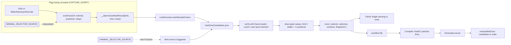
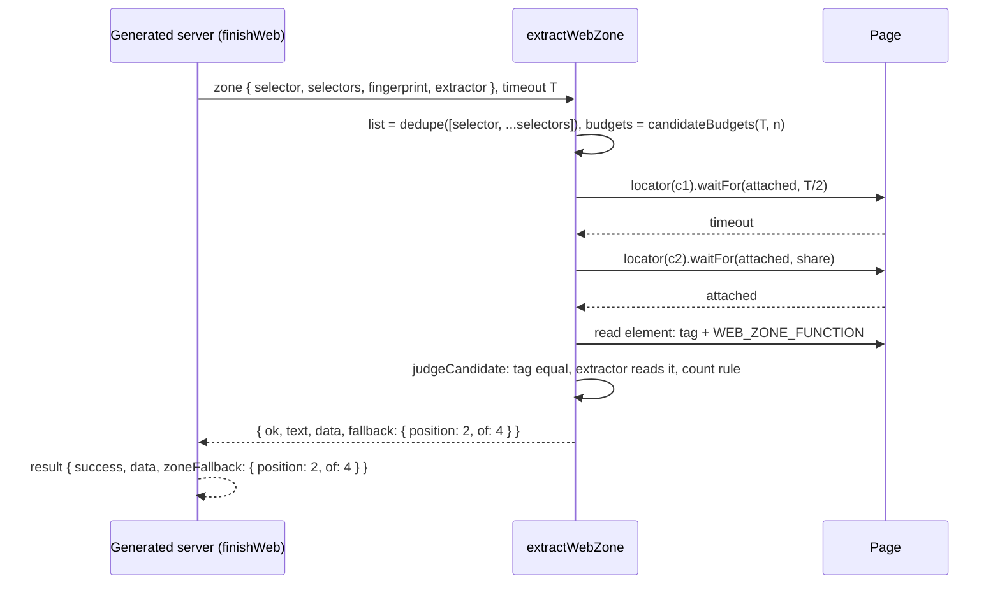

# Design Document: result-zone-selector-robustness

## Overview

This design gives a web Result_Zone the same safety net that steps already have: a ranked list of selectors, each proven on the live page when the user picks the zone, and a replay that tries them in order. It also fixes the three weaknesses found in the code: a CSS path built from `:nth-of-type` at every level, a role selector that is lost when the accessible name is cleared, and no check at pick time that the stored selector matches exactly one element.

Everything is an addition. A zone that has only `selector` is stored, compiled and replayed exactly as today. The new fields `selectors` and `fingerprint` are optional. A workflow set that has no zone with `selectors` compiles to byte-identical `mcp-server.ts`, `replay.ts` and `docker-replay.ts`, and the regression snapshot gets no new entry in `ALLOWED_DIFFERENCES`. `src/replay/runtime/*` keeps importing nothing from `src/`.

The work has five parts:

1. **One pure algorithm** (`src/recorder/minimal-selector.ts`) that computes the Minimal_Selector and the Positional_Path over an abstract node adapter. It exists once, as plain JavaScript source text, and runs in the browser (injected into `CAPTURE_SCRIPT`) and in Node (`src/suggest/html-zone.ts`, tests).
2. **A pure ranking function** (`src/recorder/zone-candidates.ts`) that turns the facts about the marked element into the ordered, deduplicated, bounded list.
3. **Verification at pick time** in `LiveRecorder` with Playwright's own locator engine, the one the replay uses, so a stored candidate was proven by the engine that will read it.
4. **Replay** in `src/replay/runtime/extract.ts` and `web-steps.ts`: ordered candidates, a shape check, a time budget, and a report of the fallback.
5. **A warning** in the recording panel for a Fragile_Zone, and the generator change that embeds the new fields only when they exist.

### Decisions in one place

| # | Question | Decision | Why, and what was rejected |
|---|---|---|---|
| 1 | Where the list lives | Optional `selectors` (array of 1 to 5 strings of 1 to 300 characters) next to `selector` on `ResultZone`. `selector` stays and equals `selectors[0]` for a recorded zone. | A new object replacing `selector` was rejected: an old reader would see no selector. |
| 2 | Shape check | Optional `fingerprint { tag, kind, count? }`. | See OP-1. |
| 3 | Row or item count tolerance (OP-1) | The count only separates empty from non-empty: a candidate is rejected when its count is 0 and the recorded count is at least 1, and a zone that is empty on every candidate is still returned from the first candidate that passed the tag check. The tag is compared strictly. | Results vary with the input, so an exact or percent tolerance rejects good zones. "Count at least 1" alone turns a legitimate empty result into `result_zone_not_found`, which is worse than today. The header row counts as a non-empty row of a table, so an empty result table still passes. |
| 4 | Hashed classes (OP-2) | One `isUnstableClass` predicate, defined below, reusing the `looksGenerated` patterns. In doubt, a class is unstable. | Accepting a suspicious class risks a selector that breaks on the next build. Rejecting a stable class only makes the selector a little longer. |
| 5 | One algorithm or two (OP-3) | One, written as plain JavaScript source text (`MINIMAL_SELECTOR_SOURCE`), interpolated into `CAPTURE_SCRIPT` and evaluated with `new Function` in Node. | See "Shared algorithm". Rejected: `fn.toString()` of a compiled TypeScript function, and two implementations. |
| 6 | Where candidates are verified | In `LiveRecorder`, with `frame.locator(candidate).count() === 1` and an identity check, not in the page with `querySelectorAll`. | `role=` and the other Playwright selectors cannot be checked with `querySelectorAll`. The replay uses `page.locator`, so the same engine gives the same answer. |
| 7 | Order | role and name, `data-testid`, non-generated id, `name` attribute, role alone, Minimal_Selector, Positional_Path. The first four are today's order. | See RC-2: a role alone is accidental (one table on the page today), so it ranks below stable attributes. This keeps `#orders` the primary of the existing tests. |
| 8 | Limit | At most four stable candidates plus one Positional_Path slot, so at most 5. | Cutting the tail of an eight-entry list would always drop the last resort. |
| 9 | Effective list at replay | `dedupe([selector, ...selectors])`. | A hand edit of `selector` takes effect first, and no equality rule can reject a file. |
| 10 | Fallback report | Success: `zoneFallback: { position, of }`. Failure: `failure.candidatesTried`. Both appear only for a zone with `selectors`. | Numbers carry no page text. |
| 11 | Generator | Two lines of the generated text are replaced by `patchLines` only when a zone of the set has `selectors`. | Same technique as the call-block variants (`usesWorkflowCall`). The alternative, new unconditional lines, would change every old snapshot. |
| 12 | Warning | Text in a new `ZONE_COPY` table, shown in the preview box, never blocking. | See "Recording panel". |
| 13 | Delivery | One serial seam group (G0), then groups with disjoint files, then seven commits (CG-0 to CG-6). | See "Implementation groups". |

### Research summary

The code was read before designing. Facts that shape the design:

- `CAPTURE_SCRIPT` is a template literal whose text is evaluated in every page and frame (`page.evaluate`, `addInitScript`, `frame.evaluate`). `tests/unit/capture-panel-logic.test.ts` asserts that the final text contains no backtick and no `${`. A string constant interpolated into the template satisfies this when the constant has neither. The file header states the rule that no function compiled by a bundler may run there, because a bundler can add helpers (`__name`) that do not exist in the page. The same rule is why `WEB_ZONE_FUNCTION` in `extract.ts` is source text.
- `src/suggest/html-zone.ts` has its own parser, its own `cssPath` (it stops before `body`) and a resolver, `resolveSelector`, that reads only: tag, `#id`, `.class`, `[attr]` and `[attr="v"]`, `:nth-of-type(n)`, the space and `>` combinators, and `role=r[name="n"]`. Anything else resolves to nothing. The algorithm output must stay inside that grammar. A hex escape that ends in a space would be split by its tokenizer, so identifiers that need escaping are not used at all.
- `extractWebZone` (`src/replay/runtime/web-steps.ts`) waits for `page.locator(selector).first()` to attach, then runs the in-page reader and `finishWebZone`. It is called by the generated server (`finishWeb`), by the host `PlaywrightDriver`, and by `record.ts` when a zone is checked at the end of a recording. A change there reaches all three.
- The generated server receives the zone through `finalOf` in `src/compiler/mcp-generator.ts`, which spreads the zone without `schema`. New fields are therefore embedded with no change to `finalOf`. The type text `export type ResultZone = Zone & { extractor?: ExtractorLike }` and the lines of `finishWeb` are the only generated lines that would change. `tests/unit/regression-fixture.test.ts` compares `mcp-server.ts`, `replay.ts` and `docker-replay.ts` of an old fixture with a stored snapshot, so those lines must not change for an old set.
- `handleMarkResult` is called synchronously by tests and by the binding `__daemonizeMarkResult`. The binding receives the Playwright source (`_source.frame`), which the handler can use to evaluate in the right frame.
- `tests/integration/result-zone-interactive.test.ts` line 127 asserts `toEqual({ selector: '#wiki-results', extractor: { kind: 'list' } })` on the zone the recorder holds. `tests/unit/suggest.test.ts` lines 123 and 130 assert `toEqual` on the suggested zone. These three assertions fail when the zone gains `selectors` and are changed, see "Behavior changes".
- `LiveRecorder` holds no secret value. Typed values are in `recorder.variableValues()`. The values of secret fields are never captured (the event carries a `secretRef`).

### Behavior changes named by the requirements

These differ from today, and a test names each one:

1. A zone marked in the page is stored with `selectors` and `fingerprint`. Its `selector` equals `selectors[0]`, which is the first candidate that was proven. It differs from today's `buildZoneSelector` result only when that result does not match exactly the marked element.
2. The `tag.class` shortcut of `resultInfoOf` is replaced. `info.css` becomes the Minimal_Selector when one exists.
3. `result-zone-interactive.test.ts:127` changes from `toEqual` to `toMatchObject({ selector: '#wiki-results', extractor: { kind: 'list' } })` plus `selectors[0] === selector`. This is an allowed difference of Requirement 1, not of Requirement 9, see RC-7.
4. The Suggester adds `selectors` to a suggested zone. `suggest.test.ts:123` and `:130` change from `toEqual` to `toMatchObject` plus `selectors[0] === selector`. The pull request lists both with this reason (Requirement 9.5).
5. A replay of a zone with `selectors` gives the first candidate half of the zone timeout (see "Replay"). A zone without `selectors` waits as before.
6. A call that used a fallback returns `zoneFallback`. A failed zone with `selectors` returns `failure.candidatesTried` and a message that says how many ways were tried.
7. For a set where a zone has `selectors`: the generated text has the extended `ResultZone` type and two more lines in `finishWeb`, and `openapi.json` describes `zoneFallback` for that workflow.

### Requirement conflicts and open points

| # | Where | Problem | Resolution in this design |
|---|---|---|---|
| OP-1 | 6.4 | Tolerance not fixed. | Decision 3. |
| OP-2 | Glossary, 3.4, 3.5 | Hashed_Class patterns not fixed. | "Unstable classes". |
| OP-3 | 9.6 | One implementation or two. | "Shared algorithm". |
| RC-1 | 5.1 and 2.1 | 5.1 says a Content_Role gets `role=<role>` with no condition. 2.1 keeps only candidates that match exactly one element. `role=row` matches many rows. | 2.1 wins. A role alone is emitted for every role and kept only when it is unique. 5.2 and 5.3 already say this for other roles. |
| RC-2 | 1.2 | "role selector" first. A role alone is unique by accident, and ranking it first would replace `#orders` by `role=table` in four existing tests. | "role selector" means role and name, as today. A role alone ranks after the `name` attribute and before the Minimal_Selector. |
| RC-3 | 7.6 | An older version that rejects unknown fields rejects the whole file, because `ResultZone` has `additionalProperties: false`. No change made now can alter that. | Not achievable as worded. What the design guarantees: `selector` stays valid alone, an older version fails at load with its normal "unknown field" message, and nothing is replayed with a wrong zone. |
| RC-4 | 3.7 | "no longer than the full Positional_Path" cannot hold in characters: `.result-table` is longer than `table`. | Measured in levels (compound selectors). The algorithm never uses more levels than the Positional_Path, and the 300 character limit bounds the length. |
| RC-5 | 10.1 and 5.4 | A role selector holds an accessible name (`role=table[name="Orders"]`), which is text. Existing tests and 5.4 allow it. | "Text content of the page" means the text inside the marked element. A name from `aria-label`, a caption or `title`, of at most 80 characters, stays. A name that equals or starts the content is already cleared by `resultInfoOf`, and a Content_Role never keeps its name. |
| RC-6 | 8.6 | "the recorder copy table" does not exist: the panel texts are literals in `capture-script.ts`. | A new `ZONE_COPY` table in `src/recorder/zone-copy.ts` is interpolated into the script, and a new unit test applies the banned-word regex to it. |
| RC-7 | Constraints | "Snapshots change only as Requirement 9 documents", but change 3 above comes from Requirement 1. | Named in "Behavior changes" and listed in the pull request. |
| RC-8 | 3.6 | The recorder holds no secret value. | The algorithm uses only ids, `data-testid`, `role`, classes and tags, never free text. `LiveRecorder` additionally drops a candidate that contains a typed value of the recording (3 characters or more). |

## Architecture



### A call whose first selector no longer matches



### Security analysis

| Question | Answer |
|---|---|
| Can a stored selector run as code? | No. A candidate goes to `page.locator(string)` only. The schema rejects a non-string, a string over 300 characters and a list over 5 entries. |
| Can a page make the recorder write a selector that adds a clause? | The algorithm writes only tags, plain ASCII identifiers (`^-?[A-Za-z_][A-Za-z0-9_-]*$`) and attribute values of the set `[A-Za-z0-9 _.:/@-]`, up to 60 characters, inside double quotes. A value outside that set makes the level unusable. The host-built candidates keep the existing `escapeQuotes` and `cssEscape`. |
| Page text or a secret in a selector | Not used as a source. Typed values are filtered out. The fingerprint holds a tag, a kind and a number. |
| Cost of the new checks | At most 8 raw candidates, each verified with two locator calls; the algorithm does at most about 200 `querySelectorAll` calls. |

## Components and Interfaces

All signatures below are final for the seam group G0. A later group may add exports and may not change one. Functions that belong to another group throw `Error('not implemented: <group>')` in G0.

### 1. The shared algorithm (`src/recorder/minimal-selector.ts`, group G-A)

```ts
/** What the algorithm needs to know about a document. N is a DOM Element or an HtmlNode. */
export interface NodeAdapter<N> {
  parent(n: N): N | undefined;          // undefined above the top element (html, or the parsed root)
  tag(n: N): string;                    // lower case
  attr(n: N, name: string): string | undefined;
  classes(n: N): string[];              // in attribute order
  sameTagSiblings(n: N): N[];           // element siblings with the same tag, document order, n included
  resolve(selector: string): N[];       // every match in the document, document order
}
export interface MinimalSelectorOptions {
  maxLength?: number;                   // default 300
  includeBody?: boolean;                // browser: true (path starts at body); html-zone: false (as today)
}
export interface MinimalSelectorResult {
  minimal?: string;                     // unique, stable-first; undefined when none is within maxLength
  positional: string;                   // the full Positional_Path, same format as today's cssPath
  levels: { minimal: number; positional: number };
}
/** Plain JavaScript, no backtick, no `${`. Declares one function: daemonizeMinimalSelector(adapter, target, options). */
export const MINIMAL_SELECTOR_SOURCE: string;
/** Node side: the same text evaluated once with `new Function`. */
export function createMinimalSelector<N>(): (adapter: NodeAdapter<N>, target: N, options?: MinimalSelectorOptions) => MinimalSelectorResult;
export function isUnstableClass(name: string): boolean;     // exported for tests, also defined inside the source
export function isGeneratedId(id: string): boolean;         // idem
export function isPositionalSelector(selector: string): boolean;
```

`isPositionalSelector` is true when the selector contains `:nth-of-type`, `:nth-child`, `:first-child` or `:last-child`. It exists in TypeScript only; it is a string test that needs no DOM.

**Levels.** For a node the algorithm builds an ordered list of compounds. A kind that cannot be written safely is skipped.

1. `#id` (id is a plain identifier and not `isGeneratedId`)
2. `tag[data-testid="v"]`
3. `tag[role="v"]`
4. `tag.class` for each stable class, at most 2, in attribute order
5. `tag`
6. `tag:nth-of-type(k)`, only when `sameTagSiblings` has more than one entry (the only positional kind)

An **Anchor** is a node with a compound of kind 1 to 4, or a landmark tag (`main nav header footer aside form section article table ul ol dl`). `html` and `body` are never anchors.

**Procedure.** `target` is the marked element.

1. For each compound of the target of kinds 1 to 5 in order, return it when `resolve` gives exactly `[target]`.
2. Climb: take the nearest Anchor above the highest node used so far (non-anchors are skipped, the descendant combinator allows it). Its best compound is `A`, the target's best compound of kinds 1 to 5 is `T`. Try `A T`. If it is not unique and the anchor is the direct parent, try `A > T`. Return the first unique. Otherwise keep the anchor in the chain and continue. At most 6 anchors.
3. Positional extension: with the nearest anchor `A`, add the nodes between `A` and the target one by one, from the target upward, each as `tag` or `tag:nth-of-type(k)`, joined by `>`, until unique. The result starts with `A`.
4. No anchor, or step 3 did not reach uniqueness: the shortest unique suffix of the full Positional_Path.
5. A result longer than `maxLength` is dropped (`minimal` undefined).

The full Positional_Path has the format of `cssPath` today (`body > div:nth-of-type(2) > main > ... > p`, or from the nearest ancestor with a non-generated id). It uses `nth-of-type` only where siblings share the tag, as today. In the browser an ancestor with a generated id does not start the path: the path goes on to `body`.

**Unstable classes (OP-2).** `isUnstableClass(name)` is true when any rule holds. The patterns are case sensitive unless noted.

| # | Family | Rule |
|---|---|---|
| 1 | Generated ids reused | `isGeneratedId(name)`: the six `looksGenerated` patterns (hex run of 8 or more, digits only, React 18 and 19 `useId`, `radix-`). The patterns are copied into the source; a test compares `isGeneratedId` with `looksGenerated` on generated strings so they cannot drift. |
| 2 | Digit runs | `/\d{4,}/` |
| 3 | Emotion | `/^css-[A-Za-z0-9]+(-[A-Za-z0-9]+)?$/` |
| 4 | styled-components and styled-jsx | `/^sc-[A-Za-z0-9]+$/`, `/^jsx-\d+$/`, and the short second class: `/^(?=.*[a-z])(?=.*[A-Z])[A-Za-z]{5,8}$/` (a camel case word of 5 to 8 letters such as `isActive` is also rejected on purpose) |
| 5 | Svelte | `/^svelte-[a-z0-9]{5,}$/` |
| 6 | CSS Modules | `/^_[A-Za-z0-9]{5,}$/`, `/^[A-Za-z0-9]+_[A-Za-z0-9-]+__[A-Za-z0-9_-]{5,}$/`, and a suffix after `-` or `_` of 5 to 8 characters that holds both a letter and a digit (`/[-_](?=[A-Za-z0-9]*\d)(?=[A-Za-z0-9]*[A-Za-z])[A-Za-z0-9]{5,8}$/`). BEM names such as `card__title` stay stable: the suffix has no digit. |
| 7 | Tailwind arbitrary values and variants | the name contains one of `[ ] ( ) : / ! @ % , =` or `.` |
| 8 | Tailwind and Bootstrap utilities | `/^-?(m\|p\|w\|h\|gap\|space\|text\|bg\|border\|rounded\|flex\|grid\|col\|row\|top\|left\|right\|bottom\|z\|min\|max\|opacity\|shadow\|font\|leading\|tracking\|justify\|items\|self\|overflow\|order)[xytblrse]?-[\w.]+$/` and the names `flex grid hidden block inline container row col` |
| 9 | State classes | `active selected open opened show shown hover focus focused disabled checked expanded collapsed loading current`, and `/^(is\|has)-/` |
| 10 | Not a plain identifier | does not match `^-?[A-Za-z_][A-Za-z0-9_-]*$`, or is longer than 40 characters |

A class that is rejected by mistake costs a longer selector. A class that is accepted by mistake costs a broken tool, so each doubtful family is on the rejecting side.

### 2. Shared algorithm: one implementation (OP-3)

| Option | For | Against |
|---|---|---|
| **A. One plain JavaScript source text, interpolated into `CAPTURE_SCRIPT` and evaluated with `new Function` in Node (chosen)** | One behavior by construction. Same pattern as `WEB_ZONE_FUNCTION`. No helper from a bundler can be missing. The existing test (no backtick, no `${`) guards the text. | The source is a string, so TypeScript does not check it. `new Function` in Node. |
| B. A TypeScript function, injected with `fn.toString()` | Typed. | `tsx`, `esbuild` and `vitest` can wrap or rename functions (`__name`, `keepNames`), and the output can then reference a helper that does not exist in the page. The file header of `capture-script.ts` forbids this. |
| C. Two implementations and one test suite | Typed Node side. | Two copies drift. The property suite would be the only guard. |

The type problem of A is reduced by the `NodeAdapter` interface and the `createMinimalSelector` wrapper, which are typed, and by a **differential property** (Property 12): the algorithm run on a random HTML document through the browser adapter and through the `html-zone` adapter must return the same selector. This is also the "single test suite" that Requirement 9.6 asks for if C were chosen, so the requirement holds either way.

Adapters:

- Browser (inside `CAPTURE_SCRIPT`): `parent = el.parentElement` (undefined for `html`), `classes = Array.from(el.classList)`, `resolve = (s) => Array.from(document.querySelectorAll(s))`, `includeBody: true`.
- `html-zone.ts`: `parent = node.parent` (undefined at `#root` and `html`), `classes` from the `class` attribute, `resolve = (s) => resolveSelector(root, s)`, `includeBody: false`.

### 3. Candidate ranking (`src/recorder/zone-candidates.ts`, group G-B)

```ts
export interface ZoneFacts {
  minimal?: string;                 // from the algorithm
  positional?: string;              // from the algorithm
  shape?: { tag: string; tableRows?: number; listItems?: number };
}
export const CANDIDATE_LIMIT = 5;
export const STABLE_SLOTS = 4;
export const SELECTOR_LENGTH_LIMIT = 300;

/** Ordered and deduplicated, unverified. Role and name, test id, id, name attribute, role alone, minimal, positional. */
export function zoneCandidateSelectors(info: ElementInfo, facts: ZoneFacts): string[];
/** Remove a candidate that holds a known value, then keep at most 4 stable ones and one positional one, each within 300 characters. */
export function limitCandidates(verified: string[], knownValues: readonly string[]): string[];
/** Every entry is positional (or there is none). */
export function isFragile(selectors: readonly string[]): boolean;
export function zoneFingerprint(facts: ZoneFacts, kind: string): ZoneFingerprint | undefined;
```

`zoneCandidateSelectors` uses `buildSelectors({ role, name, id, testId, nameAttr })` for the first four kinds (so escaping and the generated-id rule stay in one place), then adds `role=<role>` when `info.role` is set, then `facts.minimal`, then `facts.positional`. The `css` field of the info is not used. `buildSelectors` is not modified (Requirement 5.5). A value of `knownValues` shorter than 3 characters is ignored.

`zoneFingerprint` returns `{ tag, kind, count? }` with `count` set only for the kinds `table` (`shape.tableRows`) and `list` (`shape.listItems`) and only when it is 1 or more. It returns undefined without `shape`.

### 4. The recorder (`src/recorder/live-recorder.ts`, `capture-script.ts`, group G-B)

`MarkResultRequest` gets `zone?: ZoneFacts`. `MarkResultResult` success gets `selectors?: string[]`, `fragile?: boolean`.

```ts
// live-recorder.ts
handleMarkResult(request: MarkResultRequest): MarkResultResult;      // unchanged, sync, legacy path: selector only
async markResultInFrame(request: MarkResultRequest, frame: Frame): Promise<MarkResultResult>;
```

The binding `__daemonizeMarkResult` calls `markResultInFrame(request, source.frame)`. `markResultInFrame`:

1. `base = buildZoneSelector(request.info)`. When it is undefined the answer is `{ ok: false, error: 'No stable selector for this element' }` as today. A kind that is not in `WEB_KINDS` is refused as today.
2. Without `request.zone` (an older injected script) it behaves like `handleMarkResult`: a zone with `selector` only.
3. With it, `raw = zoneCandidateSelectors(request.info, request.zone)`. Each candidate is verified: `await frame.locator(c).count() === 1` and then `evaluate` of `window.__daemonizeHelpers.isZoneTarget(el)`. A candidate whose check throws is left out and the others go on (Requirement 2.4).
4. `list = limitCandidates(verified, typedValues)` with `typedValues` from `recorder.variableValues()`.
5. When `list` is empty, `request.zone.positional` is kept when present (Requirement 2.2). When even that is missing, the legacy `base` is stored as `selector` alone.
6. The zone is `{ selector: list[0], selectors: list, extractor: { kind }, fingerprint }` and the answer is `{ ok: true, selector, kind, selectors, fragile: isFragile(list) }`. The same call serves a kind change from the tabs: the fingerprint is rebuilt with the new kind and the candidates are served from a per-element cache keyed by the element identity, so a tab click does not verify again.

The page side (`capture-script.ts`):

- `zoneFactsOf(el)` calls `daemonizeMinimalSelector` with the browser adapter and returns the facts. It also reads `analyzeZone(el, 'table')` and `analyzeZone(el, 'list')` row and item counts. `analyzeZone` gets one more field, `count`, on its table and list results; its other fields, and so the preview, do not change.
- `resultInfoOf` no longer applies the `tag.class` replacement. It sets `info.css` to the Minimal_Selector when there is one.
- `finishMarkResult`, the Wider/Narrower handler and the kind tabs pass `zone: zoneFactsOf(el)` and store `fragile` in `lastMark`. A variable `zoneTarget` holds the element and `__daemonizeHelpers.isZoneTarget(el)` returns `el === zoneTarget`.
- `MINIMAL_SELECTOR_SOURCE` is interpolated once, near `cssPath`. `cssPath` itself is not changed because steps use it.

### 5. Recording panel

`src/recorder/zone-copy.ts`:

```ts
export const ZONE_COPY = {
  fragile: 'This spot may stop working if the page changes. Try Wider or Narrower, or pick a nearby element that has a name.',
} as const;
```

The text has no apostrophe, backtick or `${`, because it is interpolated into the script. It contains none of the banned whole words (`record`, `compile`, `storage state`, `environment variable`, `MCP`, `JSON`, `token`, `CLI`). In the preview box (`result-preview`), after the badge row, the panel adds `div[data-daemonize-action=result-fragile]` with that text when `lastMark.fragile` is true. It reuses the existing text style tokens (`K.text`, `K.muted`), so `recording-panel-contrast.test.ts` is unaffected. Nothing disables "Finish and save". Wider and Narrower call `__daemonizeMarkResult` again, which returns the new `fragile`, and `renderPanel()` shows or removes the line (Requirement 8.4). The hover highlight, the trail, the badge and the kind suggestion are not touched.

### 6. Types and schema (`src/types.ts`, `src/workflow/workflow-set.ts`, group G0)

```ts
export interface ZoneFingerprint { tag: string; kind: string; count?: number }
export interface ResultZone {
  selector?: string;
  selectors?: string[];                 // new, optional
  fingerprint?: ZoneFingerprint;        // new, optional
  rect?: { row: number; col: number; rows: number; cols: number };
  extractor?: Extractor;
  schema?: Record<string, unknown>;
}
```

Schema, in `$defs.ResultZone.properties`:

```ts
selectors: { type: 'array', minItems: 1, maxItems: 5, items: { type: 'string', minLength: 1, maxLength: 300 } },
fingerprint: {
  type: 'object', required: ['tag', 'kind'], additionalProperties: false,
  properties: {
    tag: { type: 'string', pattern: '^[a-z][a-z0-9-]{0,30}$' },
    kind: { enum: ['text', 'table', 'list', 'fields', 'json', 'attribute', 'regex'] },
    count: { type: 'integer', minimum: 1 },
  },
},
```

`additionalProperties: false` stays on `ResultZone`. A zone with neither field validates as before, and `serializeWorkflowSet` writes it byte for byte as before because it only serializes the object it is given. The existing error text of the validator names the instance path (`/workflows/0/resultZone/selectors/2`), which satisfies Requirement 10.6.

### 7. Replay runtime (`src/replay/runtime/extract.ts`, `web-steps.ts`, group G-C)

`extract.ts` gets, all pure and dependency free:

```ts
export interface FingerprintLike { tag: string; kind: string; count?: number }
export interface ZoneLike { /* existing */ selectors?: string[]; fingerprint?: FingerprintLike }

/** undefined means: no candidates, use the old path. Otherwise dedupe([selector, ...selectors]), at most 6. */
export function zoneCandidatesOf(zone: ZoneLike): string[] | undefined;
/** Wait per candidate: [T] for one; first = ceil(T/2), the others floor((T - first) / (n - 1)); every entry at least 1. */
export function candidateBudgets(timeoutMs: number, n: number): number[];
/** The count the zone has for its kind: table = non-empty rows of [header, ...rows]; list = non-empty items. */
export function zoneCount(raw: RawWebZone, kind: string): number | undefined;
export type Verdict = 'accepted' | 'soft' | 'rejected';
export function judgeCandidate(raw: RawWebZone | undefined, tag: string | undefined, zone: ZoneLike): { verdict: Verdict; outcome: ZoneOutcome };
```

`judgeCandidate`:

1. `raw === undefined` (nothing matched), or the outcome of `finishWebZone(raw, zone)` is not `ok`: `rejected`. This is the "extractor can read the element" rule (6.2).
2. With a fingerprint and `tag !== fingerprint.tag`: `rejected` (6.3).
3. With `fingerprint.count` set, `fingerprint.kind === zone.extractor.kind` and `zoneCount(raw, kind) === 0`: `soft` (6.4).
4. Otherwise `accepted`.

`ZoneOutcome` gets, on success, `fallback?: { position: number; of: number }` and, on failure, `tried?: number`. `zoneFailureResult` adds `candidatesTried` inside `failure` only when `tried` is defined, and `notFoundMessage` is not changed for a zone without candidates. A new `notFoundAfterCandidates(zone, tried)` words the multi-candidate failure: "The result zone matched nothing after trying N ways to find it; the steps of the workflow already ran (a write step is not undone), only reading its result failed." No selector text beyond today's, and no page text.

`web-steps.ts`: `extractWebZone` begins with `const list = zoneCandidatesOf(zone); if (list === undefined) { ...the current body, unchanged }`. The new branch loops over `list` with `candidateBudgets(timeoutMs, list.length)`. For each candidate it waits for `attached` within its budget, installs `WEB_ZONE_FUNCTION`, and evaluates `(el, ex) => ({ tag: el.tagName.toLowerCase(), raw: window.__daemonizeZone(el, ex) })` on `page.locator(c).first()`. A thrown error is `rejected` for that candidate and not for the call. It returns the first `accepted`. A `soft` verdict is kept (the first one) and the loop goes on. After the loop: the kept `soft` outcome if any, else `zoneFailure('result_zone_not_found', notFoundAfterCandidates(zone, list.length), zone)` with `tried`. When the accepted or soft candidate is not the first of `list`, the outcome carries `fallback: { position: index + 1, of: list.length }`. `window.__daemonizeZone` is deleted in `finally`, as today.

**Time (Requirement 6.5).** The call timeout `T` comes from `boundStepTimeoutMs`, as today. With candidates, the primary waits at most `ceil(T/2)` and each other candidate at most `floor((T - ceil(T/2)) / (n - 1))`. A page that renders slower than half of `T` is a regression for a new zone, in exchange for reaching the fallbacks in time. The rule is in the pure `candidateBudgets` and documented in the generated `SKILL.md` text only if the existing text already describes the zone timeout (it does not, so nothing is added).

### 8. Generator (`src/compiler/mcp-generator.ts`, `src/schema/schema-inferencer.ts`, group G-D)

`finalOf` is unchanged: it already spreads the zone without `schema`, so `selectors` and `fingerprint` are written into the `final` object as JSON. For a set where `usesZoneCandidates(set)` is false (no workflow of the set, nor a step, has a zone with `selectors`) nothing is emitted that was not emitted before. When it is true, `patchLines` is applied once to the assembled web lines:

| Line replaced (exact text today) | Replacement |
|---|---|
| ``export type ResultZone = Zone & { extractor?: ExtractorLike };`` | the same with `; selectors?: string[]; fingerprint?: { tag: string; kind: string; count?: number }` inside the braces |
| ``    ...(final.resultZone === undefined ? {} : { data }),`` | the same line, then ``    ...(read.fallback === undefined ? {} : { zoneFallback: read.fallback }),`` |

`read` is declared inside the `else` block of `finishWeb`, so the second line is placed with a `let fallback: { position: number; of: number } | undefined;` before the `if` and an assignment `fallback = read.fallback;` after `text = read.text;`. These three small insertions use `patchLines` `after`, so a missing anchor line throws at generation time instead of silently generating a different file. `patchLines` throws when the line text is not found, which a test turns into a failing generator test whenever someone edits the base lines.

A terminal set never has `selectors` (the zone is a rectangle), so terminal output is unchanged.

`SchemaInferencer` adds `zoneFallback: { type: 'object', properties: { position: {type:'integer'}, of: {type:'integer'} } }` to `outputSchema.properties` only when the zone has `selectors`. `drifted` and the other fields are untouched.

### 9. Suggester (`src/suggest/html-zone.ts`, `suggester.ts`, group G-E)

- `SuggestedResultZone` gets `selectors?: string[]`, and the JSON schema of the model suggester at `suggester.ts:118` accepts it.
- `zoneSelectorFor(node, root)` builds `facts` with `createMinimalSelector()` and the `html-zone` adapter, builds the raw list with `zoneCandidateSelectors(elementInfo(node, root), facts)`, keeps the candidates for which `resolveSelector(root, c)` is exactly `[node]`, and applies `limitCandidates(…, [])`. `suggestResultZone` returns `{ selector: list[0], selectors: list, extractor }`. A candidate that the resolver cannot read resolves to nothing and is dropped, as today.
- The local `cssPath` of `html-zone.ts` is removed in favour of `positional` from the algorithm; its format (no `body`) is kept through `includeBody: false`.
- The suggester sets no fingerprint: the Studio would have to copy it, and Requirement 9 does not ask for it. The replay then does only the extractor check for such a zone.
- The code that copies a `SuggestedResultZone` into a workflow is found with `grep entry.resultZone|resultZone` in `src/studio/**` (including `ui/js`) in task 6.1, and made to copy `selectors` too.

## Data Models

**A recorded zone** (web):

```json
{
  "selector": "role=table[name=\"Orders\"]",
  "selectors": [
    "role=table[name=\"Orders\"]",
    "#orders",
    "main table.orders-grid",
    "body > div:nth-of-type(2) > main > div > table"
  ],
  "extractor": { "kind": "table" },
  "fingerprint": { "tag": "table", "kind": "table", "count": 12 },
  "schema": { "type": "array" }
}
```

An old zone, `{ "selector": "#orders", "extractor": { "kind": "table" } }`, is valid, loads unchanged and is written back unchanged.

**What the generated server embeds** (the `final` object): the same zone without `schema`, which includes `selectors` and `fingerprint` when the zone has them.

**Replay result additions** (only for a zone with `selectors`):

```json
{ "success": true, "data": [], "zoneFallback": { "position": 2, "of": 4 } }
{ "success": false, "drifted": true, "error": "result_zone_not_found", "message": "...", "failure": { "zone": { "selector": "..." }, "candidatesTried": 4 }, "elapsedMs": 8120 }
```

`position` is 1-based in the effective list. `zoneFallback` is absent when the first candidate was accepted (Requirement 6.9).

## Correctness Properties

*A property is a characteristic or behavior that should hold true across all valid executions of a system-essentially, a formal statement about what the system should do. Properties serve as the bridge between human-readable specifications and machine-verifiable correctness guarantees.*

Criteria that are not properties: 8.5 (the user can still finish; an example test), 8.7 and 6.10 (existing tests keep passing), 2.4 (an example with a faulty frame), 5.5 (existing `buildSelectors` tests), 7.3 (compatibility test against a stored old server), 9.3 (existing resolver behavior), 11.7 to 11.10 (test requirements).

### Property 1: Candidate list shape

For any element info and any facts, `limitCandidates(zoneCandidateSelectors(info, facts), [])` has no duplicate, at most 5 entries, at most 4 entries that are not positional, each entry of at most 300 characters, and every positional entry is last.

**Validates: Requirements 1.2, 1.3, 1.4, 1.5**

### Property 2: Ranking order

For any element info and facts, the entries of `zoneCandidateSelectors` appear in the kind order role and name, test id, id, `name` attribute, role alone, minimal, positional, and `selector` of a stored zone equals the first entry.

**Validates: Requirements 1.1, 1.2**

### Property 3: Determinism of the stored zone

For any page and any marked element, building the zone twice (algorithm, ranking, fingerprint) gives equal results.

**Validates: Requirements 1.8, 3.9**

### Property 4: Minimal selector is unique

For any generated page and any marked element, when `minimal` is defined, `resolve(minimal)` is exactly `[target]` in that page, with both adapters.

**Validates: Requirements 3.1, 3.8, 11.1**

### Property 5: Minimal selector uses no more levels than the positional path

For any generated page and any marked element, `levels.minimal <= levels.positional`, and `minimal` is at most 300 characters.

**Validates: Requirements 3.7, 3.11, 11.2**

### Property 6: Idempotence

For any generated page and any marked element, running the algorithm twice returns the same result.

**Validates: Requirements 3.9, 11.3**

### Property 7: No volatile source

For any generated page that holds elements with a generated id, an unstable class, or text, no `minimal` and no ranked candidate built by the algorithm contains that id, that class or that text. The levels used are only kinds 1 to 6.

**Validates: Requirements 3.4, 3.5, 4.2, 11.4**

### Property 8: Safe grammar

For any page whose ids, classes and attribute values are arbitrary strings (including quotes, brackets, `>`, spaces, backslashes), every selector the algorithm returns is accepted by the `html-zone` selector parser and uses only the allowed grammar, and `querySelectorAll` in the browser accepts it without error.

**Validates: Requirements 10.4**

### Property 9: Candidates are proven

For any generated page and any marked element, after verification each stored candidate resolves to exactly the marked element on the recorded page, using the same resolver as the replay (the Playwright locator in the browser, `resolveSelector` for parsed HTML). A candidate that does not is not stored.

**Validates: Requirements 2.1, 2.3, 11.1**

### Property 10: Fragile classification

For any candidate list, `isFragile` is true exactly when the list is empty or every entry is positional, and the panel shows the warning exactly when `fragile` is true.

**Validates: Requirements 2.2, 8.1, 8.3**

### Property 11: A role alone is emitted and kept only when unique

For any page and element with a role and no stored name, `role=<role>` is in the raw list, and it is in the stored list exactly when its locator matches one element. No role selector holds the name of a Content_Role.

**Validates: Requirements 5.1, 5.2, 5.3, 5.4**

### Property 12: One behavior in both environments

For any generated HTML document and any element, the algorithm through the browser adapter and through the `html-zone` adapter returns the same `minimal`, `positional` (after the `body` prefix is accounted for) and `levels`.

**Validates: Requirements 9.1, 9.6**

### Property 13: Suggested candidates resolve to the suggested node

For any generated final screen, every entry of `suggestResultZone(html).selectors` resolves to exactly the suggested node on the parsed document, and `selector` equals the first entry.

**Validates: Requirements 9.2, 9.4**

### Property 14: First accepted candidate wins

For any list of candidate readings (matched or not, tag, count, readable or not), the replay returns the first reading whose verdict is `accepted`, else the first `soft`, else `result_zone_not_found` with `tried` equal to the list length. `fallback.position` is the 1-based index of the returned candidate, and `fallback` is absent when the index is 1.

**Validates: Requirements 6.1, 6.2, 6.6, 6.7, 6.9**

### Property 15: Fingerprint rule

For any reading, a fingerprint tag different from the element tag gives `rejected`; a recorded count of 1 or more with a current count of 0 for the same kind gives `soft`; a current count of 1 or more, a missing count, or another kind gives no count rejection.

**Validates: Requirements 6.3, 6.4**

### Property 16: Time budget

For any timeout `T` of 2 times `n` or more and any `n` from 1 to 6, `candidateBudgets(T, n)` has `n` entries, each at least 1, a sum of at most `T`, and the first entry is the largest.

**Validates: Requirements 6.5**

### Property 17: A zone without candidates behaves as before

For any zone with `selector` and no `selectors`, `zoneCandidatesOf` is undefined, and `extractWebZone` returns for any page the same outcome as the previous version of the function kept in the test as an oracle.

**Validates: Requirements 6.8, 7.5, 11.6**

### Property 18: Serialization round trip

For any valid workflow set whose zones have any mix of `selector`, `selectors`, `fingerprint`, serialize then deserialize returns an equal set, and for a set with neither field the serialized text equals the text produced before the change.

**Validates: Requirements 1.7, 7.1, 7.2, 11.5**

### Property 19: Bounds are enforced

For any zone with a non-string candidate, a candidate longer than 300 characters, more than 5 candidates, an empty list, or a malformed fingerprint, `serializeWorkflowSet` rejects it with a message that holds the path of the field.

**Validates: Requirements 10.6**

### Property 20: Typed values never appear

For any typed value of 3 or more characters and any candidate list, `limitCandidates(list, [value])` has no entry that contains the value, and the fingerprint holds only a lower case tag, a kind and a positive integer.

**Validates: Requirements 10.1, 10.2, 10.3**

### Property 21: Generated text differs only by the named lines

For any workflow set without a zone that has `selectors`, the generated `mcp-server.ts`, `replay.ts` and `docker-replay.ts` equal the text generated without this change. For a set with such a zone, removing the three named insertions and the extended type fragment gives that same text, and the embedded `final` object holds `selectors` and `fingerprint`.

**Validates: Requirements 7.3, 7.4, 11.6**

### Property 22: Panel text is plain

For any text of `ZONE_COPY`, no banned whole word (case insensitive) appears, and the text is part of `CAPTURE_SCRIPT` without backtick or `${`.

**Validates: Requirements 8.2, 8.6, 11.8**

## Error Handling

| Situation | Behavior |
|---|---|
| No candidate verified | The Positional_Path of the facts is stored and `fragile` is true. The user is told, not blocked. |
| No facts and no positional (an older script, or the algorithm returned nothing and the path is over 300 characters) | The zone is stored with `selector` only, as today. |
| A frame detached during verification | The check of that candidate counts as failed (Requirement 2.4). If all fail, as above. |
| Candidate throws in the page at replay | Rejected for that candidate; the next one is tried. |
| The first soft candidate (count 0) and nothing better | Returned, with `data` empty for a table or a list. No error. |
| No candidate accepted | `result_zone_not_found`, `drifted: true`, `failure.candidatesTried`, message without page text. The steps already ran, and the message says so, as today. |
| Locator error that is not a timeout (invalid selector in a hand-edited file) | Rejected for that candidate. The call result is not `result_extraction_failed`; only a failure of the extractor on an accepted element is. |
| Old generated server | Ignores nothing: it embeds no new field and has the old runtime copy. |
| Workflow file written by this version, opened by an older one | The older loader refuses the zone with its unknown-field message (RC-3). |

## Testing Strategy

The feature has pure functions with large input spaces (the algorithm, the ranking, the verdict rule, the budgets), so property tests apply. Property-based testing uses `fast-check`, already used in `tests/property/`. Each property is one test, runs at least 100 iterations, and carries the tag `Feature: result-zone-selector-robustness, Property N: <text>`. HTML pages are generated by a shared arbitrary `tests/helpers/zone-arbitraries.ts` (nested elements, repeated siblings, ids and classes of every family in the unstable table, `data-testid`, `role`, text, hostile attribute values). The browser side of Properties 4 to 9 and 12 runs the algorithm in a Playwright page with `page.setContent`, many documents per `page.evaluate` call, so 100 iterations stay fast.

**Unit and example tests**

- The real recorded path of the Introduction (`body > div:nth-of-type(2) > main > div > div > div:nth-of-type(4) > div:nth-of-type(1) > div > div:nth-of-type(1) > p`): the algorithm returns a shorter unique selector when an anchor exists, and the whole path when none (Requirement 11.7).
- Role alone: `<div role="status">` (unique) gives `role=status`; two statuses give no role candidate.
- A zone with the first candidate removed from the page and the second present: `data` from the second, `zoneFallback.position === 2`. A zone where no candidate matches: `result_zone_not_found` with `candidatesTried`.
- A legitimate empty result (table with a header only): returned from the primary, no fallback.
- Panel: the warning exists for a page whose only candidate is positional, is absent otherwise, and goes away after Wider (Requirement 8.8). `capture-panel-logic.test.ts` (no backtick, no `${`) stays and covers the interpolated source.
- Copy: `tests/unit/zone-copy.test.ts` applies the banned-word regex of `studio-ui-copy.test.ts` to `ZONE_COPY`.
- Drift guard: `isGeneratedId` equals `looksGenerated` on generated strings.
- `generated-no-src-import.test.ts` stays as is. `extract.ts` and `web-steps.ts` import nothing new.
- Regression: `regression-fixture.test.ts` gets **no** new `ALLOWED_DIFFERENCES` entry. `generated-compat.test.ts` and `generator-firewall.test.ts` pass unchanged. `merge-compat.test.ts` and `workflow-set-compat.test.ts` keep their old fixtures.

**Integration tests (Playwright, no network)**

- `tests/integration/result-zone-robustness.test.ts` records a zone on a local page, changes the page layout (adds a wrapper div, reorders siblings, renames a generated class) and replays through a generated server: the result is returned and `zoneFallback` is reported when the first candidate broke.
- `result-zone-interactive.test.ts` line 127 changes as stated. The other assertions of that file pass unchanged.
- `result-zone.test.ts` keeps `toMatchObject({ selector: '#orders' ... })` unchanged.

**What is not property tested**: the panel layout, the Playwright locator behavior itself, and the time it takes to reach a fallback on a real page (one example each).

## Implementation groups

G0 is serial and creates the contracts. After G0, groups own disjoint files. A group may add an export to a file it does not own only through G0.

| Group | Owns (files) | Depends on | Commit |
|---|---|---|---|
| **G0 seam** (serial, first) | `src/types.ts`, `src/workflow/workflow-set.ts` (schema), `src/recorder/zone-candidates.ts` (signatures, stubs), `src/recorder/minimal-selector.ts` (signatures, `MINIMAL_SELECTOR_SOURCE` stub that declares `daemonizeMinimalSelector` returning `{ positional: '', levels: {...} }`), `src/recorder/zone-copy.ts` (real text), `src/replay/runtime/extract.ts` (types and stubs of `zoneCandidatesOf`, `candidateBudgets`, `zoneCount`, `judgeCandidate`), `tests/helpers/zone-arbitraries.ts`, schema and round-trip tests (Properties 18, 19) | none | **CG-0** schema, types and contracts |
| **G-A algorithm** | `src/recorder/minimal-selector.ts` (real source, class rules), `tests/unit/minimal-selector.test.ts`, `tests/property/minimal-selector.property.test.ts` (Properties 4 to 8, 12 in the HTML adapter and the browser adapter) | G0 | **CG-1** minimal selector algorithm |
| **G-C replay** | `src/replay/runtime/extract.ts` (real functions), `src/replay/runtime/web-steps.ts`, `tests/unit/extract.test.ts` (additions), `tests/unit/zone-candidates-replay.test.ts`, `tests/property/zone-replay.property.test.ts` (Properties 14 to 17) | G0 | **CG-2** candidate replay |
| **G-D generator** | `src/compiler/mcp-generator.ts`, `src/schema/schema-inferencer.ts`, `tests/unit/generated-zone-candidates.test.ts`, `tests/property/generated-zone.property.test.ts` (Property 21) | G0, G-C types | **CG-3** generator and output schema |
| **G-B recorder** | `src/recorder/zone-candidates.ts` (real), `src/recorder/live-recorder.ts`, `src/recorder/capture-script.ts`, `tests/unit/zone-candidates.test.ts`, `tests/unit/zone-copy.test.ts`, `tests/property/zone-candidates.property.test.ts` (Properties 1, 2, 3, 10, 11, 20, 22) | G0, **G-A merged** (needs the real algorithm for its page tests) | **CG-4** recorder and panel |
| **G-E suggester** | `src/suggest/html-zone.ts`, `src/suggest/suggester.ts`, the Studio code that applies a suggested zone (found by grep in task 6.1), `tests/unit/suggest.test.ts` (the two named lines), `tests/property/suggest-zone.property.test.ts` (Property 13) | G0, **G-A merged** | **CG-5** suggester |
| **G-F end to end** | `tests/integration/result-zone-robustness.test.ts`, `tests/integration/result-zone-interactive.test.ts` (line 127 only) | G-B, G-C, G-D merged | **CG-6** end-to-end tests |

Waves for parallel sub-agents: wave 0 is G0. Wave 1 is G-A, G-C and G-D in parallel (disjoint files; G-D reads the type lines from G0 and the runtime types from G0). Wave 2 is G-B and G-E in parallel after G-A is merged. Wave 3 is G-F. `capture-script.ts` has one owner (G-B) on purpose: the algorithm interpolation, `zoneFactsOf`, the tab and trail handlers and the warning all live in that file. `extract.ts` has two owners in sequence (G0 types, then G-C), never at the same time.

Each commit runs, before it is made: `npx tsc --noEmit`, the unit tests of the group, `tests/unit/regression-fixture.test.ts`, `tests/unit/generated-compat.test.ts`, `tests/unit/generated-no-src-import.test.ts`, `tests/unit/capture-panel-logic.test.ts`, and the banned-word tests. Nothing is committed with a failing regression test.
