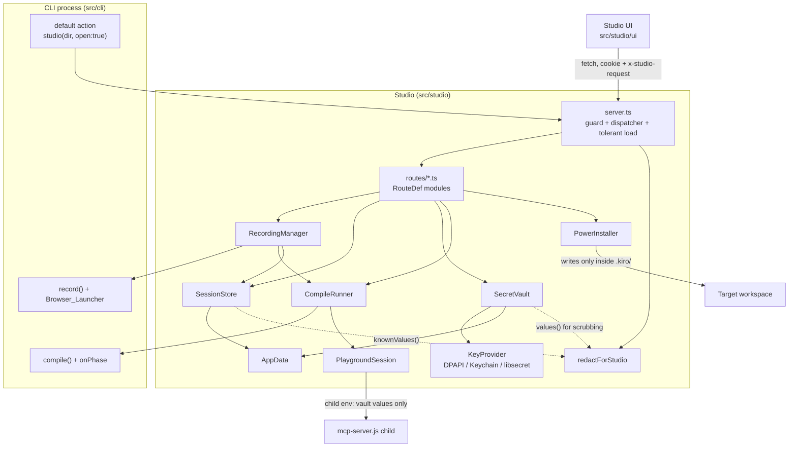
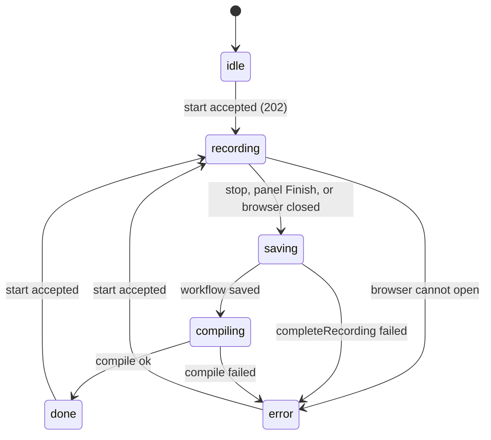

# Design Document: studio-first-flow

## Overview

This design lets a person run the whole Daemonize cycle from the Studio: `daemonize` opens the Studio, the user describes an action, records it in a visible browser, the result is compiled automatically, credentials are typed once in a guided panel, the tool is tested in the playground, and it is connected to Kiro or copied as a configuration for another client.

Everything is an addition to the existing code. No CLI subcommand, flag, output or exit code changes (Requirement 1.6), the Studio guard stays as it is, and no npm dependency is added.

Decisions in one place:

| # | Question | Decision |
|---|---|---|
| 1 | Default launch | A root `.action()` on the commander program calls the same `studio()` function as `studio --open`. Unknown arguments are rejected inside that action. |
| 2 | App_Data_Dir | Per platform folder, overridable with `DAEMONIZE_DATA_DIR`. A pure check rejects it when it is equal to or inside the cwd, a `.git` ancestor or the Output_Dir. |
| 3 | Secret_Vault | One AES-256-GCM file (`node:crypto`). Only its random 256-bit key goes to the OS store: DPAPI on Windows, `security -i` on macOS, `secret-tool` on Linux. Key material travels over stdin, never argv. No OS store means 503, never plain text. |
| 4 | Recording_Manager | One class owning a six-state machine. It calls `record()` with `signal` plus four new optional hooks. A saved session is passed as `sessionStorageState`, which is never written to the Workflow_File. |
| 5 | Browser_Launcher | New module `src/recorder/browser-launcher.ts` used by `record()` only. Injectable launch function. |
| 6 | Compile_Runner | `compile()` and `Compiler` get an `onPhase` callback and the runner passes a quiet installer with a 600 s timeout. |
| 7 | Routes | Every new route is a `RouteDef` in `src/studio/routes/<name>.ts`. One dispatcher in `server.ts` applies the guard rules (remote refusal, 405, 64 KiB, 415, 400). |
| 8 | Power_Installer | Two-step preview then install bound by a confirmation id and the displayed absolute path. It merges `settings/mcp.json` and writes `skills/<name>/SKILL.md`. Both locations are confirmed against the Kiro documentation. |
| 9 | UI | New hash routes `#/record` and `#/credentials`, an inline new-action form, a reusable accessible dialog, a state announcer, and one copy module that a test lints. Static demo hides the new features. |

### Research summary

- Kiro reads workspace skills from `.kiro/skills/<name>/SKILL.md`. The skill folder name must match the skill name, and a workspace skill wins over a global one ([Kiro Agent Skills](https://kiro.dev/docs/skills/)). The Kiro_Power already generates `skills/<power>/SKILL.md` with `name: <power>`, so the file can be copied unchanged.
- Kiro reads workspace MCP servers from `.kiro/settings/mcp.json`, and the workspace level overrides the user level ([Kiro MCP docs](https://kiro.dev/docs/mcp/), and community guides that confirm the path). Kiro substitutes `${VAR}` from its own environment, so placeholders are the correct way to carry secrets.
- Kiro CLI has an "Approved Environment Variables" feature that can block variables an MCP server asks for ([report](https://dev.to/greennnote/when-a-kiro-cli-update-silently-breaks-your-mcp-servers-the-approved-environment-variables-gotcha-15g2)). The success screen of Connect to Kiro tells the user that each `DAEMONIZE_SECRET_*` name must be set where Kiro runs and may need approval.
- Playwright 1.65.1 (`node_modules/playwright-core/lib/coreBundle.js`): a missing bundled browser throws `Executable doesn't exist at <path>` (line 34880), a missing channel throws `Chromium distribution '<chrome|msedge>' is not found at <path>` (line 35153), and a missing custom `executablePath` throws `Failed to launch chromium because executable doesn't exist at <path>` (line 41745). These three strings define "not installed" in the Browser_Launcher.
- The browser cannot return an absolute folder path to a web page, so "ask for the Target_Workspace folder" is a text field prefilled with the Studio's working directory (served by `GET /api/power/info`).

## Architecture



Request path for a new route:

1. `handle()` in `server.ts` runs the existing checks in the existing order: URL length (414), Host (403), Origin (403), token or cookie plus `x-studio-request` plus Origin (401).
2. The dispatcher finds the `RouteDef` for the exact path. A path no module owns falls through to the existing handlers and the existing 404.
3. Remote refusal (403 when the listener is not loopback and the route is `remote: 'blocked'`), then the method check (405 with `Allow`), then sample-mode refusal for writes (409), then the body read (413, 415, 400), then the handler.
4. The handler returns `{ status, body }`. The dispatcher passes the body through `redactForStudio` with `env`, the loaded storage-state values, `vault.values()` and `sessions.knownValues()`.

### Parallel implementation and the route seam

`server.ts` is edited only by Group 0. After it, the other groups add behavior only in files they own.

- Group 0 creates a stub for every module that another group will own. A stub exports the final symbol names and an inert implementation (for example `NullSecretVault`, or a route factory that returns `[]`). Group 0 wires them in `services.ts` and `routes/index.ts`.
- Each group replaces the body of its own files. No group edits `server.ts`, `services.ts`, `routes/index.ts`, `contracts.ts` or `routes/types.ts`. A contract change goes through Group 0's owner.
- The UI has one group, so `app.js` and `router.js` have one owner. To split the UI later, `js/features.js` (created first by the UI group) lists every feature route and view, so two UI authors never edit `app.js` or `router.js` together.

| Group | Scope | Depends on |
|---|---|---|
| G0 Foundation | Seam, tolerant load, dispatcher, contracts, `AppData`, shared validators, stubs, `.gitignore`, secret-scan list | none (done first, serial) |
| G1 CLI and recording engine | Default launch, Browser_Launcher, `record()` options | G0 |
| G2 Secrets | Vault, key providers, TOTP input parsing, `/api/secrets*`, playground injection, redaction wiring | G0 |
| G3 Recording and sessions | RecordingManager, SessionStore, `/api/record/*`, `/api/sessions*` | G0 contracts (fakes for G1 and G4 in unit tests); integration tests after G1 and G4 |
| G4 Compile and Power | Compile_Runner, `onPhase`, `/api/compile*`, PowerInstaller, snippet, `/api/power/*` | G0 |
| G5 UI | Everything under `src/studio/ui`, demo build script, docs | G0 and the API contracts below (can use mock responses) |

File ownership is disjoint:

| Group | Owns (create or edit) |
|---|---|
| G0 | `src/studio/server.ts`, `src/studio/contracts.ts`, `src/studio/services.ts`, `src/studio/routes/types.ts`, `src/studio/routes/index.ts`, `src/studio/app-data.ts`, `src/studio/validate-action.ts`, `src/studio/messages/common.ts`, `src/studio/messages/index.ts`, option types (only) in `src/studio/playground.ts`, `.gitignore`, `scripts/lib/secret-scan.mjs`, `tests/unit/app-data.test.ts`, `tests/unit/validate-action.test.ts`, `tests/integration/studio-empty-start.test.ts`, `tests/integration/studio-guard-routes.test.ts`, the existing `tests/integration/studio-server.test.ts` |
| G1 | `src/cli/index.ts`, `src/cli/commands/studio.ts`, `src/cli/commands/record.ts`, `src/recorder/browser-launcher.ts`, `tests/unit/cli-default-launch.test.ts`, `tests/unit/browser-launcher.test.ts`, `tests/property/browser-launcher.property.test.ts`, `tests/integration/record-studio-hooks.test.ts`, the existing `tests/integration/cli.test.ts` |
| G2 | `src/studio/secret-vault.ts`, `src/studio/key-providers.ts`, `src/studio/totp-secret.ts`, `src/studio/required-secrets.ts`, `src/studio/routes/secrets.ts`, `src/studio/messages/secrets.ts`, behavior in `src/studio/playground.ts`, tests `totp-secret`, `secret-vault`, `key-providers`, `playground-vault-env`, `secrets-no-leak`, `studio-secrets` |
| G3 | `src/studio/recording-manager.ts`, `src/studio/session-store.ts`, `src/studio/routes/record.ts`, `src/studio/routes/sessions.ts`, `src/studio/messages/record.ts`, tests `recording-manager`, `session-store`, `studio-record` |
| G4 | `src/studio/compile-runner.ts`, `src/cli/commands/compile.ts`, `src/compiler/compiler.ts`, `src/studio/power-installer.ts`, `src/studio/mcp-snippet.ts`, `src/studio/routes/compile.ts`, `src/studio/routes/power.ts`, `src/studio/messages/compile.ts`, tests `compile-runner`, `compile-onphase`, `power-installer`, `studio-power` |
| G5 | `src/studio/ui/**`, `scripts/build-studio-demo.mjs`, `docs/studio.md`, `README.md` (Studio section), tests `studio-ui-copy`, `studio-ui-validate`, `studio-ui-first-flow`, the existing `tests/unit/studio-ui-modules.test.ts` and `tests/integration/studio-ui*.test.ts` |

### Recording state machine



### Cross-group contracts

All interfaces live in `src/studio/contracts.ts` (written by G0). They are the only coupling between groups.

```ts
// ---- app data (G0 implements) -------------------------------------------
export type AppDataProblem = 'unresolved' | 'inside-working-dir' | 'inside-git-repo' | 'inside-output-dir' | 'not-writable';
export type AppDataCheck = { ok: true; dir: string } | { ok: false; problem: AppDataProblem };
export interface AppData {
  /** Resolved folder, even when excluded (for tests and messages that never print it). */
  readonly dir: string | undefined;
  /** Re-evaluated on every call: `.git` may appear later. Creates the folder (mode 0700) when ok. */
  ensure(): Promise<AppDataCheck>;
  /** Same decision without creating anything. */
  check(): Promise<AppDataCheck>;
}

// ---- secrets (G2 implements) --------------------------------------------
export class VaultUnavailableError extends Error {}  // OS protection or App_Data_Dir unusable -> 503
export class VaultUnreadableError extends Error {}   // file exists but key missing or decryption failed
export interface SecretVault {
  /** Names with a non-empty value. Unreadable vault -> empty set, never throws. */
  names(): Promise<ReadonlySet<string>>;
  /** Sync snapshot of every value held or just stored, plus normalized TOTP keys, for the Redactor. */
  values(): readonly string[];
  /** Throws VaultUnavailableError (nothing written, old values kept). Warms the cache before returning. */
  set(name: string, value: string): Promise<void>;
  /** Returns true when a value existed. Throws VaultUnavailableError. */
  remove(name: string): Promise<boolean>;
  has(name: string): Promise<boolean>;
  /** Name to value, for the Child_Server only. {} when no vault file. Throws VaultUnreadableError. */
  snapshot(): Promise<Record<string, string>>;
}

export interface RequiredSecret { name: string; kind: 'password' | 'totp' | 'token' }

// ---- sessions (G3 implements) --------------------------------------------
export interface SessionStore {
  /** Application_Key (normalized origin) for a URL, or undefined when it is not http(s). Pure. */
  keyFor(url: string): string | undefined;
  available(key: string): Promise<boolean>;
  /** Path of a usable saved storage state, or undefined (none, invalid, or App_Data_Dir excluded). */
  pathFor(key: string): Promise<string | undefined>;
  /** Atomic write (temp file plus rename). Throws SessionSaveError. */
  save(key: string, state: unknown): Promise<void>;
  /** Deletes the file when it exists. Never throws for a missing file. */
  forget(key: string): Promise<void>;
  /** Cookie and local-storage values of every saved state, from a cache refreshed by `refresh()`. */
  knownValues(): readonly string[];
  refresh(): Promise<void>;
  /** Plain-language problem when the App_Data_Dir is excluded, else undefined. */
  problem(): Promise<string | undefined>;
}

// ---- recording (G3 implements) -------------------------------------------
export type RecordingState = 'idle' | 'recording' | 'saving' | 'compiling' | 'done' | 'error';
export interface RecordingStatus {
  state: RecordingState;
  steps: number;
  labels: string[];             // at most 3, scrubbed
  error?: string;               // only in state 'error'
  recoveryFile?: string;        // only in state 'error', when a file was written
  sessionNote?: string;         // plain-language note: session not used, not saved, or storage unavailable
}
export interface StartInput { name: string; url: string; reuseSession: boolean }  // already validated
export type StartOutcome = { status: 202 } | { status: 409; message: string };
export type StopOutcome = { status: 202 } | { status: 409; message: string };
export interface RecordingManager {
  start(input: StartInput): StartOutcome;   // synchronous accept or refuse: the single-flight guard
  stop(): StopOutcome;                      // synchronous: sets 'saving' before returning 202
  status(): RecordingStatus;
  isActive(): boolean;                      // recording | saving | compiling
  close(): Promise<void>;                   // ends the session through the signal path, 10 s deadline
}

// ---- compile (G4 implements) ---------------------------------------------
export type CompileState = 'idle' | 'running' | 'done' | 'error';
export type CompilePhaseView = 'generating' | 'installing' | null;
export interface CompileStatus { state: CompileState; phase: CompilePhaseView; error?: string }
export type CompileOutcome = { ok: true } | { ok: false; message: string; outputMayBeIncomplete: boolean };
export interface CompileRunner {
  status(): CompileStatus;
  /** Sync: false when a compile is running (route answers 409). Otherwise starts and returns true. */
  tryStart(): boolean;
  /** For the RecordingManager: waits for a running compile, then runs one and resolves with its outcome. */
  runExclusive(): Promise<CompileOutcome>;
  close(): Promise<void>;                   // kills a running installation
}

// ---- power (G4 implements) -------------------------------------------------
export interface PowerFilePlan { path: string; outcome: 'create' | 'merge' | 'replace' }  // relative to .kiro, forward slashes
export interface PowerPreview {
  confirmationId: string;
  kiroPath: string;                         // absolute, exactly what the UI shows
  files: PowerFilePlan[];
  replacesEntry: boolean;                   // settings/mcp.json already holds this server key
  serverName: string;
  placeholders: string[];                   // DAEMONIZE_SECRET_* names that will be written
}
export class PowerError extends Error { constructor(readonly status: 400 | 409 | 500, message: string) { super(message); } }
export interface PowerInstaller {
  info(): Promise<{ available: boolean; defaultWorkspace: string; outputPath: string; serverName?: string }>;
  preview(workspacePath: unknown): Promise<PowerPreview>;                    // throws PowerError
  install(request: { confirmationId: unknown; kiroPath: unknown }): Promise<{ written: string[]; placeholders: string[] }>;
  snippet(): Promise<string>;                                                 // JSON text, placeholders only
}

export interface StudioServices {
  appData: AppData; vault: SecretVault; sessions: SessionStore;
  recording: RecordingManager; compiler: CompileRunner; power: PowerInstaller;
}
```

`StudioOptions` (G0) gets two test seams that no CLI flag or environment variable can reach: `services?: Partial<StudioServices>` and `routes?: RouteFactory[]` (replaces the default registry).

Route seam types (`src/studio/routes/types.ts`, G0):

```ts
export type RouteMethod = 'GET' | 'POST';
export interface RouteRequest {
  method: RouteMethod;                 // HEAD is dispatched as GET and the body is dropped
  query: URLSearchParams;
  body: Record<string, unknown>;       // POST only: parsed object, {} for an empty body
  signal: AbortSignal;                 // aborted when the client disconnects
}
export interface RouteResponse { status: number; body: unknown }
export type RouteHandler = (req: RouteRequest) => Promise<RouteResponse>;
export interface RouteDef {
  path: string;                        // exact, e.g. '/api/record/start'
  handlers: Partial<Record<RouteMethod, RouteHandler>>;
  remote: 'blocked' | 'allowed';       // blocked: 403 when the listener is not loopback
  /** When true the POST handler answers 409 in sample mode before running. Default true for POST. */
  writes?: boolean;
}
export interface RouteContext {
  services: StudioServices;
  playground: PlaygroundSession | undefined;
  workflowFile: string; outDir: string; sample: boolean;
  /** Tolerant load: set is undefined when the Workflow_File does not exist. Throws LoadError otherwise. */
  loadSet(): Promise<{ set: WorkflowSet | undefined; outputs: StudioOutputs }>;
  /** Upper-case `DAEMONIZE_SECRET_<NAME>` names non-empty in the vault, Studio env or mcp.json env. */
  configuredSecretVariables(): Promise<ReadonlySet<string>>;
  studioEnv: Record<string, string | undefined>;
}
export type RouteFactory = (ctx: RouteContext) => RouteDef[];
```

`routes/index.ts` (G0): `export const DEFAULT_ROUTES: RouteFactory[] = [recordRoutes, sessionRoutes, secretRoutes, compileRoutes, powerRoutes]`. The five imports point at G0 stubs that return `[]` until the owner fills them.

## Components and Interfaces

### G0 Foundation

**Tolerant load (Requirement 2).** `loadLive` changes as follows.

- `ENOENT` on the Workflow_File returns `targets: []`, `workflowFileExists: false`. All five routes then answer 200 with zero Actions, zero nodes, zero edges, and `buildPbtView(undefined, [], false)`.
- The Output_Dir is never created and never required. `readOutputs` already tolerates a missing folder.
- Any other failure throws `LoadError` with one of three fixed messages: `workflow file is unreadable`, `workflow file is too large`, `workflow file is not a valid workflow set`. The raw parser message and every path are dropped. A `stat` size check against `MAX_JSON_FILE` (20 MiB) runs before `readFile`.
- The Studio start path reads nothing, so Requirements 2.1 and 2.2 hold without an extra console write.
- `GET /api/overview` returns `{ ...buildOverview(), workflowFileExists, outputCompiled, recordingActive }`. `recordingActive` is `services.recording.isActive()`. In sample mode it is `true, true, false`. The static demo JSON lacks the fields and the UI defaults them (see G5).

**Dispatcher.** In `handle()`, the body limit becomes `bodyLimitFor(pathname)`: 64 KiB when the path is `/api/playground/*` or any registered route with a POST handler, else 8 KiB. After `authorized()`, `dispatchRoute()` runs the order given under Architecture. A module-level `readJsonObject` is reused as it is (413 with `Connection: close`, 415, 400 `the body must be a JSON object`). `sendJson` and `sendError` both merge `services.vault.values()`, `services.sessions.knownValues()` and the storage-state values into the Redactor input.

**Wiring.** `startStudio` builds `services` with `createServices(options, ctxInfo)`. Sample mode builds inert services (empty vault, idle manager) so no file or process is touched. `PlaygroundSession` receives `vault` and `requiredSecretNames`. `secretStatus()` adds the vault names when the playground is disabled. `close()` order: server stops accepting, `recording.close()`, `compiler.close()`, `playground.close()`.

**AppData** (`app-data.ts`, full implementation).

| Platform | Default folder |
|---|---|
| win32 | `%LOCALAPPDATA%\Daemonize`, else `<home>\AppData\Local\Daemonize` |
| darwin | `~/Library/Application Support/Daemonize` |
| linux | `$XDG_DATA_HOME/daemonize` when absolute and non-empty, else `~/.local/share/daemonize` |

`DAEMONIZE_DATA_DIR` overrides the choice when it is an absolute path. A relative value gives `unresolved`. The check:

1. Resolve the folder with `realpath` on its deepest existing ancestor, then append the missing tail. Compare case-insensitively on win32 and darwin.
2. `inside(a, b)` is true when `a === b` or `a` starts with `b + sep`.
3. Reject when inside the cwd, inside the Output_Dir, or inside any directory at or above the cwd that contains a `.git` entry (file or folder, so worktrees count).
4. `ensure()` creates the folder with mode `0o700` and answers `not-writable` on failure.

A consequence to accept: a user whose home folder is a git repository gets `inside-git-repo` for the default folder and must set `DAEMONIZE_DATA_DIR`. Requirement 6.3 states this outcome and the Vault uses the same check, so the vault answers 503 in that case.

**Shared validators** (`validate-action.ts`, pure, mirrored by `ui/js/validate.js`; a property test keeps both equal).

- Name: trim, 1 to 80 code points, contains `[A-Za-z0-9]`, no control characters (`\u0000-\u001f`, `\u007f`). The control-character rule is stricter than Requirement 3.7. It keeps newlines out of the workflow label and tool name.
- URL: trim, at most 2048 characters, `new URL` parses, protocol is `http:` or `https:`, and no `username` or `password`. The credential rule is stricter than Requirement 3.8. The URL is stored in the Workflow_File as `startUrl`, and a password in it would be a stored secret. The message tells the user to remove the user name and password.
- `plainName(value)`: rejects a `..` segment, an absolute path (`/`, `\`, drive letter), a NUL, and any separator. Used for every field that expects a plain name (Requirement 13.9).
- `applicationKey(url)`: `new URL(url).origin` for http(s), else undefined.

**Messages.** Every user-facing server text lives in `src/studio/messages/<group>.ts` as exported constants. A unit test (G5 `studio-ui-copy`) lints all of them against the Plain_Language list. Technical file names are rendered by the UI inside `<code class="path">` and are excluded from the lint (see Open points).

### G1 CLI and recording engine

**Default launch.** In `buildProgram(deps = defaultDeps)`:

```ts
program.action(async (_opts, command: Command) => {
  if (command.args.length > 0) throw new Error(`Unknown argument "${command.args[0]}". Run "daemonize --help" to see the commands.`);
  const handle = await deps.studio(DEFAULT_OUTPUT_DIR, { workflows: DEFAULT_WORKFLOWS_FILE, host: '127.0.0.1', allowRemote: false, open: true, sample: false });
  await deps.untilInterrupted(handle);   // shared with the `studio` subcommand
});
```

- With a root action, commander skips `unknownCommand()`, and v12 allows excess arguments by default, so the explicit check above produces the error. `main()` prints `Error: ...` to stderr and sets exit code 1. An unknown option fails in commander with `unknown option` and exit code 1.
- `daemonize --help` and `-h` list all subcommands and exit 0, because commander handles them before the action runs.
- Subcommands are untouched. A matching first operand always dispatches to its subcommand.
- Output equals `studio --open`: same `studio()` function, same two (plus the existing playground) lines, `openInBrowser` swallowing spawn errors (Requirement 1.4).
- `untilInterrupted(handle)` registers `SIGINT` and `SIGTERM` once, calls `Promise.race([handle.close(), delay(4500)])`, then `process.exit(0)`. The race keeps Requirement 1.10 (5 s) even though `recording.close()` may take up to 10 s: Playwright kills its browsers when the parent exits. The `studio` subcommand uses the same helper but keeps its existing behavior of returning after close.
- Tests pass `deps` to assert the call arguments and to avoid starting a server.

**Browser_Launcher** (`src/recorder/browser-launcher.ts`).

```ts
export type BrowserUsed = 'chromium' | 'chrome' | 'msedge' | 'custom';
export type LaunchFn = (options: { headless: boolean; executablePath?: string; channel?: 'chrome' | 'msedge' }) => Promise<Browser>;
export interface LaunchedBrowser { browser: Browser; used: BrowserUsed; label: string }
export class BrowserLaunchError extends Error { readonly used?: BrowserUsed }
export function isNotInstalled(error: unknown): boolean
export async function launchBrowser(options: { headless?: boolean; env?: NodeJS.ProcessEnv; launch?: LaunchFn }): Promise<LaunchedBrowser>
```

- `isNotInstalled` tests the error message against `/executable doesn['\u2019]t exist/i` and `/Chromium distribution '(chrome|msedge)' is not found/i`. Nothing else counts.
- `DAEMONIZE_CHROMIUM_PATH` non-empty: one attempt with `{ headless, executablePath }` and no channel. Any failure throws `BrowserLaunchError` naming `DAEMONIZE_CHROMIUM_PATH`, the path and the first line of the cause. No further attempt.
- Otherwise attempts in this order and no other: `{ headless }` (bundled), `{ headless, channel: 'chrome' }`, `{ headless, channel: 'msedge' }`. A not-installed failure moves on. Any other failure stops with a message that names the browser (`Chromium`, `Google Chrome`, `Microsoft Edge`) and the first line of the cause. When all three are not installed, the message names Google Chrome, Microsoft Edge and `DAEMONIZE_CHROMIUM_PATH`.
- Cause text is the first line of the Playwright message, ANSI-stripped and clipped to 200 characters, so the ASCII box Playwright appends never reaches the user.
- The default `LaunchFn` is `(o) => chromium.launch(o)`. `PlaywrightDriver` is not changed (Requirement 5.10).

**`record()` changes** (backwards compatible, all optional):

| Option | Purpose |
|---|---|
| `launch?: LaunchFn` | Test seam for the Browser_Launcher. |
| `sessionStorageState?: string` | Path used only for `browser.newContext({ storageState })`. It is never copied into `target.storageState`, so `saveWorkflow` cannot write it into the Workflow_File or the recovery file. The existing `storageState` option keeps its CLI behavior. |
| `captureSessionState?: (state: unknown) => void \| Promise<void>` | After `completeRecording` succeeds and before the browser closes, `record()` calls `context.storageState()` and passes the object. Errors are caught and reported as `summary.sessionCaptured = false`. The object stays in memory. |
| `windowMode?: 'terminal' \| 'studio'` | `terminal` (default) keeps `waitForUser`. `studio` never reads stdin: the wait is a promise that never resolves, and `page.on('close')` calls `signalStopped('the browser window was closed')`, so a closed window takes the recovery path (Requirement 4.13) instead of saving as the CLI does. |
| `onLive?: (live: LiveRecorder) => void` | Called right after `live.attach()`. The manager reads `stepCount` and `panelState().last`. |
| `onBrowser?: (browser: Browser) => void` | Lets the manager force `browser.close()` when its 10 s deadline passes. |
| `onEnding?: (reason: 'panel' \| 'signal' \| 'api' \| 'closed') => void` | Called when the race on `session`, `stopped` and `live.ended` settles, before `completeRecording`. |

`RecordSummary` gains `sessionCaptured?: boolean`. A failure of the Browser_Launcher propagates before any file is written, so the CLI prints it on stderr with exit code 1 and creates no Workflow_File content and no recovery file (Requirement 5.8).

### G2 Secrets

**TOTP input** (`totp-secret.ts`, pure).

```ts
export function normalizeBase32(text: string): string | undefined;   // steps 1-3 of Requirement 8.10, then /^[A-Z2-7]{3,}$/
export function extractTotpSecret(value: string): string | undefined; // Base32 or otpauth URI; undefined when invalid
```

- `normalizeBase32` removes `\s` and `-`, strips trailing `=`, upper-cases, and returns undefined unless the result matches `^[A-Z2-7]{3,}$`. A `=` in the middle fails the regex.
- `extractTotpSecret`: when the trimmed value starts with `otpauth:` (case-insensitive), match `^otpauth://([^/?#]*)([^?#]*)\?([^#]*)` by hand instead of `new URL`, whose handling of non-special schemes varies. The type must equal `totp` (case-insensitive). `new URLSearchParams(query).getAll('secret')` must have exactly one element, which is then normalized. Label, `issuer`, `digits`, `period` and `algorithm` are never read or kept. Otherwise the value is treated as Base32.
- `decodeBase32` from `src/replay/runtime/totp.ts` is used only in tests to compare bytes.

**Required secrets** (`required-secrets.ts`).

```ts
export function requiredSecrets(set: WorkflowSet | undefined): RequiredSecret[]
```

It unions `workflowSecrets(w, { http: false }).required` over all workflows, sorted by name with `localeCompare` as the existing model does. Kind precedence: declared kind (`header` becomes `token`), else `totp` when a step with that `secretRef` has `totp: true`, else `password`. `model.ts` already applies declared first, then step totp, so the function only maps the kind.

**Vault file and crypto** (`secret-vault.ts`).

- File: `<App_Data_Dir>/secrets.vault.json`, mode `0o600`. Content: `{ "v": 1, "alg": "aes-256-gcm", "iv": "<b64 12 bytes>", "tag": "<b64>", "ct": "<b64>" }`. Plaintext is `JSON.stringify({ [name]: value })`. AAD is the string `daemonize-vault-v1`. A fresh random IV is used per write. A write goes to `secrets.vault.json.tmp-<random>` (ciphertext only), then `rename`.
- A cache holds `{ mtimeMs, size, map }`. Each public call does one `stat`. When the file changed, the cache reloads. `values()` returns the cached values and the normalized TOTP keys. Every path that hands a value out calls `load()` first, so the cache is warm whenever a value can reach a response.
- `set` flow: `appData.ensure()` (not ok gives `VaultUnavailableError`), `keyProvider.getOrCreate()` (throws `KeyStoreUnavailableError`, mapped to `VaultUnavailableError`), decrypt the current file when it exists (a failure starts from an empty map, so a later valid POST repairs a broken vault as Requirement 8.20 asks), add the entry, encrypt, atomic write, update the cache. The previous file stays untouched on every failure path.
- If the key is missing while a vault file exists, `snapshot()` throws `VaultUnreadableError`. A new `set` creates a new key and overwrites the file (old values are lost, and the message says so).
- `names()` never throws and never needs the key when the file is absent.

**Key providers** (`key-providers.ts`). The key is 32 random bytes, kept as 64 hex characters in the store. The module-level cache keeps it in memory for the process lifetime.

```ts
export interface KeyProvider {
  readonly id: string;
  /** undefined when the store works and has no key yet. Throws KeyStoreUnavailableError on any other failure. */
  get(): Promise<Buffer | undefined>;
  create(key: Buffer): Promise<void>;          // throws KeyStoreUnavailableError
}
```

All subprocesses are started with `spawn(file, args, { shell: false, windowsHide: true, stdio: ['pipe','pipe','pipe'], env: minimalEnv })`, a 15 s timeout, and the key written to `stdin` only. `minimalEnv` copies an allow-list (`PATH`, `SystemRoot`, `windir`, `HOME`, `USERPROFILE`, `LOCALAPPDATA`, `APPDATA`, `DBUS_SESSION_BUS_ADDRESS`, `XDG_RUNTIME_DIR`, `DISPLAY`) so `DAEMONIZE_SECRET_*` of the Studio never reaches these processes.

| Platform | Mechanism | Not found | Unavailable |
|---|---|---|---|
| Windows | DPAPI `CurrentUser` through `%SystemRoot%\System32\WindowsPowerShell\v1.0\powershell.exe -NoProfile -NonInteractive -EncodedCommand <const>`. `create`: stdin is the key in base64, stdout is the protected blob in base64, stored in `<App_Data_Dir>/vault.key` (a DPAPI blob, not the key). `get`: reads that file and runs the unprotect script with the blob on stdin. | `vault.key` absent | `powershell.exe` missing or exit code not 0, constrained language mode, blob invalid for this user |
| macOS | `/usr/bin/security -i` reads commands from stdin, so the hex key is not in argv: `add-generic-password -U -a daemonize -s daemonize-studio-vault-v1 -w <hex>`. `get`: `security find-generic-password -a daemonize -s daemonize-studio-vault-v1 -w` (no secret in argv). | exit code 44, stderr contains `could not be found` | other exit code, locked keychain, no keychain |
| Linux | `secret-tool store --label="Daemonize Studio" service daemonize-studio account vault-key-v1` with the hex key on stdin. `get`: `secret-tool lookup service daemonize-studio account vault-key-v1`. | exit 1 with empty stdout and empty stderr | `ENOENT` for the binary, or any non-empty stderr (no D-Bus, no keyring daemon) |

The Windows script constant (encoded once at module load, never built from user input):

```powershell
# protect: stdin = base64 key, stdout = base64 blob
Add-Type -AssemblyName System.Security
$e = [Text.Encoding]::UTF8.GetBytes('daemonize-studio-vault-v1')
$k = [Convert]::FromBase64String([Console]::In.ReadToEnd().Trim())
[Convert]::ToBase64String([Security.Cryptography.ProtectedData]::Protect($k, $e, 'CurrentUser'))
# unprotect: same with ::Unprotect
```

Feasibility notes. The macOS `security -i` path cannot be run on this machine, so it carries a manual verification step in the tasks: add, read back, and confirm with `ps` that the key never appears in argv. If `security -i` is found not to read piped stdin, the provider reports unavailable. It does not fall back to `-w <value>` on the command line. "OS protection unavailable" is exactly "the provider threw `KeyStoreUnavailableError`" or "the App_Data_Dir check is not ok".

Test providers. `DAEMONIZE_VAULT_KEY_PROVIDER` is read only when `process.env.NODE_ENV === 'test'` (vitest sets it) and is ignored otherwise: `memory` (key in process memory), `file` (hex key in `<App_Data_Dir>/vault.key.test`, for tests that span two processes), `unavailable` (always throws). Programmatic injection through `StudioOptions.services.vault` is the preferred seam. The production code path contains no branch that reads the variable when `NODE_ENV` is not `test`.

**Routes** (`routes/secrets.ts`). All `remote: 'blocked'`.

| Route | Handler |
|---|---|
| `GET /api/secrets` | `requiredSecrets(set)` mapped to `{ name, kind, configured }`, where `configured` is `ctx.configuredSecretVariables().has('DAEMONIZE_SECRET_' + name.toUpperCase())`. Body: `{ secrets: [...] }`. Empty list when the Workflow_File is missing. |
| `POST /api/secrets` | Fields allowed: `name`, `value`. Order: unknown field 400, `plainName(name)` 400, name must be required (exact case) 400, value checks 400 (string, at least 3 characters, at most 4096 UTF-8 bytes, no NUL), TOTP parse 400, then `vault.set`. `VaultUnavailableError` gives 503. On success `await playground?.stopNow()` when `serverStarted`, then answer `{ name, configured: true }`. Messages never contain the value. |
| `POST /api/secrets/forget` | Field `name`. Plain-name check, then required or `vault.has(name)` else 400. `vault.remove`, `stopNow()` when a value was removed, answer `{ name, configured }` where `configured` is recomputed (the environment can still provide it). |

**Playground injection** (`playground.ts`, new options declared by G0).

```ts
vault?: Pick<SecretVault, 'snapshot' | 'names' | 'values'>;
requiredSecretNames?: () => Promise<readonly string[]>;
```

- `launchSpec({ strictVault })` builds the env as today, then for each required name with a non-empty vault value deletes every key equal to `DAEMONIZE_SECRET_<NAME>` ignoring case and sets `DAEMONIZE_SECRET_<NAME>` to the vault value. Only this key form is ever created. Nothing mutates `process.env` or the Studio env object, and nothing reaches `args`.
- `ensureConn()` calls it with `strictVault: true`. A `VaultUnreadableError` becomes `PlaygroundUnavailable('Your saved credentials could not be read. Enter them again in the Credentials panel.', 'vault_unreadable')`, and no process starts (Requirement 9.11).
- `configuredSecretVariables()` uses `strictVault: false` and, in its fallback branch (no `mcp.json` yet), still adds `DAEMONIZE_SECRET_<NAME>` for every name in `vault.names()`. Names only.
- `secretValues` for scrubbing becomes `() => [...knownSecretValues, ...vault.values()]`, set by the G0 wiring.
- New `stopNow(): Promise<void>` closes the connection without waiting in the call queue. A call in flight ends with the existing `server_crashed` answer. The secrets routes use it so the response is not held behind a 10 minute call.

### G3 Recording and sessions

**SessionStore** (`session-store.ts`).

- `keyFor(url)` returns `new URL(url).origin` for http(s). The file name is `sha256(key).hex.slice(0, 40) + '.storage-state.json'` in the App_Data_Dir. Equal keys map to one file and the hash separates different keys.
- `pathFor(key)`: `appData.check()` must be ok. The file must be at most 5 MiB, valid JSON, an object with an array `cookies` or an array `origins`. Otherwise the answer is undefined, which the UI reports as "no" without content (Requirement 6.14).
- `save(key, state)`: `appData.ensure()`, write `<file>.tmp-<random>` with mode `0o600`, `rename`. A failure throws `SessionSaveError` and leaves the old file.
- `forget(key)`: `unlink`, ignoring `ENOENT`.
- `refresh()` stats each `*.storage-state.json`, reparses only changed files, and keeps `storageStateValues(...)` in a cache for `knownValues()`. `loadSet()` in the dispatcher calls it. The manager adds the in-memory pending state values to the scrub list while a recording is saving.
- Storage states are plain JSON in the App_Data_Dir, as Requirement 6 defines. They are outside every repository, and never in a response. They are not encrypted. Encrypting them with the vault key is a possible later change. It would need `record()` to accept a storage-state object instead of a path, which Playwright supports.

**Routes** (`routes/sessions.ts`, `remote: 'blocked'`).

| Route | Behavior |
|---|---|
| `GET /api/sessions` | Without `key`: one entry per distinct origin of `startUrl` in the Workflow_File, `{ sessions: [{ applicationKey, available }] }`. With `key=<origin>`: validated as an exact origin (`new URL(key).origin === key`, http(s), at most 300 characters, else 400), `{ applicationKey, available }`. Only the key goes over the wire, never the full address (Requirement 3.13). |
| `POST /api/sessions/forget` | Field `applicationKey`, same exact-origin validation (a `..`, NUL or path gives 400 and no file is touched). `sessions.forget`, answer `{ applicationKey, available: false }`, also when no file existed. |

**RecordingManager** (`recording-manager.ts`).

Construction: `new RecordingManager({ workflowFile, sessions, compiler, record = defaultRecord, launch?, scrub, clock })`. `record` is the real `record()` and tests replace it with a fake that exercises the same hooks.

State: `state`, `controller: AbortController | undefined`, `live: LiveRecorder | undefined`, `browser`, `snapshot: { steps, labels }`, `error`, `recoveryFile`, `pendingSession: unknown | undefined` (in memory only), `running: Promise<void> | undefined`.

`start(input)` is synchronous and holds the only guard:

```ts
start(input) {
  if (this.state === 'recording' || this.state === 'saving' || this.state === 'compiling') return { status: 409, message: RECORD_BUSY };
  this.state = 'recording'; this.reset(); this.controller = new AbortController();   // same tick as the check
  this.running = this.run(input).catch(() => undefined);
  return { status: 202 };
}
```

Because the check and the assignment happen in the same synchronous turn, N concurrent requests produce one 202 and N-1 409, and `record()` runs once, so at most one browser opens (Requirement 4.5). Validation (400) happens in the route before `start`, so a rejected request changes nothing.

`run(input)`:

1. `key = sessions.keyFor(input.url)`. If `reuseSession`, `path = await sessions.pathFor(key)`. When the store has a problem or no usable file, continue without a state and set `sessionNote` (Requirement 6.3, 6.5). When `reuseSession` is false the store is neither read nor written (Requirement 6.16).
2. Call `record({ url, name: new URL(url).host, label: input.name, out: workflowFile, headless: false, windowMode: 'studio', signal, ...(path ? { sessionStorageState: path } : {}), ...(reuseSession ? { captureSessionState: (s) => { this.pendingSession = s; } } : {}), onLive, onBrowser, onEnding, launch })`. `storageState` is never passed, so the Workflow_File gets no path.
3. `onLive(live)` stores `live`. `onEnding(reason)` takes a snapshot of `stepCount` and `panelState().last` (labels are scrubbed), sets `state = 'saving'` (idempotent) and ignores `reason` except for logging.
4. On resolve: `state = 'compiling'`, `await compiler.runExclusive()`. Success: `state = 'done'`, and if `pendingSession` is set `sessions.save(key, pendingSession)` inside try/catch (a failure keeps `done`, sets `sessionNote`, leaves the old file, Requirement 6.15). Failure: `state = 'error'` with the compile message, workflow file untouched, `pendingSession` discarded.
5. On reject: `state = 'error'`. If `live?.stepCount === 0` or the error is "Cannot finish a workflow without steps", the message is `NOTHING_RECORDED` and no file exists. If the error text names a recovery file, `recoveryFile` is parsed from the `Recording ... saved to <path>.` sentence that `rescue()` already produces. Launch failures use the Browser_Launcher message as it is. All messages pass the scrubber.
6. `finally`: `live = undefined`, `controller = undefined`, `pendingSession = undefined`.

`stop()`: if the state is not `recording`, 409 (no change). Else `controller.abort()` (which calls `requestEnd('signal')` once `record()` is attached, or at once after attach if the abort came earlier), `state = 'saving'`, 202. A stop during browser launch ends the session with zero steps and gives the `NOTHING_RECORDED` error.

`status()`: while `live` exists it reads `live.stepCount` and `live.panelState().last` each call (labels only, the existing panel contract excludes typed values), else it returns the last snapshot. `steps` is 0 in `idle`. `error` and `recoveryFile` appear only in `error`. After `done` or `error` the final values persist until the next accepted start. The body goes through the Redactor again in the dispatcher.

`close()`: if the state is `recording`, abort. In every active state wait on `running` with a 10 s deadline, then `browser.close()` as the last resort. While `compiling` the compiler's own `close()` ends the install.

**Routes** (`routes/record.ts`, `remote: 'blocked'`).

| Route | Behavior |
|---|---|
| `POST /api/record/start` | Allowed fields: `name`, `url`, `reuseSession` (boolean, default false). Unknown field gives 400 with message `Unexpected field`. Validators from `validate-action.ts` give 400 with `{ error, field }`. Then `recording.start()`: 202 `{ state: 'recording' }`, or 409 `{ error }`. |
| `GET /api/record/status` | `recording.status()` (HEAD allowed). |
| `POST /api/record/stop` | Body must be empty or `{}`, else 400. 202 `{ state: 'saving' }` or 409. |

### G4 Compile and Power

**`onPhase`.** Types: `export type CompilePhase = 'generating' | 'writing' | 'installing'`.

- `CompileOptions.onPhase?: (phase: CompilePhase) => void` in `compile.ts`, forwarded into `Compiler.compile` options (`compiler.ts` `CompileOptions`).
- `compile()` calls `onPhase('generating')` first and `onPhase('installing')` right before the installer.
- `Compiler.compile` calls `onPhase('writing')` immediately before its first file system write: before `mkdir(join(outputDir,'sandbox'))`, and before `withAnchorThumbnails` when heal is on (that function writes first). The plain-secret check throws before this point, so that failure leaves the Output_Dir unchanged.
- The CLI does not pass `onPhase`. Its output does not change.

**CompileRunner** (`compile-runner.ts`).

Options: `{ workflowFile (absolute), outDir (absolute), compile = realCompile, playground?, installTimeoutMs = 600_000, scrub, paths: string[] }`.

Run steps:

1. `state = 'running'`, `phase = 'generating'`, `wrote = false`.
2. `hasModules = isDirectory(outDir/node_modules)`.
3. `compile(workflowFile, outDir, { http: 'off', healSupport: false, ...(hasModules ? {} : { install: true }), installer: quietInstaller, onPhase })`. No `suggest`, no `sandbox`.
4. `onPhase`: `'writing'` sets `wrote = true`; `'installing'` sets `phase = 'installing'`; `'generating'` sets `phase = 'generating'`.
5. Success: `state = 'done'`, `phase = null`, `await playground?.stop()`.
6. Failure: `state = 'error'`, `phase = null`. The message is plain and scrubbed: when `wrote` is false the Output_Dir is unchanged and the message says so, when true the runner calls `playground?.stop()` and the message says the folder may be incomplete and that Recompile can be repeated.

`quietInstaller(dir)`: `spawn('npm', ['install'], { cwd: dir, stdio: 'ignore', shell: process.platform === 'win32', detached: process.platform !== 'win32' })`. A timer of `installTimeoutMs` kills the tree (`taskkill /pid <pid> /T /F` on Windows, `process.kill(-pid)` elsewhere) and rejects with `InstallTimeout`. `close()` kills a running install the same way.

`tryStart()` is synchronous: when `state === 'running'` it returns false, else it sets `running`, starts `run()` without awaiting and returns true. `runExclusive()` waits for the current run's promise, then starts one and resolves with its `CompileOutcome`. A manual POST that arrives during that second run gets 409.

`scrubMessage(text, paths)`: replaces the cwd, Output_Dir, workflow file folder, home folder, temp folder and App_Data_Dir with `<folder>` (longest first, both separators), then replaces any remaining Windows drive path or POSIX path of two or more segments with `<path>`, and clips to 300 characters. The Redactor then removes secret values.

**Routes** (`routes/compile.ts`).

| Route | `remote` | Behavior |
|---|---|---|
| `POST /api/compile` | blocked | Body `{}` only. `compiler.tryStart()`: 202 `{ state: 'running' }` or 409. |
| `GET /api/compile/status` | allowed | `{ state, phase, error? }` (HEAD allowed). |

**PowerInstaller** (`power-installer.ts`, `mcp-snippet.ts`).

Source material comes from the compiled Output_Dir, read with a 1 MiB cap: `mcp.json` (first server entry gives the key `serverName`) and `skills/<serverName>/SKILL.md`. `serverName` must match `^[a-z0-9][a-z0-9-]{0,63}$` or the plan is refused with 409 `Compile first`.

The entry written is rebuilt, not copied:

```ts
{ type: 'stdio', command: 'node', args: [resolve(outDir, 'mcp-server.js')],
  env: { ...for each key K in source env:
           /^DAEMONIZE_SECRET_[A-Za-z0-9_]+$/ or DAEMONIZE_MODEL_(PROVIDER|NAME|API_KEY|BASE_URL)  ->  '${K}'
       , DAEMONIZE_MODE: 'strict' } }
```

Every other key and every literal value is dropped. This is the structural guarantee behind "no secret value is written" (Requirements 11.5, 11.6, 11.16). `placeholders` lists the `DAEMONIZE_SECRET_*` keys.

`preview(workspacePath)` validation, in this order, each failure `PowerError(400)`:

1. Type string, at most 1024 characters, no NUL, absolute (`path.isAbsolute`, and on Windows a drive or UNC prefix).
2. `realpath` succeeds and `stat` says directory.
3. The real path has no `node_modules` segment and is not equal to or inside the real Output_Dir or the App_Data_Dir.
4. `.kiro` target: if `<ws>/.kiro` exists, its `realpath` must be inside the workspace real path. Each target file is resolved the same way (deepest existing ancestor's `realpath` must be inside the real `.kiro`), and an existing target that is a symbolic link (`lstat`) is refused.
5. `settings/mcp.json` when present: at most 2 MiB, valid JSON, root an object, and `mcpServers` absent or an object. Otherwise `PowerError(409, 'The file settings/mcp.json cannot be read as settings')`, with no write anywhere.

The plan lists two files: `settings/mcp.json` (`create`, or `merge` when it exists) and `skills/<serverName>/SKILL.md` (`create`, or `replace` when it exists). `replacesEntry` is true when `mcpServers[serverName]` already exists. The preview stores `{ id, realWorkspace, kiroPath, expires }` in a map (10 min, at most 8 entries, a newer preview of the same workspace supersedes older ids) and returns `kiroPath` as the exact string the UI shows.

`install({ confirmationId, kiroPath })`: both must be strings, the id must exist and not be expired, and `kiroPath === stored.kiroPath` exactly, otherwise `PowerError(400)` and nothing is written. It re-runs the whole validation from step 1 (the folder may have changed) and re-reads both files. It builds the two buffers first. `mcp.json` is `JSON.stringify(merged, null, 2) + '\n'`, where the entry is assigned in place (same key position when it exists, appended otherwise) and every other top-level key and every other `mcpServers` entry keeps its value. Then it writes `<file>.tmp-<random>` (flag `wx`) for both, renames the skill, then renames `mcp.json`. If the second rename fails the first file is restored from the bytes held in memory. The answer is `{ written: ['settings/mcp.json', 'skills/<name>/SKILL.md'], placeholders }`. Confirmation ids are single-use.

Known limit: a folder swapped for a symbolic link between the check and the rename is not defended against. The threat model is one user on one machine, and the write uses temp file plus rename, which replaces a link instead of following it.

`snippet()` returns `JSON.stringify({ mcpServers: { [serverName]: entry } }, null, 2)` with the same rebuilt entry (placeholders only). It never reads the vault.

**Routes** (`routes/power.ts`, all `remote: 'blocked'`).

| Route | Behavior |
|---|---|
| `GET /api/power/info` | `{ available, defaultWorkspace, serverName? }`. `available` means `mcp-server.js` exists in the Output_Dir. |
| `GET /api/power/snippet` | `{ snippet }`, 409 when not compiled. |
| `POST /api/power/preview` | Field `workspacePath`. 200 `PowerPreview`, or `PowerError` status with `{ error }`. |
| `POST /api/power/install` | Fields `confirmationId`, `kiroPath`. 200 `{ written, placeholders }`, or `{ error }`. |

The "Add as a Kiro Power instead" option writes nothing. The UI shows the Output_Dir absolute path (taken from `GET /api/power/info`, field `outputPath`) and the Powers panel import steps.

### G5 UI

New and changed files (all under `src/studio/ui`):

| File | Purpose |
|---|---|
| `js/features.js` | Created first. Exports `FEATURE_ROUTES` (`record`, `credentials`) and `FEATURE_VIEWS`. `router.js` and `app.js` import it, so later UI work touches only feature modules. |
| `js/copy.js` | Every string of the main path screens and a `statusText(kind, state)` helper. A unit test lints it. |
| `js/validate.js` | Mirror of `validate-action.ts`. |
| `js/dialog.js` | `openDialog({ title, content, opener, onClose })`. |
| `js/announcer.js` | `announceOnChange(channel, state, text)`: stores the last state per channel and calls `announce()` only when the state changed. |
| `js/views/welcome.js` | Welcome panel and the "+ New action" button, used by `overview.js`. |
| `js/views/new-action.js` | Inline form. |
| `js/views/record-status.js` | Route `#/record`. |
| `js/views/credentials.js` | Route `#/credentials`. |
| `js/views/connect.js` | Connect card, preview dialog, success screen. |
| `js/api.js` | New methods, built on a shared `postJson` and a no-cache `getFresh`. |
| `js/views/overview.js`, `workflows.js`, `playground.js` | Welcome and button, Credentials link, "Test it" target, missing-credentials notice. |
| `app.css` | New classes only. No `outline: none` on new controls. |

Behavior highlights:

- **Welcome and form.** `overview.js` reads `workflows` and `overview`. Zero Actions: the welcome view with a primary "+ New action" button. One or more: the button above the cards. The button toggles an inline `<form>` with fields `action-name` and `action-url`, a checkbox `reuse-session`, and the buttons "Start recording" and "Cancel". Each control has a `<label for>`. Cancel removes the form, sends nothing and focuses the button. Submit trims, validates with `validate.js`, and on error sets `aria-invalid="true"`, `aria-describedby` to the message element, and focuses the first invalid field in visual order. Valid input sends one `POST /api/record/start` with `{ name, url, reuseSession }` and then sets `location.hash = '#/record'`. A 400, 409 or 5xx keeps the form and the entered values and shows the message in `role="alert"`. The hint under the checkbox calls `GET /api/sessions?key=<origin>` within 1 s of a URL change (debounced 400 ms) and shows "No saved session yet. Recording with this box checked will save one." or the saved text.
- **Status screen** (`#/record`). `getFresh('/api/record/status')` every 1500 ms (at most 2000 ms) while the state is `recording`, `saving` or `compiling`. When compiling it also reads `/api/compile/status` and shows the phase text. The screen shows the state word, step count and last three labels as text. A Stop button appears only while `recording`. A failed poll keeps the last values, shows "Connection lost. Trying again." and retries at the same interval. On `done` it shows "Test it" (link `#/playground?tool=<toolName>`) and the Connect card. On `error` it shows the message and the recovery file path. Polling stops on `done` and `error`. `announceOnChange` fires only when a state changes.
- **Credentials** (`#/credentials`). `GET /api/secrets` renders one row per secret: name in sentence case, kind word (Password, Authenticator key, Access code), the status words "Configured" or "Missing", a masked `<input type="password" autocomplete="off">` with a `<label for>`, a Save button (disabled below 3 characters and while pending), and Remove when configured. Authenticator key rows add help text linked with `aria-describedby`. Save sends `{ name, value }`, clears `input.value` in a `finally` block, applies a 10 s `AbortController`, and announces success with the secret name only. Errors show `role="alert"` text with the reason and no value. The page never writes a value to the URL, storage, cookie, attribute or text node. No required secret shows "No credentials needed" and no input. A failed list request shows an alert and Retry.
- **Connect dialog.** "Connect to Kiro" opens a prefilled folder field, calls `POST /api/power/preview`, then `openDialog` with the exact `kiroPath`, the file list with its outcomes (and the sentence that the existing entry will be replaced), Confirm and Cancel. `dialog.js` sets `role="dialog"`, `aria-modal="true"` and `aria-labelledby`, sets `inert` on `header`, `main` and `footer`, moves focus to the first focusable control, wraps Tab and Shift+Tab, closes on Escape or Cancel without any install request, and returns focus to the opener, or to the current `h1` when the opener is gone. Confirm sends `POST /api/power/install` with `{ confirmationId, kiroPath }`. The success screen lists written paths and each placeholder name, and says each must be set where Kiro runs (and may need approval in Kiro's settings). "Copy MCP configuration" uses the existing `copyButton` with a prefetched snippet. "Add as a Kiro Power instead" shows the Output_Dir path and the import steps.
- **Routing.** Each new view sets the document title to `<title> · Daemonize Studio`, renders one `h1[tabindex="-1"]`, moves focus to it and announces `<title> loaded`. `app.js` already does this for every entry of `VIEWS`, so adding the two views is enough.
- **Playground.** The tool panel shows "Configured" or "Missing" per secret from the same flag. A notice with a link to `#/credentials` appears next to the Test button while any required secret is missing.
- **Static demo and sample mode.** `isStatic` or `overview.sample === true` hides "+ New action", the Credentials links, Connect and Recompile. The two new routes show a short note instead ("This is a demo. Install Daemonize to use this."). `api.js` treats a missing `workflowFileExists` as true. `build-studio-demo.mjs` needs no new data file.
- **Security of the DOM.** All nodes come from `h()`, `panel()`, `pill()`, `errorState()`, `loadingState()` and `copyButton()`. No `innerHTML`, no inline `style`, no inline handler, no third-party library, and no request to another origin.

### API contract summary (for parallel work)

| Route | Method | Body | Success | Errors |
|---|---|---|---|---|
| `/api/overview` | GET | | existing fields plus `workflowFileExists`, `outputCompiled`, `recordingActive` | 500 `{ error }` |
| `/api/record/start` | POST | `{ name, url, reuseSession? }` | 202 `{ state: 'recording' }` | 400 `{ error, field? }`, 409, 403 remote |
| `/api/record/status` | GET | | 200 `RecordingStatus` | |
| `/api/record/stop` | POST | `{}` | 202 `{ state: 'saving' }` | 409 |
| `/api/sessions` | GET | `?key=<origin>` optional | `{ applicationKey, available }` or `{ sessions: [...] }` | 400 |
| `/api/sessions/forget` | POST | `{ applicationKey }` | `{ applicationKey, available: false }` | 400 |
| `/api/secrets` | GET | | `{ secrets: [{ name, kind, configured }] }` | |
| `/api/secrets` | POST | `{ name, value }` | `{ name, configured: true }` | 400, 503 |
| `/api/secrets/forget` | POST | `{ name }` | `{ name, configured }` | 400 |
| `/api/compile` | POST | `{}` | 202 `{ state: 'running' }` | 409 |
| `/api/compile/status` | GET | | `{ state, phase, error? }` | |
| `/api/power/info` | GET | | `{ available, defaultWorkspace, outputPath, serverName? }` | |
| `/api/power/snippet` | GET | | `{ snippet }` | 409 |
| `/api/power/preview` | POST | `{ workspacePath }` | `PowerPreview` | 400, 409 |
| `/api/power/install` | POST | `{ confirmationId, kiroPath }` | `{ written, placeholders }` | 400, 409, 500 |

Every route above except `GET /api/overview` and `GET /api/compile/status` is `remote: 'blocked'`. Every error body is `{ error: string }` and may add `field`. Every route answers 405 with `Allow` for other methods, 413 above 64 KiB, 415 for a non-JSON non-empty body, and 409 in sample mode for writes.

## Data Models

```ts
// Workflow_File: unchanged. A Studio recording never sets `storageState` (the path stays out of the file).

// RecordOptions additions (G1)
interface RecordOptionsAdditions {
  launch?: LaunchFn;
  sessionStorageState?: string;
  captureSessionState?: (state: unknown) => void | Promise<void>;
  windowMode?: 'terminal' | 'studio';
  onLive?: (live: LiveRecorder) => void;
  onBrowser?: (browser: Browser) => void;
  onEnding?: (reason: 'panel' | 'signal' | 'api' | 'closed') => void;
}

// Vault file on disk (G2)
interface VaultEnvelope { v: 1; alg: 'aes-256-gcm'; iv: string; tag: string; ct: string }   // base64 fields
type VaultPlaintext = Record<string, string>;                                                // exists only in memory

// Session_Store file name (G3)
// <sha256(applicationKey) hex, first 40 chars>.storage-state.json   inside App_Data_Dir

// Power confirmation (G4), in memory only
interface PendingConfirmation { id: string; realWorkspace: string; kiroPath: string; expiresAt: number }

// RecordingStatus, CompileStatus, PowerPreview: see Cross-group contracts.
```

`.gitignore` additions (G0), for a stray copy of any file the feature writes: `secrets.vault.json`, `secrets.vault.json.tmp-*`, `vault.key`, `vault.key.test`, `*.storage-state.json.tmp-*`. The existing `*.storage-state.json` already covers the Session_Store file names, and `git check-ignore` is asserted in a test (Requirement 13.12).

`scripts/lib/secret-scan.mjs` (G0): `SYNTHETIC_FIXTURE_FILES` gains the new test files that plant fake credentials on purpose: `tests/unit/totp-secret.test.ts`, `tests/unit/secret-vault.test.ts`, `tests/unit/key-providers.test.ts`, `tests/unit/playground-vault-env.test.ts`, `tests/unit/secrets-routes.test.ts`, `tests/unit/session-store.test.ts`, `tests/unit/power-installer.test.ts`, `tests/unit/mcp-snippet.test.ts`, `tests/property/studio-secrets.property.test.ts`, `tests/property/studio-recording.property.test.ts`, `tests/property/studio-compile-power.property.test.ts`, `tests/integration/studio-secrets.test.ts`, `tests/integration/studio-record.test.ts`, `tests/integration/studio-power.test.ts`, `tests/integration/studio-ui-first-flow.test.ts`. (The tasks use one property file per group, so the per-property file names listed earlier in this design are replaced by these.) Adding them in one place avoids concurrent edits of the scanner.

### Decided points

1. Resolved: Requirement 12.1 now exempts `code.path` elements (file paths such as `settings/mcp.json`) from the Plain_Language lint, together with secret names.
2. Resolved: Requirements 3.7 and 3.8 now include the two stricter rules (no control characters in the name, no user name or password in the address).
3. Resolved: session storage files stay plain JSON in the App_Data_Dir, as Requirement 6 defines.
4. A home folder that is a git repository makes the default App_Data_Dir invalid (Requirement 6.2). The design applies the same rule to the Vault and answers 503, with `DAEMONIZE_DATA_DIR` as the way out.
5. Existing tests that change because of this spec, to be listed in the tasks: `tests/integration/studio-server.test.ts` (a missing Workflow_File answered 500 `workflow file not found: ...`, now 200 with zero Actions, and the invalid-file messages become the three fixed ones), `tests/integration/studio-ui.test.ts` and `tests/unit/studio-ui-modules.test.ts` where they assert the empty Overview text, `tests/integration/cli.test.ts` where it asserts the output of a bare `daemonize`, and `tests/unit/playground.test.ts` where it asserts the result of `configuredSecretVariables()` with a vault present.

## Correctness Properties

*A property is a characteristic or behavior that should hold true across all valid executions of a system-essentially, a formal statement about what the system should do. Properties serve as the bridge between human-readable specifications and machine-verifiable correctness guarantees.*

Reflection on the prework: about 35 testable criteria were merged into 25 properties where one check covers several criteria. Each property lists the criteria it covers. The Redactor check (8) stays separate from the whole-system leak check (9) because it is a fast pure check that localizes a failure.

### Property 1: Action input validation

*For any* pair of strings (name, url), the shared validator accepts the name exactly when its trimmed form has 1 to 80 code points, contains an ASCII letter or digit and no control character, and accepts the address exactly when its trimmed form has at most 2048 characters, parses as an absolute URL, uses `http` or `https`, and has no user name or password. The server module and the UI module give the same verdict for every pair, and `POST /api/record/start` answers 400 and starts nothing for every rejected pair or unknown body field.

**Validates: Requirements 3.6, 3.7, 3.8, 3.10, 4.16**

### Property 2: Base32 normalization is idempotent and byte-preserving

*For any* Base32 text made of the alphabet `A-Z2-7` in any letter case, with any grouping spaces or `-`, and any trailing `=` padding, `normalizeBase32` returns a string that matches `^[A-Z2-7]{3,}$`, `normalizeBase32(normalizeBase32(S))` equals `normalizeBase32(S)`, and `decodeBase32` of the result equals `decodeBase32` of the original.

**Validates: Requirements 8.10, 8.12**

### Property 3: Otpauth round trip

*For any* valid Base32 secret S (16 to 64 characters, any case, padding and grouping), any URI label, any set of extra parameters (`issuer`, `digits`, `period`, `algorithm`) and any parameter order, `extractTotpSecret(build(S))` equals `normalizeBase32(S)`, where `build(S)` is `otpauth://totp/<label>?secret=<percent-encoded S>&...`.

**Validates: Requirements 8.11, 8.12**

### Property 4: Invalid TOTP values are rejected

*For any* string that is neither a valid Base32 secret nor an `otpauth://totp` URI with exactly one valid Base32 `secret` parameter (characters outside the alphabet, `=` in the middle, fewer than 3 characters, no `secret`, two `secret` parameters, a type other than `totp`), `extractTotpSecret` returns undefined, and `POST /api/secrets` for a `totp` secret answers 400, leaves the stored value unchanged and does not stop the Child_Server.

**Validates: Requirements 8.13**

### Property 5: The secrets list matches the workflows

*For any* workflow set with declared secrets (kinds `password`, `totp`, `token`, `header`), steps with `secretRef` and `totp` flags, and any set of names, `GET /api/secrets` lists each distinct required name once, sorted by name, with exactly the fields `name`, `kind` and `configured`, with `header` shown as `token`, kind `totp` when a referencing step has `totp: true` and no kind is declared, `password` otherwise, and an empty list when the Workflow_File does not exist.

**Validates: Requirements 8.4**

### Property 6: Configured status is the union of the three sources

*For any* vault name set, Studio environment and literal `mcp.json` environment (names in any letter case, values empty or not), `configuredSecretVariables()` contains `DAEMONIZE_SECRET_<NAME>` in upper case exactly for the names with a non-empty value in at least one source, and contains no value.

**Validates: Requirements 8.5, 9.5**

### Property 7: Vault round trip and ciphertext opacity

*For any* map of secret names to values (3 to 4096 bytes, any characters except NUL), after `set` of each entry a new vault instance on the same folder and key returns the same map, and the vault file bytes contain none of the values in UTF-8, base64 or hex form. A modified ciphertext, tag or key makes `snapshot()` throw `VaultUnreadableError`, `names()` return an empty set, and a later valid `set` succeed.

**Validates: Requirements 8.1, 8.2, 8.6, 8.20**

### Property 8: The Redactor removes every known secret value

*For any* set of known values (vault values, normalized TOTP keys and session cookie or local-storage values of 3 or more characters) and *for any* JSON structure that holds them in keys, values, nested arrays or concatenated text, `redactForStudio` output contains none of them, and drops the keys `cookies`, `origins`, `localStorage` and `sessionStorage`.

**Validates: Requirements 6.12, 8.14, 8.19, 9.10**

### Property 9: A stored secret value never leaves the vault

*For any* secret value of 8 to 128 printable characters (and for a TOTP secret also its submitted forms: spaced, lower case, padded, as an otpauth URI), after `POST /api/secrets` and a visit to every route of the Studio (including a playground call and the history), the value appears in no response body or header, no captured standard output or standard error line, and no file under the test repository, the test Output_Dir, the system temporary folder and the App_Data_Dir. The generator excludes values made only of `*` and values that occur in fixed Studio text.

**Validates: Requirements 8.3, 8.15, 9.8, 13.8**

### Property 10: The vault wins in the Child_Server environment and only there

*For any* vault map, Studio environment map, literal `mcp.json` environment map and list of required names, the Child_Server environment holds, for each required name with a non-empty vault value, `DAEMONIZE_SECRET_<NAME>` equal to the vault value and no other variable that differs from it only by letter case. Names without a vault value keep the other sources unchanged. Vault values appear only under keys of that form, `process.env` and the Studio environment object are unchanged, and no vault value appears in a command-line argument.

**Validates: Requirements 9.1, 9.2, 9.3, 9.4, 9.9**

### Property 11: At most one recording under concurrency

*For any* N from 2 to 20 valid `POST /api/record/start` requests sent concurrently while the state is `idle`, `done` or `error`, exactly one answers 202, the other N-1 answer 409, the record function is called once, and at most one session is active at any time.

**Validates: Requirements 4.4, 4.5**

### Property 12: The recording state machine follows its edges

*For any* sequence of events (start, stop, panel finish, browser closed, save done, save failed, compile ok, compile failed, launch failed, Studio close), every observed change of `RecordingStatus.state` is an edge of the allowed transitions (`idle|done|error` to `recording`; `recording` to `saving` or `error`; `saving` to `compiling` or `error`; `compiling` to `done` or `error`), a rejected event changes nothing, and a start is accepted in `done` and `error`, with the final state, step count and labels kept until then.

**Validates: Requirements 4.9, 4.14**

### Property 13: Status holds step labels only

*For any* list of step labels, any step count and any set of known secret values, `GET /api/record/status` returns the state, the step count (0 in `idle`), the last three labels in order (all when fewer than three), no known secret value, and the fields `error` and `recoveryFile` only in state `error`.

**Validates: Requirements 4.10, 4.11**

### Property 14: Application key and session file correspond

*For any* two URLs, their Application_Keys are equal exactly when their session file names are equal, the file name matches `^[0-9a-f]{40}\.storage-state\.json$`, and the file lies directly inside the App_Data_Dir. A URL that is not `http` or `https` has no key.

**Validates: Requirements 6.1**

### Property 15: The App_Data_Dir exclusion rule

*For any* layout of working directory, ancestors that contain a `.git` entry, Output_Dir and candidate data folder (equal, inside, outside, symlinked, differing only in letter case on case-insensitive systems), `appData.check()` is ok exactly when the folder is not equal to and not inside the working directory, any `.git` ancestor of it or the Output_Dir, and when it is not ok, `ensure()` creates no file, `sessions.pathFor` returns undefined and `vault.set` throws `VaultUnavailableError`.

**Validates: Requirements 6.2, 6.3**

### Property 16: The Browser_Launcher attempt order

*For any* script of per-attempt outcomes (success, not installed with any of the three Playwright messages, any other error) and any `headless` value, the launcher makes exactly these attempts: one attempt with `executablePath` and no channel when `DAEMONIZE_CHROMIUM_PATH` is non-empty (its failure message names the variable, the path and the cause); otherwise bundled, then `chrome`, then `msedge`, stopping at the first success and at the first failure that is not "not installed". Every attempt carries the same `headless` value, the result names the browser used, and when all three are not installed the message names Google Chrome, Microsoft Edge and `DAEMONIZE_CHROMIUM_PATH`.

**Validates: Requirements 5.1, 5.2, 5.3, 5.4, 5.5, 5.6, 5.7**

### Property 17: The compile status follows the phase events

*For any* sequence of phase events (`generating`, `writing`, `installing`) followed by success or failure, and any presence of `node_modules`, the runner passes `install: true` exactly when the folder is absent, reports `state: 'running'` with phase `generating` or `installing` while it runs and phase null otherwise, ends in `done` or `error`, answers a second start with `false` while running, and reports an "output may be incomplete" failure exactly when `writing` was seen.

**Validates: Requirements 7.4, 7.5, 7.7, 7.10, 7.11, 7.13**

### Property 18: Error messages carry no path and no secret

*For any* error text that contains absolute paths (working directory, home, temporary folder, Output_Dir, random Windows or POSIX paths), file content and known secret values, the message shown by the Compile_Runner, the recording status and the three workflow-file load errors contains none of them. The load errors are always one of three fixed strings.

**Validates: Requirements 2.6, 7.10, 7.11, 4.12**

### Property 19: Plain-name fields reject path forms

*For any* string that contains a `..` segment, is an absolute path, contains a separator or a NUL, sent in a field that expects a plain name or an Application_Key (`name` of the secrets routes, `applicationKey`), the route answers 400 and the file system (vault folder, session folder) is byte-identical before and after.

**Validates: Requirements 13.9**

### Property 20: Install needs the displayed path and id

*For any* install request whose `kiroPath` differs from the one of the last preview for that workspace (including different case, a trailing separator, a parent folder, or missing), or whose `confirmationId` is unknown, expired or already used, the Power_Installer answers 400 and the whole target tree is byte-identical before and after.

**Validates: Requirements 11.3**

### Property 21: Workspace validation and write confinement

*For any* workspace path that is relative, longer than 1024 characters, contains a NUL, does not exist, is a file, is inside `node_modules`, inside the Output_Dir or inside the App_Data_Dir (also through symbolic links and `..` segments), `preview` and `install` answer 400 and write nothing. *For any* valid workspace layout, including a symbolic `.kiro`, `settings` or `skills` folder, every file that `install` writes lies inside the real `.kiro` folder of the workspace, or nothing is written.

**Validates: Requirements 11.7, 11.8, 11.9, 11.11**

### Property 22: Merging keeps other entries; invalid settings are untouched

*For any* existing `settings/mcp.json` that is a JSON object with any other top-level keys and any other `mcpServers` entries, after `install` every other top-level key and every other entry deep-equals its earlier value and the entry for the server holds the rebuilt value. *For any* existing content that is not valid JSON, not an object, or has an `mcpServers` member that is not an object, `install` answers 409, the file bytes are identical and no other file is written.

**Validates: Requirements 11.4, 11.17, 11.18**

### Property 23: Installed files and the snippet hold placeholders only

*For any* set of vault values and Studio environment secrets, and *for any* source `mcp.json` whose `env` contains literal values, every `env` value in the files written by `install` and in the MCP_Config_Snippet is either `${DAEMONIZE_SECRET_<NAME>}` (or another allowed `${NAME}` placeholder) or the literal `strict` for `DAEMONIZE_MODE`, no secret value appears in any written file or in the snippet, and the snippet is JSON with one `mcpServers` entry whose `command` is `node` and whose first argument is the absolute path of `mcp-server.js` of the Output_Dir. The generator excludes values that occur in the fixed content.

**Validates: Requirements 11.5, 11.6, 11.14, 11.15, 11.16**

### Property 24: Plain-language copy

*For any* recording state, compile state and phase, secret kind and status, step count, and message key of `src/studio/messages/*`, the visible text, accessible name and announcement built by `copy.js` and the messages contain none of `record`, `compile`, `storage state`, `environment variable`, `MCP`, `JSON`, `token`, `CLI` as a whole word in a case-insensitive match, outside the elements marked `code.path`, the secret names and the "Copy MCP configuration" text. The credential row shows the sentence-case name (never `DAEMONIZE_SECRET_<NAME>`) and the kind words "Password", "Authenticator key" or "Access code".

**Validates: Requirements 10.2, 12.1**

### Property 25: One announcement per state change

*For any* sequence of polled Recording_States and Compile_States, `announceOnChange` writes to the polite live region exactly once for each change of state and never for a repeated state.

**Validates: Requirements 12.7**

## Error Handling

All errors are `{ error: string }` JSON, built from `src/studio/messages/*`, never from a raw exception message. The dispatcher passes them through the Redactor.

| Situation | Status | Effect | Notes |
|---|---|---|---|
| Missing or invalid token, foreign Host or Origin, cookie POST without marker | 401 or 403 | No state change | Existing order, runs before every route. |
| `--allow-remote` with a blocked route | 403 | No state change, no process | Checked before the method. |
| Method not defined for the route | 405 + `Allow` | None | `GET, HEAD` or `POST`. |
| Body above 64 KiB (declared or counted) | 413 + `Connection: close` | None | |
| Non-empty body, type not `application/json` | 415 | None | |
| Body not a JSON object, unknown field | 400 | None | |
| Sample mode, write route | 409 | None | The sample data is fictitious. |
| Invalid action name or address | 400 with `field` | No browser | Same validator as the UI. |
| Recording already active | 409 | Session unchanged | |
| Browser cannot start | state `error` | Message from the Browser_Launcher, no file | Names the browser and cause, or the three-browser message. |
| Window closed with steps recorded | state `error` | Recovery file kept, path in status | `rescue()` of `record()`. |
| Window closed with no step | state `error` | "Nothing was recorded", no file | |
| Save or compile failed after recording | state `error` | Workflow_File keeps the recorded Action | |
| Session store unusable or file invalid | recording continues | `sessionNote` explains | Never an error state. |
| Session save fails after success | state stays `done` | `sessionNote`, old file kept | |
| Compile already running | 409 | Run unchanged | |
| Compile fails before `writing` | `error` | Output_Dir unchanged, message says so | |
| Compile or install fails after `writing`, install over 600 s | `error` | Child_Server stopped, message says the folder may be incomplete and Recompile can be repeated | |
| Secret name not required | 400 | Vault unchanged | Case-sensitive. |
| Secret value missing, not a string, under 3 characters, over 4096 bytes, NUL, invalid TOTP | 400 | Vault unchanged, child kept | The message never repeats the value. |
| Vault protection or App_Data_Dir unavailable | 503 | Nothing written, old values kept, no plain fallback | |
| Vault unreadable | list shows `configured: false` | A valid POST repairs it | Child_Server refuses to start when it needs the vault (`vault_unreadable`). |
| Workflow_File unreadable, too large, invalid | 500 on the five data routes | Studio keeps running | One of three fixed messages. |
| Install without matching path or id | 400 | Nothing written | |
| Workspace invalid | 400 | Nothing written | |
| `settings/mcp.json` invalid | 409 | File byte-identical, nothing written | Names the file. |
| Write failure during install | 500 | Best-effort restore of the first file from memory | Message lists nothing secret. |

Process-level behavior: an unexpected exception inside a handler is caught by the existing `handle().catch`, which answers 500 `internal error`. `RecordingManager.run` catches everything and sets `error`, so no unhandled rejection can escape. The CLI maps a Browser_Launcher failure and a port failure to `Error: ...` on stderr with exit code 1.

## Testing Strategy

**Approach.** Unit tests cover examples, edge cases, error paths and integration points. Property tests (fast-check `^3.23.2`, already a dependency, no new package) cover Properties 1 to 25. Both are needed: examples pin the exact status codes and texts, properties search the input space.

**Property test rules.**
- One property test per property, minimum 100 runs (`{ numRuns: 100 }` or more), in `tests/property/*.property.test.ts`.
- Each test starts with a comment `// Feature: studio-first-flow, Property N: <title>`.
- Properties that need the file system use a fresh `mkdtemp` folder per test file and reset it per run. Properties that need a Studio start one server per file and reuse it across runs.
- No property test starts a real browser. Browser behavior is checked in integration tests with examples.
- Generators avoid values that legitimately occur in fixed text (Properties 9 and 23), and the files that plant fake secrets are listed in `SYNTHETIC_FIXTURE_FILES`.

**Fakes and seams** (none reachable from the CLI or from the environment of a normal run).
- `StudioOptions.services` and `StudioOptions.routes` inject fakes.
- `RecordingManager({ record })` takes a fake `record()` that drives the same hooks (`onLive`, `onEnding`, `signal`) with scripted timing.
- `CompileRunner({ compile })` takes a fake `compile()` that emits `onPhase` events and can block on a promise. `installer` and the spawn function are injectable for the 600 s test (fake timers).
- `launch` of `launchBrowser` and `record` is a fake `LaunchFn`.
- The vault takes a `KeyProvider`. The memory provider is used in tests. The three OS providers are tested with a fake `spawn` that records `argv`, `stdin` and `env` and asserts that no key material is in `argv` and that `DAEMONIZE_SECRET_*` is not in `env`. `DAEMONIZE_VAULT_KEY_PROVIDER` works only when `NODE_ENV === 'test'`, and a test asserts it is ignored otherwise.
- `PlaygroundSession` already takes `connect` and `launch`, which are enough for Properties 6 and 10.

**Tests by group** (names under `tests/unit`, `tests/property`, `tests/integration`).

| Group | Unit | Property | Integration |
|---|---|---|---|
| G0 | `app-data`, `validate-action`, dispatcher order with fake routes | 1 (server half), 15, 18 (load errors) | `studio-empty-start` (Requirements 2.1 to 2.9, 14.3), `studio-guard-routes` (403 remote, 413, 415, 405, 400 plain names across every registered route, Requirements 14.16) |
| G1 | `cli-default-launch` (14.14), `browser-launcher`, `record-options` | 16 | `record-studio-hooks` (real browser: `sessionStorageState` never lands in the Workflow_File, `windowMode: 'studio'` closes with a recovery file, hooks fire), bare `daemonize` as a child process: help, unknown argument, SIGINT exit within 5 s |
| G2 | `totp-secret`, `secret-vault`, `key-providers`, `playground-vault-env`, secrets routes (14.6) | 2, 3, 4, 5, 6, 7, 8, 9, 10, 19 | `studio-secrets` (full Studio with the memory provider, Requirement 14.8) |
| G3 | `recording-manager`, `session-store` (14.13), routes | 11, 12, 13, 14 | `studio-record` (real visible browser: end with stop and end with the panel button, second start 409, status labels, no typed value, stop outside `recording` 409, Requirement 14.4) |
| G4 | `compile-runner`, `compile-onphase`, `power-installer`, `mcp-snippet` (14.10, 14.11) | 17, 20, 21, 22, 23 | `studio-power` (real temp workspace and compiled sample Output_Dir) |
| G5 | `studio-ui-copy`, `studio-ui-validate`, existing `studio-ui-modules` | 1 (UI half), 24, 25 | `studio-ui-first-flow` (real browser, Requirement 14.15: keyboard-only, labels, announcements, dialog trap, input cleared, zero CSP violations, outline of at least 2 px) |

**Build and repository checks (smoke).**
- `npm test` runs the `fast` project (unit and property) and then the `integration` project, already guaranteed by `sequence.groupOrder` in `vitest.config.ts`. A test file that is not named `*.test.ts` or sits outside the three folders is a failure of the review checklist.
- `npm run build` runs `tsc` and `copy-studio-ui.mjs`. The copy test asserts `dist/studio/ui/js/features.js` and the other new files exist.
- `npm run studio:build` after `build` writes `dist-demo` without any new data file. A check asserts `dist-demo` contains no vault, session or App_Data_Dir content, and that the demo loads with the new features hidden.
- `npm run check:secrets` must exit 0 on the final tree. `git check-ignore` is run for `secrets.vault.json`, `vault.key`, `<hash>.storage-state.json`.
- Manual verification (listed in the tasks, once per platform): macOS `security -i` key storage and `ps` check, Linux `secret-tool` with a running keyring and with none (expect 503), Windows DPAPI round trip with `powershell.exe`, then restart the Studio and read the value back through the Child_Server.

**Existing tests that change** (each listed in the tasks, Requirement 13.11): `tests/integration/studio-server.test.ts` (missing Workflow_File now 200 with zero Actions, invalid-file messages are the three fixed strings), `tests/integration/studio-ui.test.ts` and `tests/unit/studio-ui-modules.test.ts` (empty Overview now shows the welcome screen), `tests/integration/cli.test.ts` (bare `daemonize` starts the Studio and no longer prints the commander help), `tests/unit/playground.test.ts` (`configuredSecretVariables()` includes vault names).

**Order of work.** G0 first. G1 to G5 then run in parallel on disjoint files. G3 integration tests and the G5 browser test run after G1 and G4 are merged, because they need the real `record()` and the real Compile_Runner. Within G3 the unit and property tests use fakes and need no other group.
