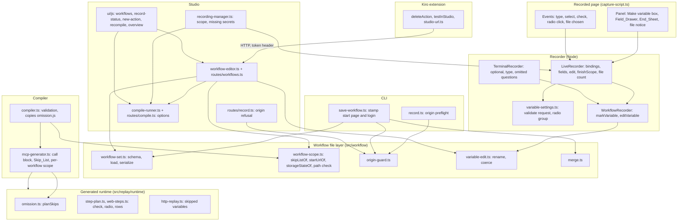
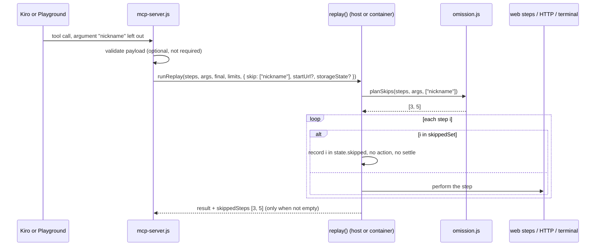
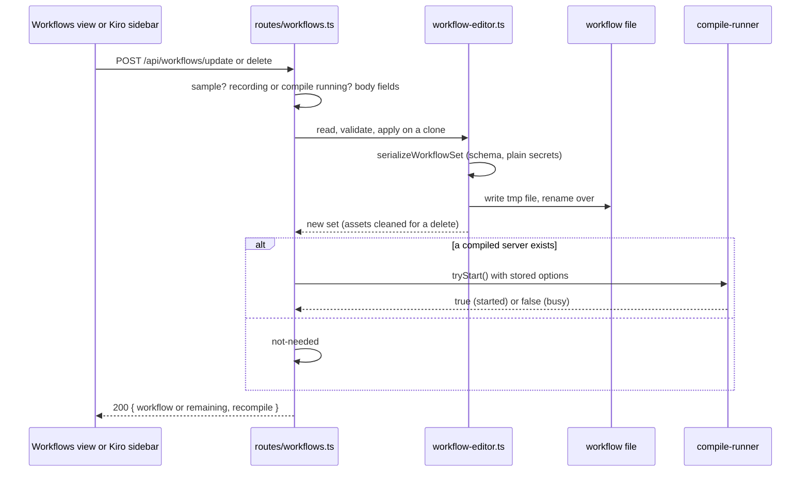

# Design Document: user-journey-improvements

## Overview

This design removes eight friction points of the Daemonize journey (record, save, compile, test in the Studio, add to Kiro): optional variables that can be skipped, several start pages in one file, checkbox, radio and file inputs, editing and deleting a recorded action, "Test in Studio" that opens the clicked action, a scope choice and a credentials warning when adding to Kiro, HTTP and Heal options on recompile, and two visual fixes.

Everything is an addition. Every new field of `daemonize.workflows.json` is optional and its absence keeps today's behavior. No CLI command, flag or default output changes, except the one refusal named in Requirement 12. `src/replay/runtime/*` stays copyable and imports nothing from `src/`. `kiro-extension/src/core/` imports neither `vscode` nor `src/`. The Studio security model is untouched: every new route is a `RouteDef` with `remote: 'blocked'`, writes answer 409 in sample mode, every answer passes through `redactForStudio`.

### Decisions in one place

| # | Question | Decision | Why, and what was rejected |
|---|---|---|---|
| 1 | Values of `whenOmitted` and what absence means | `useRecorded` or `skip`. Absent means `useRecorded`. The Studio view materializes `useRecorded` for an optional Variable that has none. The recorder panel preselects `skip` for a new optional Variable and writes it explicitly. | Rejected: default `skip` (it would change old files that hold `optional: true`); a third value `error` (no requirement needs it); writing `useRecorded` everywhere (breaks "old files unchanged, byte for byte"). |
| 2 | Where is the skip decided | One pure function `planSkips(steps, args, skipList)` in a new runtime file `omission.ts`, called once per call by `replay()`. The generated loops only test `skippedSet.has(index)` before any action or `settle`. | Rejected: testing inside `executeWebStep` (the terminal target and the HTTP path would need their own copy, and "no settle for a skipped step" would be implicit). A decision in one pure function is also what the property tests and the container share, so host and container cannot disagree (Requirement 2.13). |
| 3 | `check` step or `click` plus a flag | New `actionType: 'check'` with `value` `"true"` or `"false"`. | A click on a checked box unchecks it, so a flag on `click` cannot be idempotent, and an old runtime would click blindly. A new type leaves every old `click` untouched (7.11), is preparatory in the HTTP plan (7.9), and is excluded from heal by one line in `healEligible` (7.10). |
| 4 | How `check` is performed | Read the state, click at most once when it differs, then poll until the state equals the target or the step timeout ends. Own code, not `locator.setChecked`. | `setChecked` covers `input[type=checkbox]`, `input[type=radio]` and `[role=checkbox]` ([Playwright docs](https://playwright.dev/python/docs/input)), not `role=switch`, and it fails when the click re-renders or navigates away from the control ([Playwright issue 11026](https://github.com/microsoft/playwright/issues/11026)). A click that did not reach the state raises a non-retryable error, so a second candidate locator can never click again (at most one click, 7.12). |
| 5 | Radio group | A click step on the radio, a Variable of type `string` with `enum` = accessible names of the enabled radios of the group, `step.value` = accessible name of the clicked radio. Replay reuses the "option by value" path (`isOptionByValue` accepts role `radio`). | No new action type: a radio click is idempotent. The group is read by the page at click time and checked in Node by a pure function (limits of 8.5, 8.6). |
| 6 | Per-workflow start page and login at replay | One new optional parameter `call: WorkflowCall = { skip?, startUrl?, storageState? }` appended to `replay` (6th) and `replayInDocker` (5th), forwarded to the container in the request JSON. It exists only when the set uses it (some workflow has a Skip_List, a `startUrl` or a `storageState`); otherwise the generated files are byte-identical to today. | Rejected: one `replay.ts` per workflow (breaks the shared module and the container entry); module constants per tool (one module serves all tools). `storageState: null` ignores `DAEMONIZE_STORAGE_STATE` too: the workflow said "no login". |
| 7 | Refusing a second origin | One pure `checkSameOrigin` in `src/workflow/origin-guard.ts`, used by the Studio route, the CLI preflight (`record`) and `saveWorkflow`. `new URL(x).origin` on both sides, so `:443` equals no port. Compare only with the set `startUrl` and only when the file holds at least one workflow. | One definition, three call sites. The compiler also refuses a workflow whose own `startUrl` has another origin (10.10), so a hand-edited file cannot slip through. |
| 8 | How the Skip_List reaches the runtime, container included | `mcp-server.ts` embeds `{ skip: [names...] }` in the call of each tool. `replay()` receives it; `replayInDocker` adds it to the JSON on stdin; the container entry of `replay.js` passes `request.call` to `replay()`. Names only. | The runtime never reads the workflow file (4.4). The container runs the same `replay()` as the host, so `skippedSteps` is identical (2.13, 4.5). |
| 9 | Removing an HTTP field of a skipped Variable | `buildRequest(recipe, variables, env, skipped)`. Query and header: an entry whose text mentions a skipped `{{name}}` is dropped whole. Body: `fillBody` returns a `REMOVE` sentinel for a `{"$var":name}` leaf or a string leaf that mentions a skipped placeholder, and the parent object, array or form drops that entry (the remaining items keep their order). A root body that is removed is not sent. Path: a placeholder of a skipped Variable throws `invalid` that names the Variable. | Rejected: sending an empty string (the server would receive a value the caller never gave); `null` (not what 3.2 says, and it breaks arrays). Mixed text (`Bearer {{token}}`) is removed whole so recorded text is never sent alone (3.4). The compiler refuses a skip Variable bound in a path (3.7), so the runtime error is a second line of defence. |
| 10 | Recorded defaults for a skipped Variable in HTTP mode | `withRecordedDefaults(steps, args, skipped)` does not put the recorded value back for a skipped name. | Otherwise the skip would be undone before `buildRequest` runs. |
| 11 | Variable editing in the page | New binding `__daemonizeEditVariable` and `{ type: 'fields' }` on the panel binding. One pure validator `validateVariableSettings` serves both `__daemonizeMarkVariable` and the edit, and a rename goes through the shared pure helper `renameVariable` (`src/workflow/variable-edit.ts`), the same one the Studio editor uses. | One rule set (5.4 to 5.7, 6.10, 6.11). A refused request returns before any mutation, so the recorder state stays unchanged. |
| 12 | Atomic write of the Studio editor | `serializeWorkflowSet(set)` (schema and `findPlainSecrets` run first), write to `<file>.tmp-<pid>-<random>` in the same folder with flag `wx`, `rename` over the original, `unlink` the temporary file in `finally`. Read-modify-write runs under an in-process promise lock, after the "recording or compile running" check. | A crash leaves the original or the new file, never half of one (13.11, 13.12, 15.5). The recording save does not use the lock: the 409 check keeps the two apart. |
| 13 | Recompile after an edit | The route calls `compiler.tryStart()` with no argument. The runner then uses its stored Compile_Options (last accepted `POST /api/compile`, default `{ http: 'off', healSupport: false }`). `runExclusive()` (recording) does the same. | One place holds the options (21.6, 13.16). `tryStart()` false after a successful write answers `recompile: 'busy'` (13.18). |
| 14 | Compile options and their storage | `tryStart(options?)`: a validated body is normalized (missing `http` becomes `off`, missing `healSupport` becomes `false`), stored in memory when the compile starts, and used. Never written to a file. Validation precedes the busy check (400 before 409). | 21.4, 21.7, 21.16. Rejected: persisting in app data (21.7 forbids any file). |
| 15 | End Sheet scope | `__daemonizeFinish({ intent, scope })`. The Live_Recorder keeps `scope` only for `intent: 'kiro'` and only when it is exactly `'global'` or `'project'`, exposed as `finishScope`. The panel learns `kiroHomeExists` from `PanelState`, which the manager fills from `power.info()` before the recording starts. | The scope lives in memory (19.15). The resolution is one pure function `resolveInstallScope` so the table of 19.6 to 19.9 is testable. |
| 16 | What the End_Sheet covers | The scope radiogroup, the file-field line (9.7), the "Review fields" entry (6.7) and the Field_Drawer. The sheet is built by `capture-script.ts` and exists only when `studio: true`. A CLI recording keeps today's "Finish and save" with no sheet. | Matches `finishPressed()` today. |
| 17 | Where credentials warnings come from | `power.install` already returns `missingSecrets` and `requiredSecrets`. The manager copies them into `kiro` after normalization (sorted, unique, regex `^[A-Z][A-Z0-9_]*$`, at most 100). | No new route and no secret value is ever read. |
| 18 | Scroll target | `outcome` container when `#kiro-result` exists, else `#connect-card`. `block: 'start'`, `behavior` from `prefers-reduced-motion`, once. CSS: `scroll-margin-top` and bottom padding on `.record-outcome`. | 22.1 to 22.6. |
| 19 | Logo | The extension shield path with the check path, used by the favicon and the inline logo. Shield drawn as an outline on the surface (see conflict RC-1). | 23.1 to 23.10. |
| 20 | Several UI groups, one stylesheet | Each UI group owns its own CSS file under `src/studio/ui/css/` and its own copy module `copy-*.js`. `app.css` has one owner (the logo group). | Gives disjoint file ownership. G0 adds the `<link>` tags, the stub files and widens the contrast and copy tests to scan them. |
| 21 | Description entered by the user | Stored in `workflow.description` (schema: 0 to 1000 characters). `applyEntry` in `src/suggest/apply.ts` skips an accepted suggestion for a workflow whose trimmed `description` is non-empty. | The user wins (Assumptions of the requirements). The tool description uses the trimmed text as lead (1.7). |
| 22 | Schemas after a Studio edit | `inputSchema` and `outputSchema` stay as they are in the file. The next compile infers them again. | 14.17. |

### Research summary

- The code was read before designing. Facts that shape the design:
  - `replay.ts` is one module per set. `START_URL` and `STORAGE_STATE` are module constants, so a per-workflow value must travel as an argument.
  - `replayInDocker` sends `{ steps, args, final, limits, command, url }` on stdin; `replay.js --container` calls `replay()` (`CONTAINER_ENTRY`). The terminal replay does its own `resolveValue`, does not import `step-plan.js`, and its sandbox copy list is `replay.js, screen-hash.js, settle.js, extract.js, pattern-wait.js`. A shared decision therefore needs a file both targets can import: `omission.js`.
  - `buildRowLocator` throws `ROW_VARIABLE_MISSING` whenever `rowBinding.variable` has no value, with no fallback to `key.text`. Requirement 2.11 asks for the fallback when the Variable is omitted: a named change (see "Behavior changes named by the requirements").
  - `describeTool` already prefers `workflow.description` over the label. The schema forbids the field today, so only the loader changes.
  - `mergeWorkflowSets` takes every top-level field from the newer set. `saveWorkflow` builds that set from the new recording, so the newer start page and login win today.
  - `dispatchRoute` answers 409 `SAMPLE_MODE` before a handler runs for a write route. Requirement 12.13 wants the origin check to answer first in sample mode, so `POST /api/record/start` becomes `writes: false` and its handler does the sample check itself, after validation and the origin check.
  - `capture-script.ts` is a template string: no backtick and no `${` may appear inside it.
  - The Studio wraps `services.compiler` in `server.ts`; the wrapper must forward the new arguments.
- Playwright check support and its limits: see decision 4 ([Playwright input docs](https://playwright.dev/python/docs/input), [issue 11026](https://github.com/microsoft/playwright/issues/11026)). Content was rephrased for compliance with licensing restrictions.

### Behavior changes named by the requirements

These differ from today for an old file, and the regression fixture (Requirement 24.3) allow-lists exactly these:

1. `omission.js` is one more runtime file in every output folder and in the sandbox `copy` list.
2. An optional Variable that selects a row, left out, with `key.text` present, finds the row by `key.text` (today: `ROW_VARIABLE_MISSING`). Requirement 2.11.
3. `POST /api/record/start` and `daemonize record` refuse a second origin. Requirement 12.
4. `mergeWorkflowSets` keeps the base `targetName`, `startUrl` and `storageState` when a base workflow survives. Requirement 11.1.
5. `ReplayResult` may carry `skippedSteps`. Only with a Skip_List Variable that was omitted.

### Requirement conflicts and open points

| # | Where | Problem | Resolution in this design |
|---|---|---|---|
| RC-1 | 23.5 and 23.6 | The check mark `#c59eff` on a shield filled with `#9147ff` has a contrast of about 2.1:1, below the 3:1 that 23.6 asks between shield and check. The extension icon draws the shield as an outline on the surface, where shield (about 3.9:1) and check (about 8.3:1) both reach 3:1 against the surface. | The shield is an outline (`fill="none"`, stroke `#9147ff`) like `kiro-extension/media/icon.svg`. The logo test measures each mark against its backdrop (the surface or the header), and does not compare shield with check. Requirement 23.5 and 23.6 should be amended to say this. |
| RC-2 | 6.11 and 14.4 | A recorded Variable name may have up to 64 characters, the Studio accepts a `newName` of at most 60. | Both limits are kept. The Studio limit applies only to `newName`; a 61 to 64 character name can still have its other settings edited. |
| RC-3 | 11.3 and 11.2 | 11.2 takes the target from the new recording when every base workflow is replaced, 11.3 refuses a different origin whenever the base holds a workflow. | 11.3 runs first and wins: re-recording the only workflow of a file on another origin is refused. |
| RC-4 | 14.16 | A file where `type` is absent cannot be restored by an update that can only send `string`, `number` or `boolean`. | Setting `optional: false` removes the `optional` field. The round-trip property compares canonical forms (`optional: false` and `type: 'string'` dropped). Fixtures from the recorder never hold an explicit `optional: false`. |
| RC-5 | Introduction, Assumptions | The Check_Step is called Requirement 8 in the Assumptions and is Requirement 7 in the body. | Requirement 7 is used. |

## Architecture



### A call with a skipped Variable



### Editing from the Studio



### Commit sequence of the feature (Requirement 24.7)

F1 Requirements 1 to 4, F2 5 and 6, F3 7 to 9, F4 10 to 12, F5 13 to 17, F6 18, F7 19 and 20, F8 21, F9 22 and 23. The groups below deliver per feature so each commit is assembled from snapshots (see "Implementation groups").

## Components and Interfaces

Files under `src/` use the repository's `.js` import suffix. Signatures are the contract between groups: a group implements the signatures of its own files and calls the others only through the signatures written here.

### 1. Shared seam (written first, by G0)

#### 1.1 `src/types.ts`

```ts
export type StepActionType = RecordedAction['actionType'] | 'hover' | 'scrollIntoView' | 'switch_page' | 'check';

export type WhenOmitted = 'useRecorded' | 'skip';

export interface WorkflowVariable {
  /* existing fields */
  optional?: boolean;
  /** Only with optional: true. Absent means useRecorded. */
  whenOmitted?: WhenOmitted;
}

export interface Workflow {
  /* existing fields */
  /** Stored in the file (0 to 1000 characters). The lead of the tool description when not empty after trimming. */
  description?: string;
  /** Absolute http(s) URL; same Origin as the set startUrl. Absent: the set startUrl. */
  startUrl?: string;
  /** Path of the saved login. Absent: the set value. null: no saved login for this workflow. */
  storageState?: string | null;
}

export interface ReplayResult {
  /* existing fields */
  /** Zero-based indexes of the steps left out because their Variable was omitted. Absent when none. */
  skippedSteps?: number[];
}
```

#### 1.2 `src/workflow/workflow-set.ts` (schema and loader)

Schema additions, all optional:

```jsonc
// $defs.Step
"actionType": { "enum": [ ...existing, "check" ] },
"allOf": [{ "if": { "properties": { "actionType": { "const": "check" } }, "required": ["actionType"] },
            "then": { "required": ["value"], "properties": { "value": { "enum": ["true", "false"] } } } }]
// $defs.Variable
"whenOmitted": { "type": "string", "enum": ["useRecorded", "skip"] },
"allOf": [{ "if": { "required": ["whenOmitted"] }, "then": { "required": ["optional"], "properties": { "optional": { "const": true } } } }]
// $defs.Workflow
"description": { "type": "string", "maxLength": 1000 },
"startUrl": { "type": "string", "minLength": 1, "maxLength": 2048, "pattern": "^https?://\\S+$" },
"storageState": { "oneOf": [{ "type": "string", "minLength": 1, "maxLength": 1024 }, { "type": "null" }] }
```

New and changed functions:

```ts
/** Maps an Ajv error to a sentence that names the workflow id and the Variable or field. */
export function describeSchemaError(set: unknown, error: { instancePath: string; message?: string }): string;
// deserializeWorkflowSet: the first Ajv error goes through describeSchemaError, then:
//   - every workflow.startUrl must parse with new URL() and use http or https (else error naming id and "startUrl")
// serializeWorkflowSet: unchanged signature. It does not add or drop any field.
export { mergeWorkflowSets } from './merge.js';   // the body moves to merge.ts unchanged by G0
```

`DescriptiveParseError` keeps its three arguments; only `message` changes (`workflow "<id>", variable "<name>": whenOmitted must be useRecorded or skip`). A file with none of the new fields serializes to the same bytes as before.

#### 1.3 `src/workflow/workflow-scope.ts` (new, pure, types only imported)

```ts
export const SKIP_IN_PATH_MESSAGE = (workflowId: string, variable: string): string =>
  `Workflow ${workflowId}: the optional variable "${variable}" is part of a recorded URL path, so it cannot be skipped. Make it required, or use the recorded value.`;

/** Names with optional: true and whenOmitted: 'skip', once each, in workflow order. */
export function skipListOf(workflow: Pick<Workflow, 'variables'>): string[];
/** The first Skip_List Variable bound in a recipe path (`bindings[].in === 'path'`), if any. */
export function findSkippedPathBinding(workflow: Workflow): { stepIndex: number; variable: string } | undefined;
export function startUrlOf(set: Pick<WorkflowSet, 'startUrl'>, workflow: Pick<Workflow, 'startUrl'>): string | undefined;
/** undefined: no login. */
export function storageStateOf(set: Pick<WorkflowSet, 'storageState'>, workflow: Pick<Workflow, 'storageState'>): string | undefined;
export function originOf(url: string | undefined): string | undefined;   // new URL(url).origin, undefined when invalid
/** Compile-time check of 10.10 and 10.11: a message, or undefined when the set is fine. */
export function validateWorkflowScopes(set: WorkflowSet): string | undefined;
/** True when generated code needs the `call` parameter: some workflow has a Skip_List, a startUrl or a storageState. */
export function usesWorkflowCall(set: WorkflowSet): boolean;
```

#### 1.4 `src/workflow/origin-guard.ts` (new, pure)

```ts
export type OriginCheck = { ok: true } | { ok: false; heldOrigin: string; message: string };

/** 12.1 to 12.5: refuses only when the file holds at least one workflow, its web startUrl parses, `url` parses, and the origins differ. */
export function checkSameOrigin(existing: Pick<WorkflowSet, 'startUrl' | 'targetType' | 'workflows'> | undefined, url: string): OriginCheck;

/** Plain text, no file path: `This folder already holds actions for <origin>. Another application needs another folder.` */
export function foreignOriginMessage(heldOrigin: string): string;
/** 11.3: names both Origins, no file path. */
export function saveOriginMessage(heldOrigin: string, newOrigin: string): string;
```

#### 1.5 `src/workflow/variable-edit.ts` (new, pure)

```ts
/** What a rename and a retype need to touch. Mutates in place: steps and variables are shared with the caller. */
export interface VariableHost {
  steps: WorkflowStep[];
  variables: WorkflowVariable[];
  observedPayloads: Record<string, unknown>[];
}

export const VARIABLE_NAME_RE = /^[A-Za-z_][A-Za-z0-9_]*$/;

/**
 * step.variable, rowBinding.variable, http.bindings[].variable, `{{name}}` in http.url, query values and header values,
 * `{"$var":name}` leaves and `{{name}}` in string leaves of http.body, and the key of every observed payload.
 * Afterwards the old name appears in none of these places. Other names are untouched.
 */
export function renameVariable(host: VariableHost, from: string, to: string): void;

export type CoerceResult = { ok: true; value: unknown } | { ok: false };
/** 14.14: string to number when trimmed text is non-empty and finite; string to boolean only for "true" and "false"; number or boolean to string; number to boolean and back refused. */
export function coercePayloadValue(value: unknown, from: 'string' | 'number' | 'boolean', to: 'string' | 'number' | 'boolean'): CoerceResult;
export function retypePayloads(host: VariableHost, name: string, from: VariableType, to: VariableType): boolean;   // false: a value cannot be coerced, nothing changed
```

#### 1.6 `src/replay/runtime/omission.ts` (new, standalone, no import)

```ts
export type SkipList = readonly string[] | undefined;
export interface SkippableStep {
  actionType: string;
  variable?: string;
  secretRef?: string;
  totp?: boolean;
  rowBinding?: { variable?: string };
  http?: unknown;
}
/** `undefined` and `null` only. '' , 0 and false are supplied values. */
export function isOmitted(value: unknown): boolean;
/** The Skip_List names whose argument is omitted. */
export function omittedSkips(args: Record<string, unknown>, skip: SkipList): ReadonlySet<string>;
/**
 * Ascending, unique indexes. A step is skipped when its `variable` or its `rowBinding.variable` is in omittedSkips,
 * unless it has `secretRef`, `totp` or `http` (a step that carries a recipe handles omission through the bindings).
 * Names that no step uses are ignored.
 */
export function planSkips(steps: readonly SkippableStep[], args: Record<string, unknown>, skip: SkipList): number[];
```

#### 1.7 `src/recorder/panel-protocol.ts` (new, types only)

```ts
export type VariableType = 'string' | 'number' | 'boolean';
export type PanelRequest =
  | { type: 'state' } | { type: 'summary' } | { type: 'collapse'; collapsed: boolean }
  | { type: 'fields' }                                   // Requirement 6.3
  | { type: 'file'; fieldId: string };                   // Requirement 9.4: the only thing a file choice sends
export interface PanelFieldVariable { name: string; type: VariableType; optional: boolean; whenOmitted?: WhenOmitted }
export interface PanelField { stepIndex: number; label: string; kind: 'text' | 'choice' | 'check' | 'radio'; variable?: PanelFieldVariable }
export interface FieldsAnswer { fields: PanelField[] }   // at most 100, stepIndex ascending, no typed value
export interface MarkVariableRequest { stepIndex: number; name: string; rowText?: string; type?: VariableType; optional?: boolean; whenOmitted?: WhenOmitted }
export interface EditVariableRequest { name: string; newName?: string; type?: VariableType; optional?: boolean; whenOmitted?: WhenOmitted }
export type VariableAnswer = { ok: true } | { ok: false; error: string };
export interface FinishRequest { intent?: unknown; scope?: unknown }
export interface RadioInfo { names: string[]; total: number; clicked: string; clickedDisabled: boolean }  // names: enabled radios, document order, at most 52
export interface PanelSummary { steps: number; variables: string[]; secrets: number; files: number }
export interface PanelState { /* existing */ kiroHomeExists: boolean }
```

#### 1.8 Studio contracts (`src/studio/contracts.ts`, `inert-services.ts`, `server.ts` wrapper)

```ts
export interface CompileOptionsInput { http: 'off' | 'auto'; healSupport: boolean }
export interface CompileRunner {
  status(): CompileStatus;
  /** options given: they become the stored options when the compile starts. Absent: the stored options. */
  tryStart(options?: CompileOptionsInput): boolean;
  /** Uses the stored options. */
  runExclusive(): Promise<CompileOutcome>;
  /** The stored options; { http: 'off', healSupport: false } until a request stores others. */
  options(): CompileOptionsInput;
  close(): Promise<void>;
}
export interface RecordingStatus {
  /* existing */
  kiro?: { added: boolean; message: string; scope?: InstallScope; missingSecrets?: string[]; requiredSecrets?: string[] };
}
```

The `server.ts` wrapper of `services.compiler` forwards `options` and `tryStart(options)` to the base runner.

`routes/index.ts` registers `workflowRoutes` (a stub returning `[]` until G-H fills it). `messages/workflows.ts`, `copy-editor.js`, `copy-record.js`, `copy-compile.js` and `css/editor.css`, `css/record.css`, `css/compile.css` are created empty by G0 with the `<link>` tags in `index.html`; `copy.js` aggregates the three copy modules in `allCopyTexts()`; `tests/unit/studio-ui-copy.test.ts` scans `messages/*` and `copy-*.js`, and `tests/unit/studio-ui-contrast.test.ts` scans every file of `src/studio/ui/css/` and `app.css`. `api.js` gets `workflowUpdate(body)`, `workflowDelete(id)` and `compileStart(options?)`.

### 2. Replay runtime (G-A)

Files: `step-plan.ts`, `web-steps.ts`, `http-replay.ts`, `row-resolver.ts`. All stay standalone; `http-replay.ts` and the generated `replay.ts` import `omission.js`.

```ts
// http-replay.ts
export function buildRequest(recipe: HttpRecipeLike, variables: Record<string, unknown>, env: Env, skipped?: ReadonlySet<string>): BuiltRequest;
export function withRecordedDefaults(steps: ReadonlyArray<{ variable?: string; value?: string }>, args: Record<string, unknown>, skipped?: ReadonlySet<string>): Record<string, unknown>;
export function runHttpStep(recipe: HttpRecipeLike, variables: Record<string, unknown>, env: Env, options: RunOptions & { skipped?: ReadonlySet<string> }): Promise<HttpStepOutcome>;
const PREPARATORY = new Set(['type', 'select', 'check', 'hover', 'scrollIntoView']);   // 7.9
```

`buildRequest` with `skipped` undefined or empty behaves exactly as today. With names in `skipped`:

- query and header values: if `PLACEHOLDER` finds a skipped name, the whole key or header is left out. Entries bound to a `secretRef` are never touched.
- body: `fillBody` returns the `REMOVE` sentinel for a skipped leaf. Objects and arrays filter it out and keep the order of the rest; the `form` format builds from the filtered object; a root body that is `REMOVE` is not sent (no body, no `content-type` added).
- path: `fillText` of a skipped name throws `HttpReplayError('invalid', 'no value for the variable "<name>"')` (no secret in the text).
- `variables` never carries a skipped name (`withRecordedDefaults` leaves it out), so no `{{name}}` can remain (3.9).

```ts
// web-steps.ts
/** 7.4: the target state. true or "true" is checked, false or "false" is unchecked, anything else is the recorded value. */
export function checkTarget(resolved: string | undefined, recorded: string | undefined): boolean | undefined;
/** 7.12: whether a click is needed. */
export function needsClick(current: boolean, target: boolean): boolean;
class NonRetryableAction extends Error {}   // thrown by `act` after a click that did not reach the state; locateAndAct turns it into a StepExecutionError at once
// act(): case 'check' reads the state (`el.checked`, or aria-checked === 'true' for role checkbox, switch, menuitemcheckbox),
// clicks once when needsClick, then polls every 50 ms until the target or the step timeout.
```

`step-plan.ts`: `healEligible(step, mode)` returns false for `actionType === 'check'`; `OPTION_ROLES` gains `radio` so `isOptionByValue` and the by-value locator name work for a radio. `row-resolver.ts`: `buildRowLocator` falls back to `binding.key.text` when `binding.variable` has no value and `key.text` is non-empty, else throws `ROW_VARIABLE_MISSING` as today.

### 3. Generator and compiler (G-B)

Files: `src/compiler/mcp-generator.ts`, `src/compiler/compiler.ts`, `src/compiler/tool-description.ts`, `src/suggest/apply.ts`.

`McpGenerator` computes `const withCall = usesWorkflowCall(set)` once. When it is false, every emitted line is the same as today. When it is true:

```ts
// replay.ts
import { planSkips } from "./omission.js";
export type WorkflowCall = { skip?: string[]; startUrl?: string; storageState?: string | null };
export async function replay(steps, args, final = {}, limits = {}, overrides: Overrides = {}, call: WorkflowCall = {}) {
  const state = { skipped: [] as number[] };
  const skippedSet = new Set(planSkips(steps, args, call.skip));
  const track: HealTrack = { healedSteps: [] };
  const result = await replayCore(steps, args, final, limits, overrides, track, call, skippedSet, state);
  return { ...modeFields(track), ...result, ...(state.skipped.length > 0 ? { skippedSteps: state.skipped } : {}) };
}
// every loop: if (skippedSet.has(index)) { state.skipped.push(index); continue; }   // before settle, before the plan branch, before waitFor
function resolveStorageState(call: WorkflowCall): string | undefined {
  if (call.storageState === null) return undefined;                                   // 10.8, env ignored too
  if (process.env.DAEMONIZE_STORAGE_STATE) return resolvePath(process.env.DAEMONIZE_STORAGE_STATE);
  const recorded = call.storageState ?? STORAGE_STATE;
  return recorded ? resolvePath(dirname(fileURLToPath(import.meta.url)), recorded) : undefined;
}
// start: overrides.url ?? call.startUrl ?? START_URL ; rebaseOrigin(url, call.startUrl ?? START_URL, overrides.url)
// HTTP mode: skipped = omittedSkips(args, call.skip); withRecordedDefaults(steps, args, skipped); runHttpStep(..., { skipped })
```

A skipped step that is `prep` in the HTTP plan is never deferred, so it is never replayed on the page after a fallback (3.6). The terminal loop does the same before its `waitFor` handling (2.12).

```ts
// mcp-server.ts, one tool block, only when withCall
const runReplay = (steps, args, final, limits, call) =>
  process.env.DAEMONIZE_SANDBOX === "docker" ? replayInDocker(steps, args, final, limits, call) : replay(steps, args, final, limits, {}, call);
... await runReplay(STEPS, args, FINAL, LIMITS, { skip: ["nickname"], startUrl: "https://app.test/b", storageState: null });
// the call literal holds only the keys that are set: names, a URL, a path or null. Never a value.

// docker-replay.ts
export async function replayInDocker(steps, args, final = {}, limits = {}, call: WorkflowCall = {}) { ... }
//   resolveHostStorageState(call) follows the same rules as resolveStorageState(call)
//   child.stdin.end(JSON.stringify({ steps, args, final, limits, command, url, call }))
// CONTAINER_ENTRY: replay(request.steps, request.args, request.final ?? {}, request.limits ?? {}, { command, url }, request.call ?? {})
```

`generateSandboxFiles` adds `omission.js` to `copy` for both targets. `Compiler.compile` reads `omission.ts`, writes `omission.ts` and `omission.js`, and, before writing any file:

```ts
const scopeError = validateWorkflowScopes(set);                       // 10.10, 10.11
if (scopeError !== undefined) throw new Error(scopeError);
if (httpEnabled(set, options)) for (const w of set.workflows) {       // 3.7
  const hit = findSkippedPathBinding(w);
  if (hit !== undefined) throw new Error(SKIP_IN_PATH_MESSAGE(w.id, hit.variable));
}
```

`describeTool`: `const lead = workflow.description?.trim() ? workflow.description.trim() : workflow.label`. `applyEntry`: when `workflow.description?.trim()` is non-empty, push a `skipped` line and keep the user's text. `SchemaInferencer` and `zod-translator.ts` do not change: an optional Variable already leaves `required`, and `whenOmitted` and `description` are never read by them (properties 3 and 4 guard this).

### 4. Page recorder (G-C)

Files: `capture-script.ts`, `live-recorder.ts`, `workflow-recorder.ts`, `variable-settings.ts` (new).

#### 4.1 Bindings of the page (Playwright `exposeBinding`)

| Binding | Request | Answer |
|---|---|---|
| `__daemonizeMarkVariable` | `MarkVariableRequest` | `VariableAnswer` |
| `__daemonizeEditVariable` (new) | `EditVariableRequest` | `VariableAnswer` |
| `__daemonizePanel` | `{type:'state'}`, `{type:'summary'}`, `{type:'collapse'}`, `{type:'fields'}`, `{type:'file', fieldId}` | `PanelState`, `PanelSummary` (now with `files`), `{ ok: true }`, `FieldsAnswer`, `{ ok: true }` |
| `__daemonizeFinish` | `FinishRequest` (`{ intent }`, or `{ intent: 'kiro', scope }`) | `{ ok: true }` |

#### 4.2 `variable-settings.ts` (pure)

```ts
export interface RecordedStepFacts { actionType: StepActionType; value?: string; isRadioClick: boolean }
/** 5.4 to 5.8, 7.3, 8.2: the settings to store, or a plain message. No mutation. */
export function validateVariableSettings(
  request: { type?: unknown; optional?: unknown; whenOmitted?: unknown; rowText?: unknown },
  step: RecordedStepFacts | undefined,
): { ok: true; settings: { type?: VariableType; optional?: true; whenOmitted?: WhenOmitted } } | { ok: false; error: string };
/** 6.11 for an edit: new name, existing name, duplicates, length 64, plus the same settings rules against the current Variable. */
export function validateEdit(request: EditVariableRequest, current: WorkflowVariable[], valueOf: (name: string) => string | undefined): { ok: true } | { ok: false; error: string };
/** 8.3 to 8.6. `enum` is the names in document order. */
export function validateRadioGroup(info: RadioInfo): { ok: true; enum: string[]; value: string } | { ok: false; error: string };
export function safeFieldLabel(step: Pick<WorkflowStep, 'actionType' | 'label' | 'value'>): string;   // never contains step.value; at most 200 characters
```

Rules: `type` only `string`, `number` or `boolean`; `optional` only boolean; `whenOmitted` only `useRecorded` or `skip` and only with `optional === true`; `number` needs `Number(value.trim())` finite and `boolean` needs `value === 'true' || 'false'` (the messages are Plain_Language); `rowText` allows only `string`; a `check` step allows only `boolean` and a radio click only `string`. A request with none of the three settings yields `settings: {}` and the Variable is built as today.

#### 4.3 `LiveRecorder` and `WorkflowRecorder`

```ts
export type FinishScope = 'global' | 'project';
export interface LiveRecorderOptions { /* existing */ kiroHomeExists?: boolean }
class LiveRecorder {
  get finishScope(): FinishScope | undefined;            // only set by intent 'kiro' with scope exactly 'global' or 'project'
  panelFields(): FieldsAnswer;                           // 6.3 to 6.6: type, select, check and radio-click steps without secretRef; the last 100; no value
  get unrecordedFileFields(): number;                    // 9.5: distinct (frame, fieldId) signals
  handleMarkVariable(request: MarkVariableRequest): VariableAnswer;   // unchanged shape, new validation and coercion
  handleEditVariable(request: EditVariableRequest): VariableAnswer;
}
// WorkflowRecorder (new methods)
markChoiceVariable(stepIndex: number, variable: WorkflowVariable, value: string): void;   // radio: sets step.value, then the usual mark
editVariable(name: string, patch: { newName?: string; type?: VariableType; optional?: boolean; whenOmitted?: WhenOmitted }): void; // validated by the caller; one atomic step
variableList(): WorkflowVariable[];
```

The page sends, for a radio click, `event.radio: RadioInfo` in the `__daemonizeRecord` event. For a check step it sends `actionType: 'check'` with `value: 'true' | 'false'` (read from `el.checked` for a native input, at once; from `aria-checked` after one macrotask for a role element). `CapturedEvent` gains `radio?: RadioInfo`. `classifyRisk` is unchanged (a `check` step is `read`).

A marked `check` step creates `{ name, type: 'boolean', ... }` and refuses another type. A marked radio step creates `{ name, type: 'string', enum, ... }` with `step.value` set to the clicked name; the group is validated by `validateRadioGroup`, and a refusal leaves the click step as recorded (8.5, 8.6).

`recorder.markVariable` and `defineVariable` keep their signatures. A request without `type`, `optional` and `whenOmitted` produces the same Variable object as today (5.8, 6.15).

#### 4.4 The panel (inside `CAPTURE_SCRIPT`)

- `createOfferModel(initialRoute)` returns `{ apply(e), offer, earlier, route }`. `earlier` holds the previous offers (at most 100, unique by `fieldId`, newest last). `{t:'input'}` for another field pushes the current offer to `earlier` and keeps `offer`. `{t:'route'}` sets `offer` to null and keeps `earlier`. `{t:'typed'}` of a field that is in `earlier` removes it from there.
- "Make variable" box: name field, `<select>` type (text, number, true or false; absent for a radio, fixed to true or false for a check step), "Optional" checkbox, and when it is checked a `<select>` "If left empty" (skip this field, use the recorded value). Controls carry accessible names; tab order name, type, optional, omitted; Enter confirms. The request is `{ stepIndex, name, type, ...(optional ? { optional: true, whenOmitted } : {}) }`. An `{ ok: false }` answer keeps the box open and shows `error` next to the name field.
- Field_Drawer: opened by "Review fields" in the End_Sheet. It lists `FieldsAnswer.fields`. Selecting a field without Variable opens the same box; with a Variable it opens an edit form that sends `{ name, newName?, type?, optional?, whenOmitted? }` with only the settings the user changed. While an edit is open and unconfirmed, "Save and add to Kiro" keeps the End_Sheet closed and shows the open edit (6.12).
- File notice: a `change` listener on `input[type=file]` calls `setStatus(text, true)` at once (status text without any file detail, kept 6 s or until dismissed, `role=status`) and sends `{ type: 'file', fieldId }`. It records no step.
- End_Sheet: shows one line with `summary.files` when it is 1 or more. With `PanelState.kiroHomeExists` true it shows a native `radiogroup` (`aria-label="Where to add the tool"`, "All my projects" preselected, "Only this project"); otherwise the static text "Only this project". `finishWith('kiro')` sends `{ intent: 'kiro', scope }`; `save` and `test` send `{ intent }` only.

### 5. Terminal recorder (G-F)

`terminal-recorder.ts`: after a valid name the recorder asks, one key at a time, `optional? (y/n, Enter = n)`, `type? (s/n/b, Enter = s)`, and only for an optional Variable `if left empty: skip or use the recorded value (s/r, Enter = s)`. An answer outside the offered keys repeats the same question and changes nothing. The Variable is then created with `type` always, `optional: true` and `whenOmitted` only for an optional one. A number or boolean type whose typed text does not convert answers the plain message and asks the type again.

### 6. Workflow file, save and `record` preflight (G-D)

```ts
// merge.ts
export function mergeWorkflowSets(base: WorkflowSet, newer: WorkflowSet): WorkflowSet;
// replaced = ids of newer.workflows; keepsBase = base.workflows.some(w => !replaced.has(w.id))
// keepsBase: targetName, startUrl, storageState come from base (an absent field stays absent); every other top-level field from newer as today
// otherwise: all top-level fields from newer, as today. Workflows: Map by id (a replaced one keeps its position, new ones are appended). Neither input is mutated.
```

```ts
// save-workflow.ts
export async function saveWorkflow(out: string, target: RecordingTarget, workflow: Workflow): Promise<number>;
```

After loading `existing`: if it holds a workflow and both sides are web, `checkSameOrigin(existing, target.startUrl)` runs first and a failure throws `Error(saveOriginMessage(...))` before any write (11.3). If at least one base workflow survives, the saved workflow is stamped: `startUrl` only when it differs from the base `startUrl` (11.4, 11.7); `storageState` is the recording's value when it differs from the base's, `null` when the recording has none and the base has one (11.5 to 11.7). Then `mergeWorkflowSets`. When no base workflow survives, nothing is stamped.

```ts
// record.ts
export interface RecordOptions { /* existing */ kiroHomeExists?: boolean }   // passed to LiveRecorder
// at the start of record(), before launching a browser:
//   existing = tolerant read of options.out; unreadable or unparsable -> throw Error(LOAD_UNREADABLE message of studio/messages/common)
//   const check = checkSameOrigin(existing, options.url); if (!check.ok) throw new Error(check.message)
```

The thrown error reaches the CLI top level, which prints the message and exits non-zero as for any `record` failure. The recovery path is not entered (nothing was recorded).

### 7. Studio recording (G-E)

```ts
// src/studio/install-scope.ts (new, pure)
export function resolveInstallScope(finishScope: unknown, kiroHomeExistsNow: boolean): InstallScope;
//   'global' with kiroHomeExistsNow false -> 'project'; 'project' -> 'project'; 'global' -> 'global'; anything else -> kiroHomeExistsNow ? 'global' : 'project'
export function normalizeSecretNames(value: unknown): string[];   // strings matching ^[A-Z][A-Z0-9_]*$, unique, sorted by code point, at most 100
```

`RecordCallOptions` gains `kiroHomeExists?: boolean`; `LiveLike` gains `readonly finishScope?: 'global' | 'project'`. The manager calls `power.info()` at the start of `run()` (a failure counts as `false`), passes `kiroHomeExists` to `record()`, and in `addToKiro()`:

```ts
const info = await power.info();
const scope = resolveInstallScope(this.finishScope, info.kiroHomeExists);   // finishScope read in takeSnapshot, like finishIntent
const preview = await power.preview({ scope });
const installed = await power.install({ confirmationId: preview.confirmationId, kiroPath: preview.kiroPath, scope });
this.kiro = { added: true, message: KIRO_ADDED, scope, missingSecrets: normalizeSecretNames(installed.missingSecrets), requiredSecrets: normalizeSecretNames(installed.requiredSecrets) };
// on error: { added: false, message } with no scope, no arrays
```

`POST /api/record/start` becomes `writes: false`. Handler order: unexpected field (400), name (400), url (400), `reuseSession` (400), then

```ts
let set: WorkflowSet | undefined;
try { set = (await ctx.loadSet()).set; } catch { return { status: 409, body: { error: LOAD_UNREADABLE, field: 'url' } }; }   // 12.11
const check = checkSameOrigin(set, url.value);
if (!check.ok) return { status: 409, body: { error: check.message, field: 'url' } };      // 12.1, 12.13
if (ctx.sample) return { status: 409, body: { error: SAMPLE_MODE } };                     // as the dispatcher did
```

The same check runs in sample mode against the sample set. UI: `new-action.js` computes the origin with `new URL(value).origin` against `new URL(overview.targets[0].start).origin` when `targets[0].workflows >= 1`, 300 ms after the last keystroke, with a `role="alert"` message linked by `aria-describedby`; the start button is disabled while it shows. `record-status.js`: the scroll rule of decision 18, and a block with `role="alert"` before `connectCard()` when `kiro.added && kiro.missingSecrets.length > 0`, listing the names and a link `href('credentials')`; an absent `missingSecrets` is `[]`.

### 8. Studio workflow editor (G-H)

New files: `src/studio/workflow-editor.ts`, `src/studio/routes/workflows.ts`, `src/studio/messages/workflows.ts`. Changed: `model.ts`, `ui/js/views/workflows.js`, `copy-editor.js`, `css/editor.css`.

#### 8.1 `POST /api/workflows/update`

| | |
|---|---|
| Registration | `{ path: '/api/workflows/update', remote: 'blocked', handlers: { POST } }` (writes default true: sample mode answers 409 `SAMPLE_MODE`) |
| Request | `{ id: string, label?: string, description?: string, variables?: Array<{ name: string, newName?: string, type?: 'string'\|'number'\|'boolean', optional?: boolean, whenOmitted?: 'useRecorded'\|'skip', description?: string }> }` |
| 200 | `{ workflow: WorkflowView, recompile: 'started' \| 'not-needed' \| 'busy' }` |
| 400 | `{ error: string, field?: 'id'\|'label'\|'description'\|'variables', index?: number }`; unknown body field: `{ error: UNEXPECTED_FIELD, field }` |
| 404 | `{ error: WORKFLOW_NOT_FOUND }` |
| 409 | `{ error }` (recording or compile running, or the file is unreadable with `LOAD_UNREADABLE`) |

```ts
// workflow-editor.ts
export type EditResult<T> = { ok: true; value: T } | { ok: false; status: 400 | 404; error: string; field?: string; index?: number };
export interface UpdateRequest { id: string; label?: string; description?: string; variables?: VariableUpdate[] }
export interface VariableUpdate { name: string; newName?: string; type?: VariableType; optional?: boolean; whenOmitted?: WhenOmitted; description?: string }
export function applyUpdate(set: WorkflowSet, request: unknown): EditResult<WorkflowSet>;      // pure: clone, validate all, then apply
export function applyDelete(set: WorkflowSet, id: unknown): EditResult<{ set: WorkflowSet; removed: Workflow }>;
export function referencedAssets(set: WorkflowSet): Set<string>;                               // basenames from visual.thumbnailPath
export async function writeWorkflowFileAtomic(file: string, set: WorkflowSet): Promise<void>;  // serializeWorkflowSet, tmp, rename, unlink in finally
export async function cleanAssets(file: string, set: WorkflowSet): Promise<'ok' | 'partial'>;
```

Validation order inside `applyUpdate`: fields (`UNEXPECTED_FIELD`), `id` (400 `field: 'id'`), "only id" (400 plain message), workflow exists (404), label (trim, 1 to 200, no U+0000 to U+001F or U+007F), description (`''` or accepted by `cleanDescription`), then each Variable object in order: allowed keys and JSON types, existing unique `name`, `newName` (regex, at most 60, not the current name of another Variable and not the `newName` of another object, comparisons against the names before the update), `type`, no `enum`, `pattern` or `maxLength` when the type is not `string`, `boolean` for a Variable of a `check` step, `whenOmitted` only when the Variable is optional after the update, payload coercion (`retypePayloads`), `findSkippedPathBinding` after the update (`SKIP_IN_PATH_MESSAGE`). One invalid object fails the whole request before anything is applied. Application: rename through `renameVariable`; `optional: false` deletes the `optional` field and `whenOmitted`; `optional: true` keeps an existing `whenOmitted`; `description: ''` deletes the field. Fields the request does not name are never touched, and no `optional`, `whenOmitted` or `description` is added to a Variable the request does not name.

Route handler order: `recording.isActive()` or compile `state === 'running'` (409), read the file (`readFile` then `deserializeWorkflowSet`; failure 409 `LOAD_UNREADABLE`), `applyUpdate`, `writeWorkflowFileAtomic`, `ctx.loadSet()` for the view, then `outputs.flags.compiled ? (compiler.tryStart() ? 'started' : 'busy') : 'not-needed'`.

#### 8.2 `POST /api/workflows/delete`

| | |
|---|---|
| Request | `{ id: string }` (1 to 200 characters, no other field) |
| 200 | `{ ok: true, remaining: number, recompile: 'started' \| 'not-needed', cleanup?: 'partial' }` |
| 400 | `{ error, field }`; 404 `{ error: WORKFLOW_NOT_FOUND }`; 409 `{ error }` naming the running operation, or `SAMPLE_MODE`; 500 `{ error }` when the atomic write fails (nothing deleted, no compile) |
| Other methods | The dispatcher answers 405 with `Allow: POST` for `GET`; any other method is refused before the route |

Order: validate, running check, read, `applyDelete`, `writeWorkflowFileAtomic` (failure: 500), `cleanAssets` (a failure adds `cleanup: 'partial'` and keeps the 200), compile (`remaining >= 1 && compiled`: `tryStart()`; the last workflow deleted: `not-needed`). `cleanAssets` removes only regular, non-symlink files of `<file>.assets/` matching `ASSET_NAME` (`^[A-Za-z0-9][A-Za-z0-9_-]{0,100}\.png$`) that no remaining workflow references.

#### 8.3 `GET /api/workflows` view (`model.ts`)

```ts
variables: Array<{ name: string; type: string; description?: string; optional: boolean; whenOmitted?: WhenOmitted }>;  // whenOmitted only for optional ones; 'useRecorded' when the file has none
startPage?: string;   // displayUrl(workflow.startUrl) only when it differs from the set startUrl (10.12)
```

`workflows.js`: three `button`s in the detail ("Rename and describe", "Edit inputs", "Delete this action"), the forms of 16.2 to 16.5, errors in `role=alert`, the dialog through `openDialog` with focus on "Cancel", Escape and "Cancel" returning focus to the opener, a single pending delete request. After a 200 it re-renders, calls `announce`, and shows the recompile state when `recompile === 'started'`. The controls are not rendered in sample mode or the static demo.

### 9. Compile options (G-I)

`POST /api/compile` body: empty, or `{ http?: 'off'|'auto', healSupport?: boolean }`.

| Case | Answer |
|---|---|
| Field other than `http`, `healSupport` | 400 `{ error: UNEXPECTED_FIELD, field }` (first unexpected field), no compile, stored options unchanged |
| `http` not `'off'`/`'auto'`, or `healSupport` not boolean | 400 `{ error, field }` |
| Valid, a compile is running | 409 `{ error: COMPILE_BUSY }`, stored options unchanged |
| Valid | 202 `{ state: 'running' }`; `tryStart({ http: body.http ?? 'off', healSupport: body.healSupport ?? false })` |

`StudioCompileRunner` keeps `private stored: CompileOptionsInput = { http: 'off', healSupport: false }`, replaces it in `tryStart(options)` when it starts, and passes `{ http: stored.http, healSupport: stored.healSupport }` to `compile()` instead of the constants. Nothing is written to disk. `recompile.js` sends the two checkbox values; `overview.js` sets them from `targets[0].modes` (`http === 'auto'`, `healSupport === true`), refreshes the HTTP and Heal flags within 2 seconds of `done`, disables and unchecks both for a terminal target (with the sentence that they apply to web actions), and renders neither in sample mode or the static demo.

### 10. Kiro extension (G-K)

```ts
// core/ports.ts
export type StudioRoute = 'playground' | 'credentials' | 'overview' | 'workflows';
export type StudioTarget = { kind: 'tool'; name: string } | { kind: 'workflow'; id: string };
interface StudioSessionLike { browserUrl(route?: StudioRoute, target?: StudioTarget): string }
interface StudioApi { /* existing */ deleteWorkflow(id: string): Promise<ApiResult<{ ok: boolean; remaining: number; recompile?: string }>> }

// core/studio-url.ts
export const TARGET_NAME_RE = /^[A-Za-z0-9_-]{1,64}$/;
export function buildBrowserUrl(h: { origin: string; token: string }, route?: StudioRoute, target?: StudioTarget): string;
//   token in the query only. A valid target replaces the fragment: tool -> #/playground?tool=<encodeURIComponent(name)>, workflow -> #/workflows/<encodeURIComponent(id)>.
//   An invalid name or id: the target is ignored and the result equals buildBrowserUrl(h, route).

// core/with-timeout.ts (new)
export function withTimeout<T>(work: Promise<T>, ms: number): Promise<{ timedOut: false; value: T } | { timedOut: true }>;
```

`ui/commands/studio.ts`: `daemonize.testInStudio` takes the row. For `action:<id>` it calls `withTimeout(api.workflows(), 5000)` once, matches `<id>` exactly with `WorkflowRow.id`, and opens `{ kind: 'tool', name: toolName }` when `toolName` passes `TARGET_NAME_RE`, `{ kind: 'workflow', id }` when the workflow has no `toolName`, and plain `playground` when the id is unknown or the call fails, times out or returns a malformed body. Any other row or none opens `playground` without calling the Studio. Nothing is logged, copied or shown about the address.

`ui/commands/delete.ts` (new): `daemonize.deleteAction(node?)`. It needs `node.id` matching `^action:.+$` and a running Studio, else it does nothing. Modal `showWarningMessage` naming the label, detail "This action cannot be recovered from the Studio.", button "Delete" (the modal supplies "Cancel"). One `api.deleteWorkflow(id)` under `withTimeout(…, 10000)`; an in-flight `Set<string>` ignores a second invocation for the same id. 200: refresh and information message (names the action, adds that tools are being updated when `recompile === 'started'`); 404: refresh and "this action no longer exists"; 409: the message of the answer after the redactor; other statuses, timeout or unreachable: a plain error message. `package.json` adds the command, an inline `view/item/context` entry for `viewItem == action`, and hides it from the command palette; `package.nls.json` and `strings.ts` carry the titles and messages.

### 11. Studio visuals (G-J)

- `favicon.svg`: `viewBox="0 0 24 24"`, a `<rect>` surface `#19161d` with `rx`, one `<path>` with `d="M12 3 4 7v6c0 4.2 3.2 7.2 8 8 4.8-.8 8-3.8 8-8V7l-8-4Z"` (`fill="none"`, stroke `#9147ff`), one `<path d="m9 12 2 2 4-4">` (stroke `#c59eff`). No `ellipse`, no `circle`.
- `index.html`: `<svg class="logo" viewBox="0 0 24 24" aria-hidden="true" focusable="false">` with the same two paths and `stroke="var(--logo-shield)"`, `stroke="var(--logo-check)"`; the `ghost-body` gradient and the ellipses are removed; the `Daemonize <strong>Studio</strong>` text stays byte-identical.
- `app.css`: `--logo-shield` and `--logo-check` in each `:root` block, pointing at `--kiro-purple-500` and `--kiro-purple-300` (and darker tokens where a theme has a light header), no literal colour outside `:root`.
- `docs/design-tokens.md`: the ghost line is replaced as written in 23.7; `docs/studio.md` and `docs/replay-model.md` as in 24.8.
- Scroll CSS (`css/record.css`, owned with the recording group): `.record-outcome { scroll-margin-top: <header height + 8px>; padding-bottom: 96px; }`; the header height is measured in the layout test, not guessed.

## Data Models

```jsonc
// Variable
{ "name": "nickname", "type": "string", "optional": true, "whenOmitted": "skip", "description": "..." }
// Workflow (new fields)
{ "id": "...", "label": "Create customer", "description": "Creates a customer.", "startUrl": "https://app.test/b/new", "storageState": null, "steps": [ ... ] }
// check step
{ "actionType": "check", "selectors": ["role=checkbox[name=\"Newsletter\"]"], "value": "true", "variable": "newsletter", "anchor": { "role": "checkbox", "name": "Newsletter", "frame": [] } }
// radio click step and its Variable
{ "actionType": "click", "selectors": [...], "value": "Express", "variable": "delivery", "anchor": { "role": "radio", "name": "Express", "frame": [] } }
{ "name": "delivery", "type": "string", "enum": ["Standard", "Express"] }
```

Runtime and protocol shapes (not written to the file): `WorkflowCall`, `PanelField`, `RadioInfo`, `CompileOptionsInput`, `kiro` block of `RecordingStatus`, the answers of the two new routes (section 8).

```ts
// Result of a call (new optional field)
{ success: true, ..., skippedSteps?: number[] }
// GET /api/record/status after "Save and add to Kiro"
{ state: 'done', intent: 'kiro', kiro: { added: true, message, scope: 'project', missingSecrets: ['PASSWORD'], requiredSecrets: ['PASSWORD', 'USERNAME'] } }
```

Memory only: Compile_Options of the Studio process, `finishScope`, the file-field count, `kiroHomeExists`. None is written to a file.

| Old state | After this feature |
|---|---|
| File without any new field | Loads, serializes to the same bytes, compiles to the same tool names, input schemas and (without Skip_List, per-workflow start or login) the same `mcp-server.ts`, `replay.ts` and `docker-replay.ts`. |
| `optional: true` and no `whenOmitted` | `useRecorded`, as today. |
| `click` on a checkbox | Replayed as a click, as today. |

## Correctness Properties

*A property is a characteristic or behavior that should hold true across all valid executions of a system-essentially, a formal statement about what the system should do. Properties serve as the bridge between human-readable specifications and machine-verifiable correctness guarantees.*

Reflection on the prework: it listed about 70 testable groups. Those that share one pure function were merged (skip planning with the `skippedSteps` field and the unknown-name rule; the three HTTP places in one request property; the update validations in one "invalid request changes nothing" property; scope and secret normalization kept apart because they are different functions). Workflow-file properties come first, then runtime, recorder, Studio, extension.

### Property 1: Variable fields round trip

For any valid Workflow_Set whose Variables have `type`, `optional` and `whenOmitted` each absent or valid (`whenOmitted` only with `optional: true`) and whose workflows have `description`, `startUrl` and `storageState` (string, `null` or absent), serializing then loading returns the same values, an absent field stays absent, and a set with none of the new fields serializes to the same bytes as before.

**Validates: Requirements 1.4, 1.5, 10.3**

### Property 2: whenOmitted validity

For any Variable object, the loader accepts the file if and only if `whenOmitted` is absent, or is the string `useRecorded` or `skip` and `optional` is `true`; any other value (including `null`, `''`, `'Skip'`, a number) is refused with an error that contains the workflow id and the Variable name, and no Workflow_Set is returned.

**Validates: Requirements 1.1, 1.2, 1.3**

### Property 3: Description lead and limits

For any string `d` of 0 to 1000 characters the loader accepts `description: d`, and for any longer string or any non-string it refuses with an error that names the workflow id; for any accepted workflow the tool description starts with `d.trim()` when that is not empty and with the label otherwise.

**Validates: Requirements 1.6, 1.7, 1.8**

### Property 4: The input schema ignores whenOmitted and description

For any workflow and any assignment of `whenOmitted` and `description` values, the generated input schema (property names, types, `required`, Zod source) is the same, and every Variable with `optional: true` is absent from `required`.

**Validates: Requirements 1.9, 1.10, 8.14**

### Property 5: Skip planning

For any steps, call arguments and Skip_List, `planSkips` returns ascending unique indexes; a step is in the result if and only if its `variable` or `rowBinding.variable` names a Skip_List Variable whose argument is `undefined` or `null`, and it has no `secretRef`, `totp` or `http`; a supplied `''`, `0` or `false` never skips a step; a Skip_List name that no step uses changes nothing; and the `skippedSteps` field of the result is present if and only if the list is not empty.

**Validates: Requirements 2.1, 2.2, 2.3, 2.4, 2.5, 2.6, 2.7, 2.8, 2.9, 4.6, 4.7**

### Property 6: Row selection by an omitted Variable

For any row binding and call arguments, when `rowBinding.variable` has no value the locator uses `key.text` if it is non-empty and otherwise fails with `ROW_VARIABLE_MISSING`; when it has a value the locator uses that value; no other source is ever used.

**Validates: Requirements 2.10, 2.11**

### Property 7: HTTP request with skipped Variables

For any recipe, Variable values, secret environment and set of skipped Variables that are not bound in the path, the built request equals the request built from the same recipe with the entries that mention a skipped placeholder removed (query keys, headers, object properties, array items with the remaining items in order, form fields, a root body), every other entry is unchanged, no `{{name}}` text remains anywhere, a secret value appears only in the header, query or body place that the recipe bound to a `secretRef`, and no header named like `CREDENTIAL_HEADER` appears unless the recipe held it. With an empty skipped set the request equals today's.

**Validates: Requirements 3.1, 3.2, 3.3, 3.4, 3.5, 3.9**

### Property 8: A skipped Variable in a path is refused

For any recipe with a binding in the path of a Variable that is in the Skip_List, `findSkippedPathBinding` reports it, the Compiler with `--http auto` and the Studio update both refuse with the same message and write nothing, and `buildRequest` with that Variable omitted fails with kind `invalid`, names the Variable and contains no secret value.

**Validates: Requirements 3.7, 3.8, 14.15**

### Property 9: The Skip_List embedded in generated code

For any Workflow_Set, the array embedded for each tool equals `skipListOf(workflow)` (names only, once each, in workflow order, no value, no `secretRef`), compiling the same file twice gives identical text, the text and the input schemas do not change when `whenOmitted: 'useRecorded'` replaces an absent field, and for a set with no Skip_List Variable, no workflow `startUrl` and no workflow `storageState` the generated `mcp-server.ts`, `replay.ts` and `docker-replay.ts` contain no `call` parameter.

**Validates: Requirements 4.1, 4.2, 4.3, 4.8, 10.9**

### Property 10: Variable requests are validated before any change

For any `MarkVariableRequest` or `EditVariableRequest`, any recorded step value and any current Variables, the request is accepted if and only if every rule holds (`type` in `string`, `number`, `boolean`; `optional` boolean; `whenOmitted` in `useRecorded`, `skip` and only with `optional: true`; `number` needs a finite recorded number; `boolean` needs `true` or `false`; a `check` step only `boolean`; a `rowText` request only `string`; for an edit, an existing name, a new name matching the pattern, at most 64 characters and not used), a refused request leaves steps, Variables, recipe bindings and payload keys deep-equal to before, and an accepted request stores the payload coerced to the chosen type and, for a rename, leaves the old name nowhere. A request with none of the three settings builds the same Variable as before this change.

**Validates: Requirements 5.4, 5.5, 5.6, 5.7, 5.8, 5.10, 6.10, 6.11, 6.15, 7.3**

### Property 11: The offer model keeps earlier fields

For any sequence of `typed`, `row`, `input`, `route` and `clear` events, an `input` event for another field never sets the current offer to null and moves the previous offer into `earlier`, a `route` event sets the current offer to null and keeps `earlier`, and `earlier` holds each field once, at most 100.

**Validates: Requirements 6.1, 6.2**

### Property 12: The fields answer reveals no value

For any recorded session, the answer to `{ type: 'fields' }` lists only `type`, `select`, `check` and radio-click steps without `secretRef`, holds at most the 100 most recent in ascending `stepIndex` order, has `variable` only for a step that has one, and contains no step `value`, no typed text and no secret value anywhere in its serialized form.

**Validates: Requirements 6.3, 6.4, 6.5, 6.6**

### Property 13: A check step holds true or false

For any string `v`, a `check` step with `value: v` is accepted by the loader if and only if `v` is `"true"` or `"false"`.

**Validates: Requirements 7.2**

### Property 14: A check step is idempotent

For any initial state of a control, any target given as `true`, `"true"`, `false`, `"false"` or taken from the recorded value (an Omitted Variable with `useRecorded` or no `whenOmitted`), running the step twice in a row leaves the control in the target state, performs at most one click in total, and performs none when the control already has the target state.

**Validates: Requirements 7.4, 7.5, 7.8, 7.12**

### Property 15: Check steps are preparatory

For any workflow, `planSteps` gives a `check` step the same mode as a `type` step in the same position, and `healEligible` is false for every `check` step in every mode.

**Validates: Requirements 7.9, 7.10**

### Property 16: Radio group validity

For any radio group description (number of radios, accessible names, enabled flags, clicked radio), `validateRadioGroup` accepts if and only if the group has 2 to 50 radios, the clicked radio is enabled, and the names are non-empty, at most 200 characters and pairwise different; an accepted group gives `enum` equal to the names of the enabled radios in document order and the clicked name as the recorded value, and the input schema built from it allows exactly those values and keeps `required` as in Property 4.

**Validates: Requirements 8.3, 8.4, 8.5, 8.6, 8.14**

### Property 17: File fields are counted, not recorded

For any sequence of `{ type: 'file', fieldId }` signals from any frames, the count of unrecorded file fields equals the number of distinct (frame, field) pairs, and no step, no Variable and no entry of the `fields` answer is created.

**Validates: Requirements 9.5, 9.6**

### Property 18: Start page and login of a workflow

For any workflow, `startUrl` is accepted if and only if it is an absolute `http` or `https` URL of 1 to 2048 characters, and `storageState` if and only if it is a non-empty string of at most 1024 characters or `null`; a refusal names the workflow id and the field.

**Validates: Requirements 10.1, 10.2**

### Property 19: The Compiler resolves start page and login per workflow

For any Workflow_Set, the `call` block emitted for a workflow holds `startUrl` equal to the workflow's own when it has one, `storageState` equal to the workflow's string, or `null` for `null`, and no key when the workflow has none; a workflow `startUrl` whose Origin differs from the set `startUrl`, or any workflow `startUrl` in a terminal set, makes the Compiler stop with a message that names the workflow id before any file is written.

**Validates: Requirements 10.4, 10.5, 10.6, 10.7, 10.8, 10.10, 10.11**

### Property 20: Merging keeps earlier workflows

For any base set and new set, `mergeWorkflowSets` keeps every unreplaced base workflow unchanged and in its original order, puts a replaced workflow at its old position and new ones at the end, takes `targetName`, `startUrl` and `storageState` from the base when at least one base workflow survives (absent stays absent) and from the new set otherwise, leaves both inputs deep-equal to before, and for every unreplaced base workflow `startUrlOf` and `storageStateOf` return the same values after the merge as before.

**Validates: Requirements 11.1, 11.2, 11.8, 11.9, 11.10, 11.12**

### Property 21: Saving stamps only what differs

For any base set and recording on the same Origin, `saveWorkflow` stores a `startUrl` on the new workflow if and only if it differs from the base `startUrl`, stores `storageState` equal to the recording's value when it differs from the base's and `null` when the recording has none and the base has one, stores neither field otherwise, and the new workflow resolves to the recording's start page and login; for a recording on another Origin it writes nothing and fails with a message that names both Origins and no file path.

**Validates: Requirements 11.3, 11.4, 11.5, 11.6, 11.7**

### Property 22: Origin guard

For any set and any `url`, `checkSameOrigin` refuses if and only if the set is web, holds at least one workflow, has a `startUrl` that parses, the `url` parses, and `new URL(url).origin` differs from `new URL(startUrl).origin`; a default port equals the same address without a port; the message names the held Origin and contains no file path.

**Validates: Requirements 12.1, 12.2, 12.3, 12.4, 12.5, 12.9, 12.10**

### Property 23: An invalid update changes nothing

For any update body with at least one fault (unknown field, missing or non-string `id`, only `id`, unknown workflow, label empty after trimming or longer than 200 or with a control character, a description `cleanDescription` refuses, a Variable object with an unknown key or a wrong JSON type, an unknown or repeated `name`, a `newName` that breaks the pattern, exceeds 60 characters or equals another current name or another `newName` (including a swap), a `type` outside the three, a non-string type with `enum`, `pattern` or `maxLength`, a non-boolean type on a `check` Variable, a `whenOmitted` without `optional`, a payload that cannot be coerced), the route answers 400 or 404 with the field (and the index for a Variable), the file bytes are identical to before and no temporary file remains.

**Validates: Requirements 13.1, 13.2, 13.3, 13.4, 13.5, 13.6, 13.8, 13.12, 14.1, 14.2, 14.3, 14.4, 14.5, 14.7, 14.8, 14.9, 14.12, 14.14, 14.18**

### Property 24: A valid update touches only what it names

For any valid update, the label is the trimmed text, an empty description removes the field, `optional: false` removes `optional` and `whenOmitted`, `optional: true` without `whenOmitted` keeps the existing one, every field of the file that the request does not name (other workflows, other Variables, `startUrl`, `storageState`, schemas) keeps its value, no `optional`, `whenOmitted` or `description` is added to a Variable the request does not name, and the result loads with the Workflow_Schema.

**Validates: Requirements 13.7, 13.9, 13.10, 14.6, 14.10, 14.11, 14.17, 14.19, 14.20**

### Property 25: A rename reaches every place

For any workflow with recipes (URL, query, headers, body markers and strings, bindings), row bindings, steps and observed payloads, and any valid new name, after `renameVariable` the old name appears in none of those places, every reference to it now uses the new name, and every reference to another Variable is unchanged.

**Validates: Requirements 14.13**

### Property 26: Payload coercion

For any payload value and pair of types, `coercePayloadValue` gives: string to number when the trimmed text is not empty and `Number(text)` is finite; string to boolean only for exactly `true` or `false`; number or boolean to its decimal or `true`/`false` text; number to boolean and boolean to number refused; and `retypePayloads` leaves the host unchanged when any value is refused.

**Validates: Requirements 14.14**

### Property 27: Update then inverse update

For any valid update and the inverse update computed from the original (the old names, types, optional flags and `whenOmitted` values), applying both returns the file to its original content after canonicalization (`optional: false` and `type: 'string'` dropped), except `description` fields the user set.

**Validates: Requirements 14.16**

### Property 28: Delete keeps the rest

For any set and any id of one of its workflows, the file after a delete holds exactly the other workflows in order with every other field unchanged, `remaining` equals their number, the last workflow leaves `workflows: []` and a loadable file, every `.png` of the assets folder that no remaining workflow references (and that matches the asset name pattern) is removed, and every referenced one is kept.

**Validates: Requirements 15.5, 15.7, 15.10, 15.11**

### Property 29: The workflow view of Variables

For any workflow, `GET /api/workflows` lists for each Variable `optional` as a boolean and `whenOmitted` only for an optional one, with `useRecorded` when the file has none.

**Validates: Requirements 16.15**

### Property 30: The browser URL and its route

For any tool name matching `^[A-Za-z0-9_-]{1,64}$`, `buildBrowserUrl` puts the token in the query only, builds the fragment `#/playground?tool=<encodeURIComponent(name)>`, and the Studio `parseRoute` of that fragment is the route `playground` with the same tool name; for any workflow id the fragment is `#/workflows/<encodeURIComponent(id)>`; for a name or id that does not match, the URL equals the one built without a target.

**Validates: Requirements 18.1, 18.2, 18.3, 18.4, 18.5, 18.13**

### Property 31: Install scope resolution

For any `intent`, any `scope` value of any JSON type and any `kiroHomeExists` at the end of the recording, the Live_Recorder keeps a scope only for `intent: 'kiro'` and only when it is exactly `'global'` or `'project'`, and `resolveInstallScope` returns `project` for `project`, `global` for `global` when the home folder exists and `project` when it does not, and the default of today (`global` if the home exists, else `project`) for any other value.

**Validates: Requirements 19.3, 19.4, 19.5, 19.6, 19.7, 19.8, 19.9**

### Property 32: Missing secrets are names, sorted and bounded

For any `install` answer (lists absent, of any length, with duplicates and with entries of any type or text), `kiro.missingSecrets` and `kiro.requiredSecrets` contain only strings matching `^[A-Z][A-Z0-9_]*$`, are unique, sorted by code point, at most 100 long, are absent when the install failed, and contain no value after `redactForStudio`.

**Validates: Requirements 20.1, 20.2, 20.3, 20.4, 20.5, 20.12**

### Property 33: Compile body validation

For any JSON body of `POST /api/compile`, the Studio either starts exactly one compile with options `{ http, healSupport }` where a missing `http` is `off` and a missing `healSupport` is `false`, or answers a 4xx status, starts none and leaves the stored options unchanged.

**Validates: Requirements 21.1, 21.2, 21.3, 21.4, 21.5, 21.15, 21.16**

## Error Handling

| Situation | Where detected | What the user or caller sees | What does not happen |
|---|---|---|---|
| `whenOmitted` invalid or without `optional` | loader | Error naming workflow id and Variable | No set is returned |
| Skip Variable bound in a URL path (`--http auto`) | `Compiler.compile` | Message with workflow id and Variable, exit code 1 | No file written |
| Workflow `startUrl` on another Origin, or on a terminal set | `Compiler.compile` | Message with workflow id and the two Origins (or "web target only") | No file written |
| Path placeholder of an omitted Variable at run time | `buildRequest` | Step failure `invalid` with the Variable name | No request sent |
| `check` control not at target in time, or disabled | `act` | Standard step failure for step index and action `check` | No second click, no heal |
| Radio name not found | `locateAndAct` | Same locator failure as a missing option | No other radio clicked |
| Mark or edit request refused | `variable-settings.ts` | `{ ok: false, error }` in Plain_Language, box stays open | No state change |
| File chosen in a file field | panel | "File upload is not supported yet. This field is not recorded as an input." for 6 s, announced | No step, no file detail sent |
| `record <url>` on another Origin | `record()` preflight | The message of 12.2, exit code 1 | No browser, file unchanged |
| `record` preflight cannot read the file | `record()` preflight | "Workflow file is unreadable" message, exit code 1 | No browser |
| Save on another Origin | `saveWorkflow` | Message naming both Origins | No write |
| `POST /api/record/start` another Origin | route | 409 `{ error, field: 'url' }` | No recording |
| Same, file unreadable | route | 409 `{ error: LOAD_UNREADABLE, field: 'url' }` | No recording |
| Update or delete while recording or compiling | route | 409 plain message | No write |
| Update with an invalid field or Variable | `applyUpdate` | 400 `{ error, field, index? }`, no value typed by the user echoed except a Variable name | No write, no temporary file |
| Unknown workflow id | route | 404 | No write |
| Atomic write fails | `writeWorkflowFileAtomic` | Update: 400 for a schema or secret fault, 500 otherwise; delete: 500 | Original file kept, no thumbnail deleted, no compile |
| Thumbnail cleanup fails | `cleanAssets` | 200 with `cleanup: 'partial'` | The written file is kept |
| Compile busy after a write | `tryStart()` false | 200 with `recompile: 'busy'` | File stays written |
| Invalid compile options | route | 400 with the field | No compile, stored options unchanged |
| `power.info` fails at start | manager | The End_Sheet offers "Only this project" | No scope choice |
| `global` chosen and the home folder is gone at install time | `resolveInstallScope` | Installed as `project` | No failure |
| Install succeeds with missing credentials | manager | `kiro.missingSecrets`, the alert block with the names and a link | The tool stays installed |
| Delete or testInStudio in Kiro: 404, 409, other, timeout | extension | Plain notification, no token, no path | No retry |
| `GET /api/workflows` fails in testInStudio | extension | Playground opens without a tool, no notification | No error shown |
| Scroll target missing | `record-status.js` | No call | No exception |

## Testing Strategy

### Dual approach

Property-based tests cover the pure functions of the file layer, the runtime and the Studio validators (Properties 1 to 33). Example tests cover browser panels, UI views, route status codes, the extension glue and static markup. The two are complementary: properties find the edge cases of the rules, examples fix the exact texts, focus order and status codes.

PBT applies: the feature is mostly rule logic over large inputs (schema, planning, request building, merging, validation, coercion). It does not apply to the panel layout, the CSS, the logo and the packaging, which use example, markup and layout tests.

### Property-based tests

- Library: `fast-check` (already a dependency), run with `vitest`. No hand-rolled generator or shrinker.
- Each property is one test with `fc.assert(..., { numRuns: 100 })` at least (200 for Properties 5, 7, 10, 20, 23).
- Each test carries the tag as a comment: `// Feature: user-journey-improvements, Property N: <property title>`.
- Files: `tests/property/` (one file per property group, named in the groups below). Browser-dependent parts of a property (Property 14 control model) use a fake control, not Playwright.
- Generators for sets reuse the arbitraries of existing property tests where they exist (`tests/property/*`) and add `tests/helpers/workflow-arbitraries.ts` (G0) for Variables with the new fields, recipes with bindings and base/new set pairs. G0 owns that helper; other groups import it and do not edit it.

### Unit and example tests

Per group, with a success path and a refusal path for each behavior of Requirement 24.1: panel and recorder (`createOfferModel`, requests, edits, check, radio, file notice), merger and save, origin refusal (Studio and CLI), `workflows/update` and `workflows/delete` (valid, invalid, 404, sample mode 409, plain secret refused, method other than `POST`), compile body validation, scope and Missing_Secret fields, record status DOM (scroll call, alert), `buildBrowserUrl` and `daemonize.testInStudio`, logo markup, plain-language of every new string (static test).

Browser tests (Playwright, local fixture pages under `tests/fixtures/web/`, no network): `check-radio.html` for replay, `recorder-controls.html` for capture, a file input page for the notice.

### Regression fixture (Requirement 24.3)

The snapshot must come from the code as it is now, so it is produced first, before any group changes a source file (task P0):

1. P0 writes `tests/fixtures/regression/pre-change.workflows.json` (a web set with `type`, `select`, `click`, a row binding, an optional Variable, an HTTP recipe, and `description`-free workflows) and `tests/fixtures/regression/pre-change-tui.workflows.json` (a terminal set). Neither contains `whenOmitted`, a `check` step, a workflow `startUrl` or `storageState`. Fixed UUIDs.
2. P0 writes `tests/helpers/regression-snapshot.ts` with `buildSnapshot(file)`: it loads the file with `deserializeWorkflowSet`, compiles it with `Compiler` into a temporary folder for the three option sets `{}`, `{ http: 'auto' }`, `{ healSupport: true }`, and returns canonical JSON: the loaded set, the tool names (`nameMap`), the input schemas, the full text of `mcp-server.ts`, `replay.ts` and `docker-replay.ts` for each option set, the list of copied runtime files, and a replay trace. The trace is pure: `planLocators` descriptions per step for fixed arguments, `planSteps`, `buildRequest` results for the recipe, `buildRowLocator`, and, when Playwright is available, the result (without `elapsedMs`) of one real replay of the web fixture page.
3. P0 writes `tests/unit/regression-fixture.test.ts`. With the environment variable `UPDATE_REGRESSION=1` it writes `tests/fixtures/regression/snapshot/*.json|txt`; without it, it compares and fails on any difference that is not in `ALLOWED_DIFFERENCES`.
4. P0 runs `UPDATE_REGRESSION=1 npx vitest run tests/unit/regression-fixture.test.ts` at HEAD, before G0 starts. The commit message of F1 records `git rev-parse HEAD` of that moment. Afterwards the snapshot is read-only for every group.
5. `ALLOWED_DIFFERENCES` is closed and written by P0 from "Behavior changes named by the requirements": the extra `omission.ts` and `omission.js` in the copied-file list, and the `omission.js` entry in the sandbox `copy` list. Everything else (loaded set, tool names, input schemas, the three generated files, the trace) must match, which also proves 4.2, 7.11, 10.9 and 11.11 for an old file. A group that needs another difference reports it to the checkpoint instead of editing the list.

### Verification commands (Requirement 24.4 to 24.6)

At the checkpoint, at the repository root: `npm run build`, `npx tsc --noEmit`, `npm run check:secrets`, `npm run studio:build`, `npx vitest run`. In `kiro-extension/`: `npm run typecheck`, `npm run build`, `npm run package`, then check that `daemonize-kiro-0.1.0.vsix` exists and is newer than the start of the command. Docker-gated tests (`DAEMONIZE_DOCKER_TESTS`) may be skipped as today.

### Security tests

`findPlainSecrets` runs on every file the editor writes; a test posts an update whose description or label would put a plain secret in a recipe path (refused with 400 and no value in the answer). `tests/property/studio-no-secrets.property.test.ts` and `secrets-studio.property.test.ts` keep passing with the new answers. No test fixture holds a secret value; new fixture files are added to `scripts/lib/secret-scan.mjs` only if they must hold a synthetic one (G0).

## Implementation groups

Order: **P0** (serial, first), then **G0** (serial), then **G-A, G-B, G-C, G-D, G-E, G-F, G-H, G-I, G-J, G-K** in parallel (there is no group G-G), then **C** (checkpoint, serial). Strict rule: during the parallel phase every file below belongs to exactly one group. A group never edits a file it does not own; a change it needs elsewhere is written in its report and made by the owner or at C. A test file belongs to the group that owns its subject file; an existing test that fails because of another group's change is reported to C, not edited.

Every group works feature by feature in the order F1 to F9 for the features it touches, and after each feature copies its owned files to `%TEMP%\uji-snapshots\<group>\F<k>\<same relative path>` (see "Commit assembly").

### P0: regression fixture (serial, first, no source change)

Feature commit F1. Owns:

| Owns (create) |
|---|
| `tests/fixtures/regression/pre-change.workflows.json`, `tests/fixtures/regression/pre-change-tui.workflows.json`, `tests/fixtures/regression/snapshot/**` |
| `tests/helpers/regression-snapshot.ts`, `tests/unit/regression-fixture.test.ts` |

Run `UPDATE_REGRESSION=1 npx vitest run tests/unit/regression-fixture.test.ts` at the current HEAD, record `git rev-parse HEAD`, then run the test once without the variable (it must pass). From then on the snapshot is read-only. Do not touch any file under `src/`.

### G0: seam (serial, after P0)

Creates everything the parallel groups share. After it: `npx tsc --noEmit`, the G0 tests and `tests/unit/regression-fixture.test.ts` pass (the latter with only the allowed differences, which G0 reports if `omission.js` is not yet copied: the compile copy is G-B's, so G0 does not add it).

| Owns (create or edit) | Feature |
|---|---|
| `src/types.ts` | F1 (`whenOmitted`, `description`, `skippedSteps`), F3 (`check`), F4 (`startUrl`, `storageState`) |
| `src/workflow/workflow-set.ts` (schema, `describeSchemaError`, re-export of the merger) | F1, F3, F4 |
| `src/workflow/merge.ts` (the current `mergeWorkflowSets` moved unchanged; G-D edits it afterwards) | F4 |
| `src/workflow/workflow-scope.ts`, `src/workflow/origin-guard.ts`, `src/workflow/variable-edit.ts` (new, complete) | F1 (`skipListOf`, `findSkippedPathBinding`, `usesWorkflowCall`), F2 (`variable-edit`), F4 (rest, `origin-guard`) |
| `src/replay/runtime/omission.ts` (new, complete) | F1 |
| `src/recorder/panel-protocol.ts` (new, types only) | F2, F3, F7 |
| `src/studio/contracts.ts`, `src/studio/inert-services.ts`, `src/studio/server.ts` (the compiler wrapper only) | F7 (`kiro` fields), F8 (`CompileRunner`) |
| `src/studio/routes/index.ts`, `src/studio/routes/workflows.ts` (stub returning `[]`), `src/studio/messages/workflows.ts` (stub), `src/studio/messages/index.ts` | F5 |
| `src/studio/ui/js/api.js`, `src/studio/ui/js/copy.js` (aggregation only), `copy-record.js` (F4), `copy-editor.js` (F5), `copy-compile.js` (F8), `src/studio/ui/index.html` (three `<link>` tags), `src/studio/ui/css/record.css` (F4), `editor.css` (F5), `compile.css` (F8) as empty files with a comment | F4, F5, F8 |
| `tests/helpers/workflow-arbitraries.ts` | F1 |
| `tests/unit/studio-ui-copy.test.ts`, `tests/unit/studio-ui-contrast.test.ts` (scan `messages/*`, `copy-*.js`, `css/*.css`) | F5 |
| `tests/property/variable-fields.property.test.ts` (Properties 1, 2, 3 loader part, 13, 18), `tests/property/skip-plan.property.test.ts` (5), `tests/property/origin-guard.property.test.ts` (22), `tests/property/variable-edit.property.test.ts` (25, 26), `tests/unit/workflow-scope.test.ts` (8, helper part), existing `tests/unit/workflow-set*.test.ts` | F1 to F4 |
| `scripts/lib/secret-scan.mjs` (only if a new fixture holds a synthetic secret) | any |

`scripts/copy-studio-ui.mjs` already copies the folder recursively, so `ui/css/` needs no change; G0 checks it and `server.ts` `resolveInside` serve a file in a subfolder.

### G-A: replay runtime

| Owns (create or edit) | Feature |
|---|---|
| `src/replay/runtime/http-replay.ts` (`buildRequest`, `withRecordedDefaults`, `runHttpStep`, `PREPARATORY`) | F1, F3 |
| `src/replay/runtime/step-plan.ts` (`healEligible`, `OPTION_ROLES`) | F3 |
| `src/replay/runtime/web-steps.ts` (`check` action, `NonRetryableAction`, `checkTarget`, `needsClick`) | F3 |
| `src/replay/runtime/row-resolver.ts` (`buildRowLocator` fallback) | F1 |
| `tests/fixtures/web/check-radio.html` | F3 |
| `tests/property/http-skip-request.property.test.ts` (7, 8 runtime part), `tests/property/check-idempotence.property.test.ts` (14, 15), `tests/property/row-resolution.property.test.ts` (6, updated), `tests/integration/check-radio-replay.test.ts`, existing tests whose subject is one of these four files (`tests/integration/row-binding.test.ts`, `http-replay-e2e.test.ts`, `http-mixed-workflow.test.ts`) | F1, F3 |

### G-B: generator and compiler

| Owns (create or edit) | Feature |
|---|---|
| `src/compiler/mcp-generator.ts` (`call` block, Skip_List, per-workflow start and login, `omission.js` in the sandbox copy list and the imports of the generated files) | F1, F4 |
| `src/compiler/compiler.ts` (reads and writes `omission.ts` and `omission.js`, `validateWorkflowScopes`, skip-in-path check) | F1, F4 |
| `src/compiler/tool-description.ts`, `src/suggest/apply.ts`, `src/schema/schema-inferencer.ts` and `src/compiler/zod-translator.ts` (only if Property 4 finds a defect) | F1 |
| `tests/property/skip-list-embedded.property.test.ts` (9), `tests/property/workflow-scope-compile.property.test.ts` (19, 8 compile part), `tests/property/schema-independence.property.test.ts` (4, 16 schema part), `tests/unit/tool-description-lead.test.ts` (3 lead part), `tests/unit/generated-call-block.test.ts`, existing `tests/unit/generated-no-src-import.test.ts` and every existing compiler, generator or sandbox test that asserts generated text or a copy list | F1, F4 |

### G-C: page recorder

| Owns (create or edit) | Feature |
|---|---|
| `src/recorder/capture-script.ts` (box, drawer, offer model, check, radio, file notice, scope, `kiroHomeExists`) | F2, F3, F7 |
| `src/recorder/live-recorder.ts` (bindings, `finishScope`, `panelFields`, file count, `kiroHomeExists`) | F2, F3, F7 |
| `src/recorder/workflow-recorder.ts` (`markChoiceVariable`, `editVariable`, `variableList`) | F2, F3 |
| `src/recorder/variable-settings.ts` (new) | F2, F3 |
| `tests/fixtures/web/recorder-controls.html` | F2, F3 |
| `tests/property/variable-request.property.test.ts` (10), `offer-model.property.test.ts` (11), `fields-answer.property.test.ts` (12), `radio-group.property.test.ts` (16), `file-counter.property.test.ts` (17), `finish-scope-live.property.test.ts` (31, recorder part), `tests/integration/recorder-variables.test.ts`, `recorder-check-radio-file.test.ts`, existing `tests/integration/live-recorder.test.ts`, `recording-panel.test.ts`, `record-studio-hooks.test.ts`, `tests/unit/*capture*`, `*live-recorder*`, `*workflow-recorder*` | F2, F3, F7 |

### G-D: merge, save, record preflight

| Owns (create or edit) | Feature |
|---|---|
| `src/workflow/merge.ts` (after G0) | F4 |
| `src/cli/commands/save-workflow.ts` | F4 |
| `src/cli/commands/record.ts` (origin preflight, `kiroHomeExists` option passed to `LiveRecorder`) | F4, F7 |
| `tests/property/merge-invariant.property.test.ts` (20), `save-stamping.property.test.ts` (21), `tests/unit/record-origin-preflight.test.ts`, existing `tests/unit/save-workflow*.test.ts`, `tests/integration/record-recovery.test.ts`, `navigation-finalize.test.ts` | F4, F7 |

### G-E: Studio recording

| Owns (create or edit) | Feature |
|---|---|
| `src/studio/routes/record.ts`, `src/studio/messages/record.ts` | F4 |
| `src/studio/install-scope.ts` (new), `src/studio/recording-manager.ts` | F7 |
| `src/studio/ui/js/views/new-action.js`, `src/studio/ui/js/copy-record.js`, `src/studio/ui/css/record.css` | F4, F7, F9 |
| `src/studio/ui/js/views/record-status.js` (missing credentials block, scroll) | F7, F9 |
| `tests/property/install-scope.property.test.ts` (31, manager part), `missing-secrets.property.test.ts` (32), `tests/unit/record-route-origin.test.ts`, `recording-manager-scope.test.ts`, `new-action-origin.test.ts`, `record-status-view.test.ts` (scroll call, alert, margin and padding layout), existing `tests/integration/studio-record.test.ts`, `tests/property/studio-recording.property.test.ts` | F4, F7, F9 |

### G-F: terminal recorder

| Owns (create or edit) | Feature |
|---|---|
| `src/recorder/terminal-recorder.ts`, `src/cli/commands/record-tui.ts` (only if the prompt flow needs it) | F2 |
| `tests/unit/terminal-recorder-variables.test.ts`, existing `tests/integration/record-tui.test.ts`, `tui-e2e.test.ts`, `tests/unit/*terminal-recorder*` | F2 |

### G-H: Studio workflow editor

| Owns (create or edit) | Feature |
|---|---|
| `src/studio/model.ts` (`startPage`, `whenOmitted` in the view) | F4, F5 |
| `src/studio/workflow-editor.ts` (new), `src/studio/routes/workflows.ts`, `src/studio/messages/workflows.ts` | F5 |
| `src/studio/ui/js/views/workflows.js`, `src/studio/ui/js/copy-editor.js`, `src/studio/ui/css/editor.css` | F4, F5 |
| `tests/property/workflow-update-invalid.property.test.ts` (23), `workflow-update-valid.property.test.ts` (24), `workflow-update-roundtrip.property.test.ts` (27), `workflow-delete.property.test.ts` (28), `workflow-view-variables.property.test.ts` (29), `tests/unit/workflow-routes.test.ts` (valid, invalid, 404, sample 409, plain secret, method), `workflows-view-editor.test.ts`, existing `tests/integration/studio-ui.test.ts` where it concerns the Workflows view | F4, F5 |

### G-I: compile options

| Owns (create or edit) | Feature |
|---|---|
| `src/studio/compile-runner.ts`, `src/studio/routes/compile.ts`, `src/studio/messages/compile.ts` | F8 |
| `src/studio/ui/js/views/recompile.js`, `src/studio/ui/js/views/overview.js`, `src/studio/ui/js/copy-compile.js`, `src/studio/ui/css/compile.css` | F8 |
| `tests/property/compile-body.property.test.ts` (33), `tests/unit/compile-runner-options.test.ts`, `advanced-options-ui.test.ts`, existing `tests/property/studio-compile-power.property.test.ts` | F8 |

### G-J: logo, tokens, documentation, UI shell

| Owns (create or edit) | Feature |
|---|---|
| `src/studio/ui/favicon.svg`, `src/studio/ui/index.html` (logo markup), `src/studio/ui/app.css` (`--logo-*` tokens, `.logo`) | F9 |
| `docs/design-tokens.md` | F9 |
| `docs/studio.md` (new routes, Advanced options), `docs/replay-model.md` (`whenOmitted`, per-workflow start page and login, `check` step), root `README.md` only if it lists commands | F1, F3, F4, F5, F8 |
| `tests/unit/studio-logo.test.ts`, existing `tests/integration/studio-static.test.ts`, `studio-ui-features.test.ts` | F9 |

`index.html` belongs to G0 until G0 is done and to G-J during the parallel phase. G-J writes the docs from the contracts of this design, and C reconciles them with what the other groups delivered.

### G-K: Kiro extension

| Owns (create or edit) | Feature |
|---|---|
| everything under `kiro-extension/` (`src/core/ports.ts`, `studio-url.ts`, `studio-api.ts`, `strings.ts`, `with-timeout.ts`; `src/ui/commands/studio.ts`, `delete.ts`; `src/extension.ts`; `package.json`, `package.nls.json`) | F5, F6 |
| `tests/extension/**` (`pure/studio-url.property.test.ts` for Property 30, `glue/commands.test.ts`, `static/manifest.test.ts`, `static/plain-language.test.ts`) | F5, F6 |

G-K reads `src/studio/ui/js/router.js` in its round-trip test and does not change it.

### C: checkpoint (serial, after all groups)

1. Build the nine commits in a separate worktree from the snapshots (below).
2. In the worktree after the last commit, and then in the main tree: the verification commands of the Testing Strategy; all of Requirement 24.4 to 24.6.
3. Reconcile `docs/*` with the delivered routes and options; check the three requirement conflicts RC-1 to RC-5 with the user's answer.
4. Report each deviation from this design.

### Commit assembly (Requirement 24.7)

Because several features touch the same file, each group snapshots its owned files after each feature. C creates `git worktree add ..\uji-commits HEAD`, then for k = 1 to 9 copies, for every group and file, the newest snapshot with index at most k, runs `npx tsc --noEmit` and the tests of that feature, and commits. The tree after commit 9 must equal the finished working tree (`git diff --no-index` empty). A file whose earlier snapshot does not typecheck with the other groups' snapshot of the same feature moves to the earliest commit whose build needs it; C records every such move in its report. One commit per feature group, tests with the feature:

| Commit | Requirements | Contents |
|---|---|---|
| F1 | 1 to 4 | P0 fixture and snapshot, G0 (types, schema for `whenOmitted` and `description`, `omission.ts`, `workflow-scope` skip part), G-A (HTTP skip, row fallback), G-B (Skip_List, description lead, `omission.js` copy, path check), G-J docs part |
| F2 | 5 and 6 | G0 (`variable-edit`, panel protocol), G-C (box, fields, edit, offer model), G-F (terminal questions) |
| F3 | 7 to 9 | G0 (`check` schema, protocol), G-A (check, radio, `PREPARATORY`, heal exclusion), G-C (check capture, radio, file notice), G-J docs part |
| F4 | 10 to 12 | G0 (start page and login schema, `workflow-scope` rest, `origin-guard`, `merge.ts`, record stubs), G-B (per-workflow start and login), G-D (merge, save, preflight), G-E (route refusal, new-action message), G-H (start page line), G-J docs part |
| F5 | 13 to 17 | G0 (routes stub, editor stubs, test globs, `api.js`), G-H (editor), G-K (delete command), G-J docs part |
| F6 | 18 | G-K (`buildBrowserUrl`, `testInStudio`) |
| F7 | 19 and 20 | G0 (`kiro` fields), G-C (scope radiogroup, `finishScope`), G-D (`kiroHomeExists` option), G-E (manager, credentials block) |
| F8 | 21 | G0 (`CompileRunner` contract, wrapper, `compileStart`), G-I (runner, route, UI), G-J docs part |
| F9 | 22 and 23 | G-E (scroll), G-J (logo, tokens) |

The last commit satisfies Requirement 24.4 to 24.6.

### Shared-file summary (who owns each hot file in the parallel phase)

| File | Owner |
|---|---|
| `src/types.ts`, `workflow-set.ts`, `contracts.ts`, `server.ts`, `routes/index.ts`, `api.js`, `copy.js` | G0 (not edited afterwards) |
| `src/compiler/mcp-generator.ts`, `compiler.ts` | G-B |
| `src/recorder/capture-script.ts`, `live-recorder.ts`, `workflow-recorder.ts` | G-C |
| `src/replay/runtime/{step-plan,web-steps,http-replay,row-resolver}.ts` | G-A |
| `src/workflow/merge.ts`, `save-workflow.ts`, `record.ts` | G-D |
| `src/studio/recording-manager.ts`, `routes/record.ts`, `record-status.js`, `new-action.js` | G-E |
| `src/recorder/terminal-recorder.ts` | G-F |
| `src/studio/routes/workflows.ts`, `workflow-editor.ts`, `model.ts`, `workflows.js` | G-H |
| `src/studio/compile-runner.ts`, `routes/compile.ts`, `recompile.js`, `overview.js` | G-I |
| `app.css`, `index.html`, `favicon.svg`, `docs/*` | G-J |
| `kiro-extension/**`, `tests/extension/**` | G-K |
